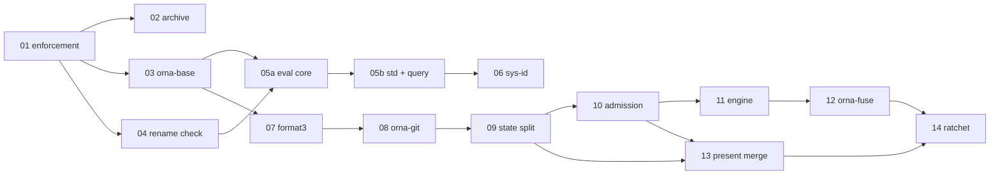

# reform(architecture): crate layering, dependency audit, and layering enforcement

**Epic:** `reform(architecture)` (bead `ornadb-7603h`)
**Status:** design for orchestrator review. No production code changes in this PR.
**Authority:** `reference/Orna-1.1.0` (`source/`, `api/`, `profiles/`, `Orna-1.1.0.md`).
**Measured at:** `origin/main` = `7c5fce9e4` (merge of PR #9760).
**Related designs:** `docs/design/sys-identity.md` (bead `ornadb-ouxeq`, PR #9771)
introduces `orna-sys-id`; this document places that crate in the layer table and
does not re-specify it.

Behaviour, formats, wire codes and CLI output must not change in any stage of this
plan. Every stage below is a pure move, split, rename or deletion, or a CI check
that adds no runtime behaviour.

---

## 0. Summary

The workspace has 26 crates and no architecture:

* the shipped binary (`orna`) links 23 of the 26 workspace crates, including the
  conformance test harness and a 2,829-line conformance-only table model;
* a 61,472-line crate (`orna-core`) is reachable from **no** production edge and is
  used by exactly two test files totalling 412 lines;
* the four largest production files hold 54,369, 29,838, 20,533 and 18,588 lines
  respectively, and one function is 4,398 lines long;
* the evaluator is a feature-gated two-crates-in-a-trench-coat: it carries optional
  `orna-repository`, `orna-runtime` and `orna-sys` dependencies to express its host
  bindings, which is the only feature-gated dependency set in the workspace and the
  only thing preventing the dependency graph from being a clean DAG;
* production admission logic lives inside the conformance harness, and is the sole
  reason the harness is in the shipped binary;
* nine independent hex encoders and six independent hex decoders exist while
  `orna-value` already depends on the `hex` crate; four independent base64 decoders;
* 149 public error enums, six of which are called `Error`;
* 3 of 26 crates have any lint configuration, so almost nothing prevents slop from
  re-entering.

The proposal is a 10-layer dependency table, 11 crate splits, 3 merges, 2 deletions
into an explicit archive, 6 renames, a per-crate dependency allowlist checked by a
script over `cargo metadata`, and a budget ratchet for file size, function size and
lint suppressions. It is delivered in 14 independently mergeable stages, sequenced
around the 12 open PRs (section 6.2).

The single most consequential decision is **D1** (section 8): whether `orna-core`
is deleted outright or kept as a clearly-labelled 1.0.0 archive. Everything else is
mechanical.

---

## 1. Current state, measured

All numbers in this section were produced on the clean checkout at `7c5fce9e4` with
the commands quoted beside them.

### 1.1 Scale

```
$ find crates -name '*.rs' | xargs wc -l | tail -1
  886610 total
$ find crates/*/src -name '*.rs' | xargs wc -l | tail -1
  491334 total        # production source
$ find crates/*/tests -name '*.rs' | xargs wc -l | tail -1
  391068 total        # integration tests (44% of all Rust in the tree)
```

Per crate, `src` lines / `test` lines / public items in `src`
(`wc -l`, and a `pub (fn|struct|enum|trait|const|static|type|mod|use)` count):

| crate | src | tests | pub items | prod in-degree | prod out-degree |
|---|---:|---:|---:|---:|---:|
| orna-application | 20,551 | 2,437 | 153 | 1 | 12 |
| orna-cli | 41,069 | 72,200 | 152 | 0 | 17 |
| orna-conformance | 20,430 | 22,139 | 167 | 2 | 15 |
| orna-core | 60,354 | 1,118 | 1,382 | **0** | 1 |
| orna-evaluator | 30,504 | 56,333 | 236 | 4 | 5 (+3 optional) |
| orna-evolution | 1,270 | 432 | 24 | 1 | 1 |
| orna-foundation | 2,581 | 23,997 | 138 | 16 | 1 |
| orna-live | 13,837 | 25,132 | 192 | 2 | 7 |
| orna-lsp | 13,091 | 11,558 | 199 | **0** | 5 |
| orna-project | 24,173 | 16,160 | 304 | 5 | 6 |
| orna-project-repl | 2,605 | 0 | 31 | 3 | 7 |
| orna-protocol | 4,448 | 240 | 39 | 5 | 1 |
| orna-repository | 75,017 | 17,718 | 1,283 | 8 | 3 |
| orna-runtime | 68,963 | 22,681 | 734 | 6 | 5 |
| orna-security | 1,721 | 237 | 73 | 4 | 0 |
| orna-semantic | 36,662 | 26,672 | 236 | 7 | 4 |
| orna-serving | 1,270 | 450 | 50 | 3 | 2 |
| orna-standard-sources | 154 | 0 | 3 | 2 | 0 |
| orna-storage | 10,738 | 6,403 | 110 | 2 | 5 |
| orna-stream | 2,843 | 0 | 46 | 3 | 1 |
| orna-syntax | 9,079 | 19,369 | 146 | 9 | 1 |
| orna-sys | 31,737 | 63,326 | 628 | 5 | 3 |
| orna-sys-macros | 19 | 0 | 2 | 1 | 0 |
| orna-table | 2,829 | 0 | 134 | 1 | 0 |
| orna-traceability | 3,858 | 1,000 | 22 | **0** | 2 |
| orna-value | 11,531 | 1,466 | 383 | 14 | 0 |

Total public items in `src`: **6,837**. Total `pub use` re-export lines: **105**.
Public API is concentrated in the three crates that layer worst: `orna-repository`
(1,283), `orna-runtime` (734), `orna-sys` (628) hold 39% of it.

### 1.2 The real production dependency DAG

From `cargo metadata --format-version 1`, production (`kind == null`,
`optional == false`) edges only:

```mermaid
flowchart TD
    subgraph shipped["Reachable from the orna binary: 23 of 26 workspace crates"]
        cli[orna-cli]
        conf[orna-conformance]
        app[orna-application]
        repl[orna-project-repl]
        proj[orna-project]
        rt[orna-runtime]
        repo[orna-repository]
        store[orna-storage]
        sys[orna-sys]
        sysm[orna-sys-macros]
        sem[orna-semantic]
        syn[orna-syntax]
        ev[orna-evaluator]
        live[orna-live]
        serv[orna-serving]
        proto[orna-protocol]
        tab[orna-table]
        sec[orna-security]
        stream[orna-stream]
        evo[orna-evolution]
        fnd[orna-foundation]
        stdsrc[orna-standard-sources]
        val[orna-value]
    end
    subgraph out["No production dependent"]
        core[orna-core]
        lsp[orna-lsp]
        trace[orna-traceability]
    end

    cli --> app
    cli --> conf
    cli --> ev
    cli --> fnd
    cli --> live
    cli --> proj
    cli --> repl
    cli --> proto
    cli --> repo
    cli --> rt
    cli --> sec
    cli --> sem
    cli --> serv
    cli --> store
    cli --> syn
    cli --> sys
    cli --> val

    conf --> ev
    conf --> fnd
    conf --> proj
    conf --> repl
    conf --> proto
    conf --> repo
    conf --> rt
    conf --> sem
    conf --> serv
    conf --> store
    conf --> stream
    conf --> syn
    conf --> sys
    conf --> tab
    conf --> val

    app --> ev
    app --> fnd
    app --> live
    app --> proj
    app --> repl
    app --> proto
    app --> repo
    app --> rt
    app --> sec
    app --> sem
    app --> syn
    app --> val

    repl --> ev
    repl --> fnd
    repl --> proj
    repl --> repo
    repl --> sem
    repl --> syn
    repl --> val

    proj --> fnd
    proj --> repo
    proj --> rt
    proj --> sem
    proj --> syn
    proj --> val

    rt --> fnd
    rt --> repo
    rt --> stream
    rt --> sys
    rt --> val

    store --> evo
    store --> fnd
    store --> repo
    store --> rt
    store --> val

    repo --> fnd
    repo --> syn
    repo --> val

    live --> fnd
    live --> proto
    live --> rt
    live --> sec
    live --> serv
    live --> stream
    live --> val

    serv --> proto
    serv --> val
    proto --> fnd

    sem --> fnd
    sem --> syn
    sem --> sys
    sem --> val

    sys --> fnd
    sys --> sec
    sys --> sysm

    ev --> fnd
    ev --> sem
    ev --> stdsrc
    ev --> syn
    ev --> val

    syn --> fnd
    fnd --> val
    stream --> fnd
    evo --> fnd

    trace --> conf
    trace --> sys
```



(`orna-lsp` and `orna-traceability` are drawn inside their own subgraph because they
have no production dependent; `orna-core` has neither a dependent nor a production
dependency beyond `orna-value`.)

Defects visible directly in the graph:

1. **`orna-storage` is a publication coordinator wearing a layer name, and it holds
   a format decoder.** Its own header says "Orna storage: format-3 publication through
   the runtime publication coordinator, plus the exact-key decoder for verified
   compact segments" (`crates/orna-storage/src/lib.rs:1-14`). The edges are correctly
   directed (repository <- runtime <- storage), but three things are wrong: the name
   "storage" describes a layer, not this job; the compact exact-key decoder
   (`crates/orna-storage/src/compact.rs`) is the second half of a format whose reader
   lives in `orna-repository/src/compact.rs`, so one format is split across two crates
   in two layers; and the crate's only dependency on `orna-runtime` is the
   test-fixture writer path (`#[cfg(any(test, feature = "compact-writer-fixtures"))]`,
   6 call sites), so a production crate carries a feature-gated edge to the state layer
   to satisfy fixtures.
2. **`orna-semantic` reaches up two layers to `orna-sys`.** 22 call sites in
   `crates/orna-semantic/src/system_api.rs` use `orna_sys::system_api_json`,
   `SystemSurfaceMember`, `system_dispatch_table` and `system_provider_linkage`, all of
   which are *catalogue data*, not host I/O. This is the one genuine upward edge in the
   production graph, and it exists because the catalogue and the host adapters share a
   crate. Stage 06 splits them (`orna-sys-id` at layer 3).
3. **The conformance harness is in the shipped binary.** `orna-cli` ->
   `orna-conformance` -> (`orna-table`, and everything else). The four production
   entry points used by the CLI are assertion admission, not conformance:
   `crates/orna-cli/src/assertion_gate.rs:200,257,267,291`,
   `crates/orna-cli/src/cli_serve.rs:642,696`,
   `crates/orna-cli/src/fuse_mount.rs:22,2248,2516,2641`.
   Definitions: `crates/orna-conformance/src/semantic_adapter.rs:4764`
   (`project_declares_assertions`), `:4783`
   (`transactional_loaded_project_candidate_validator`), `:4803`
   (`transactional_loaded_project_commit_validator`), `:5433`
   (`is_table_assertion_false`) - four public functions in a 14,773-line module.
4. **`orna-table` exists only for the harness.** Its sole production dependent is
   `orna-conformance` (`crates/orna-conformance/Cargo.toml:29`). Its types
   (`TableRuntime`, `TableSnapshot`, `Relation`, `WindowError` at
   `crates/orna-table/src/lib.rs:132,228,346,359`) are a conformance oracle, not the
   runtime's table activation. It is a test model that a production crate links.
5. **`orna-core` is unreachable from production and reaches nothing.** Its only
   consumer is `crates/orna-conformance/Cargo.toml:38`, listed under
   `[dev-dependencies]`, and `orna_core` appears in exactly two files:
   `crates/orna-conformance/tests/sys_api_compatibility.rs:1` and
   `crates/orna-conformance/tests/traceability_diff_trust_secret_batch_three.rs:4`
   (48 + 364 lines). 60,354 source lines of it are compiled only when tests run.
6. **`orna-traceability` depends on `orna-conformance`.** A reporting tool depends on
   the test harness, so the harness can never shrink without breaking a tool.
7. **`orna-foundation` is a 16-in-degree utility dump.** 2,581 source lines holding
   typed row references (`TypedRowRef<Kind>` phantom kinds,
   `crates/orna-foundation/src/lib.rs:102-215`), Git-metadata filename helpers
   (`:244`), diagnostics, `CanonicalValue`/`SchemaDescriptor` aliases (`:18-20`) that
   re-point at `orna-value`, and two adapter traits that exist purely to break a
   cycle (`RuntimeIdentityStore` at `:1654`, `RepositoryGenerationAdapter` at
   `:1671`).

### 1.3 The feature-gated cycle

The graph above is a DAG only because `orna-evaluator` hides three edges behind an
optional feature:

```toml
# crates/orna-evaluator/Cargo.toml:29-36
[features]
default = ["system-host-bindings"]
system-host-bindings = ["dep:orna-sys", "dep:orna-repository", "dep:orna-runtime"]
browser-wasm = ["getrandom/wasm_js", "dep:uuid", "uuid/js"]
cancellation-test-hooks = []
...
orna-repository = { path = "../orna-repository", optional = true }
orna-runtime = { path = "../orna-runtime", optional = true }
orna-sys = { path = "../orna-sys", optional = true }
```

This is the only `optional = true` in the workspace, and `orna-evaluator` accounts
for 37 of the 50 `cfg(feature = ...)` sites in production source. Consequences,
measured:

* The same crate is compiled with different code in different commands. `cargo build
  -p orna-evaluator --no-default-features` builds a pure interpreter; `cargo test
  --workspace` (via `orna-runtime`'s dev-dependency on `orna-evaluator`) and
  `cargo build -p orna-cli` (via `orna-cli`'s direct dependency, default features)
  build it with SQLite and Git linked. Nothing in the tree asserts which shape a
  given test observed.
* Real cycles therefore exist in the *full* graph, resolved only by cargo's tolerance
  for dev-dependency cycles:

```
    orna-evaluator --(optional, system-host-bindings)--> orna-runtime
    orna-runtime   --(dev-dependency)-----------------> orna-evaluator     # cycle
    orna-evaluator --(optional, system-host-bindings)--> orna-repository
    orna-repository--(dev-dependency)-----------------> orna-evaluator     # cycle
    orna-evaluator --(dev-dependency)-----------------> orna-project-repl
    orna-project-repl --(production)------------------> orna-evaluator     # cycle
```

* `orna-project-repl` exists to hold REPL admission (2,605 lines, 0 tests) but
  `crates/orna-evaluator/src/repl.rs` (1,766 lines) and
  `crates/orna-semantic/src/repl.rs` (564 lines) still hold the rest of the same
  feature, split across three crates by dependency pressure rather than by design.

### 1.4 God files and god functions

89 files exceed 2,000 lines. The ten worst production files:

| lines | file |
|---:|---|
| 54,369 | `crates/orna-runtime/src/lib.rs` |
| 29,838 | `crates/orna-semantic/src/lib.rs` |
| 20,533 | `crates/orna-evaluator/src/lib.rs` |
| 18,588 | `crates/orna-sys/src/introspection.rs` |
| 16,089 | `crates/orna-repository/src/lib.rs` |
| 15,632 | `crates/orna-repository/src/native_graph.rs` |
| 14,773 | `crates/orna-conformance/src/semantic_adapter.rs` |
| 14,854 | `crates/orna-application/src/lib.rs` |
| 12,412 | `crates/orna-project/src/attachments.rs` |
| 12,006 | `crates/orna-cli/src/fuse_mount.rs` |

`orna-runtime/src/lib.rs` declares eight submodules at lines 67-84 and then contains
54,369 lines of flat code plus an inline `mod tests` at line 21,765.
`orna-semantic/src/lib.rs` declares six submodules (lines 28-35) and then 29,838
lines. 155 source files contain an inline `#[cfg(test)]` module, so production and
test code share a compilation unit.

Longest functions in production source (brace-matched, `src` only):

| lines | function | location |
|---:|---|---|
| 4,398 | `explain_with_inputs` | `crates/orna-sys/src/introspection.rs:2440` |
| 2,592 | `filter_from` | `crates/orna-evaluator/src/lib.rs:16927` |
| 1,237 | `infer_node` | `crates/orna-semantic/src/lib.rs:9810` |
| 786 | `infer_success_pipeline` | `crates/orna-semantic/src/lib.rs:16646` |
| 622 | `query_paired_window_cost_restoration_fold` | `crates/orna-sys/src/introspection.rs:15578` |
| 588 | `resolve_imports_with_dependencies` | `crates/orna-semantic/src/lib.rs:4840` |
| 466 | `handle_inner_with_budget` | `crates/orna-conformance/src/semantic_adapter.rs:6438` |
| 431 | `stream` | `crates/orna-evaluator/src/lib.rs:10563` |
| 428 | `check_item` | `crates/orna-semantic/src/lib.rs:5689` |
| 357 | `authoritative_core` | `crates/orna-semantic/src/lib.rs:817` |

A 4,398-line `explain_with_inputs` is a planner explanation that inlines the planner.
`filter_from` at 2,592 lines is the entire relational pipeline in one body.

### 1.5 Duplicated concepts

**(a) Hex.** Nine independent encoders and six independent decoders, while
`crates/orna-value/Cargo.toml` already depends on `hex = "0.4.3"`:

```
encoders: orna-cli/src/encoding.rs fn hex            orna-foundation/src/lib.rs fn hex
          orna-lsp/src/standard.rs fn hex            orna-project/src/object_identity.rs fn hex
          orna-sys/src/lib.rs fn hex                 orna-repository/src/hex.rs fn hex_encode
          orna-repository/src/lib.rs fn hex_digest   orna-storage/src/compact_parquet.rs fn hex_digest
          orna-storage/src/lib.rs fn compact_schema_hex
decoders: orna-repository/src/hex.rs fn hex_decode   orna-repository/src/compact.rs fn decode_hex
          orna-repository/src/format2_rov.rs fn hex  orna-repository/src/offline_copy.rs fn unhex
          orna-conformance/src/vector_suites.rs fn hex_bytes
          orna-value/src/identity.rs fn hex_digit (used by parse_canonical_uuid_text)
```

**(b) Base64.** `orna-value/src/identity.rs:83,112` defines `base64_encode` /
`base64_decode`. Independently re-implemented at
`orna-evaluator/src/lib.rs:13744` (`decode_base64`),
`orna-live/src/lib.rs:8679,8683` (`decode_base64`, `decode_base64url`), and
`orna-repository/src/compact.rs:4481` (`decode_base64`), each returning its own
error type.

**(c) Base32 identity text.** `orna-core/src/lib.rs:44,63` implements
`encode_id`/`decode_id` with `BASE32_ALPHABET` (`:29`). This is the 1.0.0 canonical
identifier spelling; it is unreachable from production (section 1.2 defect 5) yet
still the only implementation of that spelling in the tree.

**(d) CBOR.** Hand-rolled encoder helpers `cbor_head`/`cbor_bytes` at
`orna-repository/src/format2_ogb.rs:527,540` and a second CBOR path in
`orna-value/src/cbor.rs`. Two implementations of the same wire codec for two format
versions in two crates.

**(e) Two compact readers.** `orna-repository/src/compact.rs` (6,322 lines) plus
`orna-repository/src/compact/legacy_reader_tests.rs` (3,185) and
`orna-repository/src/compact/legacy_fixture_builder.rs` implement the versioned
compact manifest reader; `orna-storage/src/compact.rs` (part of 10,738 src lines)
implements the *exact-key* decoder for segments that reader has already verified.
`crates/orna-storage/src/lib.rs:8-14` documents the split honestly - "this crate
decodes key columns of segment bytes that reader has already verified; it walks no
history and decodes no row" - which is precisely the problem: one format, two
crates, and the reader is *above* the decoder's consumer in the DAG.

**(f) `Format3Context` threading.** There is one definition
(`orna-value/src/format3.rs:246`), so this is not duplication of a type. It is
duplication of a *parameter*: 27 production signatures take `context: &Format3Context`
across five crates (`orna-value` 9, `orna-project` 6, `orna-evaluator` 5,
`orna-application` 5, `orna-storage` 2), plus `Option<Format3Context>` stored in
evaluator state at `crates/orna-evaluator/src/lib.rs:1579,1581`. Every layer between
the value and the caller re-declares it, which is why 15 call sites in
`orna-evaluator/src/lib.rs` and 10 in `orna-project/src/lib.rs` mention it.

**(g) Public error enums.** 149 `pub enum *Error|*Failure|*Fault` in `src`.
Distinct bare `Error` types: `orna-value/src/error.rs:9`,
`orna-live/src/lib.rs:89`, `orna-protocol/src/lib.rs:129`,
`orna-serving/src/lib.rs:99`, `orna-storage/src/lib.rs:1026` (plus a second at
`orna-value/src/error.rs:58`). `orna-core` alone contributes 41. There is no
workspace-level error boundary type, so every crate boundary invents a mapping, and
`clippy::result_large_err` is suppressed six times.

**(h) `sys` identity spelled as strings.** In `src` only,
`grep -rho '"sys\.[a-z_.]*"' crates/*/src` gives **867 occurrences, 311 distinct
values**; including tests and `docs/` the sys-identity design measures 1,650
occurrences and 386 distinct values. This is the owner's headline complaint and it
is quantified in `docs/design/sys-identity.md` section 1; this document only
guarantees the crate layering that fix needs (a zero-dependency `orna-sys-id`
beneath both `orna-sys` and `orna-eval`).

### 1.6 Naming audit

Every crate's own doc comment, quoted, against its name:

| crate | self-description | verdict |
|---|---|---|
| `orna-core` | "Core types shared by OrnaDB components" | **lies twice**: it is dead, and it is the 1.0.0 compatibility model, not a core |
| `orna-foundation` | "Shared, lossless Orna 1.0 foundation contracts" | says nothing; measured contents are row refs, filename helpers, aliases, adapter traits |
| `orna-runtime` | "Durable private local runtime state for one Orna worktree" | collides with *execution* runtime; it is the SQLite state layer, and its doc claim "does not publish" (`lib.rs:4-5`) is already false in flight (PR #9765 adds `publication.rs`, 1,352 lines) |
| `orna-storage` | "format-3 publication ... plus the exact-key decoder" | "storage" names a layer, not a thing; it is the format-3 write path |
| `orna-sys` | "portable sys catalogue and bounded, pre-effect admission" | name reads as OS syscalls; it is the Orna `sys` namespace |
| `orna-live` | "transport-facing adapter for canonical `orna.present.v1` sessions" | "live" is not in the spec vocabulary; the spec calls this the live protocol/presentation |
| `orna-serving` | "in-memory serving state for `orna.present.v1`" | indistinguishable from `orna-live` by name; 1,270 lines |
| `orna-protocol` | "`orna.present.v1` envelopes" | generic; it is the presentation wire format |
| `orna-table` | "in-memory table transaction primitive" | it is a conformance oracle, not a table |
| `orna-application` | "the authoritative application boundary" | "application" is a layer word; it is the facade that wires parse -> check -> eval -> store |
| `orna-project-repl` | "Typed, project-pinned admission for the bounded pure REPL" | "project" is redundant with `orna-project`; the REPL is split across three crates |
| `orna-semantic` | "Read-only semantic loading" | the layer name; it is the resolver and type checker behind `orna check` |
| `orna-standard-sources` | "Pinned source bundle" | good, keep |
| `orna-traceability` | "Bounded, logical traceability for the published reference bundle" | fine, but it is a tool, not a library |

### 1.7 What enforcement exists today

```
$ grep -l "\[lints" crates/*/Cargo.toml
crates/orna-cli/Cargo.toml
crates/orna-live/Cargo.toml
crates/orna-security/Cargo.toml
```

3 of 26 crates configure lints. There is no `[workspace.lints]` in the root
`Cargo.toml`, no `clippy.toml`, no `rustfmt.toml`, and no `deny.toml`.
`.github/workflows/lint.yml:82` runs

```
cargo clippy --locked --workspace --all-targets --keep-going -- -D warnings
```

which denies default (`clippy::all`) lints only. Consequently:

```
$ grep -rn "allow(clippy::" crates/*/src | wc -l
210
$ grep -rho "allow(clippy::[a-z_]*" crates/*/src | sort | uniq -c | sort -rn | head -3
     87 allow(clippy::too_many_arguments
     51 allow(clippy::too_many_lines
     13 allow(clippy::needless_pass_by_value
```

87 suppressions of `too_many_arguments` and 51 of `too_many_lines` are the
institutionalised form of the god-function problem. Nothing counts them, so nothing
stops the count growing. No CI job inspects the dependency graph, so nothing stops a
new crate edge from crossing a layer.

There is also no publication policy: only 6 of 26 crates set `publish = false`
(`orna-application`, `orna-conformance`, `orna-runtime`, `orna-stream`, `orna-table`,
`orna-traceability`), so the other 20 are publishable to a registry by default with
`license = "MPL-2.0"` and the workspace version. Stage 01 closes that with
`publish = false` on every crate and a check that it stays that way.

---

## 2. Prior art

| System | Mechanism | URL | Applies to Orna? |
|---|---|---|---|
| PostgreSQL | one catalogued function per `pg_proc.dat` row; `Gen_fmgrtab.pl` generates `fmgroids.h`, `fmgrprotos.h` and the `FmgrBuiltin fmgr_builtins[]` dispatch table; generated files are stamped "DO NOT EDIT ... GENERATED" | https://raw.githubusercontent.com/postgres/postgres/master/src/backend/utils/Gen_fmgrtab.pl | **Yes, directly.** Orna's `sys` catalogue is already a JSON data file (`api/sys.json`); the same generator pattern replaces 867 string literals with generated enums plus a static dispatch table. `fmgr_builtins[]` is the model for the stdlib `FunctionDef` table. |
| SQLite | C implementations in `src/func.c`; registration by one `static FuncDef aBuiltinFunc[]` table keyed by name/arity/flags (`func.c:3405-3419`) | https://raw.githubusercontent.com/sqlite/sqlite/master/src/func.c | **Yes.** Confirms that a flat static table plus a name key is the industry answer for built-ins, and that hundreds of functions can live in one catalogued array without a `match` tree. Does *not* apply: SQLite's table is one C translation unit by design; Orna's stdlib should be one table plus one module per namespace for reviewability. |
| DuckDB | catalog entries are first-class objects: `ScalarFunctionCatalogEntry` holds a `ScalarFunctionSet` and is finalized by the extension loader | https://raw.githubusercontent.com/duckdb/duckdb/main/src/include/duckdb/catalog/catalog_entry/scalar_function_catalog_entry.hpp | **Partly.** Real value: functions are *catalog data with a finalize step*, so nothing can be half-registered. Orna does not need dynamic extension loading in 1.1.0, so the `ExtensionLoader` half does not apply. |
| Lua | `typedef struct luaL_Reg { const char *name; lua_CFunction func; }` plus `luaL_setfuncs` / `luaL_newlib` register whole tables per library | https://raw.githubusercontent.com/lua/lua/master/lauxlib.h | **Yes, for shape.** `luaL_Reg` is the minimal "name -> function" row; `luaL_newlib` registers a table at a time, which is exactly "one std namespace per module, registered as a table". Does not apply: Orna has static types, so a single untyped `lua_CFunction` is insufficient. |
| rustc | lang items: compiler-recognised operations implemented in `core`/`std`, resolved lazily, with a hard error when an item is needed but absent; `#[rustc_intrinsic]` marks compiler known-unknowns | https://rustc-dev-guide.rust-lang.org/lang-items.html | **Yes, for the identity rule.** "Needed but absent is a compile error" is the property Orna lacks today (a new `api/sys.json` function silently becomes a runtime `sys.version.incompatible`). Does not apply: Orna is not compiling itself, so it needs a catalogue, not compiler built-ins. |
| rustc (tidy) | per-subsystem dependency allowlists enforced in CI: `PERMITTED_RUSTC_DEPENDENCIES`, `PERMITTED_STDLIB_DEPENDENCIES`, `PERMITTED_CRANELIFT_DEPENDENCIES`, each with a `ListLocation` so the diagnostic points at the list line | https://raw.githubusercontent.com/rust-lang/rust/master/src/tools/tidy/src/deps.rs | **Yes, this is the enforcement model.** Per-crate allowlist, checked by a small script, diagnostic names the file and line of the declaration. Adopt nearly verbatim. |
| Go | `internal` package rule: a package under `.../internal/...` is importable only from the subtree above it, enforced by the toolchain (Go 1.4 release notes, "Internal packages") | https://go.dev/doc/go1.4 | **Partly.** Rust has no equivalent; the closest cheap analogue is a crate *naming* rule plus the allowlist script (`orna-*-internal` crates may only be depended on by their owner). Does not apply as language machinery. |
| cargo-deny | `[bans]` denies crates globally; `[[bans.deny]]` with `wrappers` restricts a ban to everything except named direct dependents; `multiple-versions`, `wildcards`, `[[bans.features]]` | https://embarkstudios.github.io/cargo-deny/checks/bans/cfg.html and https://embarkstudios.github.io/cargo-deny/checks/bans/index.html | **Partly.** Excellent for external crates (`hex` banned outside the one crate that owns hex, two base64 libraries forbidden, `libsql` only below the state layer). Insufficient for internal layer rules: bans are global except for the `wrappers` exception list, so expressing "layer 6 must not depend on layer 8" needs the allowlist script. Both are proposed; cargo-deny owns external deps, the script owns internal edges. |
| Roslyn / Go compiler layering | layer docs with an enforcing test | Roslyn's `docs/wiki/Layers.md` is no longer at that path (HTTP 404 on 2026-11-09), so no claim is made about its contents | Not cited as precedent for a mechanism. The mechanism adopted here is rustc's tidy allowlist, which was verified. |

What does **not** transfer:

* C-style "one giant table in one file" (SQLite) assumes a single-namespace,
  untyped calling convention. Orna's stdlib has 82+ `sys` callables and dozens of
  `std` modules with typed signatures; one file would be its own slop.
* Dynamic function registration (DuckDB extensions, `sqlite3_create_function`) is a
  capability Orna 1.1.0 does not claim; adding a registry indirection would create a
  runtime failure mode the spec does not allow.
* `internal` visibility (Go) has no Rust equivalent; the allowlist script is the
  honest substitute.

---

## 3. Target architecture

### 3.1 Layer table

A crate may depend only on crates in the same or a lower layer. This table is the
normative content of `docs/ARCHITECTURE.md` and the data source for
`scripts/check_architecture.py`.

| # | Layer | Crates | May depend on |
|---|---|---|---|
| 0 | primitives | `orna-base` | nothing external except `sha2`, `hex`, `base64`, `unicode-normalization` |
| 1 | value | `orna-value` | 0 |
| 2 | syntax | `orna-syntax` | 0, 1 |
| 3 | identity | `orna-sys-id`, `orna-std-sources`, `orna-sys-macros` | 0 (and 1 only for `orna-std-sources`) |
| 4 | analysis | `orna-check` (was `orna-semantic`) | 0-3 |
| 5 | evaluation | `orna-eval`, `orna-std`, `orna-query` | 0-4 |
| 6 | hosts (I/O adapters) | `orna-sys`, `orna-security` | 0-5 |
| 7 | formats and planning | `orna-format3`, `orna-evolution`, `orna-stream` | 0-3 |
| 8 | repository layout | `orna-git`, `orna-repository` | 0-3, 7 |
| 9 | durable state | `orna-store`, `orna-vfs` | 0-4, 7-8 |
| 10 | publication | `orna-publication` | 0-4, 7-9 |
| 11 | project | `orna-project`, `orna-repl`, `orna-admission` | 0-10 |
| 12 | presentation | `orna-present-protocol`, `orna-live` | 0-11 |
| 13 | engine | `orna-engine` (was `orna-application`), `orna-migrate` | 0-12 |
| 14 | edges | `orna-cli`, `orna-fuse`, `orna-lsp`, `orna-conformance`, `orna-traceability` | 0-13 |
| 15 | archive | `orna-compat-v1` (was `orna-core`) | 0-1 only; no layer 2-14 crate may depend on it |

The ordering of layers 7-10 is the one that has to be argued, because it is easy to
write backwards in review and the current tree is the authority on the arrows:

* `orna-repository` today depends on nothing above it: `grep -rn 'orna_runtime::'
  crates/orna-repository/src/` returns nothing. It is the lower crate. Its own doc
  comment says the database "is intentionally below the Git boundary: callers obtain
  its location only from `orna_repository::Repository::runtime_paths`".
* `orna-runtime` depends on `orna-repository` (21 call sites), so the state layer is
  above the repository-layout layer.
* `orna-storage` depends on both (6 + 5 call sites, most of them behind
  `compact-writer-fixtures`), so a publication coordinator is above both.

Layer 7 sits below all three because a format codec must not know where a file lives:
`orna-format3`'s readers are handed bytes. Layer 9 reaching `orna-sys` would be an
upward violation, which is why the dispatch tables and operation contracts that
`orna-runtime` reads today (`SystemDispatchTable`, `ProviderRoleRegistry`,
`OperationContract`, 21 sites in `crates/orna-runtime/src/lib.rs`) move into
`orna-sys-id` at layer 3 in stage 06.

Three additional rules that are not expressible as a layer:

* **R1 no optional internal dependencies.** An internal crate edge is either a
  production dependency or absent. Capability variation is expressed by traits in a
  lower layer, not by features. This is what removes the `orna-evaluator` cycle.
* **R2 the shipped binary's production closure is exactly layers 0-14 minus the
  archive, and must never contain `orna-conformance`, `orna-traceability`,
  `orna-compat-v1` or `orna-lsp`.** The CLI may depend on `orna-admission`, which is
  the extracted production half of the harness.
* **R3 a crate name states its layer or its subject, never a metaphor.** Allowed
  suffixes: `-id`, `-sources`, `-format3`, `-protocol`, `-admission`, `-engine`.
  Forbidden: "core", "foundation", "runtime", "storage", "application", "live" as
  bare layer words.

### 3.2 Target crate census

33 crates: 10 new crates, 3 crates merged away, 2 relocations into an archive, 6
renames. 26 + 10 - 3 = 33.

**New crates and where their modules come from**

| new crate | modules moved in | source location today |
|---|---|---|
| `orna-base` | spans, safe text, diagnostic value types, opaque id text, and the single hex/base64/base32 codecs | `orna-foundation/src/lib.rs` (spans, diagnostics, `TypedRowRef`), `orna-foundation/src/object_reference.rs`, `orna-value/src/identity.rs:83-160` (codecs), `orna-core/src/lib.rs:29-90` (base32, archived copy only) |
| `orna-sys-id` | generated `SysFunction`/`SysFailureCode`/`SysRelation` + descriptor tables (specified by `docs/design/sys-identity.md`) | build script over `api/sys.json`; replaces `orna-sys/src/system_api.rs` runtime JSON parsing and `orna-core/src/system.rs` hand-written constants |
| `orna-std` | `std` namespace kernels and their definition table | `orna-evaluator/src/lib.rs` (the std dispatch and the ~200 inline kernels), `orna-evaluator/src/regex_lite.rs`, `unicode_16_case_properties.rs`, `timezone.rs`, `source_enums.rs` |
| `orna-query` | relational engine, windows, CTEs, planner explanation | `orna-evaluator/src/lib.rs:16927` (`filter_from`), `orna-evaluator/src/relation.rs`, `orna-evaluator/src/list.rs`, `orna-sys/src/introspection.rs` (18,588 lines) |
| `orna-eval` | pure interpreter core | rest of `orna-evaluator/src/lib.rs`, `cancellation.rs`, `effect_evidence.rs`, `row_admission.rs`, `explain_bindings.rs`, `browser_profile.rs` |
| `orna-format3` | every format-2/3/ORP/compact reader and writer | `orna-repository/src/{compact.rs,compact/,format2_ogb.rs,format2_orr.rs,format2_read.rs,format2_rov.rs,orp.rs,orp/,format_context.rs,row_store.rs,object_reader.rs,overflow.rs,hex.rs,cbor path}` plus `orna-storage/src/{compact.rs,compact_parquet.rs,publication_policy.rs}` |
| `orna-git` | Git object graph and plumbing transport | `orna-repository/src/{native_graph.rs,transport.rs,mount.rs,allocator.rs,init.rs}`, `orna-foundation/src/lib.rs:244` (`is_git_metadata_component`) |
| `orna-store` | durable SQLite state for one worktree | `orna-runtime/src/{lib.rs,activation.rs,catalogue.rs,checkpoint_bootstrap.rs,invocation.rs,query.rs,repository_identity.rs,stream_carry.rs}` |
| `orna-vfs` | virtual filesystem model (not the FUSE binding) | `orna-runtime/src/vfs.rs` (6,802 lines), `orna-cli/src/fuse_mount/source_write.rs` model half |
| `orna-publication` | publication coordinator | `orna-runtime/src/lib.rs` publication section (the block PR #9765 extracts as `publication.rs`, 1,352 lines) plus `orna-storage/src/publication_policy.rs` |
| `orna-admission` | transaction and assertion admission used by production | `orna-conformance/src/semantic_adapter.rs:4764-5470` and its helper closure |
| `orna-migrate` | 1.0.0 -> 1.1.0 row migration and legacy store read | `orna-application/src/{migration_rows.rs,migration_store.rs,legacy_store.rs,upgrade_gate.rs}` |
| `orna-fuse` | FUSE binding | `orna-cli/src/fuse_mount.rs` (12,006 lines), `orna-cli/src/fuse_mount/` |

**Merges (crate disappears)**

| merged crate | lines | into | reason |
|---|---:|---|---|
| `orna-serving` | 1,270 | `orna-live` as `live::serving` | Both serve `orna.present.v1`; three crates (`protocol`, `serving`, `live`) for one protocol surface, and `serving` has no consumer except `live`, `conformance` and `cli`. |
| `orna-table` | 2,829 | `orna-conformance` as `conformance::oracle_table` | Its only production dependent is the harness (section 1.2 defect 4). It is a test model and must not be its own top-level crate in the shipped closure. |
| `orna-foundation` | 2,581 | split, remainder absorbed by `orna-base` and `orna-value` | 16 dependents, no cohesive subject. `CanonicalValue`/`SchemaDescriptor` aliases (`lib.rs:18-20`) are dead indirection; the adapter traits move to `orna-store`'s port module. |

**Deleted / archived**

| crate | disposition |
|---|---|
| `orna-core` | renamed `orna-compat-v1`, moved under `crates/archive/`, `publish = false`, and guarded by R2. Deletion is decision **D1**. |
| `orna-traceability` | kept but moved to `tools/orna-traceability` and made a dependent of nothing: it must call `orna-conformance`'s corpus loader through a small `orna-corpus` facade, or read the bundle directly. R2 keeps it out of the binary either way. |

**Renames**

| from | to | why |
|---|---|---|
| `orna-core` | `orna-compat-v1` | it is the 1.0.0 compatibility model |
| `orna-foundation` | `orna-base` (+ absorbed) | names its contents |
| `orna-semantic` | `orna-check` | matches the user-visible command `orna check`; "semantic" is a layer word |
| `orna-runtime` | `orna-store` | it is durable state, not an execution runtime |
| `orna-storage` | `orna-publication` (after the format3 split) | it is the publication writer |
| `orna-application` | `orna-engine` | it is the facade that wires the stages |
| `orna-project-repl` | `orna-repl` | "project" is redundant |
| `orna-protocol` | `orna-present-protocol` | names the wire format it owns |
| `orna-standard-sources` | `orna-std-sources` | matches `orna-std` |

### 3.3 The concrete seams

Three traits and one table carry the whole re-layering. Everything else is moves.

**(1) Host port: kills the evaluator's optional dependencies.**

```rust
// crate orna_eval, file src/host.rs  (layer 5, depends on orna_value + orna_sys_id only)
use orna_sys_id::SysFunction;
use orna_value::Value;

/// Every effect the interpreter cannot perform itself.
///
/// The interpreter never sees a `sys` name as text: the parser and resolver map
/// text to `SysFunction` once, and this port receives the variant.
pub trait HostPort {
    /// Synchronous, pure-per-call view used by `sys.explain` and `sys.rt.info`.
    fn describe(&self, function: SysFunction) -> HostDescription;

    /// Perform one callable. Implementations own I/O, clocks, entropy and rows.
    fn invoke(
        &mut self,
        function: SysFunction,
        args: &[Value],
        cx: &mut CallContext<'_>,
    ) -> Result<Value, EvaluationError>;
}
```

`orna-eval` has **no** dependency on `orna-sys`, `orna-store`, `orna-git` or
`orna-repository`. `orna-sys` implements `HostPort`; `orna-engine` constructs it.
`crates/orna-evaluator/Cargo.toml`'s three `optional = true` lines and the
`system-host-bindings` feature are deleted. The wasm build selects a no-I/O `HostPort`
implementation at the `orna-engine` boundary instead of at the evaluator's manifest.

**(2) The stdlib is a table, not a `match`.**

```rust
// crate orna_std, file src/defs.rs
pub struct StdFunction {
    /// Frozen identity: `std.text.lower@1`. The only place this text exists.
    pub id: StdId,
    pub params: &'static [ParamType],
    pub result: ReturnType,
    pub effects: EffectSet,
    pub kernel: Kernel,
}

pub enum Kernel {
    /// Pure Rust implementation. No allocation of the frame is implied.
    Pure(PureFn),
    /// Implemented by the host through `orna_eval::HostPort`.
    Host(orna_sys_id::SysFunction),
    /// Relational operator executed by `orna_query`.
    Operator(orna_query::Operator),
}

/// One table indexed by a dense `StdId` discriminant, exactly like
/// PostgreSQL's `fmgr_builtins[]`.
pub static STD_FUNCTIONS: &[StdFunction] = &[/* one row per function, sorted by StdId */];

impl StdId {
    pub fn spec(self) -> &'static StdFunction { &STD_FUNCTIONS[self as usize] }
}
```

`StdId` is a generated `#[repr(u16)] enum`; `STD_FUNCTIONS.len()` is asserted equal
to `StdId::COUNT` by a const assertion, so "definition without implementation" and
"implementation without definition" are both compile errors - the rustc lang-item
property, applied to a catalogue. Per-namespace implementation modules
(`src/text/`, `src/collections/`, `src/time/`, ...) each export their rows and the
table is assembled once, which is `luaL_Reg` / `luaL_newlib` per library.

**(3) Value context is carried, not threaded.**

```rust
// crate orna_value
pub struct ContextValue { /* ... */ }

/// The pair every format-3 operation needs. Replaces 27 `&Format3Context`
/// parameters with one receiver that owns both.
pub struct Format3<'a> {
    pub context: &'a Format3Context,
    pub profile: ValueProfile,
}
```

Functions that today take `context: &Format3Context` take `f3: Format3<'_>`. This is
a mechanical signature change with no behaviour change, and it removes the repeated
`source_context: Option<Format3Context>` fields at
`crates/orna-evaluator/src/lib.rs:1579,1581`.

**(4) One error boundary per layer boundary.**

```rust
// crate orna_base
/// Layer-boundary failure. Crates keep their rich internal enums; only the
/// boundary type crosses a layer.
pub enum Fault<E> {
    /// The operation failed with a domain error in this layer.
    Domain(E),
    /// A lower layer refused; the payload is already redacted and carries a code.
    Lower(Box<Fault>),
}
```

This is deliberately *not* a workspace-wide `anyhow`. The rule is: a crate may have
as many internal error enums as it needs; a public function that crosses a layer
boundary returns one type. The 149 enums stay, but 100+ of them become private, which
is a measurable API shrink (stage 02 targets a named list).

### 3.4 Target file layout

```
crates/
  primitives/   orna-base/ orna-value/
  frontend/     orna-syntax/ orna-check/
  identity/     orna-sys-id/ orna-std-sources/ orna-sys-macros/
  evaluation/   orna-eval/ orna-std/ orna-query/
  hosts/        orna-sys/ orna-security/
  formats/      orna-format3/ orna-evolution/ orna-stream/
  repository/   orna-git/ orna-repository/
  state/        orna-store/ orna-vfs/
  publication/  orna-publication/
  project/      orna-project/ orna-repl/ orna-admission/
  presentation/ orna-present-protocol/ orna-live/
  engine/       orna-engine/ orna-migrate/
  edges/        orna-cli/ orna-fuse/ orna-lsp/
  archive/      orna-compat-v1/
tools/          orna-conformance/ orna-traceability/
```

The directory is the layer. `crates/state/orna-store` and
`crates/primitives/orna-value` make the graph readable from a file listing, which is
the property the current flat `crates/orna-*` listing does not have. Cargo workspace
members are listed individually; the grouping costs nothing.

Within a crate: `src/lib.rs` declares modules and re-exports, nothing else. Target
caps in section 3.6.

### 3.5 Enforcement in CI

Four mechanisms, all cheap, all byte-deterministic.

**(a) `scripts/check_architecture.py` over `cargo metadata`.** Reads
`docs/design/layers.toml`, which is generated from section 3.1 and hand-maintained
thereafter, and fails on:

1. any production edge that violates the layer table (R1: also any `optional = true`
   internal edge);
2. any dev-only crate (`orna-compat-v1`, tool crates) appearing in the production
   closure of `orna-cli` (R2);
3. a workspace member missing from the layer table, or a table entry naming a
   non-existent crate;
4. a crate whose `prod in-degree == 0` and which is not declared `role = "tool"` or
   `role = "archive"` (catches the `orna-core` situation automatically);
5. budget violations, all ratcheted: any file over `max_file_lines`, any file over
   the recorded per-file debt, any count of `#[allow(clippy::...)]` over budget.

```
$ python3 scripts/check_architecture.py --mode=report   # current state, exit 0
$ python3 scripts/check_architecture.py --mode=deny     # CI, exit 1 on violation
```

The diagnostic names the offending `Cargo.toml` line, in the style of rustc's
`ListLocation` (`deps.rs:16-32`), because a diagnostic that does not say where to fix
it gets suppressed instead of fixed.

**(b) `deny.toml` for external dependencies.** cargo-deny's `[bans]` is global except
for the `wrappers` exception list, which is the right shape for "only this crate may
use this external crate":

```toml
[bans]
multiple-versions = "deny"
wildcards = "deny"

# The one hex implementation lives in orna-base; every other crate must not
# re-implement or re-depend on it.
[[bans.deny]]
crate = "hex"
wrappers = ["orna-base"]
use-instead = "orna-base::hex"

# Two base64 crates in one workspace is one too many.
[[bans.deny]]
crate = "base64"
wrappers = ["orna-base"]

# The embedded database is below the state layer only.
[[bans.deny]]
crate = "libsql"
wrappers = ["orna-store"]
```

**(c) `clippy.toml` + a suppression budget.**

```toml
# clippy.toml
too-many-lines-threshold = 120
too-many-arguments-threshold = 7
cognitive-complexity-threshold = 25
type-complexity-threshold = 250
```

`too_many_lines` and `cognitive_complexity` are `clippy::pedantic`, which the
workspace does not enable today. Enabling pedantic across 491,334 lines in one step
is not reviewable, so the rollout is a ratchet:

* `scripts/architecture-budget.toml` records, per crate, the number of
  `#[allow(clippy::*)]` attributes and the list of files over 1,200 lines;
* CI fails if any recorded number grows;
* a stage that shrinks a crate lowers its recorded number in the same PR, so the
  file only ever moves down. This is the same mechanic the repo already trusts for
  `scripts/known-test-failures.toml` and `scripts/semantic-known-red.txt`.

**(d) A CI job, `arch`, in `.github/workflows/lint.yml`.** Three steps, no compile:

```yaml
      - name: Architecture
        run: python3 scripts/check_architecture.py --mode=deny
      - name: Dependency policy
        run: cargo deny --locked check bans licenses sources
      - name: Budgets
        run: python3 scripts/check_architecture.py --mode=budget
```

Because these read `cargo metadata` and the filesystem, the job finishes in under a
minute and does not contend for the 90-minute clippy slot.

### 3.6 Conventions (`docs/ARCHITECTURE.md` outline + rules)

```
1. What OrnaDB is, in one paragraph, and what it is not
2. The layer table (identical to section 3.1, kept in this file and in
   docs/design/layers.toml; a test asserts the two agree)
3. The rules
   R1 no optional internal dependencies
   R2 the shipped closure rule
   R3 naming rule (inclusive allowlist of suffixes)
   R4 src/lib.rs declares and re-exports; it contains no logic
   R5 one format, one reader: a format version gets exactly one crate
   R6 identity text exists exactly once, in a generated enum
   R7 new public API needs a reason in the PR body (the pub-item budget is ratcheted)
4. Size budgets (and why they are budgets, not bans)
   file: 1,200 lines hard, 800 target for src modules
   function: 120 lines, cognitive complexity 25
   crate src: 25,000 lines hard - beyond that, split
   inline #[cfg(test)] module: forbidden in new code; tests live in tests/
5. How to add a crate (checklist: layer assignment, layers.toml entry, owner,
   production dependent, budget entry)
6. How to add a sys or std function (catalogue -> regenerate -> implement kernel ->
   conformance vector)
7. How to split a crate (the scripted procedure from section 5.1)
8. Where the entry points are (orna binary, orna-lsp, conformance harness, tools)
9. Glossary: layer names as used here, mapped to spec vocabulary
```

Size budgets, with the reasoning stated so they survive review pressure:

| item | cap | today's worst |
|---|---:|---:|
| file | 1,200 lines | 54,369 |
| function | 120 lines / cognitive complexity 25 | 4,398 |
| crate src | 25,000 lines | 75,017 |
| `#[allow(clippy::too_many_arguments)]` | 0 in new code; budget ratchets to 0 | 87 |
| public items added per PR | 0 unless the PR body names the caller | 6,837 total |
| inline `#[cfg(test)]` in `src` | 0 in new code | 155 files |

### 3.7 `ARCHITECTURE.md` at the repository root

`docs/ARCHITECTURE.md` is the full document; the root `ARCHITECTURE.md` is the
10-line entry point that links to it and states the three rules R1-R3. The root file
exists so that a reader who opens the repository finds the layer table before the
crate list.

---

## 4. What this buys, measured

| metric | today | after | how |
|---|---:|---:|---|
| workspace crates | 26 | 33 | 10 new crates, 3 merged away, 2 archive moves, 6 renames |
| crates in the shipped binary | 23 | 29 | more crates, fewer lines: `orna-conformance` (with `orna-table`), `orna-traceability`, `orna-lsp` and `orna-compat-v1` leave the closure |
| src lines compiled into the shipped binary | 414,031 | 390,772 | the harness (20,430 src) and the merged `orna-table` (2,829) stop being linked; nothing is deleted except by D1 |
| largest compilation unit (one `lib.rs`) | 54,369 | < 1,200 | 14 stages of splits; < 2,500 is the stage-13 checkpoint |
| crates publishable by default | 20 of 26 | 0 of 33 | `publish = false` on every crate (6 have it today) |
| largest function | 4,398 | < 120 new, 400 max by budget | `orna-query` extraction + `explain_with_inputs` decomposition |
| public error enums | 149 | <= 40 public | layer boundary rule |
| hex implementations | 9 + 6 | 1 + 1 | `orna-base` |
| base64 decoders | 4 | 1 | `orna-base` |
| optional internal dependency edges | 3 | 0 | R1 + `HostPort` |
| `cfg(feature)` sites in production | 50 | <= 8 (wasm and crash-barriers only) | host port, format split |
| `cli` compile dependencies | 17 workspace crates | <= 12 | admission extraction |
| enforced layer edges | 0 | 100% | `check_architecture.py --mode=deny` |

"Lines in the shipped binary" is a compile-time and audit-surface claim, not a binary
size claim: the archive and harness are already compiled out of an optimised build
only by luck of reachability, not by the manifest.

---

## 5. Migration plan

### 5.1 Rules that make each stage safe

1. **One crate per PR.** A stage that splits a crate touches that crate's manifest,
   its modules and the import lines of its dependents, and nothing else. Two crate
   splits in one PR are not reviewable.
2. **Never split a crate while an open PR touches it.** Proved mechanically before
   starting: `gh pr list -R workingdir/ornadb --json number,files`, filter, and if any
   PR touches the crate, that stage waits (section 6.2 has the current matrix).
3. **Moves are scripted and rerunnable.** `scripts/crate_move.py` performs
   `git mv` of a module set and rewrites `use orna_old::path` to `use orna_new::path`
   across the workspace with a fixed table. If a sibling PR lands mid-flight, the
   branch is rebuilt by rerunning the script, not by resolving 40 hand conflicts.
4. **Every stage proves byte-identical behaviour.** The acceptance block is the same
   for every structural stage, plus stage-specific proofs:

```
cargo fmt --all -- --check
cargo clippy --locked --workspace --all-targets -- -D warnings
cargo test --locked --workspace --all-targets            # via lane-run.sh
python3 scripts/check_architecture.py --mode=deny
cargo deny --locked check bans licenses sources
```

   and for anything touching the CLI, `sys` catalogue or formats, the generated
   artifacts must be byte-identical to the pre-stage output:

```
git diff --exit-code -- scripts/golden/                     # OGB/compact vectors
cargo test -p orna-sys --features dev-sys-export --test sys_api_export
    # rebuilt api_sys.json must match the committed export byte for byte
orna --help > /tmp/help.after && diff /tmp/help.before /tmp/help.after
orna status --porcelain                                       # ORNA-CLI-003 output
```

5. **No shims.** A split deletes the old module in the same PR. No
   `pub use other_crate::*` bridge crate is added, because a bridge crate is a layer
   violation that the script would then have to whitelist.

### 5.2 Stages

Each stage is one agent PR and one bead. Files listed are the files touched beyond
mechanical import rewrites.

#### Stage 01 - enforcement scaffolding (`arch-enforcement`)

*Files:* `scripts/check_architecture.py` (new), `scripts/check_architecture_test.py`
(new), `docs/design/layers.toml` (new), `scripts/architecture-budget.toml` (new),
`deny.toml` (new), `clippy.toml` (new), `ARCHITECTURE.md` (new),
`docs/ARCHITECTURE.md` (new), `.github/workflows/lint.yml`,
`justfile` (add `arch-check`), root `Cargo.toml` (`[workspace.lints]` only;
`members` unchanged), `publish = false` added to the 20 crates that lack it,
`crates/orna-security/Cargo.toml` and
`crates/orna-standard-sources/Cargo.toml` (`lints.workspace = true` as the opt-in
proof).

*Acceptance:* `--mode=report` prints the current 10 errors and 1 warning (Appendix A),
the current budgets, and exits 0; `--mode=deny` on the pre-stage tree exits 1 with
exactly those 10 errors, proving the check has teeth; the `arch` CI job is green with
`--mode=report`. No source file changes, so `cargo test --workspace` is unchanged by
construction.

*Conflicts:* root `Cargo.toml` and `justfile` only. No open PR touches either
(checked: #9761-#9773 touch `crates/`, `CHANGELOG.md`, `.github/workflows/lint.yml`
only in #9766 - sequence this stage before merging #9766 or rebase one hunk).

*Why first:* every later stage is verified by this script, and the script is the only
artifact that prevents the tree regressing while the splits are in flight.

#### Stage 02 - API shrink and the archive (`compat-archive`)

*Files:* `crates/orna-core/Cargo.toml` (rename to `orna-compat-v1`,
`publish = false`), `crates/orna-core/src/lib.rs` doc header,
`crates/orna-conformance/Cargo.toml`, the two test files that import it, and the
`layers.toml` entry. Additionally, make private the error enums this stage names (the
`orna-core` 41 are already private-by-deletion of the `pub`), and drop the dead
`orna-foundation/src/lib.rs:18-20` aliases in favour of `orna-value` directly.

*Acceptance:* `cargo tree -p orna --edges normal | grep -c compat-v1` is 0;
`python3 scripts/check_architecture.py --mode=deny` passes R2 for the archive; the
two conformance tests still run and pass.

*Waits for:* PR #9767 (touches `orna-core` +647/-478 and `orna-foundation`).

#### Stage 03 - `orna-base` (`base-split`)

*Files:* new `crates/orna-base/`; moves from `orna-foundation/src/{lib.rs,object_reference.rs}`
(spans, safe text, diagnostics, `TypedRowRef` kinds), the codec functions from
`orna-value/src/identity.rs`, and the hex/base64 implementations listed in section
1.5(a)-(b) from `orna-cli`, `orna-lsp`, `orna-project`, `orna-sys`, `orna-repository`
(4 sites), `orna-storage` (2 sites), `orna-conformance`, `orna-evaluator`.
`orna-foundation` is removed; its value aliases and adapter traits go to
`orna-value` and `orna-store`'s port module respectively. External `hex` and
`base64` dependencies move into `orna-base` only, and `deny.toml` gains the two
`wrappers` bans.

*Acceptance:* standard block, plus `git grep -c 'fn hex' crates/` returns 1;
`cargo deny check bans` green with the new bans; digest-sensitive tests
(`orna-value` identity, `orna-repository` git_repository, `orna-runtime`
historical_snapshots) byte-identical.

*Waits for:* PR #9767 (`orna-foundation`, `orna-core`).

#### Stage 04 - `orna-semantic` -> `orna-check` (`rename-check`)

*Files:* crate manifest + `layers.toml`; import rewrites in `orna-syntax`'s
dependents. No module moves. This is the cheap rename used to prove the
`crate_move.py` rename path before the expensive splits.

*Acceptance:* standard block; zero source lines change except `use` lines
(`git diff --stat` shows only manifests and import lines).

*Conflicts:* none - no open PR touches `orna-semantic` (verified: #9764 touches
`orna-evaluator` and `orna-project`, not `orna-semantic`).

#### Stage 05a - `orna-eval` core (`eval-core-split`)

*Files:* new `crates/orna-eval/` with `src/host.rs` (the `HostPort` trait from
section 3.3(1)), `src/call.rs`, `src/limits.rs`, `src/cancellation.rs`,
`src/effect.rs`; the pure half of `orna-evaluator/src/lib.rs`; `orna-evaluator`
keeps only what the splits in 05b have not yet taken and re-points its public API at
`orna-eval`. `system-host-bindings`, `orna-repository`, `orna-runtime` and `orna-sys`
are removed from `orna-evaluator/Cargo.toml`; `orna-evaluator` gains a test-only
`HostPort` double in `tests/support/`.

*Acceptance:* standard block; `cargo tree -p orna-eval --edges normal` contains no
`orna-sys`, `orna-store`/`orna-runtime`, `orna-git`/`orna-repository`;
`grep -c 'optional = true' crates/*/Cargo.toml` is 0; the whole evaluator test suite
(137 targets, 56,333 lines) passes against the double.

*Waits for:* PR #9764 (`orna-evaluator`, `orna-project`) and PR #9772
(`orna-evaluator`).

#### Stage 05b - `orna-std` and `orna-query` (`stdlib-table-split`)

*Files:* new `crates/orna-std/` (definition table from section 3.3(2), one module per
`std` namespace, absorbing `regex_lite.rs`, `unicode_16_case_properties.rs`,
`timezone.rs`, `source_enums.rs`); new `crates/orna-query/` (relational engine from
`orna-evaluator/src/lib.rs:16927` `filter_from`, `relation.rs`, `list.rs`, and
`orna-sys/src/introspection.rs`); `orna-sys` keeps only the `HostPort` implementation
and explain-frame rendering.

*Acceptance:* standard block, plus the stdlib identity test: the number of rows in
`STD_FUNCTIONS` equals the number of `std` declarations in the pinned
`orna-std-sources` bundle, asserted by a new test
`crates/orna-std/tests/definition_parity.rs`; every existing
`orna-evaluator/tests/standard_library_*` target (113 files) passes unchanged, which
is the byte-identical-behaviour proof for the stdlib; `orna-sys` drops from 31,737 to
under 14,000 src lines once `introspection.rs` leaves.

*Waits for:* 05a.

#### Stage 06 - `orna-sys-id` and host adapters (`sys-id-adopt`)

*Files:* as specified by `docs/design/sys-identity.md` (build script, generated
`SysFunction`/`SysFailureCode`/`SysRelation`, `SysHostBinding` dispatcher), plus the
deletion of `orna-sys/src/system_api.rs`'s runtime JSON parsing, the deletion of
`orna-sys/src/host_registry_model.rs` string maps, and the replacement of the 867
`"sys.*"` literals in production source with `SysFunction` variants. `layers.toml`
gains `orna-sys-id` at layer 3.

*Acceptance:* the generated `api_sys.json` export is byte-identical to the committed
one (`cargo test -p orna-sys --features dev-sys-export --test sys_api_export`);
`grep -rc '"sys\.' crates/*/src` counts only parser/`Display` boundaries, which the
stage records as an explicit number in the PR body (expected: under 60 sites, all in
`FromStr`/`Display`/diagnostic-truncation paths); an unimplemented `SysFunction`
fails to compile.

*Waits for:* 05b (because the dispatcher replaces evaluator dispatch) and the merge
of the sys-identity design PR #9771. No implementation PR is open against `orna-sys`,
so this stage is otherwise unblocked.

#### Stage 07 - `orna-format3` (`format-split`)

*Files:* new `crates/orna-format3/`; moves all format-2/3/ORP/compact readers and
writers out of `orna-repository` and all format code out of `orna-storage`; the two
compact readers become `format3/src/compact/manifest.rs` (verified reader) and
`format3/src/compact/exact_key.rs` (key decoder), which is one crate with two
documented stages of the same pipeline - the R5 "one format, one reader" rule.

*Acceptance:* standard block, plus `scripts/golden/compact-storage-v1-vectors.json`
and `scripts/golden/ogb1-blob-vectors.json` byte-identical, plus the fixture manifest
audit: `cargo test -p orna-cli --test fixture_audit` and
`python3 scripts/check_fixture_manifest.py` green without regenerating
`scripts/fixture-manifest.sha256`.

*Waits for:* PR #9768 (repository splits, storage), #9769 (repository), #9763 and
#9761 (storage). This is the most contended stage; it must land in a window when all
four are merged.

#### Stage 08 - `orna-git` (`git-split`)

*Files:* new `crates/orna-git/` from `orna-repository/src/{native_graph.rs, transport.rs,
mount.rs, allocator.rs, init.rs}`; `orna-repository` keeps the boundary
(`Repository`, `stage_managed`, `runtime_paths`), `relation_admission.rs`, `migration_copy.rs`,
`complete_copy.rs`, `offline_copy.rs`, `schema_evolution.rs`.

*Acceptance:* standard block, plus `orna-repository/tests/git_repository.rs` (6,889
lines) unchanged and passing, and `git` semantics unchanged: the stage runs the
repository crash matrix and the fixture rebuild
(`cargo test -p orna-repository --test git_repository`,
`cargo test -p orna-cli --test publication_crash_matrix --features crash-barriers`).

*Waits for:* #9768, #9769.

#### Stage 09 - `orna-store`, `orna-vfs`, `orna-publication` (`state-split`)

*Files:* `orna-runtime` renamed `orna-store` with `lib.rs` reduced to module
declarations; `orna-runtime/src/vfs.rs` becomes `crates/orna-vfs/`; the publication
coordinator becomes `crates/orna-publication/`; `orna-storage`'s
`publication_policy.rs` joins `orna-publication` and `orna-storage` disappears.
`orna-store`'s doc comment is rewritten to match what it does (removing the drift at
`crates/orna-runtime/src/lib.rs:4-5`).

*Acceptance:* standard block, plus `orna-runtime`'s 19 test targets (22,681 lines)
pass after the move, and the crash/kill matrices
(`publication_crash_matrix`, `migration_kill_matrix`) are byte-identical.

*Waits for:* PR #9765 (the runtime `lib.rs` split, 54,369 -> modules - sequencing
after it makes this stage a `git mv` per module instead of a 54k-line rewrite) and
PR #9773 (runtime error centralisation).

#### Stage 10 - `orna-admission` (`admission-extract`)

*Files:* new `crates/orna-admission/` holding the production admission closure of
`orna-conformance/src/semantic_adapter.rs` (entry points at lines 4764, 4783, 4803,
5433 and the helpers they reach); `orna-conformance` keeps the corpus loader,
`vector_suites.rs`, `syntax_adapter.rs` and the test-only adapter.
`orna-cli/Cargo.toml` drops `orna-conformance` and gains `orna-admission`.

*Acceptance:* standard block; `cargo tree -p orna --edges normal | grep -c
'orna-conformance'` is 0; conformance's 67 test targets pass; the CLI assertion gate
tests (`crates/orna-cli/tests/` assertion targets, `--test publication_crash_matrix`,
`orna check` golden output) unchanged.

*Measurement first (this stage begins with a measurement commit):* the transitive
helper closure of the four entry points must be listed in the PR body. If it drags
more than ~40% of `semantic_adapter.rs`, the stage splits into 10a (extract the
admission *interfaces*: `TableActivationCandidateValidator` etc., currently in
`orna-store`) and 10b (move the implementation), because a 6,000-line move is not one
reviewable PR.

*Waits for:* #9766 (`orna-conformance` -1,189 lines, `orna-application`,
`orna-cli`) and #9770 (`orna-cli`).

#### Stage 11 - `orna-engine` and `orna-migrate` (`engine-split`)

*Files:* `orna-application` renamed `orna-engine` with `lib.rs` reduced to the facade;
`migration_rows.rs`, `migration_store.rs`, `legacy_store.rs`, `upgrade_gate.rs` move
to `crates/orna-migrate/`; `contextual_snapshot.rs` and `format3_store.rs` move to
their owning layers (`orna-value` and `orna-format3` respectively).

*Acceptance:* standard block; `orna-application`'s 10 test targets (2,437 lines)
pass; the engine's production edges are exactly layer <= 12.

*Waits for:* #9766, #9772.

#### Stage 12 - `orna-fuse` (`fuse-split`)

*Files:* new `crates/orna-fuse/` from `orna-cli/src/fuse_mount.rs` (12,006 lines) and
`orna-cli/src/fuse_mount/`; `orna-cli` keeps the argument parsing and dispatch that
mounts it. `orna-cli/src/repl.rs` (1,674 lines) either joins `orna-repl` or stays with
a documented reason - the stage decides after #9770 lands, which is already
restructuring REPL request handling.

*Acceptance:* standard block; `crates/orna-cli/tests/vfs_mount_integration.rs`
(6,379 lines) and the 127 CLI test targets pass; `orna --help` byte-identical.

*Waits for:* #9770, #9772.

#### Stage 13 - presentation merge (`present-merge`)

*Files:* `orna-protocol` -> `orna-present-protocol`; `orna-serving` merged into
`orna-live` as `live::serving`; `orna-table` merged into `orna-conformance` as
`conformance::oracle_table`.

*Acceptance:* standard block; the three crates' test targets pass after the move; the
workspace member count drops from 33 to 31.

*Waits for:* #9772 (touches `orna-live`).

#### Stage 14 - ratchet to zero (`lint-ratchet`)

*Files:* `clippy.toml` thresholds tightened to the `docs/ARCHITECTURE.md` numbers;
`[workspace.lints]` promoted so every crate uses `lints.workspace = true` with
`clippy::pedantic = deny`; `scripts/architecture-budget.toml` lowered to the final
numbers (0 `too_many_arguments` allows, <= 40 public error enums, no file over 1,200
lines, no inline `#[cfg(test)]` in `src`).

*Acceptance:* `cargo clippy --locked --workspace --all-targets -- -D warnings` green
with pedantic on; `check_architecture.py --mode=budget` green; the budget file's
every number is at or below the target column of section 3.6.

*Waits for:* stages 05-13, because tightening before the splits would only create
hundreds of new suppressions.

Dependency order:



Stage beads (children of epic `ornadb-7603h`):

| stage | bead | slug |
|---|---|---|
| 01 | `ornadb-7603h.1` | arch-enforcement |
| 02 | `ornadb-7603h.2` | compat-archive |
| 03 | `ornadb-7603h.3` | base-split |
| 04 | `ornadb-7603h.4` | rename-check |
| 05a | `ornadb-7603h.5` | eval-core-split |
| 05b | `ornadb-7603h.6` | stdlib-table-split |
| 06 | `ornadb-7603h.7` | sys-id-adopt |
| 07 | `ornadb-7603h.8` | format-split |
| 08 | `ornadb-7603h.9` | git-split |
| 09 | `ornadb-7603h.10` | state-split |
| 10 | `ornadb-7603h.11` | admission-extract |
| 11 | `ornadb-7603h.12` | engine-split |
| 12 | `ornadb-7603h.13` | fuse-split |
| 13 | `ornadb-7603h.14` | present-merge |
| 14 | `ornadb-7603h.15` | lint-ratchet |

---

## 6. Sequencing against work in flight

### 6.1 Why stage 01 goes first

Fourteen stages will each edit 20-60 `Cargo.toml` and import sites. Without the
script, every one of them is verified by "the tests still pass", which is exactly the
standard that produced 54,369-line files. With the script, a stage that accidentally
introduces an upward dependency or grows a file fails before review.

### 6.2 Open PR matrix at `7c5fce9e4`

Measured with `gh pr list -R workingdir/ornadb --json number,files,isDraft`.

| PR | state | + / - | crates touched | blocks stages |
|---|---|---:|---|---|
| #9773 | draft | +1,015 / -2,521 | runtime | 09 |
| #9772 | draft | +434 / -362 | runtime, evaluator, live, cli, application, conformance | 05a, 06, 11, 12 |
| #9771 | draft | design doc | `docs/design/` | 06 (input, not conflict) |
| #9770 | draft | +1,105 / -508 | cli, conformance | 10, 12 |
| #9769 | draft | +906 / -1,142 | repository | 07, 08 |
| #9768 | draft | +2,905 / -2,741 | repository, storage | 07, 08 |
| #9767 | draft | +980 / -743 | core, foundation, runtime, stream, application, conformance | 02, 03 |
| #9766 | either | +1,335 / -1,531 | conformance, application, cli, project, live | 09, 10, 11, 12, 13 |
| #9765 | open | +22,168 / -21,437 | runtime | 09 (must land first) |
| #9764 | draft | +1,239 / -8,113 | evaluator, project | 05a |
| #9763 | draft | +2,146 / -2,349 | storage, cli, conformance, repository | 07 |
| #9761 | draft | +361 / -154 | storage, repository, cli | 07 |

Uncontended crates, available immediately: `orna-value`, `orna-base` (new),
`orna-syntax`, `orna-semantic`/`orna-check`, `orna-sys`, `orna-sys-id` (new),
`orna-sys-macros`, `orna-security`, `orna-standard-sources`, `orna-evolution`,
`orna-stream`, `orna-table`, `orna-protocol`, `orna-serving`, `orna-lsp`,
`orna-traceability`, `orna-core` (only #9767 touches it).

The practical consequence: **stages 01, 04 and 06 can start now**; 02 and 03 wait on
one PR each; 05a, 07, 09, 10, 11, 12 are the long pole and must be scheduled in the
order their blockers merge. Stage 13's `orna-table`/`orna-serving` halves are
uncontended and can be split out of stage 13 if a merge window appears.

---

## 7. Risks, performance, and spec constraints

### 7.1 Spec constraints that bound the design

* **ORNA-LIB-002** (`reference/Orna-1.1.0/source/09-standard-library.md:13`): "Core
  integrity, transactions and assertions MUST work without `std`." This is why
  `orna-std` is a *separate crate from* `orna-eval` and why the intrinsic operations
  stay in `orna-eval`/`orna-query`: the layering makes the spec sentence structural
  instead of aspirational. Any stage that puts a `std` kernel in `orna-eval` violates
  it.
* **ORNA-TURSO-001** (`source/20-embedded.md:8`): the local durable CWD MUST use
  embedded Turso/SQLite with no mandatory external server. This fixes `libsql`'s
  position below the state layer and forbids moving it to a host adapter.
* **ORNA-TURSO-004/005** (`source/20-embedded.md:11-12`): at most one owning writable
  instance, other writers coordinate or fail. The ownership/fencing code must stay in
  the same crate as the connection it fences, which is why `orna-store` is one crate
  and not "rows" plus "leases".
* **ORNA-IMPL-001** (`source/20-embedded.md:14`): Git plumbing MAY use Git, gix or
  libgit2 while preserving native objects and observable Git semantics. This permits
  `orna-git` to be a thin wrapper crate without changing observable behaviour, and it
  requires the split to be behaviourally provable (`git_repository.rs`, the native
  object fixtures).
* **ORNA-REPO-002/003** (`source/19-repository.md:24-25`): the reachable module graph,
  not a directory scan, determines the program. `orna-project` keeps module admission;
  it is never merged into `orna-syntax` or `orna-engine`, because admission is a
  repository-graph concern, not a parse concern.
* **ORNA-CLI-001/003** (`source/18-cli.md:12,56`): preserve Git's observable
  semantics; `orna status --porcelain` is stable machine-readable output. Every stage
  touching `orna-cli` must diff those outputs; that is the acceptance proof for stages
  10, 12 and 13.
* **ORNA-SYS-001** (`source/15-system.md:18`): structural references use typed
  references, not unstructured path strings. This is the spec basis for stage 06 and
  for `orna-sys-id` being layer 3 rather than a string module.
* **Frozen wire and store formats**: `profiles/store-format-3.md`,
  `profiles/live-protocol.md`, `profiles/store-3.json`, `api/sys.json`. A stage may not
  change a byte these define. The golden vectors (`scripts/golden/`,
  `scripts/fixture-manifest.sha256`, `reference/Orna-1.1.0/tests/`) are the proof.

### 7.2 Risks

| risk | severity | mitigation |
|---|---|---|
| A split changes a hash-sensitive path (format digests, canonical hashing) and silently changes persisted bytes | high | every stage's acceptance includes the golden vectors and the fixture manifest; `scripts/check_fixture_manifest.py` must pass without regenerating the manifest |
| Conflict storms: 12 open PRs, 14 stages | high | section 5.1 rules 2-3; stages scheduled by the matrix; `crate_move.py` rerunnable |
| Stage 05a is not actually separable because the evaluator's inline std dispatch is entangled with the pure core | medium-high | 05a is defined as "the crate compiles with `HostPort` and the double"; if the entanglement is worse than measured, 05a splits into 05a1 (port trait + double) and 05a2 (core move), and stage 05b absorbs the dispatch |
| Stage 10's helper closure is much larger than the four entry points suggest | medium-high | explicit measurement commit first; fallback split 10a/10b, documented in the stage |
| Pedantic clippy on 491k lines produces an unreviewable delta | medium | the ratchet (budget file) is introduced in stage 01 in report mode; pedantic is enabled per-crate only in stage 14, after files shrink |
| A new layer rule is wrong and blocks a legitimate dependency | medium | `layers.toml` carries a `reason` per entry; a rule change is a one-line PR reviewed like any other design change; `--mode=report` always prints the offending edge with its manifest line |
| Public API churn breaks an external consumer | low | 20 of 26 crates do **not** set `publish = false` (`orna-application`, `orna-conformance`, `orna-runtime`, `orna-stream`, `orna-table`, `orna-traceability` do), but nothing consumes them from a registry today: the only external surfaces are the `orna` binary, `orna-lsp` and the exported `api/sys.json`. Stage 01 sets `publish = false` on all 33 target crates so the question cannot arise later |
| Compile time regresses from more crates | low-medium | more crates improve incremental parallelism; the split reduces the largest compilation unit from 75k to <25k lines, and the lower layers are already dev-decoupled. Stage 01's CI job adds no compile. Measure `cargo build --timings` before 05a and after 09 and record both in the stage PRs. |
| Deleting `orna-core` loses 1.0.0 compatibility knowledge | medium | decision **D1**; the default in this plan is archive-and-quarantine, not delete |

### 7.3 Performance considerations

* Crate splits do not change generated code when the split is a `git mv` plus import
  rewrites. The proof is the test suite, not a benchmark, except where noted:
* `orna-std`'s `STD_FUNCTIONS` static table replaces a `match` on strings. The
  expected effect is neutral-to-positive: a dense `StdId` lookup removes string
  comparison from dispatch. The stage must record the `standard_library_size_budget`
  test result (`crates/orna-evaluator/tests/standard_library_size_budget.rs`) before
  and after.
* `Format3<'_>` collapsing two parameters into one is a register-level change at
  worst; the `context: &Format3Context` functions are not in the row-scanning hot path
  except in `orna-format3`, whose `row_store_scale` test is the guard.
* `orna-store`/`orna-publication` split must not add a dynamic dispatch in the
  publication commit path; `PublicationCoordinator` stays a concrete generic, and the
  crash matrices (`publication_crash_matrix`, `migration_kill_matrix`) cover it.
* `HostPort` is the only new dynamic dispatch. It is called once per `sys` call, not
  per row, and `orna-eval` takes `&mut dyn HostPort` only at the call boundary: the
  interpreter's inner loop never sees a trait object. If a measurement shows otherwise,
  the port becomes a generic parameter `E: Evaluator<H: HostPort>`, which the crate
  layout allows without moving anything.

### 7.4 Rejected alternatives

1. **One mega-crate per layer (7 crates instead of 33).** Fewer manifests, but it
   recreates the exact problem at a different scale: a `orna-state` crate holding
   Git + SQLite + VFS + publication is 200k lines with no boundary. Rejected: the
   measured failure mode is intra-crate entanglement (54k-line `lib.rs`), not
   manifest count.
2. **Keep `orna-foundation` and add layer attributes instead of splitting.**
   Attributes are comments; the compiler does not enforce them. Rejected because the
   `orna-core` situation (61k lines, dev-only, nobody noticed) is proof that
   unenforced structure decays.
3. **`pub use` bridge crates during the transition.** Makes each split a one-file
   change, but every bridge is an upward dependency that the layer script must
   whitelist, and a whitelist becomes the new dumping ground. Rejected in favour of
   scripted, rerunnable single-PR moves.
4. **Enabling `clippy::pedantic` workspace-wide in stage 01.** Would produce thousands
   of diagnostics on the god files, forcing either a mass suppression commit (which the
   budget would then ratchet against itself) or a stall. Rejected in favour of the
   budget ratchet plus stage 14.
5. **Cargo workspace-level `default-members` to hide the archive.** Does not remove
   the edge; a `--workspace` build still compiles it. Rejected: R2's closure check is
   the real guarantee.
6. **Splitting `orna-sys` by I/O kind (fs/process/net crates).** Measured: `host_filesystem.rs`
   2,301, `host_process.rs` 466, `host_network.rs` 390, `host_environment.rs` 194. Four
   crates for 3,351 lines with one shared provider trait would add manifests without
   adding a boundary. Rejected: they stay modules of `orna-sys`; the 18,588-line
   `introspection.rs` moves to `orna-query`, which is the only genuinely misplaced part.
7. **Making the conformance harness a `#[cfg(test)]` module of the CLI.** Would remove
   the edge without a crate, but the harness has its own binary (`orna-conformance`)
   and 67 integration targets. Rejected: the real fix is stage 10, extracting the
   production admission code so the harness can leave the closure.
8. **Renaming crates without moving modules (pure cosmetics).** Cheaper, but does not
   change a single measured number in section 4. Rejected as a substitute; renames are
   included only where they follow a split (stage 11) or where they are free (stage 04).

---

## 8. Decisions the owner must make

**D1. Delete or archive `orna-core`?**
Evidence: 60,354 source lines, 1,382 public items, zero production dependents, used by
two test files totalling 412 lines (`crates/orna-conformance/tests/sys_api_compatibility.rs`,
`crates/orna-conformance/tests/traceability_diff_trust_secret_batch_three.rs`), which
import `CatalogueRevisionId`, `SchemaId`, `CatalogueSnapshot`,
`QualifiedSemanticName`, `SchemaDefinition`, `SemanticChange`, `catalogue_diff`,
`ArtifactCompatibilityCoordinates`. This plan's default is to rename it
`orna-compat-v1`, move it to `crates/archive/`, and keep it out of the production
closure (stage 02). The alternative is to delete it and inline those seven names into
the two tests' support module, removing 60k lines from the tree. Which do you want?
If deleted, does the 1.0.0 compatibility archive need a replacement home?

**D2. Is `orna-conformance` allowed to stay a separate binary, or should the corpus
harness move under `tools/` and stop being a workspace library?**
It is currently both (a library the CLI links, and a binary). Stage 10 removes the
library use. Moving it to `tools/` afterwards is one path change; leaving it in
`crates/` keeps `cargo test --workspace` running it by default.

**D3. Does the `std` implementation table need to be generated from the pinned
`std` sources, or hand-written against a generated identity?**
`docs/design/sys-identity.md` generates `sys` identity from `api/sys.json`. The `std`
surface is `stdlib/std/*.orna` pinned in `orna-std-sources` (a Git submodule), which
is ordinary Orna source, not a JSON catalogue. Either `orna-std` hand-writes one
`StdFunction` row per declaration and a test asserts parity with the pin (this plan's
choice: `crates/orna-std/tests/definition_parity.rs`), or a build script parses the
pinned Orna sources to generate the table. The second is more work but makes "a std
declaration with no implementation" impossible to compile.

**D4. How much of the `--all-features` surface must stay buildable?**
The workspace has 8 features today (`browser-wasm`, `crash-barriers`, `test-seams`,
`test-support` x2, `dev-sys-export`, `legacy-fixture-writer`,
`compact-writer-fixtures`, `cancellation-test-hooks`). This plan keeps
`crash-barriers`, `browser-wasm` and the test-only fixture writers, and deletes
`system-host-bindings` (R1). Confirm that a wasm build with no host bindings is the
intended shape, because that decision is what makes the evaluator cycle removable.

---

## Appendix A: the 10 errors and 1 warning `check_architecture.py` will report on
`7c5fce9e4`

Every production edge in the current graph was checked against the target table. The
table below is exhaustive; the tree is better layered than it looks, and the one
genuinely upward edge is not one anybody has been discussing.

```
[V1]  orna-semantic -> orna-sys            (layer 4 -> 6: upward; the only
                                            upward edge in the production graph,
                                            22 sites in src/system_api.rs)
[V2]  orna-cli -> orna-conformance         (R2: harness in the shipped binary)
[V3]  orna-conformance -> orna-table       (R2: oracle in the shipped binary)
[V4]  orna-traceability -> orna-conformance (tool depends on the harness)
[V5]  orna-evaluator -> orna-runtime (optional)    (R1: optional internal edge)
[V6]  orna-evaluator -> orna-repository (optional) (R1)
[V7]  orna-evaluator -> orna-sys (optional)        (R1)
[V8]  orna-core: production in-degree 0 and role not declared as archive
[V9]  orna-lsp: production in-degree 0 and role not declared as tool
[V10] orna-traceability: production in-degree 0 and role not declared as tool
[W1]  orna-foundation: single crate, no cohesive subject, 16 production
      dependents, 2,581 src lines -- warning, not an error
```

Notes on what the checker must therefore *not* report, because the edge is correct:

* `orna-storage -> orna-runtime` and `orna-storage -> orna-repository` are downward
  in the target table (`orna-publication` at 10 over `orna-store` at 9 and
  `orna-repository` at 8). The current tree already has this direction right.
* `orna-runtime -> orna-repository`, `orna-runtime -> orna-stream`,
  `orna-runtime -> orna-sys` are all downward (`9 -> 8`, `9 -> 7`, `9 -> 6`).
* `orna-repository -> orna-syntax`, `-> orna-foundation`, `-> orna-value` are
  downward (`8 -> 2`, `8 -> 0`, `8 -> 1`).

After stage 06 removes `V1` (the catalogue moves to `orna-sys-id` at layer 3), the
only remaining errors are the structural ones R1/R2, which are fixed by stages 05a,
10 and 13. The checker's `layers.toml` records, per crate, an `allowed` list rather
than "same layer is fine", so a same-layer edge such as `orna-present-protocol ->
orna-live` still has to be written down.

## Appendix B: commands used for every measurement in this document

```
cargo metadata --format-version 1 > /tmp/meta.json
find crates -name '*.rs' -type f -printf '%s %p\n' | sort -rn | head -25
find crates -name '*.rs' | xargs wc -l | sort -rn | head -25
for d in crates/*/; do find $d -name '*.rs' | xargs wc -l | tail -1; done
grep -rn --include=*.rs -E "^\s*pub(\([^)]*\))?\s+(async\s+)?(fn|struct|enum|trait|const|static|type|mod|use)\b" crates/*/src | wc -l
grep -rn --include=*.rs -E "pub enum \w*(Error|Failure|Fault)\w*" crates/*/src | wc -l
grep -rho '"sys\.[a-z_.]*"' crates/*/src | wc -l
grep -rn "allow(clippy::" crates/*/src | wc -l
grep -l "\[lints" crates/*/Cargo.toml
grep -rn "optional *= *true" crates/*/Cargo.toml
gh pr list -R workingdir/ornadb --limit 40 --json number,title,files,isDraft

# layer-direction evidence used to order layers 7-10 and to build Appendix A
grep -rn 'orna_runtime::' crates/orna-repository/src/        # empty: repository is the lower crate
grep -rc 'orna_runtime::' crates/orna-storage/src/*.rs       # 6 + 5, mostly fixture-gated
grep -rn 'orna_sys::' crates/orna-semantic/src/*.rs          # 22 sites, catalogue data only
grep -rn 'orna_sys::' crates/orna-runtime/src/*.rs           # 21 sites, dispatch tables only
```

## Appendix C: the proposed root `ARCHITECTURE.md`

Delivered by stage 01, at the repository root, so a reader meets the layer table
before the crate list.

```markdown
# OrnaDB architecture

OrnaDB is a layered Rust workspace: a language front end, a pure evaluator, a `sys`
host boundary, a durable local state layer, a Git repository layer, and edges
(CLI, LSP) that wire them. The full architecture, with measured evidence and the
migration plan, is in [docs/ARCHITECTURE.md](docs/ARCHITECTURE.md).

## The three rules

R1. No optional internal dependencies. A crate edge is production or absent;
    capability variation lives in a trait in a lower layer, never in a feature.
R2. The shipped `orna` binary never links `orna-conformance`, `orna-traceability`,
    `orna-lsp` or `orna-compat-v1`.
R3. A crate name states its layer or its subject, never a metaphor. "core",
    "foundation", "runtime", "storage", "application" and "live" as bare words are
    rejected in review.

## Layers (a crate may depend only on the same or a lower layer)

| # | layer | crates |
|---|---|---|
| 0 | primitives | orna-base |
| 1 | value | orna-value |
| 2 | syntax | orna-syntax |
| 3 | identity | orna-sys-id, orna-std-sources, orna-sys-macros |
| 4 | analysis | orna-check |
| 5 | evaluation | orna-eval, orna-std, orna-query |
| 6 | hosts (I/O) | orna-sys, orna-security |
| 7 | formats and planning | orna-format3, orna-evolution, orna-stream |
| 8 | repository layout | orna-git, orna-repository |
| 9 | durable state | orna-store, orna-vfs |
| 10 | publication | orna-publication |
| 11 | project | orna-project, orna-repl, orna-admission |
| 12 | presentation | orna-present-protocol, orna-live |
| 13 | engine | orna-engine, orna-migrate |
| 14 | edges | orna-cli, orna-fuse, orna-lsp |
| 15 | archive | orna-compat-v1 (nothing may depend on it) |

## Size budgets

file 1,200 lines; function 120 lines and cognitive complexity 25; crate src 25,000
lines. `python3 scripts/check_architecture.py --mode=budget` enforces these against
`scripts/architecture-budget.toml`, which may only shrink.
```

---


