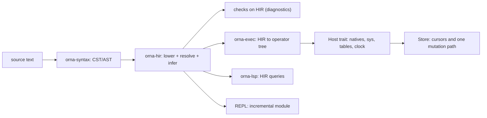
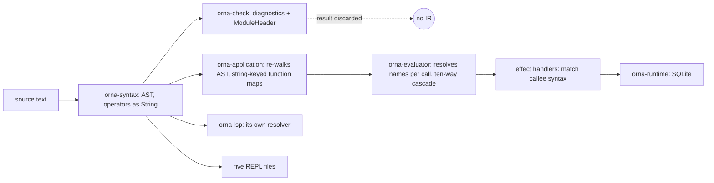

# pivot(hir): one typed, resolved IR and one execution pipeline

Status: design proposal for owner review. Changes no production code.
Epic: `ornadb-csenl` ("pivot: typed HIR, one execution pipeline, language
reference, deletions"). One bead per migration stage is listed in section 6.
Input documents: `local://critique-fable-5-2.md` sections 4 and 5 (the
critique), [`architecture.md`](architecture.md), [`sys-identity.md`](sys-identity.md),
[`std-native.md`](std-native.md), [`native-declarations.md`](native-declarations.md).
Language decisions this design depends on live in
`docs/language/DECISIONS.md` (branch `docs/pivot-language-decisions`, written
in parallel). They are cited here as D1 to D13 and stay OPEN until the owner
answers; section 8 says which stage each one blocks.

Authority for behaviour is `/home/kieran/dev/ornadb/reference/Orna-1.1.0`.
Implementation evidence is `origin/main` = `026faee90`. Every `file:line`
below is a path relative to `crates/` at that commit unless it says otherwise.
Where a number is a count, the command that produced it is in the sentence or
in Appendix B.

--------------------------------------------------------------------------

## 0. Summary

OrnaDB has a parser, a checker, an evaluator, a facade crate that glues them
together, a language server, five REPL front ends and three table-mutation
handler families. It has no compiled program. `orna_check::analyze` returns an
`Analysis` that holds module headers, assertion plans and diagnostics
(`orna-check/src/lib.rs:1319-1329`) and nothing the evaluator can run. Every
later layer starts again from the syntax tree and a name string.

This document proposes one crate, `orna-hir`, between `orna-syntax` and
everything else:

The four claims the rest of the document defends:

1. **Resolve once.** Lowering turns every name into a `DefId`, a local slot,
   or a diagnostic. Every call is classified exactly once into
   `Callee::{Source, Native, Sys, TableOp, Relational, Intrinsic, Value}`.
   After lowering, no layer looks at a callee spelling again. Section 1 counts
   26 places that do today.
2. **One `Ty`, one effect summary per function.** The checker's `Type`, the
   `sys` JSON type language, the intrinsic `SigType` and the ABI `AbiType`
   collapse into one `Ty` with inference variables. Effects are a field of
   every function signature, computed by the same pass that infers types.
3. **One execution pipeline.** The checker becomes "HIR construction plus
   checks on HIR". The executor consumes only HIR. The REPL is an incremental
   module on the same pipeline; the language server is a set of queries over
   it; `sys.explain` prints the operator tree that will run.
4. **A strangler, not a rewrite.** The old pipeline keeps shipping. HIR is
   built beside it and a differential harness runs every fixture through both,
   comparing results, diagnostics and step counts. Stages port one feature at
   a time. The first stage (H0, section 6) is already useful: resolution for
   the language server and a test that pins the new call classification
   against the old evaluator's routing.

What this design deliberately does not decide: the language questions in
`DECISIONS.md`. Where a decision changes a data structure, the structure is
written with the decision as a parameter (marked `[D1]`, `[D2]`, ...) and the
cost of each answer is stated in section 8.

--------------------------------------------------------------------------

## 1. What exists today, layer by layer

### 1.1 The pipeline as it runs

| Layer | Crate and size | What it receives | What it knows about a callee |
|---|---|---|---|
| Syntax | `orna-syntax`, `parser.rs` 5,837 lines | text | nothing; `Expr::Call { callee: Box<Expr> }` (`parser.rs:530`); operators are `String` (`Binary { op: String }`, `parser.rs:518-523`); `if`, `case`, `for`, `while`, `loop` are one node `Expr::Control { kind, binding, condition, body, arms, alternate }` (`parser.rs:582-590`) |
| Check | `orna-check`, `lib.rs` 5,760, `inference.rs` 3,294, `calls.rs` 2,877, `system_api.rs` 3,544 | AST plus a `Scope` | a symbol table of strings (`Scope.names: BTreeMap<String, Symbol>`, `scope.rs:7`) |
| Admission | `orna-application/src/lib.rs`, 14,854 lines | AST again | builds `BTreeMap<String, PureFunction>` keyed `"std.bits.bit_or"` and binds leaves to `IntrinsicId` by catalogue lookup on the name (`lib.rs:297-355`) |
| Evaluate | `orna-evaluator/src/lib.rs`, 15,764 lines | AST again, plus `Functions` | resolves per call at run time: `resolve_function_name` (`lib.rs:10452`), `route_call` (`lib.rs:9884`) |
| Host | three effect-handler families, `sys` bindings | a callee `&Expr` and canonical argument values | `SourceMutationEffectHandler::handle` pattern-matches `Expr::Field { name: "insert" | ... }` (`orna-application/src/lib.rs:2781-2801`) |
| Editor | `orna-lsp`, 11,974 lines in `src/` | AST, checker diagnostics only (`orna-lsp/src/project.rs:19`) | its own resolver (`workspace.rs:382-561`, `names.rs:338`) |
| REPL | 8,049 lines in five files | AST | `orna-check/src/repl.rs` (564), `orna-evaluator/src/repl.rs` (1,766), `orna-project-repl/src/lib.rs` (2,605), `orna-cli/src/repl.rs` (1,883), `orna-application/src/repl_transaction.rs` (1,231) |

The checker's `Scope` has 43 fields, 38 of them `BTreeMap` or `BTreeSet`
keyed by source names (`awk` count over `scope.rs:6-117`): `names`, `modules`,
`table_rows`, `nominal_rows`, `nominal_identities`, `refined_types`,
`enum_variants`, `secret_types`, `local_nominal_names`, and so on. Each map
is one more answer to "what does this spelling mean".

### 1.2 Every place a name is resolved

The count below is of independent implementations, meaning code that maps a
spelled name or callee shape to a definition, a native, a host operation or a
table without calling another row of this table. Rows that share a file are
still counted separately when they share no code.

| # | Layer | Site (`file:line`) | What it resolves | By |
|---|---|---|---|---|
| R01 | check | `orna-check/src/imports.rs:15`, `:40` (`resolve_imports`) | `use` paths to module exports and aliases | module path strings |
| R02 | check | `orna-check/src/inference.rs:310-477` (`infer_call`) | ordinary callee type after about twenty special-case probes (`fail`, `error`, `Some`, `parallel`, `merge_streams`, `sys.Commit.insert`, `ui.action`, money constructor, stream, collection, nominal conversion, statistics, race, timeout, relation member, table operation, codec decode, local generic) | `Expr::Name { text }` string equality |
| R03 | check | `orna-check/src/calls.rs:2325` (`resolve_qualified_module_member`) | `alias.member` through `Scope.modules` and `available_modules` | strings |
| R04 | check | `orna-check/src/intrinsics.rs:225`, `:268` (`root_intrinsic_id`, `module_intrinsic_id`, `resolve_intrinsic`) | root, `std.<module>` and aliased intrinsic spellings; `name.starts_with("__")` at `:244` | strings plus `orna_intrinsics::lookup` |
| R05 | check | `orna-check/src/system_api.rs:791` (`resolve(path)`), `system_calls.rs` | `sys.*` paths against a table parsed from JSON signature strings | string path |
| R06 | check | `orna-check/src/calls.rs:1940-1943`, `inference.rs:574`, `item_checks.rs:1270` | table operation by member name: three copies of the `insert`/`upsert`/`update`/`delete`/`rekey` list | `match name.as_str()` |
| R07 | check | `orna-check/src/item_checks.rs:1246` (`resolved_callable_symbol`) | callee to a `Symbol` | strings |
| R08 | check | `orna-check/src/lib.rs:2929` (`lookup_unit`), `units.rs:802-808` (`resolved_type_of`, `resolve_type_aliases`) | unit, dimension and alias names | strings |
| R09 | check | `orna-check/src/item_checks.rs:23` (`resolve_local_protocol_name`) | protocol names | strings |
| R10 | check | `orna-check/src/secrets.rs:396` (`resolved_helper_summary_key`) | helper function for secret-flow summaries | strings |
| R11 | evaluate | `orna-evaluator/src/lib.rs:10452` (`resolve_function_name`) | callee to an admitted function key; consults scope, namespace, REPL aliases, `std.` prefix, the sys host registry | strings, in an order given by `if` statements |
| R12 | evaluate | `orna-evaluator/src/lib.rs:6105` (`name_lookup`) | identifier to a value | `Scope(BTreeMap<String, Value>, ...)` |
| R13 | evaluate | `orna-evaluator/src/lib.rs:9884` (`route_call`) | native versus source: four spelling branches (`Module::from_path`, the `std.math` special case, root intrinsic, `for_each`/`Stream.from_list`) | rsplit on `.` |
| R14 | evaluate | `orna-evaluator/src/lib.rs:9795` (`call_system_host`) | `sys.explain`, `sys.rt.info`, `sys.blob.*`, registered host operations; tests `scope.0.contains_key("sys")` at `:9801` | spelled path |
| R15 | evaluate | `orna-evaluator/src/lib.rs:9581-9660`, `:11487`, `:11630`, `:7752` | `.divide` by field name, `codec_decode_operation`, the literal `"std.ui.action"`, `root_intrinsic` (`:9671`), `is_relation_source`, `relation_call` | spelling and AST shape |
| R16 | evaluate | `orna-evaluator/src/lib.rs:11911` (`is_static_effect_path`), `:9526` (`dispatch_effect`) | "is this callee an effect to offer the handler" | `Expr::Field` shape |
| R17 | evaluate | `orna-evaluator/src/sys_bindings.rs:551` (`dispatch`), `sys_dispatch.rs` | registered operation to host handler | operation name string |
| R18 | evaluate | `orna-evaluator/src/repl.rs:171` (`with_module_aliases`) and `alias_target` | REPL module aliases | strings |
| R19 | application | `orna-application/src/lib.rs:297-355` | std function to `IntrinsicId`: `intrinsic.binds_declaration(&lookup_name)`, `strip_prefix("std.time.")` | catalogue lookup by name |
| R20 | application | `orna-application/src/lib.rs:2159-2171` (`admitted_table_name`), `:2781-2905` (`handle`) | table by callee path, including suffix match on the last segment | strings |
| R21 | application | `orna-application/src/repl_transaction.rs:750` | second table-mutation handler, for REPL transactions | `Expr::Field` shape |
| R22 | conformance | `orna-conformance/src/semantic_adapter.rs:4590`, `:4695`, `:6318` | three more handlers (`CandidateRelationEffectHandler`, `ActivationRelationEffectHandler`, `TableEffectHandler`), one of which production uses for assertion admission | `Expr::Field` shape |
| R23 | intrinsics | `orna-intrinsics/src/lib.rs:53` (`lookup`) | `(Module, name)` to `Intrinsic`, accepting the public export, the private leaf and re-export spellings | strings |
| R24 | editor | `orna-lsp/src/workspace.rs:382-561` (`resolve_at`, `resolve`, `lookup`, `lookup_imports`, `lookup_path`) | every name occurrence | its own `Key` strings |
| R25 | editor | `orna-lsp/src/names.rs:338` (`resolve_binding`) | local bindings and scopes | strings |
| R26 | editor | `orna-lsp/src/standard.rs:204` (`resolve_module`) | module qualifier to a standard module | strings |

That is **26 independent resolution implementations in 6 crates** (check 10,
evaluate 8, application 3, conformance 1 row of 3 handlers, intrinsics 1,
editor 3). Beyond them, the checker reads `scope.names` directly 25 times and
`scope.modules` or `available_modules` 14 times (Appendix B, commands 3 and
4). No row delegates to another.

### 1.3 The call cascade, and the order it is decided in

`Evaluator::call` (`orna-evaluator/src/lib.rs:9581`) decides what a call is by
trying these in order, and the order is the semantics:

| Order | Kind | Test |
|---|---|---|
| 1 | decimal `.divide` | `resolved.is_none() && input.is_none() && callee is Expr::Field { name == "divide" }` (`:9590-9594`) |
| 2 | codec decode | `codec_decode_operation(resolved)` matches `"std.encoding.json.decode"` etc. (`:11630`) |
| 3 | `std.ui.action` | `site.spelled == Some("std.ui.action")` (`:9631`) |
| 4 | root intrinsic | `Some`, `now`, `uuid7`, `error`, `fail` by `match text.as_str()`; shadowed if `scope.0.contains_key(text)` or `site.resolved.is_some()` (`:9671-9684`) |
| 5 | relation source | `is_relation_source(callee)` (`:11487`) |
| 6 | relation stage | `relation_call(...)` (`:7752`) |
| 7 | sys host | `call_system_host` (`:9795`) |
| 8 | native | `route_call` returns `CallRoute::Native(id)` (`:9884`) |
| 9 | source function or closure | `call_source_function` (`:9985`), itself offering the callee to the effect handler first (`call_static_effect`, `:9958`) |

`route_call` alone has four ways to decide "native" before it falls through to
"source". The checker has the mirror image in `infer_call`, and nothing
asserts the two agree: they are held together by tests.

The same call is bound by four argument binders: `order_arguments`
(`lib.rs:10329`, native), `ordered_host_arguments` (`lib.rs:11167`, host
operations), the inline map building in `call_source_function`
(`lib.rs:10061-10100`, source), and `call_blob_operation` (`lib.rs:9290`, Blob).

### 1.4 Types: seven representations of one idea

| Where | Type |
|---|---|
| `orna-syntax/src/parser.rs:439` | `TypeExpr` |
| `orna-check/src/types.rs:6` | `Type` (no inference variable; `Named(String)` and `Applied { base: String, .. }`) |
| `orna-check/src/system_api.rs:140` | `SystemType` |
| `orna-intrinsics/src/signature.rs:14` | `SigType` |
| `orna-sys/src/provider.rs:143` | `AbiType` |
| `orna-sys-id` (generated) | `SysType` |
| `orna-evolution/src/lib.rs:60` | `FieldType` |

Each boundary converts, and converts through names. The checker "infers" an
unannotated parameter as `Int` whenever it sits beside `+ - * / % < <= > >= ==
!=` (`orna-check/src/inference.rs:1455-1475`, `lambda_numeric_parameter_usage`),
which is why `fn same(name) = name == "admin";` is rejected.

### 1.5 Effects: two vocabularies and no function-level field

The checker has a closed 12-variant `EffectKind` (`orna-check/src/effects.rs:11-24`:
`TableRead`, `TableWrite`, `Network`, `Filesystem`, `Process`, `Clock`,
`Randomness`, `SecretAccess`, `Ui`, `Git`, `StorageAdmin`, `RuntimeAdmin`) and
an `EffectSummary { effects, opaque, may_fail }` (`types.rs:72-80`) attached to
`Symbol`. `orna-intrinsics` has a different 7-variant `Effect`
(`orna-intrinsics/src/effect.rs`: `Pure`, `PinnedData`, `Clock`, `Entropy`,
`Host`, `Stream`, `Query`). The function type `Type::Function { .. }`
(`types.rs:52-62`) carries no effects. The evaluator derives its own notion
from whichever handler answers.

### 1.6 Execution state: three representations of "what happened"

`Context.transfer: Option<Transfer>` with `Transfer::{Return, Break, Continue}`
(`orna-evaluator/src/lib.rs:5179-5182`) plus `Result<Value, EvaluationError>`
plus a `CancellationToken`. Every sub-evaluation must be followed by
`if self.transfer.is_some() { return Ok(Value::Null) }`; that line appears 43
times in `lib.rs`, seven of them inside `call`'s own region. Cancellation is an
ordinary error plus a flag.

`Value` (`lib.rs:3589-3665`) has `Null` and `Option(Option<Box<Value>>)` side
by side, `Int(BigInt)`, `Float(u64)`, `Date(String)`, and `Function { name:
String, .. }` for a function value: a name, resolved again on every call.
`Scope` is `BTreeMap<String, Value>` plus four more sets (`lib.rs:4797-4804`)
and `Closure { captured: Scope, .. }` clones it (`lib.rs:3667-3673`).

### 1.7 Table access: five mutation paths and a 2,048 cap

`Limits::default()` has `max_collection_items: 2_048`, `max_steps:
2_048 * 200 + 10_000 = 419,600`, `max_string_bytes: 16_384`, `max_depth: 64`,
`max_integer_digits: 1_024` (`orna-evaluator/src/lib.rs:124-130`, `:223-234`).
`ApplicationAuthority::committed_read_limits` sets `max_rows_per_table` to
that same `max_collection_items` (`orna-application/src/lib.rs:708-717`), so a
committed read refuses row 2,049. `Limits::check_integer` renders the integer
to decimal text to measure its length (`lib.rs:253-259`).

Insert semantics exist in `SourceMutationEffectHandler::handle`
(`orna-application/src/lib.rs:2781`), its async wrapper (`:2478`),
`ReplTransactionEffectHandler` (`repl_transaction.rs:750`) and three handlers in
`orna-conformance` (`semantic_adapter.rs:4590`, `:4695`, `:6318`): at least six
production-reachable `EffectHandler` implementations that decide what
`Note.insert(..)` means, plus `ContextualSnapshotEffectHandler`
(`contextual_snapshot.rs:110`), `Ovb2EffectHandlerAdapter`,
`ContextValueEffectHandlerAdapter` (two impls), `SysHostBindingRegistry`
(`sys_bindings.rs:1344`, `:1389`) and `QuerySessionEffects`
(`orna-runtime/src/lib.rs:6780`).

The evaluator already has the beginning of the right shape. A `RelationPlan`
carries `source`, `stages: Vec<RelationStage>` with `Filter`, `Map`,
`FlatMap`, `SortBy`, `BucketBy`, `Distinct`, `Pairs`, `Window`, `Drop`, `Take`
(`relation.rs:275-286`, `:645-671`), and the handler trait has
`scan_relation_page(source, after, limit, budget) -> RelationPage { rows, next }`
(`lib.rs:279-282`, `:1440`). It is a plan the evaluator interprets over pages
of whole-row values, not a pull operator tree, and a stage that needs the
whole input (sort, bucket, distinct) materialises it under the 2,048 cap.

### 1.8 `std`, intrinsics and `sys`: three declaration mechanisms

- Root intrinsics and `std` natives: `orna-intrinsics`, 124 `IntrinsicId`
  variants (`id.rs`), 4,015 lines in `modules/*.rs`, signatures in `SigType`,
  bound to pinned-std source by name (R19, R23).
- `sys`: `api/sys.json` carries Orna signatures as strings
  (`"signature": "fn sys.meta<T>(value: T): sys.ValueMetadata<T>"`), parsed at
  run time by the checker's own parser (`system_api.rs`, 3,544 lines) and mapped
  to Rust by a build script (`orna-sys/build.rs`, 211 lines; `orna-sys-codegen`;
  `orna-sys-macros`; `orna-sys-id`).
- `sys.explain`: 17,855 lines in `orna-sys/src/introspection.rs`, with
  `QueryFoldState` at `:1764`, fed in production by
  `orna-evaluator/src/explain_bindings.rs`, which describes a planner that
  does not run.

### 1.9 What is already good and is kept

The canonical value encodings (`orna-value`), SQLite and publication in
`orna-runtime` and `orna-repository`, the diagnostic code vocabulary, the
syntax crate's lexer and visitor (`orna-syntax/src/visit.rs`), the pinned
standard source, the fixture and conformance corpus (92 `examples/valid`, 80
`examples/invalid`, 104 `repl-inline-*` fixtures, plus the module corpus), and
the gate registry. HIR sits on top of the syntax crate and below nothing that
has to change shape in stage H0.
