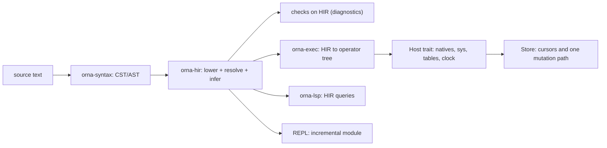
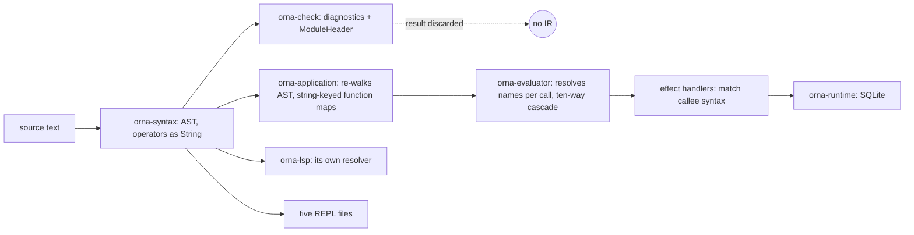
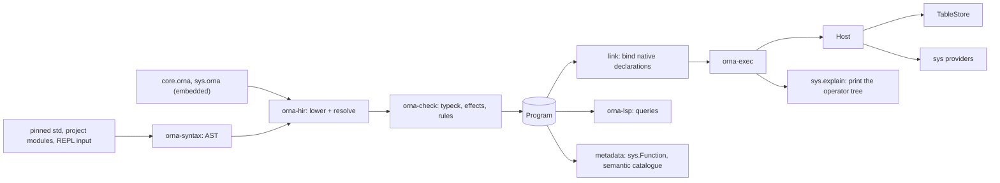
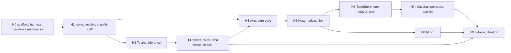

# pivot(hir): one typed, resolved IR and one execution pipeline

Status: design proposal for owner review. Changes no production code.
Epic: `ornadb-csenl` ("pivot: typed HIR, one execution pipeline, language
reference, deletions"). One bead per migration stage is listed in section 6.
Input documents: `local://critique-fable-5-2.md` sections 4 and 5 (the
critique), [`architecture.md`](architecture.md), [`sys-identity.md`](sys-identity.md),
[`std-native.md`](std-native.md), [`native-declarations.md`](native-declarations.md).
Language decisions this design depends on live in
the file docs/language/DECISIONS.md (branch `docs/pivot-language-decisions`, written
in parallel). They are cited here as D1 to D13 and stay OPEN until the owner
answers; section 8 says which stage each one blocks.

Authority for behaviour is `/home/kieran/dev/ornadb/reference/Orna-1.1.0`.
Implementation evidence is `origin/main` = `026faee90`. Every `file:line`
below is a path relative to `crates/` at that commit unless it says otherwise.
Where a number is a count, the command that produced it is in the sentence or
in Appendix B.

--------------------------------------------------------------------------

## 0. Summary

OrnaDB has a parser, a checker, an evaluator, a facade crate that glues them
together, a language server, five REPL front ends and three table-mutation
handler families. It has no compiled program. `orna_check::analyze` returns an
`Analysis` that holds module headers, assertion plans and diagnostics
(`orna-check/src/lib.rs:1319-1329`) and nothing the evaluator can run. Every
later layer starts again from the syntax tree and a name string.

This document proposes one crate, `orna-hir`, between `orna-syntax` and
everything else:



The four claims the rest of the document defends:

1. **Resolve once.** Lowering turns every name into a `DefId`, a local slot,
   or a diagnostic. Every call is classified exactly once into
   `Callee::{Source, Native, Sys, TableOp, Relational, Intrinsic, Value}`.
   After lowering, no layer looks at a callee spelling again. Section 1 counts
   26 places that do today.
2. **One `Ty`, one effect summary per function.** The checker's `Type`, the
   `sys` JSON type language, the intrinsic `SigType` and the ABI `AbiType`
   collapse into one `Ty` with inference variables. Effects are a field of
   every function signature, computed by the same pass that infers types.
3. **One execution pipeline.** The checker becomes "HIR construction plus
   checks on HIR". The executor consumes only HIR. The REPL is an incremental
   module on the same pipeline; the language server is a set of queries over
   it; `sys.explain` prints the operator tree that will run.
4. **A strangler, not a rewrite.** The old pipeline keeps shipping. HIR is
   built beside it and a differential harness runs every fixture through both,
   comparing results, diagnostics and step counts. Stages port one feature at
   a time. The first stage that delivers value (H1, section 6) is one resolver:
   resolution for the language server and a test that pins the new call
   classification against the old evaluator's routing.

What this design deliberately does not decide: the language questions in
`DECISIONS.md`. Where a decision changes a data structure, the structure is
written with the decision as a parameter (marked `[D1]`, `[D2]`, ...) and the
cost of each answer is stated in section 8.

--------------------------------------------------------------------------

## 1. What exists today, layer by layer

### 1.1 The pipeline as it runs



| Layer | Crate and size | What it receives | What it knows about a callee |
|---|---|---|---|
| Syntax | `orna-syntax`, `parser.rs` 5,837 lines | text | nothing; `Expr::Call { callee: Box<Expr> }` (`parser.rs:530`); operators are `String` (`Binary { op: String }`, `parser.rs:518-523`); `if`, `case`, `for`, `while`, `loop` are one node `Expr::Control { kind, binding, condition, body, arms, alternate }` (`parser.rs:582-590`) |
| Check | `orna-check`, `lib.rs` 5,760, `inference.rs` 3,294, `calls.rs` 2,877, `system_api.rs` 3,544 | AST plus a `Scope` | a symbol table of strings (`Scope.names: BTreeMap<String, Symbol>`, `scope.rs:7`) |
| Admission | `orna-application/src/lib.rs`, 14,854 lines | AST again | builds `BTreeMap<String, PureFunction>` keyed `"std.bits.bit_or"` and binds leaves to `IntrinsicId` by catalogue lookup on the name (`lib.rs:297-355`) |
| Evaluate | `orna-evaluator/src/lib.rs`, 15,764 lines | AST again, plus `Functions` | resolves per call at run time: `resolve_function_name` (`lib.rs:10452`), `route_call` (`lib.rs:9884`) |
| Host | three effect-handler families, `sys` bindings | a callee `&Expr` and canonical argument values | `SourceMutationEffectHandler::handle` pattern-matches `Expr::Field { name: "insert" | ... }` (`orna-application/src/lib.rs:2781-2801`) |
| Editor | `orna-lsp`, 11,974 lines in `src/` | AST, checker diagnostics only (`orna-lsp/src/project.rs:19`) | its own resolver (`workspace.rs:382-561`, `names.rs:338`) |
| REPL | 8,049 lines in five files | AST | `orna-check/src/repl.rs` (564), `orna-evaluator/src/repl.rs` (1,766), `orna-project-repl/src/lib.rs` (2,605), `orna-cli/src/repl.rs` (1,883), `orna-application/src/repl_transaction.rs` (1,231) |

The checker's `Scope` has 43 fields, 38 of them `BTreeMap` or `BTreeSet`
keyed by source names (`awk` count over `scope.rs:6-117`): `names`, `modules`,
`table_rows`, `nominal_rows`, `nominal_identities`, `refined_types`,
`enum_variants`, `secret_types`, `local_nominal_names`, and so on. Each map
is one more answer to "what does this spelling mean".

### 1.2 Every place a name is resolved

The count below is of independent implementations, meaning code that maps a
spelled name or callee shape to a definition, a native, a host operation or a
table without calling another row of this table. Rows that share a file are
still counted separately when they share no code.

| # | Layer | Site (`file:line`) | What it resolves | By |
|---|---|---|---|---|
| R01 | check | `orna-check/src/imports.rs:15`, `:40` (`resolve_imports`) | `use` paths to module exports and aliases | module path strings |
| R02 | check | `orna-check/src/inference.rs:310-477` (`infer_call`) | ordinary callee type after about twenty special-case probes (`fail`, `error`, `Some`, `parallel`, `merge_streams`, `sys.Commit.insert`, `ui.action`, money constructor, stream, collection, nominal conversion, statistics, race, timeout, relation member, table operation, codec decode, local generic) | `Expr::Name { text }` string equality |
| R03 | check | `orna-check/src/calls.rs:2325` (`resolve_qualified_module_member`) | `alias.member` through `Scope.modules` and `available_modules` | strings |
| R04 | check | `orna-check/src/intrinsics.rs:225`, `:268` (`root_intrinsic_id`, `module_intrinsic_id`, `resolve_intrinsic`) | root, `std.<module>` and aliased intrinsic spellings; `name.starts_with("__")` at `:244` | strings plus `orna_intrinsics::lookup` |
| R05 | check | `orna-check/src/system_api.rs:791` (`resolve(path)`), `system_calls.rs` | `sys.*` paths against a table parsed from JSON signature strings | string path |
| R06 | check | `orna-check/src/calls.rs:1940-1943`, `inference.rs:574`, `item_checks.rs:1270` | table operation by member name: three copies of the `insert`/`upsert`/`update`/`delete`/`rekey` list | `match name.as_str()` |
| R07 | check | `orna-check/src/item_checks.rs:1246` (`resolved_callable_symbol`) | callee to a `Symbol` | strings |
| R08 | check | `orna-check/src/lib.rs:2929` (`lookup_unit`), `units.rs:802-808` (`resolved_type_of`, `resolve_type_aliases`) | unit, dimension and alias names | strings |
| R09 | check | `orna-check/src/item_checks.rs:23` (`resolve_local_protocol_name`) | protocol names | strings |
| R10 | check | `orna-check/src/secrets.rs:396` (`resolved_helper_summary_key`) | helper function for secret-flow summaries | strings |
| R11 | evaluate | `orna-evaluator/src/lib.rs:10452` (`resolve_function_name`) | callee to an admitted function key; consults scope, namespace, REPL aliases, `std.` prefix, the sys host registry | strings, in an order given by `if` statements |
| R12 | evaluate | `orna-evaluator/src/lib.rs:6105` (`name_lookup`) | identifier to a value | `Scope(BTreeMap<String, Value>, ...)` |
| R13 | evaluate | `orna-evaluator/src/lib.rs:9884` (`route_call`) | native versus source: four spelling branches (`Module::from_path`, the `std.math` special case, root intrinsic, `for_each`/`Stream.from_list`) | rsplit on `.` |
| R14 | evaluate | `orna-evaluator/src/lib.rs:9795` (`call_system_host`) | `sys.explain`, `sys.rt.info`, `sys.blob.*`, registered host operations; tests `scope.0.contains_key("sys")` at `:9801` | spelled path |
| R15 | evaluate | `orna-evaluator/src/lib.rs:9581-9660`, `:11487`, `:11630`, `:7752` | `.divide` by field name, `codec_decode_operation`, the literal `"std.ui.action"`, `root_intrinsic` (`:9671`), `is_relation_source`, `relation_call` | spelling and AST shape |
| R16 | evaluate | `orna-evaluator/src/lib.rs:11911` (`is_static_effect_path`), `:9526` (`dispatch_effect`) | "is this callee an effect to offer the handler" | `Expr::Field` shape |
| R17 | evaluate | `orna-evaluator/src/sys_bindings.rs:551` (`dispatch`), `sys_dispatch.rs` | registered operation to host handler | operation name string |
| R18 | evaluate | `orna-evaluator/src/repl.rs:171` (`with_module_aliases`) and `alias_target` | REPL module aliases | strings |
| R19 | application | `orna-application/src/lib.rs:297-355` | std function to `IntrinsicId`: `intrinsic.binds_declaration(&lookup_name)`, `strip_prefix("std.time.")` | catalogue lookup by name |
| R20 | application | `orna-application/src/lib.rs:2159-2171` (`admitted_table_name`), `:2781-2905` (`handle`) | table by callee path, including suffix match on the last segment | strings |
| R21 | application | `orna-application/src/repl_transaction.rs:750` | second table-mutation handler, for REPL transactions | `Expr::Field` shape |
| R22 | conformance | `orna-conformance/src/semantic_adapter.rs:4590`, `:4695`, `:6318` | three more handlers (`CandidateRelationEffectHandler`, `ActivationRelationEffectHandler`, `TableEffectHandler`), one of which production uses for assertion admission | `Expr::Field` shape |
| R23 | intrinsics | `orna-intrinsics/src/lib.rs:53` (`lookup`) | `(Module, name)` to `Intrinsic`, accepting the public export, the private leaf and re-export spellings | strings |
| R24 | editor | `orna-lsp/src/workspace.rs:382-561` (`resolve_at`, `resolve`, `lookup`, `lookup_imports`, `lookup_path`) | every name occurrence | its own `Key` strings |
| R25 | editor | `orna-lsp/src/names.rs:338` (`resolve_binding`) | local bindings and scopes | strings |
| R26 | editor | `orna-lsp/src/standard.rs:204` (`resolve_module`) | module qualifier to a standard module | strings |

That is **26 independent resolution implementations in 6 crates** (check 10,
evaluate 8, application 3, conformance 1 row of 3 handlers, intrinsics 1,
editor 3). Beyond them, the checker reads `scope.names` directly 25 times and
`scope.modules` or `available_modules` 14 times (Appendix B, commands 3 and
4). No row delegates to another.

### 1.3 The call cascade, and the order it is decided in

`Evaluator::call` (`orna-evaluator/src/lib.rs:9581`) decides what a call is by
trying these in order, and the order is the semantics:

| Order | Kind | Test |
|---|---|---|
| 1 | decimal `.divide` | `resolved.is_none() && input.is_none() && callee is Expr::Field { name == "divide" }` (`:9590-9594`) |
| 2 | codec decode | `codec_decode_operation(resolved)` matches `"std.encoding.json.decode"` etc. (`:11630`) |
| 3 | `std.ui.action` | `site.spelled == Some("std.ui.action")` (`:9631`) |
| 4 | root intrinsic | `Some`, `now`, `uuid7`, `error`, `fail` by `match text.as_str()`; shadowed if `scope.0.contains_key(text)` or `site.resolved.is_some()` (`:9671-9684`) |
| 5 | relation source | `is_relation_source(callee)` (`:11487`) |
| 6 | relation stage | `relation_call(...)` (`:7752`) |
| 7 | sys host | `call_system_host` (`:9795`) |
| 8 | native | `route_call` returns `CallRoute::Native(id)` (`:9884`) |
| 9 | source function or closure | `call_source_function` (`:9985`), itself offering the callee to the effect handler first (`call_static_effect`, `:9958`) |

`route_call` alone has four ways to decide "native" before it falls through to
"source". The checker has the mirror image in `infer_call`, and nothing
asserts the two agree: they are held together by tests.

The same call is bound by four argument binders: `order_arguments`
(`lib.rs:10329`, native), `ordered_host_arguments` (`lib.rs:11167`, host
operations), the inline map building in `call_source_function`
(`lib.rs:10061-10100`, source), and `call_blob_operation` (`lib.rs:9290`, Blob).

### 1.4 Types: seven representations of one idea

| Where | Type |
|---|---|
| `orna-syntax/src/parser.rs:439` | `TypeExpr` |
| `orna-check/src/types.rs:6` | `Type` (no inference variable; `Named(String)` and `Applied { base: String, .. }`) |
| `orna-check/src/system_api.rs:140` | `SystemType` |
| `orna-intrinsics/src/signature.rs:14` | `SigType` |
| `orna-sys/src/provider.rs:143` | `AbiType` |
| `orna-sys-id` (generated) | `SysType` |
| `orna-evolution/src/lib.rs:60` | `FieldType` |

Each boundary converts, and converts through names. The checker "infers" an
unannotated parameter as `Int` whenever it sits beside `+ - * / % < <= > >= ==
!=` (`orna-check/src/inference.rs:1455-1475`, `lambda_numeric_parameter_usage`),
which is why `fn same(name) = name == "admin";` is rejected.

### 1.5 Effects: two vocabularies and no function-level field

The checker has a closed 12-variant `EffectKind` (`orna-check/src/effects.rs:11-24`:
`TableRead`, `TableWrite`, `Network`, `Filesystem`, `Process`, `Clock`,
`Randomness`, `SecretAccess`, `Ui`, `Git`, `StorageAdmin`, `RuntimeAdmin`) and
an `EffectSummary { effects, opaque, may_fail }` (`types.rs:72-80`) attached to
`Symbol`. `orna-intrinsics` has a different 7-variant `Effect`
(`orna-intrinsics/src/effect.rs`: `Pure`, `PinnedData`, `Clock`, `Entropy`,
`Host`, `Stream`, `Query`). The function type `Type::Function { .. }`
(`types.rs:52-62`) carries no effects. The evaluator derives its own notion
from whichever handler answers.

### 1.6 Execution state: three representations of "what happened"

`Context.transfer: Option<Transfer>` with `Transfer::{Return, Break, Continue}`
(`orna-evaluator/src/lib.rs:5179-5182`) plus `Result<Value, EvaluationError>`
plus a `CancellationToken`. Every sub-evaluation must be followed by
`if self.transfer.is_some() { return Ok(Value::Null) }`; that line appears 43
times in `lib.rs`, seven of them inside `call`'s own region. Cancellation is an
ordinary error plus a flag.

`Value` (`lib.rs:3589-3665`) has `Null` and `Option(Option<Box<Value>>)` side
by side, `Int(BigInt)`, `Float(u64)`, `Date(String)`, and `Function { name:
String, .. }` for a function value: a name, resolved again on every call.
`Scope` is `BTreeMap<String, Value>` plus four more sets (`lib.rs:4797-4804`)
and `Closure { captured: Scope, .. }` clones it (`lib.rs:3667-3673`).

### 1.7 Table access: five mutation paths and a 2,048 cap

`Limits::default()` has `max_collection_items: 2_048`, `max_steps:
2_048 * 200 + 10_000 = 419,600`, `max_string_bytes: 16_384`, `max_depth: 64`,
`max_integer_digits: 1_024` (`orna-evaluator/src/lib.rs:124-130`, `:223-234`).
`ApplicationAuthority::committed_read_limits` sets `max_rows_per_table` to
that same `max_collection_items` (`orna-application/src/lib.rs:708-717`), so a
committed read refuses row 2,049. `Limits::check_integer` renders the integer
to decimal text to measure its length (`lib.rs:253-259`).

Insert semantics exist in `SourceMutationEffectHandler::handle`
(`orna-application/src/lib.rs:2781`), its async wrapper (`:2478`),
`ReplTransactionEffectHandler` (`repl_transaction.rs:750`) and three handlers in
`orna-conformance` (`semantic_adapter.rs:4590`, `:4695`, `:6318`): at least six
production-reachable `EffectHandler` implementations that decide what
`Note.insert(..)` means, plus `ContextualSnapshotEffectHandler`
(`contextual_snapshot.rs:110`), `Ovb2EffectHandlerAdapter`,
`ContextValueEffectHandlerAdapter` (two impls), `SysHostBindingRegistry`
(`sys_bindings.rs:1344`, `:1389`) and `QuerySessionEffects`
(`orna-runtime/src/lib.rs:6780`).

The evaluator already has the beginning of the right shape. A `RelationPlan`
carries `source`, `stages: Vec<RelationStage>` with `Filter`, `Map`,
`FlatMap`, `SortBy`, `BucketBy`, `Distinct`, `Pairs`, `Window`, `Drop`, `Take`
(`relation.rs:275-286`, `:645-671`), and the handler trait has
`scan_relation_page(source, after, limit, budget) -> RelationPage { rows, next }`
(`lib.rs:279-282`, `:1440`). It is a plan the evaluator interprets over pages
of whole-row values, not a pull operator tree, and a stage that needs the
whole input (sort, bucket, distinct) materialises it under the 2,048 cap.

### 1.8 `std`, intrinsics and `sys`: three declaration mechanisms

- Root intrinsics and `std` natives: `orna-intrinsics`, 124 `IntrinsicId`
  variants (`id.rs`), 4,015 lines in `modules/*.rs`, signatures in `SigType`,
  bound to pinned-std source by name (R19, R23).
- `sys`: `api/sys.json` carries Orna signatures as strings
  (`"signature": "fn sys.meta<T>(value: T): sys.ValueMetadata<T>"`), parsed at
  run time by the checker's own parser (`system_api.rs`, 3,544 lines) and mapped
  to Rust by a build script (`orna-sys/build.rs`, 211 lines; `orna-sys-codegen`;
  `orna-sys-macros`; `orna-sys-id`).
- `sys.explain`: 17,855 lines in `orna-sys/src/introspection.rs`, with
  `QueryFoldState` at `:1764`, fed in production by
  `orna-evaluator/src/explain_bindings.rs`, which describes a planner that
  does not run.

### 1.9 What is already good and is kept

The canonical value encodings (`orna-value`), SQLite and publication in
`orna-runtime` and `orna-repository`, the diagnostic code vocabulary, the
syntax crate's lexer and visitor (`orna-syntax/src/visit.rs`), the pinned
standard source, the fixture and conformance corpus (92 `examples/valid`, 80
`examples/invalid`, 104 `repl-inline-*` fixtures, plus the module corpus), and
the gate registry. HIR sits on top of the syntax crate and below nothing that
has to change shape in stage H0.

--------------------------------------------------------------------------

## 2. Target data model

### 2.1 Crate and layer

New crate `orna-hir`. It depends on `orna-syntax` (input), `orna-base` (name
and NFC helpers, layer 0) and `orna-value` (the `Diagnostic` type and canonical
type identities, layer 1). It depends on nothing else: not on `orna-check`,
`orna-evaluator`, `orna-intrinsics`, `orna-sys` or any storage crate. In the
layer table of [`architecture.md`](architecture.md) section 3.1 it is a new
layer between syntax (layer 2) and `orna-check`/`orna-evaluator`; no existing
crate may be below it except `orna-syntax`, `orna-base` and `orna-value`.
`scripts/check_architecture.py` enforces that in the same PR that creates the
crate (stage H0, section 6).

Three further crates appear in later stages and are described in sections 3 to
5: `orna-exec` (HIR to operator tree; replaces the evaluator core), `orna-host`
(the `Host` trait and the link step), and the store interface that lives in
`orna-storage`'s existing layer. `orna-check` keeps its name and its public
`analyze*` API; its internals become checks over HIR (section 3.1).

### 2.2 Ids and tables

Every nameable thing has a `DefId`. Locals do not: they are slots in a body.

```rust
/// Index types are `u32` newtypes over `IndexVec<I, T>` (a `Vec<T>` that can
/// only be indexed by `I`). Ids are stable within one `Program`.
pub struct ModuleId(u32);
pub struct DefId(u32);        // global across modules, one per declaration
pub struct BodyId(u32);       // one per function, lambda, initializer, assertion
pub struct LocalId(u32);      // slot index inside one Body
pub struct ExprId(u32);       // index inside one Body
pub struct PatId(u32);        // index inside one Body
pub struct Name(Arc<str>);    // NFC-normalised identifier (ORNA-LEX-005), interned

pub struct Program {
    pub modules: IndexVec<ModuleId, Module>,
    pub defs:    IndexVec<DefId, Def>,
    pub bodies:  IndexVec<BodyId, Body>,
    pub tys:     TyInterner,
    /// Which engine native ABI the `core`/`sys` modules were loaded against.
    pub native_abi: NativeAbi,
}

pub struct Module {
    pub path: ModulePath,             // Vec<Name>, e.g. std.bits
    pub origin: ModuleOrigin,         // Core | Sys | Std | Project | Repl
    pub source: SourceId,
    pub items: Vec<DefId>,            // declaration order
    pub exports: BTreeMap<Name, DefId>,
    pub imports: Vec<Import>,         // resolved: each carries the DefId or ModuleId it names
    pub diagnostics: Vec<Diagnostic>,
}

pub struct Def {
    pub module: ModuleId,
    pub name: Name,
    pub vis: Visibility,
    pub span: SourceSpan,
    pub kind: DefKind,
}

pub enum DefKind {
    Fn(FnDef),
    Table(TableDef),
    Type(TypeDef),               // alias or nominal, refinements included
    Enum(EnumDef),               // variants are DefKind::Variant defs, listed here
    Variant(VariantDef),
    Protocol(ProtocolDef),
    Impl(ImplDef),               // protocol implementation (table or type member)
    Dimension(DimensionDef),     // [D8]
    Unit(UnitDef),               // [D8]
    Let(LetDef),                 // module-level binding
    Assertion(AssertionDef),
    Field(FieldDef),             // table, nominal and enum-payload fields
}
```

`Module.exports` and `imports` replace the checker's `Scope.names`,
`Scope.modules`, `Scope.available_modules` and `ModuleHeader` exports
(`orna-check/src/scope.rs:7`, `:33`, `:36`). Resolution of a path is a lookup
in these tables, run once, by `orna-hir::resolve`.

`DefKind::Fn` is the only place a function lives, whoever implements it:

```rust
pub struct FnDef {
    pub generics: Vec<GenericParam>,          // name + protocol bounds, resolved to DefIds
    pub params: Vec<ParamDef>,                // name, Ty, default: Option<BodyId>, binder pattern
    pub ret: Ty,
    pub effects: EffectSet,                   // [D2] computed by one pass, see 2.5
    pub body: FnBody,
}
pub enum FnBody {
    /// An Orna body. Lambdas and initializers use the same `Body`.
    Source(BodyId),
    /// `native fn` in `core.orna`, `sys.orna` or the pinned `std`. No body, so
    /// the signature above is the only signature. Bound at link time to a
    /// host implementation keyed by this DefId (section 4).
    Native(NativeDecl),
}
pub struct NativeDecl { pub abi: NativeAbi, pub key: NativeKey }   // key = (module path, name)
```

`FnDef.params` carries the default expression as a `BodyId` and the binder
information that today lives in four places (section 1.3): parameter names for
named arguments, positions, defaults, and whether a parameter accepts piped
input (always parameter 0). There is exactly one argument binder, section 2.7.

### 2.3 Types: one `Ty` with inference variables

```rust
/// Interned; `Ty` is a `Copy` index and equal types are equal indices.
pub struct Ty(u32);

pub enum TyKind {
    // Scalars, spec spellings (F43): Str, not Text.
    Bool, Int, Decimal, Float, Str, Blob, Uuid, Date, Instant, Duration, Period,
    Digest, Unit,
    /// The type of an expression that cannot complete (fail, return, break).
    Never,
    /// A diagnostic was already emitted. Never a dynamic Any.
    Error,

    /// `T?`. [D3] one option representation: there is no `Null` type and no
    /// `Value::Null`; the literal `null` lowers to `None` of an inferred
    /// payload. If D3 keeps two nulls, `Null` returns here as a scalar and
    /// section 8 lists the extra lowering rules.
    Option(Ty),

    List(Ty),
    Tuple(Box<[Ty]>),
    Record(Box<[(Name, Ty)]>),          // structural, sorted by name
    Range(Ty),
    Relation(Ty),                       // table or query value; row type inside
    Stream(Ty),
    /// A declared nominal: table row type, `type`, `enum`, or a `sys` type.
    /// The DefId is the identity (no `Named(String)`); arguments are the
    /// generic arguments.
    Adt(DefId, Box<[Ty]>),
    Fn(FnTy),
    /// `Quantity`, `Money<C>` etc. only if D8 keeps them. [D8]
    Quantity(QuantityTy),

    /// A generic parameter of the enclosing definition.
    Param(ParamIdx),
    /// An inference variable; solved by `InferCtxt`, absent from a finished Body.
    Infer(TyVar),
}

pub struct FnTy { pub params: Box<[Ty]>, pub ret: Ty, pub effects: EffectRow }  // [D2]
```

Unification is standard: `InferCtxt` holds a union-find table of `TyVar`
with a generalisation level. After checking a body, a `zonk` pass replaces
every `Infer` with its solution or reports a new ambiguity diagnostic at the span
of the expression that introduced the variable (the empty list literal, the
`null`, the unannotated lambda parameter). This is what makes
`let xs = []; union(xs, [1])` type-check: `xs : List<?T>` with `?T := Int` at
the use. Today it fails with "empty list needs an expected element type".

`[D1]` parameterises the solver, not the data model. The `Ty` above is the
same under both answers.

- **D1 = constraint inference (HM-style, principal types).** A function
  signature may omit parameter types; its parameters start as fresh `Infer`
  variables, are solved from the body and generalised at the function boundary
  into `Param`s with inferred protocol bounds. The solver needs let-level
  generalisation, defaulting rules for numeric literals, and a protocol
  obligation queue. This is the "implement INFER-1" option.
- **D1 = required parameter annotations.** Parameters and generic parameters
  must be written. `Infer` variables exist only for locals, literals and lambda
  parameters whose type is fixed by the context at the call. There is no
  generalisation and no obligation queue; unification is first-order and local
  to a body. This removes `lambda_numeric_parameter_usage`
  (`orna-check/src/inference.rs:1455`) either way.

Stage H2 (section 6) builds the solver for the second option first, because it
is a strict subset of the first. The first option adds generalisation on top.

### 2.4 Bodies, locals in slots, patterns

```rust
pub struct Body {
    pub owner: DefId,
    pub exprs: IndexVec<ExprId, Expr>,
    pub pats:  IndexVec<PatId, Pat>,
    /// One entry per binding in the body. `LocalId` is the frame slot.
    pub locals: IndexVec<LocalId, Local>,
    pub params: Box<[LocalId]>,           // slots 0..n bound by the argument binder
    /// Only for lambdas: the outer slot each captured slot is copied from.
    /// Capture is by value (VALUE-003); [D10] changes the checks, not this shape.
    pub captures: Box<[Capture]>,
    pub root: ExprId,
    pub effects: EffectSet,               // body's own effects, see 2.5
}
pub struct Local { pub name: Name, pub ty: Ty, pub mutable: bool, pub span: SourceSpan }
pub struct Capture { pub outer: LocalId, pub inner: LocalId }

pub struct Expr { pub kind: ExprKind, pub ty: Ty, pub span: SourceSpan }
```

A local read is `ExprKind::Local(LocalId)`: an array index, not a
`BTreeMap<String, Value>` lookup (`orna-evaluator/src/lib.rs:4797`). A lambda
is its own `Body` with `captures`; at run time a closure is a body id plus a
`Box<[Value]>` of the captured slots, replacing `Closure { captured: Scope }`
(`lib.rs:3667-3673`) which clones a whole scope per closure.

Expressions. Operators are enums; `if`, `case`, `for`, `while` and `loop` are
separate variants with required fields, replacing
`Expr::Control { kind, binding, condition, body, arms, alternate }`
(`parser.rs:582-590`, whose legal field combinations the evaluator enumerates
at `lib.rs:6041-6083`):

```rust
pub enum ExprKind {
    Lit(Lit),                               // Int(BigInt|i64 small), Decimal, Float(bits), Str, Bool, Date, Instant
    Local(LocalId),
    Def(DefId),                             // value use of a fn, table, variant, let
    Unary   { op: UnOp, operand: ExprId },  // Neg, Not
    Binary  { op: BinOp, lhs: ExprId, rhs: ExprId },        // arithmetic, comparison, ^
    Logic   { op: LogicOp, lhs: ExprId, rhs: ExprId },      // And, Or, Coalesce (??): short-circuit
    Range   { lo: Option<ExprId>, hi: Option<ExprId>, inclusive: bool },
    Call(Box<Call>),                        // see 2.6; pipes `|` lower to Call with the input as arg 0
    Recover { body: ExprId, handler: LocalId, arm: ExprId },// `|?`
    Field   { base: ExprId, field: FieldRef },              // FieldRef = DefId (nominal/table) or record index
    Index   { base: ExprId, index: ExprId },
    Tuple(Box<[ExprId]>), List(Box<[ExprId]>),
    Record(Box<[(Name, ExprId)]>),          // structural record
    Construct { def: DefId, fields: Box<[(DefId, ExprId)]> },// nominal / variant, field DefIds
    Lambda  { body: BodyId, captured: Box<[ExprId]> },
    Interp(Box<[InterpPart]>),
    Block   { stmts: Box<[Stmt]>, tail: Option<ExprId> },
    If      { cond: ExprId, then: ExprId, els: Option<ExprId> },
    Case    { scrutinee: ExprId, arms: Box<[Arm]> },        // Arm { pat, guard, body }
    For     { pat: PatId, iter: ExprId, body: ExprId },
    While   { cond: ExprId, body: ExprId },
    Loop    { body: ExprId },
    Return(Option<ExprId>), Break(Option<ExprId>), Continue,
    Assign  { place: Place, op: AssignOp, value: ExprId },  // Place = Local | Field | Index chain rooted at a LocalId
    Error,                                                  // a diagnostic was emitted
}
pub enum Stmt { Let { pat: PatId, init: ExprId }, Assert(ExprId), Expr(ExprId) }
```

`BinOp` is `Add | Sub | Mul | Div | Rem | Pow | Eq | Ne | Lt | Le | Gt | Ge`.
The checker does not choose an arithmetic implementation: it records operand
types, and `orna-exec` picks `AddInt`, `AddDecimal`, ... when it builds the
operator tree from `ty(lhs)` (section 7.2). The parser's operator strings
(`"|"`, `"|?"`, `"??"`, `"^"`, `"&&"`, `"||"`, `parser.rs:3626-3640`) are
turned into enums by lowering, not by the parser's consumers.

Patterns carry resolved constructors:

```rust
pub enum Pat {
    Wild,
    Bind  { local: LocalId },
    Lit(Lit),
    Tuple(Box<[PatId]>),
    List  { prefix: Box<[PatId]>, rest: Option<LocalId>, suffix: Box<[PatId]> },
    Record(Box<[(Name, PatId)]>),
    /// An enum variant or nominal constructor, resolved to a DefId. Field
    /// patterns name FieldDefs, not strings.
    Ctor  { def: DefId, fields: Box<[(DefId, PatId)]> },
}
```

Exhaustiveness and constructor-arity checks run over `Pat`, once, in
`orna-check`; the evaluator no longer re-validates pattern shapes.

### 2.5 Effects per function

```rust
/// A bitset: the 12 `sys.EffectKind` values (`orna-check/src/effects.rs:11`)
/// plus `Opaque` (effectful with no EffectKind, today `EffectSummary.opaque`)
/// and `MayFail`.
pub struct EffectSet(u16);

pub enum EffectRow {
    Known(EffectSet),     // [D2-signature] written or inferred, part of the type
    Var(EffectVar),       // [D2-signature] polymorphic over a callback's effects
    Hidden,               // [D2-hidden] function types carry no effect information
}
```

`FnDef.effects` and `Body.effects` are computed by one pass in `orna-hir`: a
body's effects are the join of its calls' callee effects (`Callee` carries the
DefId, so the effect is a table lookup) plus its table operations; mutually
recursive functions are joined over strongly connected components. A `native
fn` takes its effects from its declaration, so `core.orna`, `sys.orna` and the
std natives all state effects in the same syntax, which resolves the critique's
objection to an `effect` clause that exists "for natives alone"
(`local://critique-fable-5-2.md` section 4.2 item 3).

Two vocabularies today (section 1.5) become one: `EffectKind` is the single
enumeration, and `orna_intrinsics::Effect` is deleted in stage H5. The
mapping, from the intrinsic classes: `Pure` and `PinnedData` to the empty set,
`Clock` to `Clock`, `Entropy` to `Randomness`, `Host` to the specific
`EffectKind` the declaration names (today decided per callee by
`host_effect`, `effects.rs`), `Stream` to `Opaque`, `Query` to `TableRead`.

`[D2]` selects how a function *value* is treated:

- **hidden** (status quo made explicit): `FnTy.effects = Hidden`. A callee that
  is a parameter or a local of function type has unknown effects and counts as
  `Opaque`, as `EffectSummary.opaque` does today. A callback passed to `filter`
  is checked at the argument site: a `Lambda` has its `Body.effects`, a
  `Def(fn)` has `FnDef.effects`, anything else is `Opaque`.
- **signature**: `FnTy.effects` is `Known` or `Var`. Callback-taking natives
  (`filter`, `map`, `every`) are declared `native fn filter<T, E>(rows:
  Relation<T>, f: fn(T): Bool effect E): Relation<T> effect E`. Unification
  gains an effect-row component (set join and equality, no row polymorphism
  beyond a single variable per function type).

The pass and the field exist in both cases. Only `FnTy.effects` changes.

### 2.6 Calls: classified once

```rust
pub struct Call { pub callee: Callee, pub args: Box<[Arg]>, pub piped: bool }

pub enum Callee {
    /// A function with an Orna body.
    Source    { def: DefId, targs: Box<[Ty]> },
    /// A `native fn` in `core` or the pinned `std`. Host-implemented.
    Native    { def: DefId, targs: Box<[Ty]> },
    /// A `native fn` in `sys.orna`. Same declaration and link mechanism as
    /// Native; a separate variant because the host capability and the
    /// `sys.EffectKind` gating differ (section 4).
    Sys       { def: DefId, targs: Box<[Ty]> },
    /// `Table.insert/upsert/update/delete/rekey/count/first/one/as_of`.
    TableOp   { table: DefId, op: TableOp },
    /// A relation pipeline stage or relation constructor: `filter`, `map`,
    /// `sort_by`, `bucket_by`, `distinct`, `pairs`, `window`, `take`, `drop`,
    /// `flat_map`, source scan.
    Relational { op: RelOp },
    /// A form that cannot be a function because it has a non-call evaluation
    /// rule: `fail` (abrupt), `parallel`, `race`, `timeout`, `merge_streams`.
    /// A closed enum; the initial list is the checker's special-case probes
    /// (`orna-check/src/inference.rs:318-467`) that are not natives.
    Intrinsic (IntrinsicForm),
    /// A constructor: enum variant, nominal type, `Money<C>`.
    Ctor      { def: DefId },
    /// A call of a first-class value: closure, function-typed parameter or
    /// local. The callee is an expression and its type is `Ty::Fn`.
    Value     { callee: ExprId },
}
pub enum TableOp { Insert, Upsert, Update, Delete, Rekey, Count, First, One, AsOf }
```

The classification is a total function of the resolved callee `DefId` or
expression type, computed in `orna-hir::lower` after name resolution. It
replaces: `route_call` (R13), `call` pre-dispatch (R15), `call_system_host`
(R14), the checker's `infer_call` probe chain (R02), `resolve_intrinsic` (R04),
`infer_table_operation` and its two copies (R06), the application admission
binding (R19) and every handler's "is this callee mine" test (R16, R20-R22).
The shadowing rule that `root_intrinsic` implements by `scope.0.contains_key`
(`lib.rs:9671-9684`) becomes ordinary lexical resolution: `Some` is a
`core.orna` export, a local named `Some` shadows it because the resolver finds
the local first.

Which names are in `Intrinsic` versus `Native` is not an implementation
detail: if D12 moves `Some`, `now`, `uuid7` and `error` into `core.orna`
they are `Native`; if not they must be `Intrinsic`. Stage H1 (section 6) pins
the current classification with a test against the old evaluator's routing
before any behaviour changes.

### 2.7 One argument binder

Arguments are matched to parameters once, during lowering, never at run time:

```rust
pub struct Arg { pub slot: ParamIdx, pub value: ArgValue }
pub enum ArgValue { Expr(ExprId), Default /* run the parameter's default body */ }
```

`lower_call` takes the callee's `FnDef.params`, applies positional-then-named
rules (positional after named is `ORNA-EVAL-ARGUMENT` today; it becomes a
checker diagnostic), puts the piped input at parameter 0 (`piped: true`), and
emits one `Arg` per parameter in parameter order, with `Default` where the
declaration provides one. A call whose arguments do not bind is a diagnostic at
the call span; no run-time `ORNA-EVAL-ARGUMENT` remains for a statically
resolved callee. This deletes `order_arguments`, `ordered_host_arguments`, the
source binder in `call_source_function` and the Blob binder
(`lib.rs:10329`, `:11167`, `:10061-10100`, `:9290`). A `Callee::Value` call
binds positionally against its `FnTy` (function types carry no parameter
names, `types.rs:54-57`), which is the existing rule.

### 2.8 Completion

```rust
/// What evaluating an expression produced. The spec has three completion
/// states; cancellation is a fourth, distinct from failure.   [D4]
pub enum Completion {
    Value(Value),
    Return(Value),
    Break(Value),
    Continue,
    Fail(Error),
    Cancelled,
}
```

The executor returns `Completion` from every operator. A caller that wants a
value matches once; a `?`-style helper short-circuits every non-`Value`
variant to the enclosing operator. This replaces `Context.transfer:
Option<Transfer>` plus `Result` plus the cancellation flag, and the 43
`if self.transfer.is_some()` checks (section 1.6). `Cancelled` is a variant so
"failed while cancellation was requested" and "cancelled" are different values;
`[D4]` decides whether `Recover` (`|?`) may catch it (the critique argues it
must not).

### 2.9 What HIR does not contain

No `Value` (runtime values live in `orna-exec`, with `orna-value`'s canonical
encodings at the boundary). No storage identity (a `TableDef` records declared
fields, keys and assertions; the store binds it to a table object at link
time). No resolved source text: spans refer to a `SourceId` and are used for
diagnostics and editor queries only.

### 2.10 Worked example: `std.bits.bit_or(a, b)`

Today (critique 4.1, re-verified): the checker decides "native" from
`name.starts_with("__")` (`intrinsics.rs:244`); admission builds a string map
and binds the leaf by catalogue lookup (`orna-application/src/lib.rs:297-355`);
at run time `call` resolves the callee string again, runs the public wrapper
as source, reaches the `__bit_or` leaf, takes `CallRoute::Native`, orders
arguments from the catalogue's copy of the signature, and `dispatch` matches
the name string in `bits` (`intrinsics/bits.rs:10-12`).

With HIR: `std/bits.orna` declares `pub native fn bit_or(a: Int, b: Int):
Int effect none;`. Lowering resolves `bits.bit_or` through the import to a
`DefId`, whose `FnBody` is `Native`, and emits `Call { callee: Native { def },
args: [Expr(a), Expr(b)] }`. Link binds `(std.bits, bit_or)` to a Rust
function once and records it under that `DefId`. Execution evaluates two
arguments and calls a function pointer. There is no name in the executed
program.

--------------------------------------------------------------------------

## 3. The pipeline and who consumes the HIR



### 3.1 The checker: HIR construction plus checks on HIR

`orna-check` keeps its crate name and its public `analyze*` functions (they are
called from `orna-application`, `orna-project-repl`, `orna-lsp` and the CLI).
Internally it changes from "walk the AST and keep a `Scope`" to a sequence of
passes over a `Program`:

| Pass | Crate | Input | Output | Replaces |
|---|---|---|---|---|
| `lower` | `orna-hir` | AST | `Def`s, untyped `Body`s | header collection (`orna-check/src/units.rs:499`), and every later re-walk of syntax by admission |
| `resolve` | `orna-hir` | defs, `use` | `Module.exports/imports`, `Local` slots, `Callee` for path callees, bound `Arg`s | the 26 sites R01..R26 of section 1.2 |
| `typeck` | `orna-check` | resolved program | `Expr.ty`, `Local.ty`, `FnDef` signatures, settled calls | `infer*`, `Scope`, `Type` |
| `effects` | `orna-check` | call graph | `FnDef.effects`, `Body.effects` | `EffectSummary` joins, `host_effect`, `stabilize_function_summaries` (`units.rs:349`) |
| rules | `orna-check` | typed program | diagnostics | assertion scope, table admission, secrets, computed fields, currency, checkpoints, units |

The new public entry point returns the program and the diagnostics together:

```rust
pub fn check(inputs: &[ModuleInput], env: &Environment) -> Checked;
pub struct Checked { pub program: Program, pub diagnostics: Vec<Diagnostic> }
```

`Environment` carries what `Catalogue` carries today as string-keyed maps
(`orna-check/src/catalogue.rs:9-30`): already-lowered packages (`core`, `sys`, a
pinned `std`), attached databases and the object identity manifest. The legacy
`analyze*` functions stay until stage H9 and are reimplemented, one at a time,
as `check(..)` followed by a conversion to `Analysis`. Until each is
reimplemented it runs the old code, so no caller changes in the intermediate
stages.

Rules are ported by family, each behind the differential harness (section 6.2).
A rule that today asks "is this callee spelled `Table.insert`" asks "is this a
`Callee::TableOp`"; a rule that asks "does this expression name a table" asks
"is this `ExprKind::Def` of a `DefKind::Table`". The rule families, in the
order they port, with their present size:

| Family | Today | After |
|---|---|---|
| scalar typing and operators | `inference.rs` 3,294, `types.rs` | `typeck` operator tables over `Ty` |
| calls, pipelines, collections | `calls.rs` 2,877, `intrinsics.rs` 1,255, `collection_calls.rs`, `collections.rs`, `flow.rs` 1,234 | one call rule per `Callee` variant |
| tables and assertions | `assertions.rs` 979, `item_checks.rs` 1,600, `source_row.rs` | rules over `TableDef` and `Call.callee = TableOp` |
| units and money | `units.rs` 1,498, parts of `inference.rs` | rules over `TyKind::Quantity` [D8] |
| `sys` | `system_api.rs` 3,544, `system_calls.rs` 1,915 | none: `sys.orna` is lowered like any module (section 4) |
| checkpoints, secrets | `checkpoint.rs` 3,574, `secrets.rs` 414, `semantic_payload.rs` 1,831 | ported last; they are type-directed and port with `typeck` |

### 3.2 The executor consumes only HIR

`orna-exec` replaces `orna-evaluator`. It receives a linked `Program` and
builds an operator tree (section 7.2). It has no dependency on `orna-syntax`:
it cannot match on a callee's spelling because it is never given one.

```rust
pub struct Activation<'a> {
    pub program: &'a Program,
    pub host: &'a mut dyn Host,
    pub quotas: Quotas,
    pub cancel: &'a CancellationToken,
}
impl Activation<'_> {
    pub fn call(&mut self, entry: DefId, args: Vec<Value>) -> (Outcome, Usage);
    pub fn eval(&mut self, body: BodyId, frame: Frame) -> (Outcome, Usage);
}
pub enum Outcome { Success(Value), Failure(Error), Cancelled }   // spec 06-expressions.md:428-436
```

There is no `ActivationMode` (`orna-evaluator/src/lib.rs:5008`), no
`repl_bindings` flag (`:5036`) and no Cargo feature that changes what a call
means (`system-host-bindings`, `:9864-9873`). What differs between `orna run`,
the REPL, `serve`, the mount and a browser build is the `Host` value passed in
(section 4.3). `Usage` reports steps, peak retained bytes and rows scanned for
every activation, so quotas stay observable (ORNA-CLOSURE-004,
`reference/Orna-1.1.0/source/01-scope.md:62`).

### 3.3 The REPL is an incremental module

Today a session is two sessions side by side (`AdmittedReplSession { semantic:
ReplContext, runtime: ReplSession }`, `orna-project-repl/src/lib.rs:184-188`),
and the runtime half re-parses every module and rebuilds alias maps
(`admitted_runtime_sources`, `:603`). The target is one append-only program:

```rust
pub struct Session {
    program: Program,       // core, sys, std, the project, and one Repl package
    module: ModuleId,       // the session module
    slots: Vec<Value>,      // session-level `let` bindings, `$_`, `$?`
    revision: u64,
}
impl Session {
    /// Lower, resolve and check one input against the current program.
    /// Changes nothing.
    pub fn stage(&self, source: &str) -> Result<Delta, Vec<Diagnostic>>;
    /// Append the delta. Fails if the session moved on since `stage`.
    pub fn commit(&mut self, delta: Delta) -> Result<(), Stale>;
}
```

- An input that declares an item appends a `Def`. Redefining a name appends a
  new `Def` and rebinds the name in the session module; closures created
  earlier keep the `DefId` they captured.
- An expression or statement becomes a `Body` whose free names resolve to
  session slots. `$_` and `$?` are `ExprKind::Local` of reserved session slots,
  not a flag that the evaluator checks (`orna-evaluator/src/lib.rs:6087`).
- `stage` then `commit` keeps today's two-phase admission
  (`ReplAdmission`, `ReplCommitError::{ForeignContext, StaleContext}`,
  `orna-check/src/repl.rs:40-56`).
- A generic function is just a `FnDef` with generics, so the pinned defect
  `generics_fail_explicitly_in_the_bounded_runtime`
  (`orna-project-repl/src/lib.rs:1564-1584`) becomes a passing test.
- Value shape cannot depend on a mode because the executor has none. Today
  statistics are wrapped in an option only `if self.mode.is_repl()`
  (`orna-evaluator/src/lib.rs:10300-10310`; critique F12).

This replaces `orna-check/src/repl.rs` (564 lines), `orna-evaluator/src/repl.rs`
(1,766), the alias code in `orna-project-repl` and the ambiguity walk
(`orna-evaluator/src/repl.rs:842`); site R18 of section 1.2 is among them.
`orna-cli/src/repl.rs` and `repl_transaction.rs` keep the terminal and
transaction UI; the write path in `repl_transaction.rs:525-560` is deleted
because a REPL write is the one `TableOp` path of section 5.3.

### 3.4 The language server is a set of HIR queries

The server keeps one `Program` per workspace and rebuilds modules from the
tolerant parse (`orna-syntax/src/editor.rs`). `Module` records, for each name
occurrence, what it resolved to (`NameUse { span, res }`, a field `orna-hir`
adds beside `exports/imports`):

| Feature | Query | Today |
|---|---|---|
| go to definition | `use_at(module, offset)` then `Def.span` or `Local.span` | `Workspace::resolve` (`orna-lsp/src/workspace.rs:409`) |
| references, rename | every `NameUse` with equal `Res` | `NameIndex` (`names.rs:162`) |
| hover, inlay types | `Expr.ty` at the offset, printed by the diagnostics printer | `Hint` approximations (`names.rs:29-51`, string lists `:377-381`) |
| signature help | `Call.callee` at the cursor, then `FnDef.params` | `expression_name` re-resolution (`analysis.rs:997`) |
| completion | slots in scope at the offset, then module exports, then members by `Ty` | separate walks (`analysis.rs:1130`) |
| semantic tokens | `NameUse.res` classified by `DefKind` | `resolved_token` (`semantic.rs:218`) |

The editor and the engine then cannot disagree about what a name means,
because they run the same resolver. `Expr` carries a `ty` and every node a span
(`2.4`), so hover needs no inference of its own. `orna-lsp` loses `names.rs`
(1,485 lines), the resolver half of `workspace.rs` (1,108) and the `Hint`
machinery in `analysis.rs`; it keeps document sync, positions, formatting and
protocol glue.

### 3.5 `sys.explain` prints the real operator tree

`sys.explain(query)` receives a relation value. After stage H7 that value is
the operator tree the executor will pull from (section 5.4). Explain walks it
and emits one `sys.Plan` node per operator: the table's object id, the stage
kind, the callback's `DefId` and its `EffectSet`. `sys.explain(function)` prints
the function's signature, effects and the tables its body reaches through
`Callee::TableOp` and table-valued `ExprKind::Def`. There is no second model
of the query, so explain cannot describe an execution that does not happen.
Today `explain_query_plan` builds a description with no joins, predicate,
projections or ordering and passes it to a planner nothing else uses
(`orna-evaluator/src/explain_bindings.rs:127-155`); stream A deletes that
planner (`orna-sys/src/introspection.rs`, 17,855 lines) independently, so H7
only has to replace the 369-line binding.

### 3.6 Other consumers

| Consumer | Reads | Replaces |
|---|---|---|
| Admission (`ApplicationAuthority`) | a linked `Program`, cached per (source digest, environment) | `Functions`, `StandardLayer` (`orna-evaluator/src/lib.rs:857`), alias maps, `with_standard_sources` (`orna-application/src/lib.rs:294-406`) |
| Assertion gate (`orna-cli/src/assertion_gate.rs`) | `AssertionDef` bodies and the tables they reach via `Callee::TableOp` / `ExprKind::Def` | `AssertionPlan.dependencies: BTreeSet<String>` (`orna-check/src/lib.rs:1260-1262`) and the harness handlers in `orna-conformance` |
| `orna run` | `FnDef.effects` of the entry decides read-only versus read-write | `entry_references_tables()` / `requires_publication_metadata()` path selection (`orna-cli/src/main.rs:2028-2060`), and the substring test on source text (`orna-application/src/lib.rs:471-472`) |
| `sys.Function`, semantic catalogue | `FnDef` signature, effects, `ObjectId` | `ModuleHeader` (`orna-check/src/types.rs:150-162`) |
| Formatter | nothing: it works on syntax | nothing |

--------------------------------------------------------------------------

## 4. Host functions: one declaration mechanism, bound by `DefId`

### 4.1 The question

"Which functions does the runtime implement, and how does a program name
them?" has three answers today (critique 3.6):

| Surface | Declared in | Bound by | Where |
|---|---|---|---|
| root intrinsics, `std` natives | Rust: 124 `IntrinsicId` variants, 4,015 lines of `Intrinsic` rows (`orna-intrinsics/src/modules/*.rs`), 109 rows with `Dispatch::Native`, 56 with a private `leaf` | catalogue lookup by `(Module, name)` at admission, gated by a pin range that equals one hard-coded commit hash (`orna-application/src/lib.rs:345-352`, `orna-intrinsics/src/pin.rs:7`) | the evaluator's `dispatch` matches the id to a family and the family matches the name string (`orna-evaluator/src/lib.rs:10175-10327`) |
| `std` bodies that cannot be written in Orna | `.orna` with `fail(error(..))` bodies, forwarders and self-calls | by spelling | [native-declarations.md](native-declarations.md) sections 1.2 to 1.8 |
| `sys` | `api/sys.json` (82 functions, 78 relations, 4 singletons) holding Orna signatures as strings, decoded at run time by the checker's own parser (`orna-check/src/system_api.rs:16-24`, `:97-148`) | generated ids (`orna-sys-id`, 973 lines), a generator (`orna-sys-codegen`, 4,089 lines), a build script (`orna-sys/build.rs`, 211 lines), and `SysHostBindingRegistry` (`orna-evaluator/src/sys_bindings.rs:1344`, 2,942 lines) | `call_system_host` by spelled path (`orna-evaluator/src/lib.rs:9795`) |

Each has its own signature type (`SigType`, `SystemType`, `AbiType`), its own
effect vocabulary and its own shadowing rule (root intrinsics shadowable;
`sys` not, ORNA-NS-006). The owner's native-declarations design already chose
the repair for the first two rows. This section extends it to the third and
states how the result meets the HIR.

### 4.2 One declaration form, in source

A host-implemented function is a body-less declaration in ordinary Orna syntax,
parsed and lowered by the same front end as every other function
([native-declarations.md](native-declarations.md) sections 3.1 and 3.2):

```orna
pub native fn trim(value: Str): Str effect none;
pub native fn integer(lo: Int, hi: Int): Int effect randomness;
pub native fn filter<T>(rows: Relation<T>, keep: fn(T): Bool): Relation<T> effect none;
```

Three modules of such declarations exist, in three packages:

| Module | Package | Versioned with | Replaces |
|---|---|---|---|
| `core.orna` | `PackageKind::Core`, embedded in `orna-exec` | the engine | `orna-intrinsics` tables for the root environment and for every native that is language-defined (collections, text, bits, hash, codecs, stats, time) |
| `sys.orna` | `PackageKind::Sys`, embedded in the engine, never shadowable | the engine | `api/sys.json` as a source of truth, `SystemType`, `AbiType`, the signature half of `orna-sys-codegen` |
| the pinned `std` | `PackageKind::Std`, captured with the project | the project's std pin | the `fail(..)` marker bodies; only if D12 keeps natives there |

`[D12]` decides the third row and nothing else. Under D12 option "core and
`sys` with the engine, pure-Orna `std`", the 113 std natives move into
`core.orna`, `std` becomes ordinary replaceable source (ORNA-NS-007), and the
historical-pin problem (ORNA-LIB-001) becomes a question about the engine's
native ABI alone (section 4.4). Under "std keeps natives" the std package also
contains `native fn`s, subject to the admission scope check of
native-declarations.md 3.5. The HIR is identical in both: `FnBody::Native`
(section 2.2) in a function of some package. `Callee::Native` versus
`Callee::Sys` (section 2.6) is decided by the package kind of the declaring
module, not by a spelling.

What this removes, concretely: `leaf`, `binds_declaration`, `Dispatch`,
`Justification` and the signature and effect fields of `Intrinsic`;
`SigType`; the `__x` leaves and forwarders in the pinned std; the JSON as
source of truth (`api/sys.json` is generated from `sys.orna`, so the
specification's machine-readable file is derived, never parsed at run time).
`sys.orna` goes through `orna-hir::lower` like any module, so a `sys`
function is a `DefId` like any other and "typed sys id" is not a separate
project (critique 4.2).

### 4.3 Binding: once, at link, by `DefId`

```rust
// orna-exec (the link step lives beside the executor; it needs both)
pub struct Linked {
    pub program: Arc<Program>,
    natives: IndexVec<DefId, Option<Bound>>,   // None for every non-native def
}
enum Bound { Native(NativeFn), Sys(SysFnId) }

pub fn link(program: Program, host: &HostManifest) -> Result<Linked, Vec<LinkError>>;
```

`link` walks every `FnBody::Native(NativeDecl { abi, key })` in the program and
binds it:

- **Engine natives.** `key = (declaring module path, declared name)` indexes a
  table that a small build script in `orna-exec` generates from the embedded
  `core.orna`: `enum NativeId` plus `static NATIVES: [NativeFn; N]`, where each
  entry names a Rust function `natives::<module>::<name>`. A declaration without
  an implementation does not compile; an implementation without a declaration
  is dead code under `-D warnings`. The script uses `orna-syntax` directly: no
  `syn`, no JSON, no proc-macro crate (budget: 200 lines, replacing
  `orna-sys-codegen`, `orna-sys-macros` and the 211-line `orna-sys/build.rs`).
- **`sys` functions.** The same table gives a `SysFnId`; the call goes through
  `Host::sys_call` (below). Whether the host implements it is read from
  `HostManifest`, so an unavailable member is a link error naming the
  declaration, not a run-time `sys.version.incompatible` for a function the
  checker already admitted (`orna-check/src/system_api.rs`, the
  `SystemProviders::{DeclaredSurface, Production}` split at `lib.rs:1351-1362`
  exists only to paper over this).
- **Both directions are load errors**, before anything runs
  (native-declarations.md 3.6): a declaration at the current ABI with no
  implementation, and an implementation with no declaration. Error codes are
  that document's `ORNA-STD-NATIVE-*` family.

After link nothing consults a name. The operator tree (section 7.2) is built
from `Linked`: a `Callee::Native { def }` call node stores the `NativeFn`
pointer itself, so a native call is one indirect call after its arguments are
evaluated.

```rust
pub type NativeFn = fn(&mut NativeCx<'_>, &[Value]) -> Step;
pub struct NativeCx<'a> {
    pub limits: &'a Quotas,          // charge steps, retained bytes
    pub host: &'a mut dyn Host,      // clock, entropy, tables; only for declared effects
    pub targs: &'a [Ty],             // type arguments, e.g. `decode<T>`, [D5]
}
```

Arguments arrive already bound and ordered by the one binder (section 2.7), so
no native re-implements positional or named matching; `order_arguments` and the
Blob binder go away.

### 4.4 The `Host` trait

One trait replaces `EffectHandler`, `Ovb2EffectHandler`,
`ContextValueEffectHandler`, `Ovb2EffectHandlerAdapter`,
`ContextValueEffectHandlerAdapter` (`orna-evaluator/src/lib.rs:1331-1850`) and
the `system-host-bindings` Cargo feature (`:9864-9873`):

```rust
pub trait Host {
    fn manifest(&self) -> &HostManifest;       // native ABI, sys declarations implemented
    fn sys_call(&mut self, id: SysFnId, cx: &mut HostCx<'_>, args: &[Value]) -> Step;
    fn now(&self) -> Instant;                  // fixed per activation (ORNA-TXN-005)
    fn entropy(&mut self, out: &mut [u8]) -> Result<(), Error>;
    fn io(&mut self) -> Option<&mut dyn HostIo>;   // filesystem, network, process; None in a browser build
    fn store(&mut self) -> &mut dyn TableStore;    // section 5
    /// One host per `parallel` child: each child is a separate activation and
    /// transaction (ORNA-CONCUR-003, `source/10-execution.md:87`).
    fn fork(&mut self, child: usize) -> Option<Box<dyn Host + Send>>;
}
```

Key differences from the handlers it replaces:

- It receives a `SysFnId`, never `&Expr`. A host cannot pattern-match syntax
  because it is not given any (today `handle(callee: &Expr, ..)`,
  `orna-evaluator/src/lib.rs:1332`).
- Table access is not an effect call: it is `store()` (section 5), reached by
  `TableOp` and relational nodes, not by offering a callee to whichever handler
  claims it.
- One value type. Values cross the boundary as `Value` and are converted to
  `CanonicalValue` or `ContextValue` by the host where it needs them, so the
  value profile is not encoded in which trait object the caller holds.
- The browser build (`orna-evaluator/src/browser_profile.rs`) is a `Host` with
  `io() = None` and `store()` over memory, not a different crate configuration.

### 4.5 Versioning the native ABI

Today `CURRENT_STD_PIN` is a 40-character commit hash compiled into the binary
(`orna-intrinsics/src/pin.rs:7`), `PinRange::contains` compares two strings, and
`route_call` tests the constant (`orna-evaluator/src/lib.rs:9903`). That cannot
honour both ORNA-LIB-001 (a historical program keeps its library) and
ORNA-NS-007 (std replaceable).

The replacement is a number on the engine. `NativeAbi(u32)` is bumped when a
native's behaviour or signature changes incompatibly; each declaration in
`core.orna` carries `since` and optionally `until`; a captured program records
the ABI it was admitted with in its dependency snapshot, and `link` refuses a
program whose recorded ABI the engine does not implement, with a message naming
both numbers. `orna-sys-model::AbiVersion { major, minor }`
(`orna-sys-model/src/abi_version.rs:4`) already exists for provider negotiation
and is reused for `sys`. A historical program that needs an older native keeps
it as a second `core.orna` entry under a retired name with an `until` bound; the
native-declarations.md legacy-reading rule (section 3.14) covers old std pins.

### 4.6 Effects on declarations

The `effect` clause draws from the 12 `sys.EffectKind` values or `none`
(native-declarations.md 3.8). It is mandatory for a body-less declaration
because there is no call graph to infer from, and the effect pass of section
2.5 reads it into `FnDef.effects`. `[D2]` decides whether the clause is also
*permitted on source functions*; the critique's objection (a clause that exists
for natives alone) is met either way because the field and the checker rule are
shared. A native with callback parameters is declared with an effect variable
under D2-signature and is treated as `Opaque` for its callback under D2-hidden
(section 2.5).

### 4.7 Deleted when this lands (stage H5)

`orna-intrinsics` (4,894 lines; the crate keeps only `NativeAbi` if anything),
`orna-sys-macros`, the generation half of `orna-sys-codegen`, `SystemType` and
the decode half of `system_api.rs`, `SysHostBindingRegistry`'s string dispatch,
the three effect-handler traits and two adapters, `call_system_host`,
`route_call`, `root_intrinsic`, `call_native`, `dispatch`, `order_arguments`,
`ordered_host_arguments`, `call_blob_operation`'s binder, and the
`system-host-bindings` feature. `orna-sys` keeps the providers themselves
(`host_filesystem.rs`, `host_network.rs`, `host_process.rs` and so on); only how
they are named and reached changes.

--------------------------------------------------------------------------

## 5. The table engine: cursors and one mutation path

### 5.1 What is wrong today

Reads. Every table an activation may touch is read whole before the evaluator
starts. `committed_rows_at` (`orna-cli/src/main.rs:2638-2672`) loads every row of
every admitted table and refuses the first row past
`ApplicationAuthority::committed_read_limits()` (2,048 rows per table, the
project source byte limit in bytes, `orna-application/src/lib.rs:711-717`). The
SQLite side does the same: `committed_table_rows` is documented "reads one
complete committed relation" and returns `Vec<(Vec<u8>, Vec<u8>)>`
(`orna-runtime/src/table_store.rs:1642-1685`). The assertion gate encodes every
table at `HEAD` on every gated commit (`orna-cli/src/assertion_gate.rs:77-110`).
The result is `RuntimeTableRows = BTreeMap<String, Vec<(Vec<u8>, Vec<u8>)>>`
(`orna-runtime/src/table_snapshot.rs:14`), and "paging" is a merge of that
vector with a write overlay (`query_page`, `:188`), requested one row at a time
(`RELATION_SCAN_PAGE_ROWS = 1`, `orna-evaluator/src/lib.rs:128`).

Writes. Section 1.7 counts the paths. A write is an `Expr::Field` callee
matched against five names by whichever of six handlers the caller holds
(`orna-application/src/lib.rs:2781`, `repl_transaction.rs:750`,
`orna-conformance/src/semantic_adapter.rs:4590, 4695, 6318`, and the async
variant at `lib.rs:2478`), accumulating into a per-handler `overlay` map, then
committed through one of eight entry points in `orna-runtime`
(`src/lib.rs:925, 939, 1010, 1272, 1325, 1351, 1365`, `src/catalogue.rs:1627`).

Limits. Three distinct bounds produce the "2,048" symptom (section 1.12). Only
one of them, the evaluator's `max_collection_items`, is a language-level
resource bound; the other two exist because the reads are whole-table.

### 5.2 The store interface

```rust
// orna-exec defines it; the production implementation lives with orna-runtime.
pub trait TableStore {
    /// Open a cursor over `table` within `bounds`, in canonical key order or
    /// reverse. Sees the activation's own writes (read-your-writes).
    fn scan(&mut self, table: TableId, bounds: KeyBounds, dir: Direction)
        -> Result<CursorId, StoreError>;
    /// The next row as borrowed key and row bytes, or `None` at the end.
    fn next(&mut self, cursor: CursorId) -> Result<Option<RowRef<'_>>, StoreError>;
    fn close(&mut self, cursor: CursorId);

    fn get(&mut self, table: TableId, key: &[u8]) -> Result<Option<Vec<u8>>, StoreError>;
    fn put(&mut self, table: TableId, key: &[u8], row: &[u8], expect: Expect)
        -> Result<(), StoreError>;           // Expect::{Absent, Present, Any}
    fn delete(&mut self, table: TableId, key: &[u8]) -> Result<(), StoreError>;
    fn next_auto_id(&mut self, table: TableId) -> Result<i64, StoreError>;
}
```

Properties, each traced to a requirement or a present behaviour:

- **Cursors, not pages.** A cursor advances one row at a time; the store
  decides read-ahead. The evaluator's "one row per page" and the runtime's
  1,024-row page cap (`table_snapshot.rs:188`) disappear because no vector is
  being paged.
- **Read-your-writes.** A cursor merges committed rows with the activation's
  staged writes in key order, as `RuntimeQuerySession::query_page` does now
  (`table_snapshot.rs:188-270`); the merge moves from a vector of pairs to two
  ordered iterators.
- **No savepoints.** The specification rolls back only at the activation
  boundary: an unhandled failure rolls back every Orna-controlled write
  (ORNA-ERR-006, `source/06-expressions.md:403`; ORNA-TXN-002,
  `source/10-execution.md:9`). `|?` recovers a value and does not undo writes,
  so the store needs begin, commit and rollback only, at the activation.
- **Parallel children** each get their own `Host` and therefore their own
  store transaction (ORNA-CONCUR-003); the store never has two writers inside
  one activation.
- **Row bytes are canonical.** The store traffics in the existing canonical
  key and row encodings (`orna-value`); schema decoding happens in
  `orna-exec`, from `TableDef`. The store knows tables by `TableId` mapped to
  `ObjectId` at link, replacing the name-keyed maps and the
  `table_storage_key` string mapping.

Implementations: SQLite tail plus committed Git rows (production), an
in-memory store (tests, browser profile, the differential harness), and a
read-only store over a historical snapshot (`as_of`). The production
implementation exposes the committed base as an ordered iterator over the
existing storage (the `table_row` table is already `ORDER BY row_key`,
`table_store.rs:1665-1671`; the committed Git tree is already key-ordered
`[INFERENCE]: the format-3 reader's ordering contract was not re-read for this
document`). Stage H6 verifies that contract and records it in the stage bead
before any code depends on it.

### 5.3 One mutation path

```rust
// orna-exec/src/table.rs: the only caller of TableStore::put and ::delete
pub fn apply(
    op: &TableOp, def: &TableDef, input: Value, store: &mut dyn TableStore, cx: &mut Cx,
) -> Step;
```

`apply` implements, once: default evaluation (field defaults are `Body`s,
section 2.3), rejection of computed-field writes, schema check, key derivation
(declared or automatic via `next_auto_id`), the duplicate-key and missing-row
rules for each of `Insert | Upsert | Update | Delete | Rekey`, and then `put` or
`delete`. It is reached from exactly one place: the operator for
`Callee::TableOp` (section 7.2). Because the HIR has already resolved the table
(`TableRef::Static(DefId)` or a `Handle` expression whose type is the table), `let t = Note;
t.insert(..)` and `Note.insert(..)` are the same node (critique F07). The
differences between `orna run`, the REPL, `serve` and the mount are which
`Host` supplies the `TableStore` and when it commits, never how a write is
interpreted.

Assertion validation at commit uses the same `TableDef` and `Body`s through
the same store, so `orna-conformance` stops owning assertion admission
(critique F08).

### 5.4 Relations are operator trees pulled from cursors

A relation value is a tree, built when the pipeline is evaluated and pulled
when a terminal observes it:

```rust
enum RelNode {
    Scan    { table: TableId, bounds: KeyBounds, at: Option<SnapshotRef> },
    Values  (List),                                   // a list used as a relation
    Filter  { input: Rc<RelNode>, pred: Callable },
    Map     { input: Rc<RelNode>, f: Callable },
    FlatMap { input: Rc<RelNode>, f: Callable },
    Take    { input: Rc<RelNode>, n: usize },
    Drop    { input: Rc<RelNode>, n: usize },
    Distinct(Rc<RelNode>),
    SortBy  { input: Rc<RelNode>, key: Callable },    // blocking
    GroupBy { input: Rc<RelNode>, key: Callable },    // blocking
    BucketBy{ input: Rc<RelNode>, spec: BucketSpec }, // streaming, one bucket retained
    Union   (Vec<Rc<RelNode>>),
}
```

Terminals (`count`, `first`, `one`, `sum`, `every`, `exists`, `collect`,
`for_each`) open the cursor chain and pull. `take(n)` stops pulling after `n`
rows, so `Note | take(10)` reads ten rows whatever the table holds. This is the
behaviour the evaluator's relation plans already have in miniature
(`orna-evaluator/src/relation.rs`, 1,375 lines, `RelationPlan` with stages
and a streaming/sorted/bucket driver choice at `lib.rs:5562-5635`); the change
is that the leaf is a store cursor and not a vector of 2,048 evaluator values.
`sys.explain` prints this tree (section 3.5): the same value, not a model of it.

Pushdown is not part of this design. A `Filter` over `Scan` still evaluates
its callback per row. Key-range bounds are set only when the HIR shows a key
comparison the typechecker can prove, and indexes wait on D9. Assertions
remain whole-relation by ASSERT-004/005 (critique F24); this design removes the
accidental caps, not the semantic cost.

### 5.5 What happens to the three limits

| Limit today | After | Why |
|---|---|---|
| `max_collection_items = 2,048`, checked at every retained collection (`orna-evaluator/src/lib.rs:5767`) | `Quotas.max_retained_bytes`, charged by operators that retain (`collect`, `SortBy`, `GroupBy`, a list literal, a string) and reported in `Usage` | a streaming `count` over a million rows retains nothing and needs no cap; a `sort_by` over a million rows retains them and must be bounded by memory, not by an item count |
| `max_rows_per_table = 2,048` and the byte bound on the committed read (`orna-application/src/lib.rs:711-717`) | deleted, with `committed_read_limits`, `CommittedReadLimits` (`orna-project/src/table_storage.rs:66`) and the whole-table `committed_rows_at` | no whole-table read exists |
| one row per page, 1,024 maximum | deleted | cursors |

`Limits::default()` is passed at eleven production call sites (section 1.12).
After H6 they construct `Quotas` from one function in `orna-exec`, with defaults
chosen from the section 7 benchmarks and reported when exceeded
(ORNA-CLOSURE-004: limits "must remain observable"). The one remaining
item-count rule is the language's own: none, unless the language reference
adds one.

### 5.6 What this does not claim

It does not make a million-row insert fast. The gate-C evidence (565 s
admission, 343 s publication, 918 s cold scan locally, critique F20) is
dominated by Git object writing and by the admission path that bypasses the
language; that is stream E/F work. What this section delivers is that the
language path can address a million rows at all, with memory bounded by the
operators that retain, so the gate can be re-earned through `orna run`.

--------------------------------------------------------------------------

## 6. Migration: a strangler with a differential harness

### 6.1 Rules

1. **The old pipeline keeps working and stays authoritative** until stage H9.
   Every stage before H9 is additive: new crates, new tests, and a consumer
   that switches to the new code only where the stage's acceptance proof says it
   is equal or better.
2. **The tree is green after every merge.** A stage is a series of PRs, each
   independently mergeable. No PR leaves a crate that does not compile, a test
   on the known-red list that was not there, or a corpus case that regressed.
3. **Equality is measured, not argued.** The differential harness (6.2) runs
   the corpus through both pipelines and compares results, diagnostics, step
   counts and call classification. A difference is either a bug or an entry in
   a reviewed `expected-differences.toml` with a reason and a bead. The file
   behaves like `scripts/known-test-failures.toml`: an entry that stops
   differing fails the run, so the list only shrinks.
4. **Deletion belongs to the stage that makes the code dead.** A stage's
   acceptance includes the line count it removes. Nothing is deleted before its
   replacement is the only consumer.
5. **No stage depends on a language decision it does not need** (section 8), so
   the owner's answers to D1 to D13 can arrive while work proceeds.

### 6.2 The differential harness (stage H0)

A new test-support crate, `orna-differential` (layer 14, role `harness`, never
linked into `orna-cli`; `scripts/check_architecture.py` enforces it). It owns:

**The corpus.** One loader that turns every program the repository already
owns into a `Case`:

| Source | Size at `026faee90` | Becomes |
|---|---|---|
| `reference/Orna-1.1.0/examples/valid` and `invalid` | 92 and 80 files | module cases; expected accept or reject |
| `.orna` fixtures under `crates/*/tests/fixtures` and `src/fixtures` | 5,532 files in the 15 largest directories: evaluator 2,145, check 1,076, conformance 653, syntax 428, runtime 285, traceability 183, sys 164, cli 159, application 109, project 72, lsp 66, project-repl 65, and three smaller | module, REPL-input or expression cases, by the harness each fixture already feeds |
| `crates/orna-evaluator/tests/standard_*.rs` | 115 files, 99 uses of `AdmittedReplSession` | REPL-session cases (an ordered list of inputs) |
| `stdlib/std` | 53 modules | module cases; every public function is also an entry |
| `reference/Orna-1.1.0/tests/*.json` vectors | 16 files | expectations attached to the above, not new cases |

Each `Case` records its sources, entry function or input list, environment,
limits and the table rows it needs. Today's tests already hold this knowledge
in test code; the harness lifts it into data so both pipelines can be driven
from the same description.

**The observation.** Each pipeline, for each case, produces:

```rust
pub struct Observation {
    pub diagnostics: Vec<String>,           // codes, sorted (the checker sorts by code then message, lib.rs:2215)
    pub outcome: Option<Result<Vec<u8>, String>>,   // canonical value bytes, or the error code
    pub steps: Option<u64>,
    pub calls: Vec<CallRecord>,             // one per executed call: span, kind
    pub writes: Vec<(String, Vec<u8>, Option<Vec<u8>>)>,   // table, key, new row, in staging order
}
```

The old pipeline's observer drives `ApplicationAuthority::admit_module` and
`evaluate_staged*` for module cases and `AdmittedReplSession` for REPL cases,
the same entry points the production binary uses. Steps are read from the
existing `StepBudget` (`orna-evaluator/src/lib.rs:269`, `remaining()` at `:386`;
`evaluate_with_functions_and_budget`, `:2368`), so one run gives the count;
where an API takes no budget the harness falls back to the technique of
`orna-evaluator/tests/std_intrinsic_step_parity.rs`: the smallest `max_steps`
that lets the program succeed, found by bisection (the predicate is monotone).

**The route trace.** One test-only hook in the old evaluator: under a Cargo
feature `route-trace` (off in every shipped build), `call` records
`CallRecord { span, kind }` where `kind` is which of the nine branches of
section 1.3 served the call. This is the single edit to production code in H0,
about 20 lines at the exits of `call` (`orna-evaluator/src/lib.rs:9581-9662`),
and it is deleted in H9. It is what makes the "classification equals the old
routing" assertion of H1 possible without reading the evaluator.

**Comparators and the ratchet.** `diagnostics` compared as sets of codes (spans
are new information, not a difference); `outcome` compared byte for byte;
`steps` compared exactly unless a case lists an allowance (6.4); `calls`
compared through the mapping of 6.3 (stage H1); `writes` compared in order.
`tests/differential/expected-differences.toml` holds one entry per accepted
difference: case id, field, old, new, reason, bead. A run fails on a new
difference and on a stale entry.

**Where it runs.** A job in `.github/workflows/cli-tests.yml` runs the harness
on every PR. The corpus is small programs: the evaluator tests that already
run them take seconds each in aggregate, so the target is the whole corpus in
under three minutes on a CI runner `[INFERENCE: not measured; H0 measures it
and, if it exceeds the target, PRs run the subset touching changed crates and
the nightly run takes everything]`. Self-differential at H0 (old against old)
must report zero differences and zero flaky cases; that proves the harness
before any new code exists.

### 6.3 Stage list

Beads are children of `ornadb-csenl`. Each stage names what it delivers, the
acceptance proof, what it deletes and its main risk.



H2 and H4 may proceed in parallel after H1 (execution of untyped-but-resolved
bodies is possible for the operators whose behaviour does not depend on a
type, and H4 only needs types from H2 for arithmetic selection; section 7.2).

#### H0: scaffold, differential harness, baseline benchmarks (`ornadb-csenl.15`)

- **Delivers.** `orna-hir` with ids, `Program`, an empty lowering entry point
  and the validator of 2.12 (no passes yet); `orna-differential` as in 6.2;
  the `route-trace` hook; three benchmarks (section 7.4) measured on the old
  evaluator, with their numbers checked in as the baseline; `layers.toml`
  entries for both crates.
- **Acceptance.** Old-against-old differential over the whole corpus: zero
  differences, zero flaky cases, wall time recorded. Benchmarks run in CI and
  fail on a regression of the deterministic counters. `check_architecture.py`
  passes with the new crates.
- **Deletes.** Nothing.
- **Risk.** Corpus extraction is tedious because fixtures feed different
  harnesses; a case that cannot be reproduced is listed as excluded with a
  reason, and the excluded count is itself ratcheted. Decisions: none.

#### H1: lowering, resolver, call classification; LSP on HIR (`ornadb-csenl.16`)

- **Delivers.** AST to HIR items and bodies; the one resolver for names,
  imports, locals and slots, patterns and the one argument binder (2.7);
  `Callee` classification for every path callee (2.6); `NameUse` index per
  module. `orna-lsp` definition, references, rename, hover (names only; types
  arrive in H2) and semantic tokens move to HIR queries.
- **Acceptance.** (a) Classification: for every call the old evaluator
  executes over the corpus, the HIR `Callee` at that span maps to the recorded
  route by this table, with differences only in `expected-differences.toml`:

  | Old route (section 1.3) | HIR `Callee` |
  |---|---|
  | 9 source function | `Source`, `Value` |
  | 8 native, 2 codec decode, 3 `std.ui.action` | `Native` |
  | 7 system host | `Sys` |
  | 6 relation stage or terminal | `Relational` (via `Pending::Container` until H2) |
  | 4 root intrinsic | `Intrinsic` or `Native` (D12) |
  | effect-handler table write | `TableOp` |
  | 1 `.divide` | `Pending::Member` until H2 |

  (b) Resolution: for every name in every corpus program, the HIR resolver and
  the old checker agree on resolved or unresolved, and on `ORNA-S011`
  ambiguity. (c) The `orna-lsp` test suite passes unchanged. (d) The
  validator of 2.12 passes on every lowered corpus program.
- **Deletes.** R24 to R26: `orna-lsp/src/names.rs` (1,485 lines), the resolver
  half of `workspace.rs` (`:382-561` of 1,108), `standard.rs` (375) and the
  `Hint` approximations in `analysis.rs`.
- **Risk.** The old checker is the oracle for resolution, and it has quirks
  (suffix match on the last path segment at `orna-application/src/lib.rs:2159-2171`; the `sys` shadow test at
  `orna-evaluator/src/lib.rs:9804` that ORNA-NS-006 says should be a resolution
  error). Quirks that the specification does not require are listed as
  differences and fixed in the HIR; quirks it does require are copied. The
  tolerant parse must lower to a total `Program`. Decisions: D5 and D11 affect
  `Binding::Overloads` and re-exports; lowering produces the single-definition
  forms and the other forms are added when decided.

#### H2: `Ty`, inference and expression typing on HIR (`ornadb-csenl.17`)

- **Delivers.** `Ty` interning, `InferCtxt`, operator tables over `Ty`,
  expression typing, call checking per `Callee`, `Pending` calls settled,
  diagnostics with spans (ORNA-INFER-011). Three parts, in order:
  - **H2a, no decision needed.** Fully annotated programs and the
    annotation-required solver (2.3), first-order and local to a body.
  - **H2b, needs D1, D3, D5.** The parameter-annotation policy, the option
    representation and lifting, overloading and type arguments.
  - **H2c, needs D8.** `Quantity`, or its removal.
- **Acceptance.** Over the corpus, for every program the old checker accepts
  and the new one accepts, the printed type of every public signature is equal
  or listed; for every program one rejects and the other accepts, an entry with
  the reason (the heuristic of `inference.rs:1455-1533` is the expected source
  of most). Invalid-corpus codes match (80 `examples/invalid` and the
  conformance expected-diagnostics). The `generics_fail_explicitly` pin
  (`orna-project-repl/src/lib.rs:1564`) is listed as an expected difference
  that H8 then turns into a passing test.
- **Deletes.** Nothing yet: the old checker remains authoritative.
- **Risk.** The largest in the plan. `orna-check` is 36,352 lines of
  accumulated special cases (checkpoints, snapshot contexts, secrets, money),
  and the spec gives typing rules only as INFER-1. H2a ships a strict subset;
  anything the subset cannot type is reported as "not yet on HIR" and the
  harness counts it, so the ratchet is "typed share of the corpus only grows".

#### H3: effects pass and checker rules on HIR; `orna check` on HIR (`ornadb-csenl.18`)

- **Delivers.** `FnDef.effects` by strongly connected component (2.5); every
  rule family of 3.1 ported; `analyze*` reimplemented as `check(..)` plus a
  conversion to `Analysis`, one function at a time. Rule families with a
  checkpoint or secret flavour keep a `Ty`-to-`Type` adapter until their own
  port lands, so the tree stays green.
- **Acceptance.** Diagnostic codes equal over the whole corpus including
  invalid and conformance cases; `Analysis` equal for the library entry points
  consumed by `orna-application`; the effect set of every corpus function
  equals the old `EffectSummary` or is listed. `orna check` runs on HIR by
  default; `ORNA_CHECK_LEGACY=1` selects the old path for two releases of
  nightly runs, then goes.
- **Deletes.** In `orna-check`: `inference.rs` (3,294), `calls.rs` (2,877),
  `intrinsics.rs` (1,255), `flow.rs` (1,234), `imports.rs` (1,112),
  `collections.rs` and `collection_calls.rs` (439), `scope.rs` (137),
  `types.rs` (162) and the matching parts of `lib.rs`: 10,510 lines in nine
  files plus. `checkpoint.rs`, `semantic_payload.rs` and `secrets.rs` (5,819)
  follow when their rules are ported. `located.rs` (235) goes with
  span-carrying diagnostics.
- **Risk.** Rule parity at the margins (checkpoint topology, snapshot context
  maps, `checkpoint.rs` 3,574 lines of pairwise rules). Mitigation: the
  adapter above and the harness; nothing is switched until the corpus agrees.

#### H4: `orna-exec` pure core (`ornadb-csenl.19`)

- **Delivers.** Values, frames of slots, `Completion`, the one binder, the
  operator tree for expressions, control flow, source calls, closures with
  captures, patterns, records, lists, enums, failure and recovery (`|?`),
  cancellation as a variant, bit-length digit check, `Usage`. No natives, no
  tables.
- **Acceptance.** The subset of the corpus that needs only these features is
  executed by both pipelines with equal outcomes and equal steps (6.4); the
  harness reports the executable share (it must only grow); benchmarks B1 and
  B2 (section 7.4) run on the new executor and meet their targets.
- **Deletes.** Nothing: it is a new crate.
- **Risk.** Step parity (6.4) and `BigInt` behaviour; mitigated by the
  allowlist and by differential testing of every operator over generated
  operand pairs in addition to the corpus.

#### H5: `Host`, `core`/`sys` native declarations, link, native families (`ornadb-csenl.20`)

- **Delivers.** Section 4: `core.orna`, `sys.orna`, the build script, `link`,
  `Host`, and the native families ported one PR each (bits, text, hash, base64,
  json, orna and ovb codecs, math, time, random, money, collections, stats,
  streams, concurrent, ui, then `sys`).
- **Acceptance.** `api/sys.json` generated from `sys.orna` is byte-equal to
  the checked-in file. Per family, the standard-library tests
  (`orna-evaluator/tests/standard_*.rs`, `std_intrinsic_*.rs`) pass on the
  new executor through the harness; step parity per family against
  `std_intrinsic_step_parity.rs`'s baseline. A deliberately unbound declaration
  is a link error with both names; a deliberately undeclared implementation
  fails the build.
- **Deletes.** Section 4.7, but only at H9 for the parts the old evaluator
  still uses; `orna-sys-macros` and the codegen half of `orna-sys-codegen` go
  in H5 because nothing else consumes them.
- **Risk.** D12 decides where std natives live, and the pinned std changes in
  a separate repository (native-declarations.md N4). Mitigation: the
  declaration form is the same under both answers; the first ports (bits,
  hash) need only `core.orna`. Native families are copied, not shared: the old
  evaluator's `Value` is private to it and differently shaped, so each family
  exists twice until H9. That duplication is bounded and one-directional, and
  the harness is the guard against drift.

#### H6: `TableStore`, cursors, one mutation path (`ornadb-csenl.21`)

- **Delivers.** Section 5.2 and 5.3: the trait, an in-memory implementation,
  the SQLite and committed-Git implementation, `table::apply`, assertion
  validation through the same store, removal of the three limits.
- **Acceptance.** Every `writes` observation in the corpus equal in order and
  bytes; a scan of a table with more rows than the old cap (generate 100,000
  rows) completes with bounded memory (measured peak, B3); the 2,048-row
  tests are rewritten to assert the old limit is gone and listed as
  expected differences; the six handlers' behaviours covered by one parametrised
  test over `TableStore` implementations.
- **Deletes.** At H9 with the old evaluator; in H6 itself, the conformance
  crate's three handlers once assertion admission uses `table::apply`
  (`semantic_adapter.rs`, the parts at `:4590`, `:4695`, `:6318`), which also
  lets `orna-cli` drop `orna-conformance` (V2).
- **Risk.** The ordering contract of the committed base (5.2). Durability is
  not touched: commit and rollback entry points are called as today.

#### H7: relational operators as a pull tree; `sys.explain` on it (`ornadb-csenl.22`)

- **Delivers.** Section 5.4; `sys.explain(query)` and `sys.explain(function)`
  printing the real tree.
- **Acceptance.** `explain_runtime.rs` and `planner_metadata.rs` expectations
  re-derived from the tree (listed as differences where the planner's
  invented fields disappear); a `take(10)` over a 100,000-row table reads 10
  rows (counted through the store).
- **Deletes.** `explain_bindings.rs` (369) and, with stream A,
  `orna-sys/src/introspection.rs` consumers.
- **Risk.** The `sys.Plan` shape in the specification (`15-system.md:204`) may
  expect fields only a planner could supply; any such field is reported to the
  owner rather than invented.

#### H8: REPL as an incremental module (`ornadb-csenl.23`)

- **Delivers.** 3.3.
- **Acceptance.** All 115 `standard_*` tests and the 65 project-repl fixtures
  pass through the new `Session` via the harness; the generic-function pin
  becomes a passing test; there is no `ActivationMode`.
- **Deletes.** `orna-check/src/repl.rs` (564), `orna-evaluator/src/repl.rs`
  (1,766), the alias code in `orna-project-repl`, and the write path in
  `repl_transaction.rs`.
- **Risk.** Redefinition and shadowing semantics across inputs; the two-phase
  `stage`/`commit` contract is kept to bound it.

#### H9: cutover and deletion (`ornadb-csenl.24`)

- **Delivers.** Each entry point switches in its own PR, in this order, each
  with a shadow period (the old pipeline also runs in the nightly job and any
  difference fails it): the assertion gate, `orna run`, the REPL, `serve`, the
  mount. Then the old pipeline is deleted. Optional last step: replace operator
  strings and `Expr::Control` in the AST with enums (critique F36); consumers
  are already unaffected because only the lowering pass reads them.
- **Acceptance.** Two consecutive nightly runs with zero harness differences
  outside the allowlist; the allowlist has no entry without a bead; the
  benchmarks meet section 7.4; no `orna-evaluator` dependency remains in
  `cargo metadata`.
- **Deletes.** Section 10.
- **Risk.** The long tail: a production path whose behaviour is covered by no
  corpus case. Mitigation: the shadow period, and a rule that any production
  discrepancy found later first becomes a corpus case.

### 6.4 Step parity

Step counts are observable (ORNA-CLOSURE-004 lets limits vary only where
"explicitly permitted and … observable"), they are asserted by existing tests
(`std_intrinsic_step_parity.rs`: 27 programs at 256, 1,024 and 4,096 elements),
and an activation that fails with `ORNA-EVAL-LIMIT` at one count in one
pipeline and succeeds in the other is a visible difference. So parity is
measured from H4. Each lowered `Expr` carries `weight: u16`, the number of
legacy steps it stands for: one for most nodes; zero for a `Group`, which the
old evaluator counts as a step of its own (`evaluate_node` calls `step()` for
every node including `Expr::Group`, `lib.rs:6010`) so lowering folds that step
into the child's weight; and the per-row charge of relation scans
(`context.step()` per streamed row, `lib.rs:8323-8326`). `weight` is deleted
with the old evaluator.

Exact parity is the default. A case may carry an allowance when lowering
legitimately removes work the old evaluator did (a resolved call no longer
evaluates its callee expression, `call_source_function` evaluating the callee at
`lib.rs:10012`). Each allowance names the reason. At H9 the new count
becomes the definition: baselines are re-recorded once, in one reviewed PR, and
`weight` is removed.

### 6.5 Value delivered at each stage

| After | What exists that did not |
|---|---|
| H0 | a corpus-wide differential harness; published benchmark numbers for the old evaluator |
| H1 | one resolver, proved against the old evaluator's routing on every corpus call; the editor and the engine agree; about 2,000 lines of second resolver deleted (`names.rs` 1,485, `standard.rs` 375, the resolver half of `workspace.rs`; the critique counts about 2,950 for the whole resolving layer) |
| H2 | spans on type errors; real inference for annotated programs; the `fn same(name) = name == "admin"` rejection (`inference.rs:1455`) gone |
| H3 | `orna check` on HIR; about 10,500 lines of checker deleted; per-function effects available to every consumer |
| H4 | an executor with slot locals; B1 and B2 numbers |
| H5 | one declaration mechanism for host functions; `api/sys.json` derived |
| H6 | no 2,048-row read cap; one write path; `orna-cli` without `orna-conformance` |
| H7 | `sys.explain` that describes what runs |
| H8 | one REPL path; generics at the prompt |
| H9 | the old pipeline gone |

### 6.6 Reversibility

Before H9 every stage can be reverted by reverting its PRs, because the old
pipeline never stopped being authoritative; the only shipped-code edits are the
`route-trace` feature (H0) and consumer switches that H1 (LSP) and H3 (`orna
check`) gate behind an environment variable for a fixed period. H9's per-entry
switches are single-line defaults with the old path intact until the final
deletion PR.
