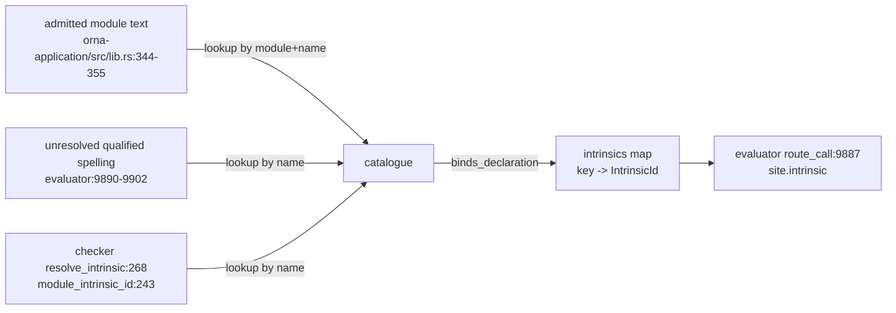
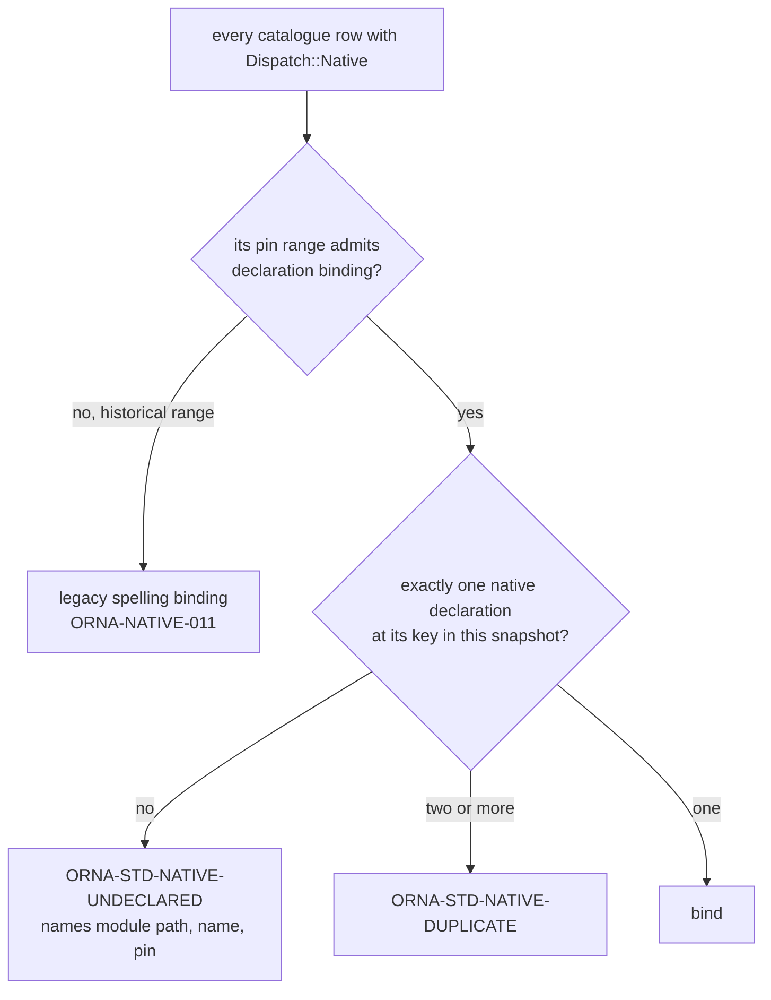

# reform(native-decl): first-class native declarations for the pinned standard library

Status: design proposal. Successor to section 3.4 of
[`docs/design/std-native.md`](std-native.md), whose `fail(...)` marker
convention the owner rejected on 2026-11-10.
Epic: `reform(std-native)` (`ornadb-yuzot`). Beads: `reform(native-decl)`.
Owner order: `ornadb-yuzot`, comment of 2026-11-10 00:56. Owner sign-off for
the specification extension is that order.

Authority: `/home/kieran/dev/ornadb/reference/Orna-1.1.0` (frozen release
`final-2026-10-05`). Implementation evidence: `origin/main` =
`f02dd7c31`, pinned standard library `stdlib/std` =
`fdf63e87cc2ce52f240ba80328c61f31d38153a9`.

Every constraint is cited `file:line` into the reference tree. Every
implementation claim is cited `file:line` into the tree at the commit above.
Every number in section 1 was produced by a command in section 9.

This document changes no production code. The normative text lives in
[`docs/spec-extensions/NATIVE-1.md`](../spec-extensions/NATIVE-1.md).

--------------------------------------------------------------------------

## 0. Summary

The pinned standard library states that 113 of its operations are implemented
by the runtime, and it has no way to say so. It says it three ways instead:
a private `__x` leaf whose body is `fail(error(...))` behind a one-line public
wrapper; a public function whose body is only `fail(error(...))`; and, for a
handful of names, nothing at all. Which of those is in force depends on which
spelling an internal table happens to record, and the evaluator decides per
call whether a *name* is native.

This design adds one declaration form to the language, admitted only in the
pinned standard dependency:

```orna
pub native fn trim(value: Str): Str effect none;
```

It has no body, so it cannot lie. Its signature is the only signature. Its
effect clause is the only effect statement, and it exists because a
body-less declaration has no call graph to derive effects from
(`source/10-execution.md:33`, ORNA-TXN-008; `source/14-pages.md:76`,
ORNA-EVAL-004). It binds to a runtime implementation by
`(declaring module path, declared name)`, at load, before anything is
evaluated; if the implementation is absent the module is rejected and the
error names both sides. `orna-intrinsics` loses `Signature`, `SigType` and
`Effect` and keeps identity, dispatch class, justification and note. The
`__x` leaves, the forwarders, the marker convention and the name tables go.

The pinned `std` remains an ordinary pinned dependency: still imported with
`use`, still resolved by lexical scope, still shadowable, still determined by
the captured snapshot (`source/09-standard-library.md:3,11,13`;
`source/03-source-modules.md:36`). What the amendment removes is a fiction,
not a guarantee.

--------------------------------------------------------------------------

## 1. Current state, measured

### 1.1 The numbers

Catalogue (`crates/orna-intrinsics/std_intrinsics.json`, produced from the
const tables in `crates/orna-intrinsics/src/modules/*.rs`):

| Quantity | Value |
|---|---|
| catalogue entries | 124 |
| of which root intrinsic environment (`Module::Core`) | 5 |
| of which pinned `std` rows | 119 |
| `std` rows with `Dispatch::Native` | 113 |
| `std` rows with `Dispatch::SourceOnly` (`std.math`, deleted Rust arms) | 6 |
| rows dispatched through a private `__leaf` | 56 |
| rows dispatched through the public name | 57 |
| rows with `Dispatch::Host` | 0 (the `orna-sys` link is stage S7) |

Pinned `stdlib/std` at `fdf63e87` (80 `.orna` files):

| Quantity | Value |
|---|---|
| `pub fn` declarations | 630 |
| top-level `fn __x` declarations | 83 (58 distinct names) |
| of those, body is `fail(error(...))` | 68 |
| of those, no marker body (`std.io` host leaves) | 15 |
| `pub fn X(...) = __X(...)` forwarders | 88 |
| of those, not `std.io` | 74 |
| `fail(error(` occurrences in the whole pin | 152 |
| top-level declarations whose whole body is `fail(error(...))` | 123 (68 private, 55 public) |
| of the 55 public ones, actual native markers (`std.query` core re-exports) | 16 |
| `native fn` declarations the migration must write | 129 |
| distinct catalogue identities those declarations bind | 113 |

The 129 is 113 plus 16, not 113 alone: 16 of the pin's native markers are the core
relation re-exports in `stdlib/std/query.orna:254-284`, which are `REEXPORTS`
rows rather than catalogue rows. The language has no `pub use`, so
`std.query.filter` cannot re-export `std.collection.filter`; it needs its own
declaration binding the same identity (section 3.6). The other 23
`REEXPORTS` entries are ordinary one-line delegations and need no declaration.

### 1.2 Two dispatch conventions live in one pin today

Section 3.4 of [`docs/design/std-native.md`](std-native.md) specified one
convention. The pin landed with two, because
`Intrinsic::binds_declaration` (`crates/orna-intrinsics/src/modules/mod.rs:165`)
binds the leaf when a row records one and the public name otherwise:

```rust
pub fn binds_declaration(&self, name: &str) -> bool {
    match self.leaf {
        Some(marker) => marker == name,
        None => self.justification != Justification::SourceExpressible,
    }
}
```

Leaf-bound (56): `std.text` 10, `std.bits` 6, `std.stats` 14,
`std.collection` 4, `std.random` 4, `std.encoding.*` 9,
`std.money` 3, `std.ui` 1, `std.query` 5.

Public-bound (57): `std.collection` 32, `std.stream` 10, `std.time` 6,
`std.hash` 5, `std.concurrent` 3, `std.query` 1.

The two are observably different. A leaf-bound call evaluates the public
wrapper and then the leaf (`stdlib/std/text.orna:17-28`); a public-bound call
never evaluates the declared body at all, because `route_call`
(`crates/orna-evaluator/src/lib.rs:9887`) returns `CallRoute::Native` for the
resolved declaration before the body is entered. So 57 declared bodies in the
pinned source are dead code, and 74 one-line forwarders exist only to move
the call one frame down to a `__` name.

`std.hash` shows the inconsistency inside one module: it declares five marker
leaves with the two-way body (`stdlib/std/hash.orna:12-54`) and the catalogue
nevertheless binds the five public names
(`crates/orna-intrinsics/src/modules/hash.rs`), so its five leaves are
unreachable guards rather than entry points.

### 1.3 The `fail(...)` body cannot identify a native

The owner's objection is not stylistic. A `fail(error(...))` body is what
39 ordinary library functions use for their real behaviour in the same pin,
for example `stdlib/std/url.orna` (13 sites), `stdlib/std/regex.orna` (7),
`stdlib/std/test.orna` (7) and `stdlib/std/net/websocket.orna` (6). Only 16
of the 55 public `fail`-bodied declarations are native markers.

So "this declaration is native" is not recoverable from its body. It is
recoverable only from a name table, which is exactly the mechanism
`source/09-standard-library.md:13` (ORNA-LIB-002) forbids: "it cannot be
filled by an undocumented host library with the same spelling". The marker
was meant to make the binding honest and it does not: the runtime still has
to keep, and still has to trust, a list of spellings.

### 1.4 The declaration is not checked against the catalogue

`crates/orna-intrinsics/tests/no_native_without_declaration.rs:70` is the
whole parity check:

```rust
fn declares(source: &str, name: &str) -> bool {
    source.lines().any(|line| {
        let line = line.trim_start();
        let line = line.strip_prefix("pub ").unwrap_or(line);
        let Some(rest) = line.strip_prefix("fn ") else { return false; };
        rest.strip_prefix(name)
            .is_some_and(|tail| tail.starts_with('(') || tail.starts_with('<'))
    })
}
```

It scans for a name at the start of a line. No test in the workspace compares
a catalogue signature with the pinned declaration; `grep -rn stdlib/std
crates/orna-intrinsics crates/orna-standard-sources` returns the path twice,
once in a doc comment and once in that test. So the 113 signatures in the
catalogue and the 113 in the pinned source are held equal by review alone.

### 1.5 Signatures exist in four places

| Copy | Where | Count |
|---|---|---|
| catalogue `Signature` | `crates/orna-intrinsics/src/signature.rs`, rows in `src/modules/*.rs` | 124 |
| export projection | `crates/orna-intrinsics/std_intrinsics.json` | 124 |
| pinned declaration | `stdlib/std/*.orna` | 113 natives |
| checker rules | `crates/orna-check/src/intrinsics.rs` (1,255 lines; `infer_intrinsic` 520-868, `check_intrinsic_constraints` 941-1128, `check_bucket_by` 1128-1187, `ROOTED_COLLECTION_HELPERS` 196) | per-family rules |

`intrinsic.signature` is read at `crates/orna-evaluator/src/lib.rs:7811`,
`:10158` (argument ordering and arities) and at
`crates/orna-check/src/intrinsics.rs:396`, `:529`, `:1196` (typing). Those
six sites are the reason a signature cannot simply be deleted today: nothing
else supplies parameter names, defaults or arities at the call site.

### 1.6 Binding is decided by a name, in four places



Four consequences, each observed:

1. `crates/orna-application/src/lib.rs:344-355` decides binding from
   `signature.name` and a module path derived by string surgery on the
   namespace (`namespace.strip_prefix("std.time.")`).
2. `crates/orna-evaluator/src/lib.rs:9890-9902` still dispatches a *qualified
   spelling* that resolved to nothing, so `std.<module>.<name>` reaches a
   Rust arm without any declaration existing. That is the ORNA-LIB-002 breach
   the reform set out to remove, and it survives stage S2.
3. `crates/orna-evaluator/src/lib.rs:9903-9911` additionally routes *every*
   unresolved `std.math.*` spelling to `IntrinsicId::MathIncrement`.
4. `crates/orna-check/src/intrinsics.rs:243-265` decides that a call is
   native from the name, with `if name.starts_with("__")` as one of its
   conditions and a per-family `is_registry_typed` allow-list
   (`:205`).

### 1.7 The wrapper cannot be repaired in place

`stdlib/std/text.orna:17-28` is representative:

```orna
fn __trim(value: Str): Str =
    fail(error(
        code: "ORNA-EVAL-UNSUPPORTED",
        message: "std.text.trim is a native intrinsic"
    ));
...
pub fn trim(value: Str): Str = __trim(value);
```

Three defects, all structural:

* The leaf body is false. It is not a trim; it is a failure that never runs
  when the table entry exists and runs only when the entry is missing.
* Delete the catalogue row and the program returns a failure for an operation
  the spec requires (`source/09-standard-library.md:130`), instead of failing
  to load.
* For the 12 public-bound modules the wrapper is dead but the leaf marker is
  live, so the same file contains one convention that runs and one that does
  not.

`stdlib/std/collection.orna:6-27` and `stdlib/std/query.orna:254-284` use yet
another shape: a public function whose entire body is the marker, so a caller
of `std.query.filter` sees a failure comment where an implementation should
be.

### 1.8 Twelve declarations are direct self-calls

A fourth shape is worse than a lie because it terminates only by accident.
Twelve public declarations call themselves by their own qualified name:

`stdlib/std/concurrent/main.orna:13` -

```orna
pub fn parallel<T>(callbacks: [fn(): T]): [T] = std.concurrent.parallel(callbacks);
```

and the same pattern for `race` (`:28`), `timeout` (`:35`) and `sleep` (`:44`), plus
`stdlib/std/stream.orna` for `for_each` (`:26`), `batch` (`:31`), `buffer`
(`:35`), `merge` (`:40`), `throttle` (`:45`), `debounce` (`:51`), `retry`
(`:56`) and `recover` (`:63`).

Each of the twelve terminates only because an internal table happens to
contain the spelling, so the evaluator never enters the body. Remove the row,
or resolve the call through a path the table does not cover, and the call
recurses without bound until the recursion limit fires. This is the exact
failure the owner named: the declaration does not describe an implementation,
it depends on one being recognised from outside.

### 1.9 Historical pins use a third convention

`crates/orna-evaluator/tests/fixtures/module-upgrade-std-collection-v4.orna:1`

```orna
fn __list_length<T>(values: [T]): Int = 0;
```

The six `legacy` catalogue rows (`crates/orna-intrinsics/src/modules/retired.rs`,
`PinRange::HISTORICAL_V4_V5` at `crates/orna-intrinsics/src/pin.rs:31`) exist
because captured snapshots in the v4/v5 fixtures declare these leaves with
lying bodies and no marker. Any mechanism that is not additive breaks them.

### 1.10 What the grammar can express today

| Requirement | Grammar today |
|---|---|
| a function with no body | only `protocol_function` (`grammar/orna.ebnf:69-71`), a protocol member |
| an attribute or annotation | no production exists (`source/34-grammar.md` has none) |
| a declaration that is native | no production exists |
| `pub use` / re-export | no: `use_declaration = "use" , ...` (`grammar/orna.ebnf:27`) takes no visibility |
| a new keyword | `source/04-lexical.md:29` (ORNA-LEX-007) fixes the exact set of 31; `crates/orna-syntax/src/lexer.rs:8-40` implements exactly those 31 |

The absent `pub use` matters for the target design. `source/09-standard-library.md:9`
requires that `std.query` and `std.stream` "may re-export the intrinsic
operators with identical identities and behaviour", and the language cannot
spell a re-export. That is why `stdlib/std/query.orna:254-284` contains 16
marker-bodied public declarations: they are the only way the pin could make
the names reachable. A form that states an identity *is* the re-export the
spec asks for, and it is the first form in the language that can express one.

--------------------------------------------------------------------------

## 2. Prior art

Ten systems have solved "the declaration is in library source, the
implementation is in the runtime". What each one settled, and what transfers.

### 2.1 rustc `#[rustc_intrinsic]`: the compiler checks the declared signature

Intrinsics are declared with a real Rust signature and no body in
`library/core/src/intrinsics/mod.rs`, and
`compiler/rustc_hir_analysis/src/check/intrinsic.rs` compares the
declaration's generics, parameter types and result type against the
compiler's expected signature, emitting
`WrongNumberOfGenericArgumentsToIntrinsic` and friends.
<https://github.com/rust-lang/rust/blob/master/compiler/rustc_hir_analysis/src/check/intrinsic.rs>

This is the same problem: the declaration is pinned library source, the
implementation is the engine. rustc does not deduplicate the signature; it
makes the duplication machine-checked and refuses to build when the two
disagree.

Transfer: wholesale. Keep the declaration, keep the implementation in Rust,
and make the pair a load-time or build-time check rather than a convention.
Reject: a compiler-owned namespace. Orna's `std` is optional and replaceable
(`source/03-source-modules.md:36`, ORNA-NS-007), so the check must be
conditional on the admitted snapshot, not on the name.

### 2.2 Rust `extern "C"` blocks and lang items

An `extern` block declares a foreign symbol with a Rust signature; the
signature is authoritative for callers, and a missing symbol is a link
error, not a run-time surprise.
<https://doc.rust-lang.org/reference/items/external-blocks.html>
Lang items are the opposite arrangement: an identity (a `LangItem` enum
variant) that the standard library binds by an attribute, so the name in
source is not the identity.
<https://doc.rust-lang.org/unstable-book/language-features/lang-items.html>

Transfer: the identity is separate from the spelling, which is exactly the
`IntrinsicId`-plus-declaration split; and a signature on a body-less
declaration is a normal, accepted shape.
Reject: `extern` as the keyword. `extern "C"` names a foreign calling
convention and a symbol mangling rule. An Orna native has neither: it is
called with Orna values through the ordinary call path.

### 2.3 WebAssembly imports: link-time, all-or-nothing, before mutation

An import declares `(module, name, signature)`. Validation checks the type;
instantiation is given the external values for the imports and "may *fail*
with an error otherwise", and "all failure conditions are checked before any
observable mutation of the store takes place"
(`document/core/exec/modules.rst`).
<https://github.com/WebAssembly/spec/blob/main/document/core/exec/modules.rst>

Transfer: this is the admission model. Binding is a link step over a
declared import set; a missing import stops the instance from being created;
the check precedes any effect. Orna's load is an instantiation and its
"imports" are the pinned declarations.
Reject: numeric indices. Orna identity is a namespace path and a name.

### 2.4 PostgreSQL `LANGUAGE internal AS 'symbol'`: checked at creation

`CREATE FUNCTION f(...) ... LANGUAGE internal AS 'name'` binds a declared
signature to a backend symbol. The validator runs at creation and errors
`there is no built-in function named "name"` with `ERRCODE_UNDEFINED_FUNCTION`
(`src/backend/catalog/pg_proc.c`, `fmgr_internal_validator`, which notes it
deliberately ignores `check_function_bodies` because "it is unlikely the
function name will be found later if it isn't there now").
<https://www.postgresql.org/docs/current/sql-createfunction.html>
<https://github.com/postgres/postgres/blob/master/src/backend/catalog/pg_proc.c>

Transfer: missing implementation is a *creation* error, named after the
missing symbol, and the signature comes from the declaration, not from the
runtime table. Direct analogue of ORNA-NATIVE-006.
Reject: symbol strings in source. The binding key must be the module path and
name the source already uses, so no second identity appears in the pin.

### 2.5 Swift `@_silgen_name` and `_extern`: attribute plus Sema validation

`DeclAttr.def:64` defines `_silgen_name`, `:782` defines `_extern`; Sema
diagnoses `extern_not_at_top_level`, `extern_empty_c_name` and
`extern_c_maybe_invalid_name` (`lib/Sema/TypeCheckAttr.cpp`).
<https://github.com/swiftlang/swift/blob/main/include/swift/AST/DeclAttr.def>
<https://github.com/swiftlang/swift/blob/main/lib/Sema/TypeCheckAttr.cpp>

Transfer: the placement and naming rules are enforced in semantic analysis
with their own diagnostics, not left to code generation.
Reject: attributes. Orna has no attribute production
(`source/34-grammar.md`), so an attribute form is a lexer change plus a
parser change plus a formatter change, for a restriction that a contextual
keyword expresses for free.

### 2.6 Kotlin/Native `external fun`: body-less and link-checked

An `external` declaration has no body; its implementation is supplied by a
linked library, and an unresolved one fails at link or first use.
`cinterop` goes the other way and *generates* Kotlin stubs from C headers,
which is the arrangement Orna's `orna-sys` already uses for `sys` operations.
<https://kotlinlang.org/docs/native-c-interop.html>

Transfer: `external`-style body-less declarations are ordinary declarations
for resolution, typing, documentation and navigation; only the
implementation is elsewhere.
Reject: generated declarations for `std`. A generated stub would make a
program's declarations come from the binary rather than the captured
snapshot, which `source/09-standard-library.md:11` (ORNA-LIB-001) forbids.

### 2.7 TypeScript `declare function`: declaration without implementation

`declare function f(x: T): U;` declares a callable with no body; the
declaration file is never executed and exists for the type checker.
<https://www.typescriptlang.org/docs/handbook/declaration-files/by-example.html>

Transfer: a body-less, fully typed declaration is a first-class declaration,
and hovering or navigating to it is the normal editor experience.
Reject: ambient-by-default. An Orna native declaration must be an error when
it is not backed, because OrnaDB executes.

### 2.8 Lua `luaL_Reg`: the cautionary case

Each library is a flat `{"name", function}` array registered at open time
(`lbaselib.c`); arity and types are not declared anywhere.
<https://github.com/lua/lua/blob/master/lbaselib.c>
<https://www.lua.org/manual/5.4/manual.html#luaL_Reg>

Transfer: one table per module, which the design keeps as one catalogue file
per module.
Reject: name-plus-pointer tables without declarations. That is the state
section 1.6 documents, and its failure mode is Orna's today.

### 2.9 CPython: builtin modules plus Argument Clinic

Builtin functions are declared in the C source with
`/*[clinic input] ... [clinic start generated code]*/` blocks; `clinic.py`
generates argument parsing and conversion, and the generated file records a
checksum of the declaration block so a stale generation fails the build.
<https://github.com/python/cpython/blob/main/Tools/clinic/clinic.py>
<https://docs.python.org/3/c-api/intro.html>

Transfer: the declaration is the single source of the argument contract, and
the generated artefact carries a digest of what it was generated from. That is
the design's `signature_digest` per catalogue entry and the `build.rs`
freshness check (`crates/orna-intrinsics/build.rs`).
Reject: code generation of the declaration. In Orna the declaration is
written in Orna and nothing needs generating.

### 2.10 SQLite loadable extensions: registration, not declaration

`sqlite3_create_function` registers a function pointer by name at run time;
a loadable extension is a shared object opened later
(`src/func.c`, `sqlite3RegisterBuiltinFunctions`).
<https://www.sqlite.org/loadext.html>

Transfer: the arity/name/pointer triple belongs together, one table per
module.
Reject: run-time registration. `std` is pinned, not user-extensible at run
time (`source/09-standard-library.md:11`). Orna's equivalent of "load an
extension" is "admit a different pinned snapshot".

### 2.11 What does not transfer

* Numeric identities as protocol (PostgreSQL OID, wasm indices): Orna has no
  intrinsic numbering in the spec and must not invent an observable one.
* `unsafe` classes (rustc) as the declaration axis: Orna's axis is the effect
  set, and the spec already fixes its vocabulary (`api/sys.json`,
  `sys.EffectKind`).
* A compiler-owned namespace (rustc, Swift): `std` is replaceable
  (ORNA-NS-007), so a native declaration binds only inside an admitted
  pinned dependency.

--------------------------------------------------------------------------

## 3. Target design

### 3.1 Surface syntax: five candidates

| Form | Grammar cost | Honesty | Verdict |
|---|---|---|---|
| A `pub native fn f(x: T): U effect E;` | one alternative in `top_level_item`, four productions, no lexer change | the word says what it is; no body to mislead | **chosen** |
| B `pub fn f(x: T): U;` (body-less) | one alternative folded into `function_declaration` | minimal, but nothing distinguishes a native from a typo or a misplaced protocol member; also silently admitted in user source | rejected |
| C `pub fn f(x: T): U = native;` | one new expression production | reintroduces exactly the placeholder body the owner rejected, one level of indirection down | rejected |
| D `#[native(effect: E)] pub fn ...` | a lexical class, an attribute production, formatter support | conventional in other languages, but the frozen grammar has no attribute production at all and every other Orna declaration is keyword-led | rejected |
| E `extern fn` | same as A | names a foreign calling convention Orna does not have | rejected |

Form A is the only one where the surface token carries the claim, the
restriction is syntactic (only a top-level item can be native), and no
existing production or lexical rule changes.

### 3.2 The form

```orna
// std.text: today a marker leaf behind a forwarder.
pub native fn trim(value: Str): Str effect none;

// std.stats: today a marker leaf; the public wrapper carries the defaults.
pub native fn mean<T>(rows: [T], scale: Int? = null, rounding: Str? = null): T?
    effect none;

// std.bits: today a marker leaf behind a forwarder.
pub native fn bit_or(left: Int, right: Int): Int effect none;

// std.random: today a marker leaf; the operation reads host entropy.
pub native fn integer(lower_inclusive: Int, upper_exclusive: Int): Int
    effect randomness;

// std.concurrent: today the declaration is a direct self-call
// (`= std.concurrent.parallel(callbacks)`).
pub native fn parallel<T>(callbacks: [fn(): T]): [T] effect none;

// std.hash: today a marker leaf; the hashing itself reads no host state.
pub native fn sha256(input: Blob): Digest effect none;

// std.query: today a marker leaf under a validating public wrapper. The
// wrapper stays as ordinary source (see the merge rule below); the leaf keeps
// its spelling and becomes a declaration instead of a lying body.
native fn __window_rate<T>(
    points: [(Instant, T)], size: Int, step: Int
): [T?] effect none;
```

Properties, all of them consequences of the form and not of a convention:

* There is no body, so there is no body to be wrong.
* Every parameter has a type and the result has a type, because there is no
  body to infer from. An unannotated parameter or result is a syntax-adjacent
  admission error (ORNA-NATIVE-001).
* Visibility is the reachability. Today `std.ui.node` has no public
  declaration at all: `stdlib/std/ui.orna:5-15` declares a private `__node`
  and 17 public constructors that call it, and the catalogue registers the
  private leaf under the public label `std.ui.node`. A declaration states the
  reachability in one place.
* Defaults and arity are the declaration's. `std.stats.mean` states
  `scale: Int? = null`, so the admissible arities follow; the catalogue's
  `arities: [1, 3]` field becomes derivable and is deleted.
* The tail of a call is not special. A pipeline supplies argument one
  (`source/09-standard-library.md:21`) for every call, so the catalogue's
  per-parameter `pipeline` flag is also derivable and is deleted.
* `Relation<T>` and `Stream<T>` in the signature are the only statement of
  container overloading, because they are the types
  (`source/09-standard-library.md:19`).

#### The merge rule (which of the two declarations survives)

The pin's 56 leaf-bound operations split in two, and the split decides what the
migration does to each file:

* **Pure forwarder wrapper.** The wrapper is `pub fn x(p) = __x(p);` and does
  nothing else - `stdlib/std/text.orna:17-28`, `stdlib/std/bits.orna:9-39`,
  `stdlib/std/hash.orna:12-17`, `stdlib/std/random.orna:20-21`,
  `stdlib/std/money.orna`, the codecs. The two declarations are merged into one
  `pub native fn x(...)` that carries the public parameter list (defaults
  included) and the result type, and both the leaf and the wrapper are
  deleted. A test asserts that no `pub fn x(...) = __x(...)` remains.
* **Validating wrapper.** The wrapper performs a check before delegating -
  `stdlib/std/query.orna:173-198` (`ordered_time_series` rejects a non-positive
  size, a non-positive step, fewer than two points and unordered timestamps)
  _and_ `stdlib/std/query.orna:202-207`. The runtime does not perform that
  check: `window_time_series_statistics`
  (`crates/orna-evaluator/src/lib.rs:14305-14344` at `09546575e`, `:14521` at
  the measurement commit `f02dd7c31`) starts at
  `positive_collection_size` and never validates ordering. So the wrapper
  stays as ordinary source and the leaf becomes a private
  `native fn __window_rate(...)`.

The rule is: a wrapper may only be deleted when deleting it changes no
observable failure. Where it cannot be deleted, the declaration replaces the
leaf and the wrapper remains honest source that delegates. Nothing in the
design requires a wrapper to disappear; it requires a declaration to be the
only place that claims to be native.

### 3.3 Grammar delta

Added to `top_level_item` (`grammar/orna.ebnf:14`, `source/34-grammar.md:19`):

```ebnf
top_level_item    = use_declaration
                  | native_declaration
                  | table_declaration
                  | function_declaration
                  | protocol_declaration
                  | enum_declaration
                  | dimension_declaration
                  | unit_declaration
                  | type_declaration
                  | assertion_statement
                  ;
```

New productions:

```ebnf
(* A native declaration states that the pinned dependency supplies the
   implementation. It has no body, so every type is written out. *)
native_declaration = visibility , "native" , "fn" , identifier ,
                     [ generic_parameters ] ,
                     "(" , [ native_parameters ] , ")" ,
                     ":" , type_expression ,
                     "effect" , native_effect_set , ";" ;
native_parameters  = native_parameter , { "," , native_parameter } , [ "," ] ;
native_parameter   = identifier , ":" , type_expression , [ "=" , expression ] ;
native_effect_set  = "none" | effect_class , { "," , effect_class } ;
effect_class       = identifier ;
```

No other production changes. `visibility` (`grammar/orna.ebnf:25`),
`generic_parameters` (`:60`), `type_expression` (`:111`) and
`function_parameters` (`:56`) are reused as they are. `native_parameter` is
`function_parameter` without the `self` alternative, expressed as its own
production so the restriction is visible in the grammar rather than only in
prose.

Lexical consequences: **none**. `native`, `effect` and `none` are not
keywords and MUST NOT become keywords; ORNA-LEX-007
(`source/04-lexical.md:29`) is unchanged. Because `contextual_name` already
admits `identifier` (`grammar/orna.ebnf:270`), `native` and `effect` are
usable as field names, member names, parameter names and function names
exactly as they are today.

Disambiguation: no top-level item today begins with an identifier
(`use`, `table`, `fn`, `protocol`, `enum`, `dim`, `unit`, `type`, `assert` are
keywords), so `native` followed by `fn` is recognised with two tokens of
lookahead and no existing source changes meaning (ORNA-NATIVE-002).

### 3.4 Normative clauses

Fifteen clauses, numbered `ORNA-NATIVE-001` to `ORNA-NATIVE-015`. The full
text is the amendment document
[`docs/spec-extensions/NATIVE-1.md`](../spec-extensions/NATIVE-1.md); the
substance is:

| Clause | Subject | Enforcement |
|---|---|---|
| 001 | Form: no body; result type and every parameter type required; no `self`. | parser + admission |
| 002 | Recognition: two-token lookahead at top level; no new keyword; ORNA-LEX-007 unchanged. | parser tests |
| 003 | Placement: module-unit top level only; not in `repl_input`, `impl`, `protocol`, `table`, `type`, row units. | parser tests |
| 004 | Authority: only a module of the admitted pinned `std` dependency may declare one. | loader |
| 005 | Binding key: declaring module namespace path and declared name; duplicates rejected; two spellings of one identity must carry structurally equal signatures. | loader + parity test |
| 006 | Implementation required: absent implementation is a load error naming module path, name and pin, before evaluation; no placeholder and no deferred failure. | loader |
| 007 | Implementation must be declared: at a pin whose catalogue admits declaration binding, every bound implementation has exactly one declaration; a missing one is a load error. | loader + parity test |
| 008 | Signature authority: the declaration's signature is the function's type for typing, argument order, named arguments, defaults, arity and result; nothing restates it. | checker |
| 009 | Effect clause: mandatory; a set from the closed `sys.EffectKind` vocabulary or `none`; container/plan aspects are carried by `Stream<T>`/`Relation<T>`. | parser + checker |
| 010 | Effect checking: the clause is the only admissible source of a native's effect set, because a body-less declaration has no call graph. | checker |
| 011 | Historical pins: what a pin does is decided by its captured text, never by a version number; a pin without the declaration keeps the mechanism its text supports. | loader |
| 012 | User programs: a native declaration is not admitted outside the pinned dependency; a replaced `std` that declares one is rejected, one that does not is ordinary source. | loader |
| 013 | No name-based dispatch: an implementation is reached by the identity bound to a resolved declaration, not by a spelling matching a table (restates ORNA-LIB-002 for the evaluator). | evaluator + grep guard |
| 014 | Introspection: a native declaration is a public declaration for resolution, imports, documentation, hover, completion and go-to-definition; `sys` reports its declared signature and effect set; no new `sys` member. | LSP + docs |
| 015 | ABI: a pin's native ABI is its set of `(module path, name, lowered signature, effect set)`; a change in a published pin is a new pin; a mismatch is a load error, never adaptation. | loader + `signature_digest` |

#### Which specification clauses this adds or touches

Added:

* a new subsection in chapter 9 (standard library) carrying ORNA-NATIVE-001 to
  015;
* the grammar production above in chapter 42 and in `grammar/orna.ebnf`;
* three load diagnostics: `ORNA-STD-NATIVE-UNBOUND`,
  `ORNA-STD-NATIVE-UNDECLARED`, `ORNA-STD-NATIVE-SCOPE`, plus the parser
  diagnostics `ORNA091-E-NATIVE-BODY`, `-NATIVE-TYPE`, `-NATIVE-SELF`,
  `-NATIVE-EFFECT`, `-NATIVE-PLACE`.

Touched, narrowly:

* `source/09-standard-library.md:3` ("ordinary, explicitly imported library
  code"). Amended to: ordinary in every observable way (imported, resolved,
  shadowable, pinned, documented, typed), except that the reference library
  profile may state that an implementation is supplied by the runtime.
* `source/09-standard-library.md:15` (ORNA-LIB-003, "when supplied under the
  reference-library profile"). Now matched to a declaration set instead of an
  unstated set. The clause's own conditional is the hook, which is why no
  semantic change is needed.
* `source/09-standard-library.md:9` (re-export with identical identity). The
  clause is reaffirmed and, for the first time, expressible.

Not touched: ORNA-LEX-007 (keyword set); ORNA-SOURCE-001/002/003;
ORNA-LIB-001/002/004/005/006/007; ORNA-NS-005 through 008; ORNA-TXN-007/008;
ORNA-EVAL-004; chapters 5, 6, 10, 11, 14, 29; `api/sys.json` gains no member;
no existing diagnostic code changes meaning.

Two defects in the frozen release are worth recording while touching the
grammar: `grammar/orna.ebnf:1` says "Orna 1.0.0 syntactic grammar" while
`source/34-grammar.md:6` says "Orna 1.1.0", and the two copies of the grammar
must be edited together (stage N7).

### 3.5 Where a native declaration may appear

Three layers, each with a distinct failure mode:

1. **Syntax**: only as a `top_level_item` of a module unit
   (ORNA-NATIVE-003). The REPL entry point (`repl_input`,
   `grammar/orna.ebnf:7-11`) does not admit it, so a prompt cannot declare
   one. `impl_member` and `protocol_member` do not admit it, so a nested
   implementation cannot either.
2. **Admission**: only a module whose logical path is a standard module path
   and whose bytes were verified against the admitted
   `StandardDependencyProfile` (`crates/orna-check/src/lib.rs:108-114`,
   `from_sources` at `:133`) may contain one (ORNA-NATIVE-004). The
   predicate already exists; the check is one branch in the loader.
3. **Pin**: only the reference or a project-captured standard dependency. A
   module loaded from the project's own tree, from an attachment, or from a
   generated stub is not a standard module.

Consequence: "user code may not declare native" is not a policy, it is a
parse error followed by a load error. A test asserts both.

### 3.6 Binding key and the two admission errors

The binding key is `(declaring module namespace path, declared name)`.

The module path is the *namespace the declaration is written in*, not the
catalogue's coarse `Module` family: `std.time.duration.compact` with name
`format`, not `Module::Time` with name `duration.compact.format`. That is the
only way the dotted operation labels in the current catalogue
(`std.time.duration.{compact,clock,words,iso}.format`) become ordinary
declarations.

The declaration carries no identity token. An `IntrinsicId` in source would
publish internal structure that the spec does not have and that the
catalogue's own design excluded; it would also let a pin rename its identity
without changing its text.

Admission, at load, before any evaluation:

```mermaid
flowchart TD
    A[parse admitted module] --> B{native declaration?}
    B -->|no| C[ordinary function<br/>body is the implementation]
    B -->|yes| D{module is a verified<br/>standard module?}
    D -->|no| E["ORNA-STD-NATIVE-SCOPE<br/>names module path + name + file:line"]
    D -->|yes| F{catalogue entry for<br/>(module path, name)?}
    F -->|no| G["ORNA-STD-NATIVE-UNBOUND<br/>names module path, name, pin"]
    F -->|yes| H{catalogue says Native<br/>and pin admits it?}
    H -->|no| I["ORNA-STD-NATIVE-UNBOUND<br/>catalogue row is SourceOnly/retired"]
    H -->|yes| J{lowered declaration signature<br/>equals catalogue digest?}
    J -->|no| K["ORNA-STD-NATIVE-BINDING<br/>both signatures shown"]
    J -->|yes| L[bind IntrinsicId to the declaration]
```

and, over the whole admitted snapshot, the reverse direction:



Both directions are load errors, both name the module path and the function
name, and both are raised before evaluation (ORNA-NATIVE-006/007). They are
the PostgreSQL `there is no built-in function named "x"` and the wasm
instantiation check, applied to a pinned dependency.

Why direction two is an error at the reference pin and not at a historical
one: a historical pin's catalogue rows carry a legacy binding for that pin's
identity (ORNA-NATIVE-011), so its missing declaration is expected, not a
defect. The current pin has no such excuse, and the check is what keeps a
future pin bump honest.

### 3.7 The signature is the single typing source

After the change, for a native:

| Fact | Sole source |
|---|---|
| parameter names and order | the declaration |
| parameter types | the declaration |
| defaults and admissible arities | the declaration |
| result type | the declaration |
| generic parameters and bounds | the declaration |
| visibility and reachability | the declaration (`pub` or not) |
| effect set | the declaration's `effect` clause |
| identity and dispatch class | the catalogue |
| why it is native at all | the catalogue's `justification` and `note` |

The declaration's types are the ones the checker already lowers: the std
source is parsed into `Declaration` items (`crates/orna-syntax/src/parser.rs:248`)
with a `FunctionSignature` (`:321`), so a native declaration reuses
`FunctionSignature` unchanged and needs no second lowering path.

The projected signature (the current `SigType` language) is deleted from the
catalogue. Where a structural comparison is still needed - direction three of
the admission check above, and the ABI digest - it is computed by lowering the
declaration once and hashing the result, so there is one stored form (the
source) and one derived form (the digest).

### 3.8 Effect class

The specification has exactly one machine-readable effect vocabulary:
`sys.EffectKind`, twelve values (`api/sys.json`, enums), mirrored by
`crates/orna-check/src/effects.rs:11-24`:

```
table_read, table_write, network, filesystem, process, clock,
randomness, secret_access, ui, git, storage_admin, runtime_admin
```

The clause is mandatory and is a set:

```orna
pub native fn throttle<T>(stream: Stream<T>, duration: Duration): Stream<T> effect clock;
pub native fn integer(minimum: Int, maximum: Int): Int effect randomness;
pub native fn now(): Instant effect clock;
pub native fn node(kind: Str, fields: [UiField]): Ui effect ui;
pub native fn read_text(path: Path): Str effect filesystem;
pub native fn trim(value: Str): Str effect none;
```

`none` is the empty set and the only spelling outside the twelve.

Three things this deliberately does not do:

* It does not widen `sys.EffectKind`. The vocabulary is spec-fixed and
  describes host boundaries; a native's host effects fall inside it or are
  absent.
* It does not reuse `orna_intrinsics::Effect`'s seven classes. `PinnedData`,
  `Stream` and `Query` are not host effects: pinned data is captured, so it
  is snapshot-deterministic by ORNA-LIB-001; stream waiting and checkpoint
  behaviour, and plan evaluation, are carried by `Stream<T>` and `Relation<T>`
  (`source/09-standard-library.md:19`, `:81-89`, `:112-124`). Conflating them
  with host effects is the category error that leaves the current `Effect`
  unused by the checker (`crates/orna-check/src/effects.rs` never reads it).
* It does not make an effect clause optional with an inferred default. There
  is nothing to infer from (ORNA-NATIVE-010).

Effect checking itself does not change: the checker derives effects from the
resolved call graph where a body exists (ORNA-TXN-008, ORNA-EVAL-004) and now
reads the clause where a body does not.

### 3.9 How `orna-intrinsics` shrinks

Before (`crates/orna-intrinsics/src/modules/mod.rs:136-171`):

```rust
pub struct Intrinsic {
    pub id: IntrinsicId,
    pub module: Module,
    pub name: &'static str,
    pub leaf: Option<&'static str>,
    pub signature: Signature,        // 113 duplicated signatures
    pub effect: Effect,              // a second effect vocabulary
    pub dispatch: Dispatch,
    pub justification: Justification,
    pub note: &'static str,
    pub pins: PinRange,
}
```

After:

```rust
pub struct Intrinsic {
    pub id: IntrinsicId,
    pub module: Module,              // family routing and diagnostics
    pub declaration_path: &'static str, // half the binding key
    pub declared_name: &'static str,    // half the binding key
    pub dispatch: Dispatch,
    pub justification: Justification,
    pub note: &'static str,
    /// Spellings earlier pins used for this identity. Never used at a pin
    /// that carries a declaration (ORNA-NATIVE-011).
    pub legacy: &'static [LegacySpelling],
}

pub struct LegacySpelling {
    pub pins: PinRange,
    pub spelling: &'static str,      // e.g. "__trim" or "map"
}
```

Deleted: `signature.rs` (`SigType`, `Param`, `Signature`, `render`, 193
lines), `effect.rs` (44 lines), and the `leaf`, `signature`, `effect`, `pins`
fields from all 124 rows. What remains per row is what a reviewer must read:
which identity, which implementation class, why it is native, and what earlier
pins called it. The 113 signatures stop being a second place to be wrong.

`PinRange` (`crates/orna-intrinsics/src/pin.rs:17`) keeps identity comparison
and gains `legacy` ranges. Its own doc comment already anticipates the
widening: "a later stage may widen this to an ordered range once the project
exposes a total order over pins" - this design does not need a total order,
because the era is decided by the captured text.

### 3.10 How `orna-check` types a native call

Today the checker decides "is this native" from a spelling
(`crates/orna-check/src/intrinsics.rs:243-297`) and then reads the catalogue
signature (`:529`, `:1196`). After the change:

1. Resolution puts a `SymbolKind::Native { id }` in scope for the declaration,
   exactly as it puts `SymbolKind::Function` there today. A qualified call
   `std.text.trim(v)` resolves to that symbol; an alias import resolves to the
   same symbol; a local function of the same name shadows it
   (`crates/orna-check/src/scope.rs`, unchanged rule).
2. Typing lowers the declaration's `FunctionSignature` with the existing
   `TypeExpr` -> `Type` path and checks arguments against it. Named
   arguments, defaults and arity come from the same `Vec<Parameter>` the
   ordinary path uses, so a native call and a source call type identically.
3. One rule remains intrinsic-specific and stays: container overload
   selection (`[T]` versus `Relation<T>`) is chosen from the first argument's
   type, and the contextual-lambda rule binds a `fn(T): U` parameter's
   argument against the substituted function type. Both are properties of the
   *declared types*, not of a table.
4. Effects come from the clause (section 3.8).

Deleted from the checker: `is_registry_typed` (`:205`), the
`std.math`-and-`__`-prefix conditions of `module_intrinsic_id` (`:243-265`),
`ROOTED_COLLECTION_HELPERS` (`:196`) once root names come from
`ROOT_NAMES`/`root_intrinsic`, and the two `intrinsic.signature` reads
(`:529`, `:1196`). The family-specific rules (`infer_collection_call`,
`infer_statistics_call`, `check_bucket_by`, `check_intrinsic_constraints`)
keep their semantics but take their types from the declaration.

### 3.11 How the evaluator dispatches

Dispatch is already by id (`crates/orna-evaluator/src/lib.rs:9887`,
`:10172`). Three changes:

1. Delete the unresolved-spelling fallback (`:9890-9902`) and the `std.math`
   catch-all (`:9903-9911`). A call whose callee is a qualified spelling with
   no resolved declaration is now an ordinary unresolved-name diagnostic
   (ORNA-NATIVE-013). This closes the ORNA-LIB-002 breach that survived S2.
2. Take parameter names, defaults and arities from the bound declaration
   instead of `intrinsic.signature.params` (`:7811`, `:10158`). The binding
   site already has the declaration, so the intrinsic map stores
   `(IntrinsicId, Vec<Parameter>)`.
3. Keep `dispatch(id, ...)` exhaustive (`:10172`). An id with no arm is a
   compile error, which is the structural guarantee PostgreSQL gets from
   `Gen_fmgrtab.pl` and rustc from `check_intrinsic_type`.

One call frame disappears per leaf-bound native: today
`std.text.trim(v)` is `call wrapper -> call leaf -> dispatch`; after, it is
`dispatch`. [INFERENCE] That is a constant-factor win on the call path, not a
change in asymptotics; the step harness in
[`docs/design/std-native.md`](std-native.md) section 5.2 measures it rather
than asserting it.

### 3.12 How a user sees it

Nothing a user writes changes. A program still writes

```orna
use std.text;
let name = std.text.trim(raw);
```

What changes is what the tooling can say about it.

| Surface | Today | After |
|---|---|---|
| go-to-definition from a call | lands on `pub fn trim(value: Str): Str = __trim(value);`, whose body is a forwarder | lands on `pub native fn trim(value: Str): Str effect none;` - there is no second hop because there is no second declaration |
| hover | the wrapper's signature | same signature, plus "native: implemented by the OrnaDB runtime; pinned `std` at `<pin>`; effect: none", sourced from the catalogue's `note` |
| completion and signature help | the wrapper | the declaration; defaults and arity come from the declaration |
| the editor's read-only std copy | `orna/std/<digest>/std/<module>.orna` (`crates/orna-lsp/src/standard.rs:8-10`) | unchanged, and now the file a user reads is the truth |
| `orna check` diagnostics | a missing binding is a run-time `ORNA-EVAL-UNSUPPORTED` failure | a load diagnostic naming the module path, function and pin, before evaluation |
| reference docs / API export | generated from a table that restates signatures | generated from the parsed pin; the table cannot disagree |

`sys` introspection gains nothing (ORNA-NATIVE-014): no member is added to
`api/sys.json`, and `sys.resolve`/`sys.describe` report the declaration as an
ordinary function with its declared signature and effect set.

No new `sys.ObjectKind` is introduced. The `extension` variant that already
exists there means a source package extension, not a native operation.

### 3.13 Formatter

The formatter (currently `crates/orna-lsp/src/formatting.rs`, 272 lines, over
`crates/orna-syntax`) must emit the declaration idempotently:

```orna
pub native fn mean<T>(
    rows: [T],
    scale: Int? = null,
    rounding: Str? = null
): T? effect none;
```

Rules: one `native` keyword on the `pub` line; the effect clause stays on the
closing line, after `: T?`; a multi-clause effect set keeps source order,
because order is not semantic and rewriting it would churn pins. Acceptance
is `format(parse(text)) == text` over the whole pinned tree plus a
`format(parse(format(x))) == format(x)` property over the fixture corpus, and
the formatting test asserting a native module re-parses.

### 3.14 Historical pins and the legacy reading rule

The rule is: **the mechanism follows the captured text, not a version
number.**

For an admitted snapshot, per catalogue identity:

1. If the snapshot declares `native fn <name>` under the identity's
   `declaration_path`, that declaration binds it (modern path).
2. Otherwise, if the catalogue has a `LegacySpelling` whose `pins` contains
   the admitted pin, that spelling binds it (legacy path).
3. Otherwise nothing binds it, and it is source.

Case by case:

| Pin | What its text contains | What binds |
|---|---|---|
| `fdf63e87` (current) | `fn __x` markers and public forwarders | legacy path |
| v4/v5 module-upgrade fixtures | `fn __list_length = 0;`, marker-bodied `pub fn map` | legacy path, per `PinRange::HISTORICAL_V4_V5` |
| the first pin after stage N4 | `native fn x ... effect E;` | modern path |
| a head-pinned project | its own captured text | whatever its text says |
| a replaced `std` (ORNA-NS-007) | ordinary functions; a `native fn` is rejected by ORNA-NATIVE-004 | source |

So no historical pin is broken by the migration, and no historical pin can be
*acquired* by it either: an old capture keeps the old behaviour because its
bytes are old. That is ORNA-LIB-001 read literally.

The acceptance tests for this are the existing ones:
`crates/orna-evaluator/tests/standard_snapshot_replay.rs` (61 tests, which
builds real git histories from `crates/orna-evaluator/tests/fixtures/module-upgrade-std-collection-v{4,5,6}.orna`
and the v1-v6 math fixtures) and the v4/v5 module-upgrade tests.

### 3.15 Versioning of the native ABI

A pin's native ABI is the set of

```
(declaration_path, declared_name, lowered signature, effect set)
```

for every bound identity. It is versioned by the pin and by nothing else: the
pin is a Git commit, and a capture names it. Consequences, all normative
(ORNA-NATIVE-015):

* Changing a `native fn`'s name, module path, parameter types, result type or
  effect set in a published pin is an ABI break. It requires a new pin; it
  cannot be served by adapting the implementation.
* The shipped binary declares the ABI range it implements
  (`crates/orna-intrinsics/src/pin.rs:7`, `CURRENT_STD_PIN`, becomes a
  supported set). A project pinned outside it gets a load diagnostic, not a
  best-effort bind.
* `std_intrinsics.json` gains `"schema": "orna.std_intrinsics.v3"` and a
  per-entry `signature_digest` over the lowered declaration. The digest is the
  CPython Argument Clinic checksum applied to Orna: it makes drift between pin
  and binary a build failure in both directions rather than a review habit.
* `IntrinsicId` remains internal. It is `#[repr(u16)]` for layout only and is
  not part of any format, export or observable identity.

### 3.16 What the pin looks like afterwards

`stdlib/std` keeps 630 minus the declarations it deletes, plus the 129 it
adds. What each existing shape becomes:

| Today's shape | After |
|---|---|
| pure-forwarder wrapper plus marker leaf (`stdlib/std/text.orna:17-28`) | one `pub native fn` carrying the wrapper's parameter list and the leaf's result; both old declarations deleted |
| marker leaf under a validating wrapper (`stdlib/std/query.orna:202-207`) | the wrapper stays as source; the leaf keeps its spelling as a `native fn` |
| marker leaf with no public counterpart (`stdlib/std/ui.orna:5-15`) | `native fn __node` keeps its spelling; visibility is the reachability |
| marker-bodied public re-export (`stdlib/std/query.orna:254-284`) | `pub native fn`, binding the same `IntrinsicId` |
| self-recursive public declaration (`stdlib/std/stream.orna:26-65`) | `pub native fn`; the self-call cannot be written |
| public-bound name with a forwarder body (`stdlib/std/hash.orna:12-17`) | `pub native fn`; the unreachable leaf is deleted |
| spelling with no declaration at all | its first `native fn` |

The per-file split is produced by the stage's generator and asserted by its
parity test; this document states the total (129 declarations over 113
identities, section 1.1) and the rules, not a hand-counted breakdown.

The 15 `std.io` leaves are `Dispatch::Host` and are untouched by this design
(they bind through `orna-sys`;
[`docs/design/std-native.md`](std-native.md) section 3.10 keeps the parity
check between the two registries).

Every `fail(error(...))` that remains in the pin is a real failure of a real
implementation. That is the test of whether the migration is complete:
`grep -c 'is a native intrinsic' stdlib/std/**/*.orna` must be zero.

--------------------------------------------------------------------------

## 4. Migration plan

Seven stages. Each is one PR, independently mergeable, ordered so that no
stage depends on a later one. "Corpus gate" means: the full
`cargo test -p orna-syntax -p orna-check -p orna-evaluator -p orna-project`
suite plus the byte-identical REPL golden outputs and
`python3 scripts/check_fixture_manifest.py`.

| Stage | Title | Depends on |
|---|---|---|
| N1 | grammar, AST, parser, corpus tests | - |
| N2 | admission binding, both load errors, evaluator dispatch | N1 |
| N3 | checker types from the declaration and consumes the effect clause | N1 (typing), N4 (effect clause) |
| N4 | `ornadb-std` migration of all 113 natives and the pin bump | N2 |
| N5 | delete the duplicated tables and the marker machinery | N3, N4 |
| N6 | LSP, formatter, docs, runbook | N4 |
| N7 | specification amendment and publication | N1 |

### N1 - grammar, AST, parser, corpus tests

Files:
* `crates/orna-syntax/src/parser.rs` (`Declaration::Native` beside `:248`,
  `native_declaration` beside `:2639`, `parse_native_tail` beside `:2962`)
* `crates/orna-syntax/src/visit.rs` (`:175` neighbourhood)
* `crates/orna-syntax/tests/native_declaration.rs` (new)
* `crates/orna-syntax/tests/parser_w27_grammar.rs` (new audited divergences)
* `crates/orna-lsp/src/analysis.rs:255` (the `symbol_for_item` arm, so the
  workspace keeps compiling)
* `docs/spec-extensions/NATIVE-1.md` (the grammar delta, first version)

Acceptance:
```
cargo test -p orna-syntax --locked
    native_declaration_is_accepted            the seven forms of section 3.2
    native_declaration_needs_a_result_type    ORNA091-E-NATIVE-TYPE
    native_declaration_needs_parameter_types  ORNA091-E-NATIVE-TYPE
    native_declaration_rejects_self           ORNA091-E-NATIVE-SELF
    native_declaration_needs_an_effect        ORNA091-E-NATIVE-EFFECT
    native_is_not_a_keyword                   `fn native()`, `x.native`, `{native: 1}`, `native(x)` all still parse
    native_declaration_is_top_level_only      rejected in repl_input, impl, protocol, table, type, block, row_unit
    declare_without_native_is_still_an_error  `declare fn f()` is not admitted
```
Risk: `Declaration` has 254 match sites across 56 files
(`grep -rn 'Declaration::Function' --include=*.rs crates/ | wc -l`). They are
compiler-guided, and the risk is a new arm that silently treats `Native` as
`Function`. Mitigation: the variant carries no `body` field, so every arm that
destructures `body` fails to compile.

### N2 - admission binding, both load errors, evaluator dispatch

Files:
* `crates/orna-check/src/lib.rs` (`StandardCatalogueError::NativeUnbound`,
  `::NativeUndeclared`, `::NativeScope`, `::NativeBinding` beside `:248`)
* `crates/orna-application/src/lib.rs:344-355` (bind from the declaration)
* `crates/orna-intrinsics/src/modules/mod.rs:136-171` (`legacy` field,
  `binds_declaration` becomes `binding_for(pin)`)
* `crates/orna-intrinsics/src/pin.rs` (`LegacySpelling` ranges)
* `crates/orna-evaluator/src/lib.rs:9881-9930` (delete the fallbacks)
* `crates/orna-evaluator/tests/dispatch_has_no_string_table.rs` (extend the
  forbidden-symbol list)
* `crates/orna-check/tests/native_admission.rs` (new)

Acceptance:
```
cargo test -p orna-check -p orna-evaluator --locked
    declared_without_implementation_is_a_load_error   names std.text.frobnicate and the pin
    implementation_without_declaration_is_a_load_error names the same, at the reference pin
    duplicate_declaration_of_one_key_is_rejected
    two_spellings_of_one_identity_bind_one_id        std.query.count == std.collection.count
    native_outside_a_standard_module_is_rejected      user module, attachment, generated stub
    historical_pin_still_loads                       v4/v5 fixtures unchanged
    qualified_spelling_without_a_declaration_is_unresolved
```
plus `crates/orna-evaluator/tests/standard_*.rs` (590 tests) and
`standard_snapshot_replay.rs` (61) green with no edits, and a
`dispatch_has_no_string_table` case for each deleted symbol
(`registered_standard_binding`, `captured_collection_binding_is_native`,
`legacy_root_wrapper_is_pinned`, `captured_collection_helper_is_loop`).

Intentional behaviour changes, each asserted: an unresolved
`std.<module>.<name>` spelling no longer dispatches natively; `std.math.*`
spellings resolve to their source declarations instead of `MathIncrement`.

Risk: the fallback removal is the one user-visible change. It is the
ORNA-LIB-002 fix, and the two `std.math` cases are `Dispatch::SourceOnly`
rows whose bodies already exist in the pin (`stdlib/std/math.orna:7-42`).

### N3 - checker types from the declaration and consumes the effect clause

Files: `crates/orna-check/src/intrinsics.rs`, `calls.rs`, `collections.rs`,
`effects.rs`, `scope.rs`, `std_support.rs`,
`crates/orna-check/tests/intrinsic_typing.rs` (new).

Acceptance:
```
cargo test -p orna-check --locked
    zero new diagnostics over every .orna fixture in the tree (snapshot test)
    native_call_types_identically_to_a_source_call   named args, defaults, arity
    effect_clause_is_the_sole_effect_source          declared clock rejected in an assertion;
                                                     declared none accepted; undeclared effect is a load error
    no_catalogue_signature_reads                     grep guard: intrinsic.signature is read nowhere in orna-check
```
Risk: the family-specific rules must keep their exact semantics. The corpus
snapshot is the oracle; any diff is a bug in the rewrite, not a fix.

### N4 - `ornadb-std` migration of all 113 natives and the pin bump

Two PRs, `github.com/workingdir/ornadb-std` then the superproject pin bump.

Std repo: 129 `native fn ... effect ...;` declarations (113 catalogue
identities plus the 16 core re-export declarations in `std.query`); delete the
pure-forwarder wrappers, the marker leaves and the 16 marker-bodied
re-exports; keep the 15 `std.io` leaves. Section 3.16 gives the per-shape rule.

Superproject: `crates/orna-intrinsics/src/pin.rs:7` (`CURRENT_STD_PIN`),
`crates/orna-intrinsics/src/modules/*.rs` (`declaration_path` for the
duration formatters), `stdlib/std` gitlink, `scripts/fixture-manifest.sha256`
if the mirror rows change, `crates/orna-standard-sources/src/lib.rs` if a
module file is added.

Acceptance:
```
python3 scripts/check_standard_library_pin.py
cargo test -p orna-intrinsics -p orna-evaluator -p orna-check --locked
    every_native_declaration_binds         129 declarations, 129 bindings, 0 unbound
    every_bound_identity_is_declared       129 declarations over 113 distinct identities
    signatures_are_equal                   declaration digest == catalogue digest per identity
    no_marker_remains                      grep 'is a native intrinsic' stdlib/std returns nothing
```
plus the 115-file `standard_*.rs` suite unchanged.

Risk: the std PR must merge before the pin bump; a half-landed pair fails the
pin checker and, with N2 in place, the loader. The bump is atomic in the
superproject, so the window is one PR.

### N5 - delete the duplicated tables and the marker machinery

Files:
* `crates/orna-intrinsics/src/signature.rs`, `src/effect.rs` (deleted)
* `crates/orna-intrinsics/src/modules/*.rs` (`signature`, `effect`, `leaf`
  removed from 124 rows)
* `crates/orna-intrinsics/tests/no_native_without_declaration.rs` (replaced by
  the parity test the loader now performs)
* `crates/orna-intrinsics/src/bin/std-api-export.rs` (moved: the export must
  parse the pin, so it becomes `orna std api-export`, a subcommand of
  `crates/orna-cli`)
* `crates/orna-check/src/intrinsics.rs` (`is_registry_typed`, `__`-prefix
  conditions, `ROOTED_COLLECTION_HELPERS`)

Acceptance:
```
cargo test -p orna-intrinsics --locked
    catalogue_is_total
    std_intrinsics_json_is_current           schema v3, per-entry signature_digest
    no_signature_type_exists                 SigType, Signature and Param are gone from the crate
cargo run -p orna-cli -- std api-export --json   deterministic over two runs
```
Risk: the export artefact's owner changes (owner decision Q4). Until it does,
the artefact's digest is computed over the catalogue files only, which cannot
catch a pin change; that is why N5 needs N4.

### N6 - LSP, formatter, docs, runbook

Files: `crates/orna-lsp/src/standard.rs`, `analysis.rs`, `hover.rs`,
`requests.rs`, `formatting.rs`, `crates/orna-lsp/tests/*`,
`docs/maintainer-runbook.md`.

Acceptance: hover text names the pin and the effect set; go-to-definition from
a call lands on the declaration; completion lists every native; formatter
idempotence over the pinned tree; a formatting test that a native module
re-parses; `python3 scripts/check_doc_links.py` clean.

Risk: LSP golden files are large; the edits are additive (a new
`Declaration::Native` arm), so the goldens change only for native modules.

### N7 - specification amendment and publication

Files: `docs/spec-extensions/NATIVE-1.md` (final), a proposal PR against the
specification release repository adding the subsection to
`source/09-standard-library.md`, the productions to `source/34-grammar.md` and
`grammar/orna.ebnf`, the diagnostic-reference rows to
`source/33-diagnostics.md`, and `CHANGELOG.md` here.

Acceptance: every ORNA-NATIVE clause maps to a named test in the workspace
(a table in the amendment, checked by a test that the test names exist);
`python3 scripts/check_doc_links.py`; the amendment text and the code agree,
enforced by ORNA-NATIVE-015's digest.

Risk: the specification release is frozen (`final-2026-10-05`); publication is
an owner action, not an implementation action. Until it is published the
amendment lives in `docs/spec-extensions/` and the implementation cites it.

--------------------------------------------------------------------------

## 5. Risks

| Risk | Mitigation |
|---|---|
| A new `Declaration` variant has 254 match sites | Compiler-guided; the variant has no `body`, so every arm that destructures a body fails to compile rather than silently treating a native as a function |
| Two binding paths (modern and legacy) disagree at some pin | `binding_for(pin)` returns exactly one spelling per identity, and a test asserts exactly one match for every pin in the fixture corpus |
| The declaration is a second statement of "what is native", which can drift from the catalogue | Both directions are load errors (ORNA-NATIVE-006/007), so a drift is not a silent bind |
| The checker keeps name-based special cases | Stage N3 deletes them and adds a grep guard over `intrinsic.signature` and the `__`-prefix conditions |
| A 1.0.0 implementation cannot read a pin from this era | Stated explicitly: the extension is a language minor version (owner decision Q1). A capture from before the bump keeps the old mechanism (section 3.14), so existing programs are unaffected |
| The `std` PR and the pin bump land apart | One PR on each side, ordered; `check_standard_library_pin.py` and the loader both fail on a half state |
| Effect-clause vocabulary is invented rather than spec-fixed | The vocabulary is `sys.EffectKind`, twelve values, verbatim (`api/sys.json`); `none` is the empty set and is the only addition (owner decision Q2) |
| The reference bundle is edited by accident | All specification text lands in `docs/spec-extensions/`; `reference/` is unchanged, and `check_fixture_manifest.py` covers the frozen fixtures |
| The export artefact becomes a conformance-only path | N5 moves it to `orna std api-export`, the production loader, not a test harness |

--------------------------------------------------------------------------

## 6. Rejected alternatives

**R1. Keep the marker convention and validate it at admission** (the design
being replaced). Rejected by the owner, and section 1.3 shows the mechanism
cannot work even in principle: 39 legitimate `fail(error(...))` bodies are
indistinguishable from the 16 markers, so validation must consult a name table
and the table is what the honesty requirement was meant to remove.

**R2. Grow the root intrinsic environment instead.** Put the 113 operations in
the intrinsic environment that needs no import. Rejected: the environment is
specified as small and sufficient "to evaluate source, query and update
tables, consume streams, validate assertions and inspect `sys`"
(`source/09-standard-library.md:3`), its members are enumerated at `:5-7` and
`:27-40`, and every added name becomes unavailable to shadowing's ordinary
rules. It would also make `std` import meaningless for these operations, which
contradicts `source/09-standard-library.md:9` (imports are ordinary `use`) and
ORNA-NS-007 (`std` optional and replaceable).

**R3. Carry the operations as `sys.*` functions.** `sys` already has a
generated typed registry (`crates/orna-sys`, `api/sys.json`), a typed identity
(`orna-sys-id`), an effect column and a host-operation dispatch. Rejected:
the `sys` member set is closed and spec-fixed (`api/sys.json`,
`source/15-system.md`), it cannot be shadowed or replaced (ORNA-NS-006), and
it is available without any import. Moving `std.text.trim` to
`sys.text.trim` would delete the `std` library contract of ORNA-LIB-003 and
make every portable text operation part of the database core. The
`Dispatch::Host` link in [`docs/design/std-native.md`](std-native.md) section
3.10 is the right relationship between the two registries: separate, one
checked parity test.

**R4. Generate the declarations from Rust, as `orna-sys` does for host
operations** (`crates/orna-sys/src/host_registry.rs` emits
`system_host_bindings.orna` stubs). Rejected: a program's declarations would
then come from the binary rather than from its captured snapshot, which is
exactly what ORNA-LIB-001 forbids and what
`scripts/check_standard_library_pin.py` exists to catch.

**R5. Declare natives in a manifest file shipped inside the pin** (for example
`stdlib/std/natives.toml`). Rejected: the declaration would not be in the
module it describes, so imports, hover, go-to-definition, completion and the
formatter would all need a second input; and the type surface of a module
would depend on a file the module does not show.

**R6. Do nothing; keep the current mechanism and document it.** Rejected on
measured grounds: 74 forwarders and 68 marker leaves to maintain, 57 dead
declared bodies, two binding conventions in one pin, 113 signatures stated
twice with no test comparing them, 113 effect statements in a vocabulary the
checker never reads, and a dispatch path that still reaches Rust arms for
spellings no declaration supports (`crates/orna-evaluator/src/lib.rs:9890-9902`).

**R7. Put the identity in the declaration** (`native fn trim(...) intrinsic
TextTrim effect none;`). Rejected: it publishes internal structure, freezes an
enum in a shipped pin, and lets a pin rename its identity without changing its
text. The binding key stays `(module path, name)`, which is the identity the
specification already uses.

**R8. Make `native` a keyword.** Rejected: ORNA-LEX-007 fixes the exact
keyword set (`source/04-lexical.md:29`) and any program with an identifier
named `native` would stop parsing. `native` stays an identifier and the
production is recognised by two-token lookahead (ORNA-NATIVE-002).

--------------------------------------------------------------------------

## 7. Decisions the owner must make

**Q1. Language version coordinate for the extension.** A pin from this era
cannot be parsed by a 1.1.0 implementation, because `native` is not in its
grammar. Is the extension published as language 1.2.0 (a minor version that
adds a declaration form), or as a 1.1.0 errata with an implementation-defined
extension namespace? The design assumes 1.2.0 and that the pin bump is a
deliberate version event. Everything else is unaffected by the answer.

**Q2. Effect-clause vocabulary.** The design uses the twelve `sys.EffectKind`
spellings verbatim plus `none` (the empty set), and deletes the private
seven-class `orna_intrinsics::Effect`. Alternative: keep the seven classes and
add them to the specification as a second vocabulary. Recommendation: the
twelve plus `none`; one vocabulary, already spec-fixed, already implemented in
`crates/orna-check/src/effects.rs`, and `Stream`/`Query` are container types
rather than effects.

**Q3. Rows that are expressible in Orna but currently native.** Fourteen rows
are classed `SRC?` in [`docs/design/std-native.md`](std-native.md) section 3.9
(`std.text.starts_with/ends_with/contains/replace`, eight `std.stats`
operations, two `std.money` operations). Which of them stay native, and
therefore need a `native fn` with a recorded justification? The design does
not change the split; the step harness's 4.3x threshold (section 5.2 there)
decides it, and each conversion deletes a declaration rather than adding one.

**Q4. Where the API export lives.** `std-api-export` currently lives in
`crates/orna-intrinsics` and reads the compiled const tables
(`crates/orna-intrinsics/src/bin/std-api-export.rs`). Once signatures come
from the pin, the export must parse it, which `orna-intrinsics` (layer 2)
cannot do. Proposal: `orna std api-export` in `crates/orna-cli`, so the
artefact is produced by the production loader. Alternative: keep a small tool
crate above `orna-standard-sources`.

**Q5. Does a user package ever get to declare a native?** The design says no
(ORNA-NATIVE-004/012), which keeps `std` the only native carrier and keeps
every user-visible operation reproducible from source. If a future pinned
third-party package is meant to ship native operations, the rule has to
change, and this design deliberately does not pre-judge it.

--------------------------------------------------------------------------

## 8. What this design does not do

* It does not change any user-visible `std` function's name, signature or
  behaviour, except the two evaluator-only spellings listed in N2's
  intentional changes.
* It does not add, remove or rename a `sys` member, a wire format, a store
  format or a CLI output.
* It does not touch `reference/Orna-1.1.0`, the 1.0.0 archive
  (`crates/archive/orna-compat-v1`), the legacy readers, or
  `crates/orna-conformance/tests/fixtures/legacy-1.0.0/`.
* It does not resolve the `SRC?` split (Q3), the `orna-sys` signature type
  (that is stage S7 of the parent epic), or the callback-invocation cost
  ([`docs/design/std-native.md`](std-native.md) section 5.2).
* It does not commit, push, merge or change `work/` beyond creating the stage
  beads.

--------------------------------------------------------------------------

## 9. Measurement commands

```bash
# catalogue inventory
python3 - <<'PY'
import json, collections
d = json.load(open("crates/orna-intrinsics/std_intrinsics.json"))["intrinsics"]
print(len(d), collections.Counter(i["dispatch"]["kind"] for i in d))
print(collections.Counter(i["module"] for i in d))
print("with leaf:", sum(1 for i in d if i.get("leaf")))
PY

# pinned source inventory at the gitlink commit
cd stdlib/std
git ls-tree -r --name-only fdf63e87 | grep '\.orna$' | wc -l     # 80
git grep -c '^pub fn ' fdf63e87 -- '*.orna' | awk -F: '{s+=$NF} END{print s}'   # 630
git grep -c '^fn __' fdf63e87 -- '*.orna' | awk -F: '{s+=$NF} END{print s}'     # 83
git grep -c 'fail(error(' fdf63e87 -- '*.orna' | awk -F: '{s+=$NF} END{print s}' # 152

# body shape, forwarders and marker bodies (section 1.1 table)
python3 - <<'PY'
import subprocess, re
std = "stdlib/std"
files = [f for f in subprocess.run(["git","ls-tree","-r","--name-only","fdf63e87"],
         cwd=std, capture_output=True, text=True).stdout.split() if f.endswith(".orna")]
src = {f: subprocess.run(["git","show",f"fdf63e87:{f}"], cwd=std,
       capture_output=True, text=True).stdout for f in files}
decl = re.compile(r"(?m)^(pub )?fn ([A-Za-z0-9_]+)")
for f, t in src.items():
    idx = [(m.start(), m.group(1) or "", m.group(2)) for m in decl.finditer(t)]
    for i, (pos, vis, name) in enumerate(idx):
        end = idx[i+1][0] if i+1 < len(idx) else len(t)
        body = re.sub(r"\s+", " ", t[pos:end]).split("=", 1)[-1].strip()
        if body.startswith("fail(error("):
            print("marker", f, vis or "private", name)
PY

# binding conventions per module (section 1.2)
python3 - <<'PY'
import json, collections
d = json.load(open("crates/orna-intrinsics/std_intrinsics.json"))["intrinsics"]
by = collections.Counter((i["module"], "leaf" if i.get("leaf") else "public")
                         for i in d if i["module"] != "core"
                         and i["dispatch"]["kind"] == "Native")
for k, v in sorted(by.items()): print(k, v)
PY

# duplicate-signature surface
grep -rn 'Declaration::Function' --include=*.rs crates/ | wc -l          # 254
wc -l crates/orna-intrinsics/src/signature.rs crates/orna-intrinsics/src/effect.rs
wc -l crates/orna-check/src/intrinsics.rs                                 # 1255
grep -rn 'intrinsic.signature' --include=*.rs crates/                     # 6 sites
```
