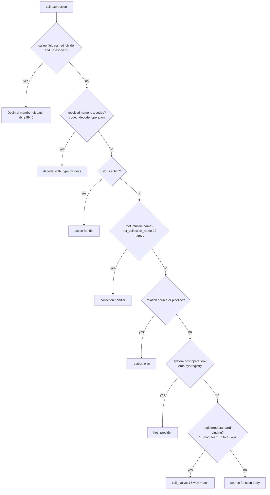

# reform(std-native): typed intrinsic registry and the standard-library implementation split

Status: design proposal (epic `ornadb-yuzot`)
Authority: `/home/kieran/dev/ornadb/reference/Orna-1.1.0` (spec), analysed at
`origin/main` = `7c5fce9e4`, stdlib pin `b3ce954c38483e2e1f9edbd9cc2a9906b94680df`.

Every constraint below is cited as `file:line` into that reference tree. Every
implementation claim is cited as `file:line` into the checked-out tree at the
commit above. Numbers were measured with the commands in section 8.

--------------------------------------------------------------------------

## 0. Summary

The standard library's native operations are dispatched through string tables
that are (a) duplicated across five or six places in `orna-evaluator` and
`orna-semantic`, (b) only partially backed by declarations in the pinned std
source, and (c) decided at run time by heuristics that inspect the *shape of
the pinned source's AST*. The pinned std source itself carries three mutually
incompatible "this is implemented in Rust" conventions, one of which is a
silently wrong placeholder.

The reform replaces that with one typed catalogue - a new crate
`orna-intrinsics` - holding one `Intrinsic` descriptor per operation (module
path, source name, signature, effect class, container kinds, pin range, dispatch
kind), with `IntrinsicId` as a `#[repr(u16)]` enum. Both the evaluator and the
semantic checker read it. The evaluator binds an id to a resolved function
*once, at admission*, and dispatches on the enum, so the hot path never compares
strings. Everything that is expressible as ordinary Orna moves into the std repo
(`stdlib/std`, published as `github.com/workingdir/ornadb-std`); everything that
is a genuine primitive keeps a Rust implementation with a recorded justification.

No surface-syntax change is required or permitted. Section 3.4 explains why, and
what internal mechanism keeps the language spec intact.

--------------------------------------------------------------------------

## 1. Current state, measured

### 1.1 Where the native surface lives

`crates/orna-evaluator/src/lib.rs` is 20,536 lines. The standard-library native
machinery inside it:

| Region | Lines | What it is |
|---|---|---|
| `lib.rs:15030-15055` | 26 | `StandardBindingKind` (16 variants) and `StandardBindingModule` |
| `lib.rs:15140-15395` | 256 | `STANDARD_BINDING_MODULES`: 16 modules, 178 spellings |
| `lib.rs:15397-15440` | 44 | `registered_standard_binding`: linear prefix scan |
| `lib.rs:9215-9368` | 154 | `route_call`: 8-way gate, candidate priority list |
| `lib.rs:9524-9645` | 122 | `call_native`: name formatting, argument ordering, 16-way match |
| `lib.rs:14753-15004` | 252 | `named_arguments`: ~90-arm parameter-name table |
| `lib.rs:15483-15528` | 46 | `captured_collection_helper_is_loop`, `LEGACY_ROOT_WRAPPER_OPERATIONS`, `captured_collection_binding_is_native` |
| `lib.rs:15725-15777`, `16047-16074` | ~90 | `stats_name`, `time_name`, `bits_name`, `text_name`, `math_name`, `root_collection_name`, `root_stream_name`, `standard_name`, allocating `function_name` |
| `lib.rs:15852-15980` | 128 | `relation_named_arguments`, statistics call-argument table |
| `lib.rs:9790-13763` | 3,974 | the per-kind handlers and their helpers |
| total | ~4,900 | 24% of `lib.rs` |

The 3,974-line handler region, by family:

```
math          24      collection dispatch      195
bits          27      collection helpers       252   (map, flat_map, sort_by, rank, distinct, union, count, sum)
text          86      stats numeric helpers    436
stream       639+432  stats dispatch+helpers   492   (mean, median, percentile, extreme)
concurrent   134      collection tail helpers  574   (first .. window_time_series_statistics)
time         164      shift left/right          49
base64        17      recursive_cte             41
random       140
hash          60
codecs        70
money         73
```

`crates/orna-semantic/src/lib.rs` is 30,331 lines. 21 functions - 1,842 lines -
exist only to type native calls, and the file contains 306 `matches!` sites:

```
lib.rs:1593-1714   standard_function_effects, summarize_standard_function_effects
lib.rs:8925-9025   infer_codec_decode_call
lib.rs:13697-13748 infer_stream_from_list
lib.rs:13749-14783 standard_collection_operation_is_admitted, is_portable_collection_operation,
                   standard_collection_module_operation, standard_statistics_module_operation,
                   root_collection_intrinsic_is_unshadowed, finite_list_collection_operation,
                   infer_finite_list_collection_call, infer_finite_list_collection,
                   infer_finite_list_helper_collection, infer_finite_list_simple_collection
lib.rs:15977-16380 infer_relation_collection_call, infer_relation_collection_pipeline
```

Two crates therefore hold the same facts about the same 103 operations, twice.

### 1.2 What the tables say

`STANDARD_BINDING_MODULES` (`lib.rs:15140-15395`) contains:

| module | spellings | of which `__`-prefixed | distinct canonical ops |
|---|---|---|---|
| `std.collection.` | 39 | 10 | 29 |
| `std.query.` | 46 | 16 | 30 |
| `std.math.` | 0 | 0 | 0 |
| `std.text.` | 20 | 10 | 10 |
| `std.bits.` | 12 | 6 | 6 |
| `std.stream.` | 10 | 0 | 10 |
| `std.concurrent.` | 3 | 0 | 3 |
| `std.ui.` | 1 | 1 | 1 |
| `std.stats.` | 14 | 14 | 14 |
| `std.time.` | 6 | 0 | 6 |
| `std.hash.` | 5 | 0 | 5 |
| `std.random.` | 8 | 4 | 4 |
| `std.encoding.base64.` | 4 | 2 | 2 |
| `std.encoding.json.` | 3 | 3 | 3 |
| `std.encoding.orna.` | 2 | 2 | 2 |
| `std.encoding.ovb.` | 2 | 2 | 2 |
| `std.money.` | 3 | 3 | 3 |

178 spellings, 147 distinct (module, name) pairs, 103 distinct canonical op
names, of which 35 appear in both `std.collection` and `std.query` as separate
table rows. `std.math.` is registered with zero operations while `fn math`
(`lib.rs:9790`) still implements six (`increment`, `decrement`, `is_zero`,
`min`, `max`, `clamp`) - so `std.math.min(...)` never dispatches natively when
the declaration resolves, and `std.math.abs(...)` never could. The math handler
is reachable only through an *unresolved* qualified spelling.

The full per-operation inventory with classification is section 3.9.

### 1.3 Three incompatible marker conventions in the pinned std source

Everything the runtime implements is declared in `stdlib/std`. There are three
different conventions, and a reader cannot tell which is which without reading
the evaluator.

(1) Self-recursive pair, public name registered natively - `stdlib/std/text.orna:14-28`:

```
// Private leaves route public source exports through the evaluator primitives
// registered for this pinned Unicode profile.
fn __trim(value: Str): Str = std.text.trim(value);
...
pub fn trim(value: Str): Str = __trim(value);
```

(2) Self-recursive pair, private leaf registered natively - `stdlib/std/hash.orna:12-13`:

```
pub fn sha256(input: Blob): Digest = __sha256(input);
fn __sha256(input: Blob): Digest = sha256(input);
```

(3) A placeholder body that answers with a wrong value if ever executed -
`stdlib/std/collection.orna:6-12`:

```
fn __group_by<T, K>(values: [T], key: fn(T): K): [(K, [T])] = [];
fn __rank<T, K>(values: [T], key: fn(T): K): [(T, Int)] = [];
fn __asof_join<T, Time, Key>(
    left: [T], right: [T], time: fn(T): Time, by: fn(T): Key
): [(T, T?)] = [];
fn __bucket_by<T, P>(rows: [T], period: P, zone: Str): [[T]] = [];
```

Convention (3) is a silent-wrong-answer hazard, and it is not confined to one
file. `stdlib/std/query.orna:139-142` declares five window/time-series leaves
whose bodies return `false` and `[]`:

```
fn __strictly_ordered_time_series<T>(points: [(Instant, T)]): Bool = false;
fn __window_rate<T>(points: [(Instant, T)], size: Int, step: Int): [T?] = [];
fn __window_rate_integrate<T>(points: [(Instant, T)], size: Int, step: Int): [(T?, T?)] = [];
fn __window_derivative<T>(points: [(Instant, T)], size: Int, step: Int): [[(Instant, T)]] = [];
fn __window_integrate<T>(points: [(Instant, T)], size: Int, step: Int): [T?] = [];
```

Conventions (1) and (2) are
infinite recursion if the table entry is ever removed. `stdlib/std/stream.orna:8`
and `stdlib/std/bits.orna:9` mix (1) and (2) inside one module.

The declared bodies of convention (2) are dead in every case: because the
registry names the *public* symbol for `std.hash`, `std.text`, `std.bits`,
`std.random`, `std.base64`, `std.money`, `std.time`, `std.ui` and
`std.json`/`orna`/`ovb`, `route_call` takes the `bound_elsewhere` branch
(`lib.rs:9287-9303`) and the public body never runs. For `std.stats` and
`std.collection` it is the reverse: the private leaf is registered, the public
body runs, and the leaf's body never runs. Which of the two happens is decided
by whether the registered spelling starts with `__`.

### 1.4 Dispatch depends on the AST shape of the captured source

`lib.rs:15483-15528`:

```rust
fn captured_collection_helper_is_loop(functions: &Functions, name: &str) -> bool {
    let Some(helper) = functions.get(name) else { return false; };
    matches!(&helper.body, Expr::Block { statements, .. }
        if statements.iter().any(|statement| matches!(statement,
            Statement::Control { value: Expr::Control { kind: ControlKind::While, .. }, .. })))
}

fn captured_collection_binding_is_native(operation: &str, functions: &Functions) -> bool {
    operation.starts_with("__")
        || (operation == "map"
            && !captured_collection_helper_is_loop(functions, "std.collection.map_from"))
}

fn legacy_root_wrapper_is_pinned(prefix: &str, operation: &str, functions: &Functions) -> bool {
    functions.contains_key(&format!("{prefix}{operation}"))
        && !captured_collection_helper_is_loop(functions, &format!("{prefix}{operation}_from"))
}
```

Whether a call runs in Rust or in Orna is decided by whether a helper's body
happens to contain a `while` statement. A pin that switches a recursive helper
to a loop silently switches the operation from native to source (or back). A
second, unrelated gate does the same for time: `std.time` natives bind only when
`std.time.timezone_data_version` is a string literal equal to the baked-in
dataset version (`lib.rs:15462-15477`, enforced at `lib.rs:15428-15430`). Both
rules are load-bearing, undocumented in the spec, and unenumerable.

The rules are what makes it possible to support the historical pins in
`crates/orna-evaluator/tests/fixtures/module-upgrade-std-collection-v4.orna` and
`-v5.orna`.

### 1.5 Registered names with no declaration at all

Comparing `STANDARD_BINDING_MODULES` against every `fn` declared in the pinned
`stdlib/std` tree: **51 of 147 (module, name) pairs have no declaration in the
pinned source.** Two classes:

* The 17 core relation operations in `std.collection.` and `std.query.`
  (`filter` ... `exists`). Spec `source/09-standard-library.md:9` permits the
  re-export ("`std.query` and `std.stream` may re-export the intrinsic operators
  with identical identities and behaviour"), but the spec's model is a source
  re-export with the *same identity*. The implementation instead reaches a
  native because a string table contains the spelling, which is exactly the
  mechanism `source/09-standard-library.md:13` (ORNA-LIB-002) forbids: "it cannot
  be filled by an undocumented host library with the same spelling".
* `std.stream.from_provider` (`lib.rs:10573`). The pinned `stdlib/std/stream.orna`
  has no such function, and `crates/orna-semantic` has no typing rule for it, so
  no checked program can call it - it is an evaluator-only name.

Conversely, 6 registered private leaves are referenced by nothing in the pinned
source at all: `__list_length`, `__list_concat`, `__numeric_sum`, `__stable_sort`,
`__minimum`, `__maximum` (`lib.rs:15174-15183`). They exist only for historical
pins, whose fixtures declared e.g. `fn __list_length<T>(values: [T]): Int = 0;`
(`crates/orna-evaluator/tests/fixtures/module-upgrade-std-collection-v4.orna:1`)
- another lying placeholder.

### 1.6 Drift between evaluator and semantic

`lib.rs:15746-15777` (`root_collection_name`) lists 22 root names;
`crates/orna-semantic/src/lib.rs:13940-13966` lists 17. The five implemented in
the evaluator with no semantic typing rule are `bucket_by`, `last`, `pairs`,
`project`, `rank`.

* `project` has no implementation arm in `fn collection` either
  (`lib.rs:11676-11862`), so `project(rows, ...)` reaches the final
  `_ => Err(ORNA-EVAL-UNSUPPORTED)` arm.
* `last` is used by the specification's own example,
  `source/06-expressions.md:146`: `values | sort_by(value => value) | last();`
  It is not in the core-operation table of `source/09-standard-library.md:27-40`
  and not in the checker, so the spec's example is not typeable today.
* `bucket_by` is in `named_arguments` only as `__bucket_by`
  (`lib.rs:14890`), so a named-argument call to the public
  `std.collection.bucket_by(rows, period: p, zone: z)` has no entry.

`crates/orna-semantic` is otherwise clean: `std.text`, `std.bits`, `std.hash`,
`std.money`, `std.time` are typed from their pinned declarations with no
duplication. The duplication is confined to collection, query, stats, stream
and codecs - the operations whose types are container-polymorphic.

### 1.7 The reference bundle patches the pinned std source from a Rust fixture

`crates/orna-standard-sources/src/lib.rs:24-31` embeds each pinned module with
`include_str!`, and the macro accepts an appended extra file. One row uses it
(`crates/orna-standard-sources/src/lib.rs:37-38`):

```
REFERENCE_STANDARD_QUERY_PATH_V1 = "std/query.orna" + "query_recursive_cte_n0o0e.orna";
```

`crates/orna-standard-sources/src/fixtures/query_recursive_cte_n0o0e.orna`
adds a public function to `std.query` that does not exist in the pinned snapshot,
with the comment "The Orna 1.0.0 reference does not prescribe recursive CTE
syntax". A program's library behaviour therefore depends on a Rust fixture, not
on its captured snapshot, which is precisely what
`source/09-standard-library.md:11` (ORNA-LIB-001) forbids.

### 1.8 Hot-path costs of the current dispatch

The `fn call` doc comment (`lib.rs:8916-8919`) states the resolution order, and
each stage is a separate string test:



Per call, before any Orna work happens:

1. `resolve_function_name` (`lib.rs:9670`) calls `function_name`
   (`lib.rs:16065`), which allocates a `String` (`text.clone()` /
   `format!("{}.{}", ...)`).
2. `route_call` (`lib.rs:9215`) calls `registered_standard_binding`
   (`lib.rs:15397`), which allocates the name a second time and then does a
   linear scan: up to 16 module prefix tests and up to 46 inner comparisons.
3. `call_native` (`lib.rs:9524`) builds a `binding_name` `Cow` with `format!`
   for hash, random, base64 and money, then `named_arguments`
   (`lib.rs:14753`) walks a ~90-arm `match` on the parameter table.
4. Only then does the handler run its own `match (name, values.as_slice())`.

For a pipeline such as `rows | filter(pred) | count()`, step 1-3 run once per
pipeline stage; for `rows | flat_map(r => r.items)` they run per outer row. The
reform makes 1-3 a single enum comparison resolved at admission. Callback
invocation cost (the real hot loop for `map`/`filter` over many rows,
`lib.rs:13472-13530`) is unchanged by this reform and is called out in section
5.2 as a separate, measured follow-up.

### 1.9 Test surface that constrains the reform

115 test files named `crates/orna-evaluator/tests/standard_*.rs`, 590 tests,
27,899 lines, plus `standard_profile_v1.rs` (54 tests),
`standard_snapshot_replay.rs` (61 tests) and 251 tests in `evaluator.rs`. That
suite is the byte-identical acceptance net for every stage below.

--------------------------------------------------------------------------

## 2. Prior art

What experts did, and what transfers.

### 2.1 PostgreSQL: one data file, generated id header, generated dispatch table

`src/backend/utils/Gen_fmgrtab.pl` reads `src/include/catalog/pg_proc.dat` and
emits three artefacts: `fmgroids.h` (`F_*` macros = the typed id), `fmgrprotos.h`
(prototypes) and `fmgrtab.c` (`fmgr_builtins[]`, an array of
`{oid, nargs, strict, retset, prosrc, fnptr}` plus a sparse `fmgr_builtin_oid_index`).
https://github.com/postgres/postgres/blob/master/src/backend/utils/Gen_fmgrtab.pl

Transferable: the id enum, the arity/parameter metadata and the function pointer
come from one row, and the generated id header is what callers use instead of a
name. Direct analogue: `IntrinsicId` + `INTRINSICS` + evaluator `match id`.

Not transferable: a catalog table is user-visible SQL data; Orna's std is source
with a signature visible to the checker, so the declaration must exist in source
(a row in a Rust table alone would be the ORNA-LIB-002 breach).

### 2.2 SQLite: `FuncDef` table and a public registration API

`src/func.c` implements `static void <name>Func(sqlite3_context*, int, sqlite3_value**)`
and `sqlite3RegisterBuiltinFunctions` fills a local `static FuncDef aBuiltinFunc[]`
with `{nArg, funcFlags, xSFunc, zName, uExtra}`; `src/main.c:284` calls it at
startup.
https://github.com/sqlite/sqlite/blob/master/src/func.c

Transferable: one table per module, arity+name+pointer together; the same table
structure serves user-registered functions (`sqlite3_create_function`), which is
the shape Orna needs if a pinned std package ever ships its own native op.

Not transferable: SQLite has no static type checking, so it can afford to be
permissive about arity mismatch at run time. Orna must reject at check time.

### 2.3 DuckDB: typed function objects in a catalog, introspectable

`ScalarFunction`/`ScalarFunctionSet` registered through the Catalog, plus the
`duckdb_functions()` table function that lists every registered function with
its parameters, return type and side-effect class for debugging.
https://github.com/duckdb/duckdb/blob/main/src/function/table/system/duckdb_functions.cpp

Transferable: an introspectable table-of-functions is a debugging and
documentation artefact, not just a dispatch mechanism. Orna should export the
same catalogue (`sys`-style read-only view or a `std-api-export` binary) so the
LSP and docs are generated from one source.

### 2.4 Lua: `luaL_Reg` arrays, one array per library module

`lbaselib.c` registers `{"assert", luaB_assert}, ...` through
`luaL_setfuncs`; each library is a flat name/pointer array in its own file.
https://github.com/lua/lua/blob/master/lbaselib.c

Transferable: "one file per std module, one declaration per operation" - the
file layout of section 3.3 is this, typed.

Not transferable: no signatures; arity checking is by hand at call time. That is
the failure Orna already has.

### 2.5 rustc: `#[rustc_intrinsic]` with the compiler *checking* the declared signature

Intrinsics are declared in `library/core/src/intrinsics/mod.rs` with a real Rust
signature and no body; `rustc_hir_analysis/src/check/intrinsic.rs` calls
`equate_intrinsic_type` -> `check_function_signature` and reports
`WrongNumberOfGenericArgumentsToIntrinsic`, and `intrinsic_operation_unsafety`
cross-checks the declaration's safety against the compiler's list.
https://github.com/rust-lang/rust/blob/master/compiler/rustc_hir_analysis/src/check/intrinsic.rs

This is the single most important precedent, because it is the same problem:
*the declaration is in pinned library source, the implementation is in the
compiler*. rustc does not deduplicate the signature; it makes the duplication
machine-checked, and the compiler refuses to build when they disagree.

Transferable, wholesale: keep the declaration in the std repo, keep the
implementation in Rust, and add a build/test-time parity check that compares the
two signatures structurally. The check is the deliverable, not the absence of
text.

Also transferable: the header comment in `check/intrinsic.rs` ("Remember to add
all intrinsics here, in rustc_codegen_llvm/src/intrinsic.rs, and in
library/core/src/intrinsics.rs") acknowledges that even rustc has three lists -
and each is checked against the others.

Not transferable: rustc has a compiler-owned namespace. Orna's `std` is optional
and replaceable (`source/03-source-modules.md:36`, ORNA-NS-007), so binding must
be conditional on the admitted snapshot, not on the name.

### 2.6 PHP: declaration-only stub files from which the runtime table is generated

`build/gen_stub.php` reads `*.stub.php` (never executed), emits
`*_arginfo.h` and `*_decl.h`, and stores a `Stub hash` in the generated file so a
stale generation is detected and fails the build.
https://github.com/php/php-src/blob/master/build/gen_stub.php

Transferable: the "sha1 of the source declaration stored next to the generated
artefact" trick is a cheap, effective drift detector and maps directly onto
Orna's existing `scripts/check_standard_library_pin.py` mirror check.

Not transferable: PHP *generates* the C glue because there is no way to write the
declaration in C. Orna can write the declaration in Orna, so the generated
artefact here is only the registry projection, not the source.

### 2.7 Go: a declarations-only file the compiler reads

`src/builtin/builtin.go` documents predeclared identifiers; the compiler's own
table and checks live in `cmd/compile/internal/types2`. The file's header says
the items "are not actually in package builtin".
https://github.com/golang/go/blob/master/src/builtin/builtin.go

Transferable: a source file whose only job is to carry declarations for the
compiler's builtins is an accepted design. Orna's pinned std source already
plays that role for its natives; the reform makes the relationship explicit and
checked instead of heuristic.

### 2.8 Roslyn: `WellKnownMember` enum plus signature verification

`src/Compilers/Core/Portable/WellKnownMember.cs` enumerates every member the
compiler treats specially; the binder verifies each against a `MemberSignature`.
https://github.com/dotnet/roslyn/blob/main/src/Compilers/Core/Portable/WellKnownMember.cs

Transferable: the enum is the stable identity; names are a lookup into it.
That is exactly `IntrinsicId`.

### 2.9 OCaml: `external` declarations bound by a name-keyed primitives table (the cautionary case)

`runtime/caml/prims.h` exposes `caml_builtin_cprim[]`, a parallel
`caml_names_of_builtin_cprim[]`, and `Primitive1..PrimitiveN` macros that cast by
arity.
https://github.com/ocaml/ocaml/blob/trunk/runtime/caml/prims.h

OCaml is the closest structural analogue to Orna today: source declares
`external`, the runtime binds by name, arity is a separate parallel array. The
consequence is well known: any second backend (js_of_ocaml) must maintain its own
name-to-implementation table, and a rename in source is invisible to the runtime
until it fails at run time. Orna's `__trim`/`trim` mutual recursion is the same
class of defect.

Reject: name-keyed binding without a typed id.

### 2.10 What does not apply

* PostgreSQL's OID-as-catalog-key: Orna has no stable numeric identity in the
  spec and must not invent one that user programs can observe. `IntrinsicId` is
  internal and `#[repr(u16)]` only for layout; it is not part of any format.
* SQLite/DuckDB's runtime-registered user functions: `std` is pinned, not
  user-extensible at run time (`source/09-standard-library.md:11`, ORNA-LIB-001).
* rustc's `unsafe` intrinsic classes: Orna's equivalent axis is the *effect*
  class (`source/09-standard-library.md:152`), which the checker already models
  (`crates/orna-semantic/src/effects.rs:71,134`).

--------------------------------------------------------------------------

## 3. Target design

### 3.1 Layering

```
                        +---------------------------+
                        |  orna-intrinsics (new)    |
                        |  id + descriptor + sig    |
                        |  deps: orna-foundation    |
                        +------------+--------------+
                                     |
             +-----------------------+-----------------------+
             |                                               |
   +---------v----------+                          +---------v---------+
   | orna-semantic      |                          | orna-evaluator    |
   | typing from the    |                          | dispatch from the |
   | same descriptors   |                          | same descriptors  |
   +--------------------+                          +-------------------+
```

`orna-intrinsics` depends on `orna-foundation` only. It must not depend on
`orna-semantic` (`Type` is defined there, `crates/orna-semantic/src/lib.rs:432`)
nor on `orna-evaluator` (would be a cycle), so it defines its own closed
`SigType`. `orna-semantic` maps `SigType -> Type` with a total function.

`orna-sys` keeps its generated host-operation registry; section 3.10 states the
exact, checked relationship between the two.

### 3.2 Crate `orna-intrinsics`: types

```rust
// crates/orna-intrinsics/src/id.rs
#[derive(Clone, Copy, Debug, Eq, Hash, Ord, PartialEq, PartialOrd)]
#[repr(u16)]
pub enum IntrinsicId {
    // intrinsic environment (spec 9:5-7): no import, no std snapshot needed
    CoreSome = 0,
    CoreNow,
    CoreUuid7,
    CoreError,
    CoreFail,
    CoreFilter,
    CoreMap,
    CoreFlatMap,
    CoreSortBy,
    CoreTake,
    CoreDrop,
    CoreDistinct,
    CoreUnion,
    CoreCount,
    CoreFirst,
    CoreLast,
    CoreOne,
    CoreSum,
    CoreMin,
    CoreMax,
    CoreEvery,
    CoreExists,
    // std modules
    CollectionChunk,
    CollectionFlatten,
    // ...
    TextTrim,
    TextSplit,
    // ... one variant per operation, 103 in total
}

impl IntrinsicId {
    /// Every id, in declaration order. A test proves this is exhaustive.
    pub const ALL: &'static [IntrinsicId] = &[/* generated by the same macro */];
    pub const fn as_u16(self) -> u16 { self as u16 }
    pub const fn name(self) -> &'static str { /* symbolic, for diagnostics */ }
}
```

```rust
// crates/orna-intrinsics/src/signature.rs
#[derive(Clone, Copy, Debug, Eq, PartialEq)]
pub enum SigType {
    Unit, Bool, Int, Float, Decimal, Str, Blob, Path, Digest, Uuid,
    Date, Instant, LocalDateTime, TimeOfDay, Duration, TimeZone, ZonedDateTime,
    Error, JsonValue, Ui, Money,
    List(&'static SigType),
    Relation(&'static SigType),
    Query(&'static SigType),
    Stream(&'static SigType),
    Option(&'static SigType),
    Range(&'static SigType),
    Tuple(&'static [SigType]),
    Record(&'static [(&'static str, SigType)]),
    Nominal(&'static str),
    Fn(&'static [SigType], &'static SigType),
    /// Type parameter, by index into `Signature::type_params`.
    Param(u8),
}

#[derive(Clone, Copy, Debug, Eq, PartialEq)]
pub enum Effect {
    /// Deterministic over its arguments; safe in assertions and watches.
    Pure,
    /// Reads pinned data tables (Unicode, time-zone, locale). Deterministic for
    /// a captured snapshot, so also assertion-safe.
    PinnedData,
    /// Reads the host clock.
    Clock,
    /// Reads host entropy.
    Entropy,
    /// Crosses a host effect boundary (fs, process, net).
    Host,
    /// Consumes or advances a stream / checkpoint.
    Stream,
    /// Reads table state through a query plan.
    Query,
}

#[derive(Clone, Copy, Debug, Eq, PartialEq)]
pub enum Justification {
    /// Part of the intrinsic environment required by spec 9:5-7.
    CoreIntrinsic,
    HostResource,
    CanonicalFormat,
    PinnedUnicodeData,
    RepresentationAccess,
    PlanOrStreamMachinery,
    SuperlinearCanonicalKey,
    /// Expressible in Orna, but the Orna form was measured worse; see `note`.
    MeasuredWorse,
}

#[derive(Clone, Copy, Debug, Eq, PartialEq)]
pub enum Dispatch {
    /// Bound to a declaration in the pinned source; the Rust arm is authoritative.
    Native,
    /// Bound to a host operation in the `orna-sys` registry.
    Host { operation: &'static str },
    /// The Rust arm was deleted; the pinned source body is authoritative.
    SourceOnly,
}

#[derive(Clone, Copy, Debug, Eq, PartialEq)]
pub struct Param {
    pub name: &'static str,
    pub ty: SigType,
    pub has_default: bool,
    /// True for argument one, which a pipeline may supply (`spec 9:21`).
    pub pipeline: bool,
}

#[derive(Clone, Copy, Debug, Eq, PartialEq)]
pub struct Signature {
    pub type_params: &'static [&'static str],
    pub params: &'static [Param],
    pub result: SigType,
}

#[derive(Clone, Copy, Debug, Eq, PartialEq)]
pub struct Intrinsic {
    pub id: IntrinsicId,
    pub module: Module,
    /// Name inside the module, as the pinned source spells it.
    pub name: &'static str,
    /// Private marker leaf in the pinned source, when the module uses one.
    pub leaf: Option<&'static str>,
    pub signature: Signature,
    pub effect: Effect,
    pub dispatch: Dispatch,
    pub justification: Justification,
    /// One sentence, emitted into `std_intrinsics.json` and the design docs.
    pub note: &'static str,
    /// Pins in which this binding is active (spec 9:11, ORNA-LIB-001).
    pub pins: PinRange,
}

#[derive(Clone, Copy, Debug, Eq, PartialEq)]
pub struct PinRange {
    /// First pinned std commit that declares the binding.
    pub since: &'static str,
    /// Last pinned std commit that declares it, or `None` for the current pin.
    pub until: Option<&'static str>,
}

#[derive(Clone, Copy, Debug, Eq, PartialEq, Hash)]
pub enum Module {
    Core, Collection, Query, Math, Text, Bits, Stream, Concurrent, Ui,
    Stats, Time, Hash, Random, Base64, Json, OrnaCodec, OvbCodec, Money,
}

impl Module {
    pub const fn path(self) -> &'static str {
        match self {
            Module::Core => "",
            Module::Collection => "std.collection",
            Module::Query => "std.query",
            // ...
        }
    }
}
```

Lookup:

```rust
pub fn lookup(module: Module, name: &str) -> Option<&'static Intrinsic>;
pub fn by_id(id: IntrinsicId) -> &'static Intrinsic;      // total; panics only on a build bug
pub fn parameters(id: IntrinsicId) -> &'static [Param];
pub fn catalogue() -> &'static [Intrinsic];               // deterministic order
```

`by_id` is total because a test asserts `INTRINSICS.len() == IntrinsicId::ALL.len()`
and that the two agree element-wise in declaration order.

### 3.3 One declaration site per operation, one file per std module

```
crates/orna-intrinsics/
    Cargo.toml
    build.rs                     # verifies generated std_intrinsics.json is current
    src/lib.rs                   # re-exports, lookup, catalogue
    src/id.rs                    # IntrinsicId + ALL
    src/signature.rs             # SigType, Param, Signature
    src/effect.rs                # Effect
    src/pin.rs                   # PinRange
    src/modules/mod.rs           # INTRINSICS concatenation + Module
    src/modules/core.rs          # root intrinsic environment
    src/modules/collection.rs    # std.collection and std.query
    src/modules/text.rs
    src/modules/bits.rs
    src/modules/stats.rs
    src/modules/stream.rs
    src/modules/concurrent.rs
    src/modules/time.rs
    src/modules/hash.rs
    src/modules/random.rs
    src/modules/base64.rs
    src/modules/json.rs
    src/modules/orna_codec.rs
    src/modules/ovb_codec.rs
    src/modules/money.rs
    src/modules/ui.rs
    src/modules/math.rs
    src/modules/retired.rs        # historical-pin-only leaves
    tests/catalogue_is_total.rs
    tests/std_declaration_parity.rs
    tests/no_native_without_declaration.rs
```

Each module file is a plain const array - no macro cleverness:

```rust
// crates/orna-intrinsics/src/modules/text.rs
use crate::effect::Effect;
use crate::id::IntrinsicId;
use crate::signature::{Param, SigType, Signature};
use crate::{Dispatch, Intrinsic, Justification, Module, PinRange};

const S: SigType = SigType::Str;

pub(crate) const TEXT: &[Intrinsic] = &[
    Intrinsic {
        id: IntrinsicId::TextTrim,
        module: Module::Text,
        name: "trim",
        leaf: Some("__trim"),
        signature: Signature {
            type_params: &[],
            params: &[Param { name: "value", ty: SigType::Str, has_default: false, pipeline: false }],
            result: SigType::Str,
        },
        effect: Effect::PinnedData,
        dispatch: Dispatch::Native,
        justification: Justification::PinnedUnicodeData,
        note: "trims the pinned Unicode 16.0.0 White_Space set; the Rust toolchain's tables are not a substitute",
        pins: PinRange::CURRENT,
    },
    Intrinsic {
        id: IntrinsicId::TextUpper,
        module: Module::Text,
        name: "upper",
        leaf: Some("__upper"),
        signature: Signature {
            type_params: &[],
            params: &[Param { name: "value", ty: SigType::Str, has_default: false, pipeline: false }],
            result: SigType::Str,
        },
        effect: Effect::PinnedData,
        dispatch: Dispatch::Native,
        justification: Justification::PinnedUnicodeData,
        note: "full Unicode 16.0.0 uppercase including Final_Sigma-adjacent expansions",
        pins: PinRange::CURRENT,
    },
];
```

`std.collection` and `std.query` share one descriptor entry when the identity is
the same, per `source/09-standard-library.md:9`:

```rust
// crates/orna-intrinsics/src/modules/collection.rs
Intrinsic {
    id: IntrinsicId::CoreCount,
    module: Module::Collection,       // also exported as Module::Query; see reexports
    name: "count",
    leaf: None,
    signature: Signature {
        type_params: &["T"],
        params: &[Param { name: "rows", ty: SigType::List(&SigType::Param(0)), has_default: false, pipeline: true }],
        result: SigType::Int,
    },
    effect: Effect::Pure,
    dispatch: Dispatch::Native,
    justification: Justification::CoreIntrinsic,
    note: "core count re-exported by std.collection; relation overload is the same id",
    pins: PinRange::CURRENT,
},
```

with `pub const REEXPORTS: &[(Module, &str, IntrinsicId)]` carrying
`(Module::Query, "count", IntrinsicId::CoreCount)` and so on. That removes the 35
duplicated table rows: one identity, two spellings.

### 3.4 How the pinned source declares a primitive, without changing the language

**A surface-syntax change is not acceptable.** Reasons, all cited:

* `source/34-grammar.md` has no attribute/annotation production, so `#[intrinsic]`
  or `pub intrinsic fn` cannot be spelled today.
* `source/03-source-modules.md:9` (ORNA-SOURCE-002) allows top-level declarations
  only; a new declaration form would be a language change.
* `source/09-standard-library.md:3` requires `std` to be "ordinary, explicitly
  imported library code pinned to a Git snapshot". A primitive-only declaration
  form would make part of `std` not ordinary.
* `source/09-standard-library.md:15` (ORNA-LIB-003) fixes the portable operations'
  semantics "when supplied under the reference-library profile"; a new syntax
  would need the reference profile to change too.

So the mechanism is an *internal* convention plus a machine check:

1. The pinned source declares the operation as an ordinary function, exactly as
   today: `pub fn trim(value: Str): Str = ...`.
2. The registry names the module path and the name. For modules that keep a
   private leaf, the registry also names the leaf.
3. **The leaf body must be a failure marker**, and the loader validates it:

```
pub fn trim(value: Str): Str = __trim(value);
fn __trim(value: Str): Str =
    fail(error(code: "ORNA-EVAL-UNSUPPORTED", message: "std.text.trim is a native intrinsic"));
```

The marker must be `fail(error(...))` - `Type::Bottom`
(`crates/orna-semantic/src/lib.rs`, `infer_fail_call`) unifies with every declared
return type, so the leaf typechecks for every signature, and if the registry ever
fails to bind it the program fails loudly instead of returning `[]`, recursing
forever, or silently answering with a wrong value.

4. **Validation at admission** (`IntrinsicBinding::check`): for every registry
   entry with `dispatch != SourceOnly`, the resolved declaration must exist, its
   lowered signature must equal the registry `Signature`, its leaf (if named)
   must exist with a `fail` marker body, and the pin must be inside `pins`.
   Any mismatch is a load diagnostic naming both sides. For every resolved
   declaration in a module the registry covers, if it has no entry it is an
   ordinary function - which is the common case and needs no marker.

This is the rustc arrangement (declaration in library source, implementation in
the compiler, compiler checks the pair) with the check moved into the standard
module loader. It needs no spec change, and it makes the three incompatible
conventions of section 1.3 impossible: there is exactly one, and it is validated.

Spec compliance of each clause:

| Requirement | Citation | How it holds |
|---|---|---|
| Behaviour from captured snapshots | `09-standard-library.md:11` ORNA-LIB-001 | `PinRange` per entry; entries outside the resolved pin never bind. The addendum mechanism of 1.7 is deleted. |
| A host may not fill an undeclared spelling | `09-standard-library.md:13` ORNA-LIB-002 | Binding requires a resolved declaration in the admitted module, not a name match. |
| Portable operations keep their semantics | `09-standard-library.md:15` ORNA-LIB-003 | Signatures come from the declaration; the registry copy is checked equal. |
| `std` optional and replaceable | `03-source-modules.md:36` ORNA-NS-007 | A replaced `std` produces different declarations, so no registry entry binds; replacements keep working as ordinary source. |
| Core works without `std` | `09-standard-library.md:13` ORNA-LIB-002 | `Module::Core` entries are the root environment; they never require an import. |
| `std.query`/`std.stream` re-export with identical identity | `09-standard-library.md:9` | `REEXPORTS` gives both spellings one `IntrinsicId`. |
| Pipeline supplies argument one | `09-standard-library.md:21` | `Param::pipeline`. |
| Read-only callbacks are effect-checked | `09-standard-library.md:44` ORNA-LIB-004 | `Effect` is per intrinsic; the checker reads it instead of a separate table. |
| Signature notation `T`, `U`, `K`, `fn(T): U` | `09-standard-library.md:19` | `type_params`, `SigType::Param`, `SigType::Fn`. |

### 3.5 Evaluator: resolve once at admission, dispatch on the enum

Admission already walks every resolved standard declaration to build
`PureFunction`s (`crates/orna-evaluator/src/lib.rs:838-844`) and the shared
`StandardLayer` (`crates/orna-evaluator/src/lib.rs:850-871`), constructed in
`crates/orna-application/src/lib.rs:397` from per-module exports computed at
`crates/orna-application/src/lib.rs:374-382`. That walk gains one field:

```rust
// crates/orna-evaluator/src/lib.rs:838, PureFunction
pub struct PureFunction {
    pub parameters: Vec<Parameter>,
    pub body: Expr,
    pub environment: Environment,
    /// Set at admission when this declaration is a registered intrinsic.
    pub intrinsic: Option<IntrinsicId>,
}
```

Assignment at admission (`crates/orna-application/src/lib.rs`, next to the
export map it already computes):

```rust
for (path, declaration) in admitted_standard_declarations {
    let module = module_of(&path);
    let id = orna_intrinsics::lookup(module, &declaration.name)
        .filter(|intrinsic| intrinsic.pins.contains(&declaration.pin))
        .filter(|intrinsic| intrinsic.dispatch != Dispatch::SourceOnly)
        .map(|intrinsic| intrinsic.id);
    functions.insert(path, PureFunction { intrinsic: id, ..declaration });
}
```

Routing becomes:

```rust
fn route_call(&self, site: &CallSite<'_>) -> CallRoute {
    if let Some(id) = site.intrinsic {
        return CallRoute::Native(id);
    }
    if let Some(id) = orna_intrinsics::root_intrinsic(&site.name) {
        return CallRoute::Native(id);           // Core* ids only
    }
    CallRoute::Source
}
```

Deleted outright: `STANDARD_BINDING_MODULES`, `registered_standard_binding`,
`is_native_collection_binding`, `LEGACY_ROOT_WRAPPER_OPERATIONS`,
`legacy_root_wrapper_is_pinned`, `captured_collection_binding_is_native`,
`captured_collection_helper_is_loop`, `math_name`/`bits_name`/`text_name`/
`stats_name`/`time_name`/`root_collection_name`/`root_stream_name`,
`portable_collection_operation`, `statistics_function_operation`, and the
`named_arguments` string table.

Argument ordering:

```rust
fn call_native(&mut self, id: IntrinsicId, arguments: &[Argument], input: Option<Value>, ...) {
    let intrinsic = orna_intrinsics::by_id(id);
    let values = order_arguments(intrinsic.signature.params, arguments, input)?;
    self.dispatch(id, values)
}

fn dispatch(&mut self, id: IntrinsicId, values: Vec<Value>) -> Result<Value, EvaluationError> {
    match id {
        IntrinsicId::CoreCount => self.count(values),
        IntrinsicId::TextTrim => self.text_trim(values),
        IntrinsicId::TextUpper => self.text_upper(values),
        // ... one arm per native id
        // SourceOnly ids never reach here; the match is exhaustive so a new
        // intrinsic id without an implementation is a compile error.
    }
}
```

The exhaustive `match` is the structural guarantee PostgreSQL gets from
`Gen_fmgrtab.pl` and rustc from `check_intrinsic_type`: an id with no
implementation cannot compile.

### 3.6 Semantic: one typing rule per intrinsic

`orna-semantic` keeps its own `Type`; it gains one total conversion and one
generic call-typing routine:

```rust
fn sig_type(sig: SigType, subst: &Substitution) -> Type;

/// Types a native call from the registry descriptor. Container overloads
/// (`[T]` vs `Relation<T>`) are chosen from the first argument's type, which is
/// the only rule today's hand-written functions implement.
fn infer_intrinsic(
    id: IntrinsicId,
    input: Option<Inferred>,
    arguments: &[Argument],
    scope: &Scope,
    local: &BTreeMap<String, Symbol>,
    diagnostics: &mut Vec<Diagnostic>,
) -> Inferred;
```

The contextual-lambda rule that today is spelled out per operation is one clause
of that routine: when parameter `i` has type `SigType::Fn(&[SigType::Param(j)], _)`
and parameter `j` is bound, the lambda at argument `i` is checked against the
substituted function type. This is why `partition(values, predicate)` contextually
types `predicate` and why `asof_join` types `time`/`by` - and it generalises to
any future intrinsic without a new table.

Deleted: `is_portable_collection_operation`, `root_collection_intrinsic_is_unshadowed`,
`finite_list_collection_operation`, `standard_collection_module_operation`,
`standard_statistics_module_operation`, `standard_collection_operation_is_admitted`
(becomes the binding check), the `expected` tables at `lib.rs:14357` and
`14637`, and the per-operation arms of `infer_finite_list_collection`,
`infer_finite_list_helper_collection`, `infer_finite_list_simple_collection`,
`infer_relation_collection_call`, `infer_relation_collection_pipeline`
(~1,842 lines).

Net effect on the checker, and this is an intentional, listed behaviour change:

* `last(xs)` and `pairs(xs)` gain typing (currently untypeable).
* `rank`, `bucket_by` gain root typing (currently evaluator-only).
* `project` is removed from the evaluator's root list (it has no implementation
  and is not in the spec).
* `std.collection.count(xs)` / `std.query.map(xs, f)` stop being admitted, because
  the pinned source does not declare them. Under
  `09-standard-library.md:9` a re-export must be a source re-export; stage S4
  adds those re-export declarations explicitly, so the spellings keep working and
  the identity is shared.

### 3.7 Relation, stream and codec overloads

* **Relation overloads** stay native, because a protocol implementation for a
  built-in type cannot be declared from the std repo:
  `source/06-expressions.md:165` (ORNA-GENERIC-003) requires a protocol
  implementation to be lexically nested in the nominal target type, and
  `Relation<T>`/`[T]` are owned by the language
  (`source/05-types.md:7-36`). `[T]` overloads can be Orna; `Relation<T>`
  overloads cannot. One `IntrinsicId` carries both, with
  `dispatch: Native` and the relation implementation living in
  `crates/orna-evaluator/src/relation.rs` under the same id.
* **Streams** stay native: waiting, ownership and checkpoint effects
  (`09-standard-library.md:19`, `116-124`) are not expressible in source.
* **Codecs** stay native: they own the canonical formats
  (`09-standard-library.md:148`, `source/29-formats.md`), and JSON decoding is
  schema-directed through the type witness.

### 3.8 Signature authority, and why the registry is not a second spec

The pinned source is authoritative for what a *program* may call. The registry is
authoritative for what the *runtime* implements, and the two are proved equal:

```
tests/std_declaration_parity.rs
    for intrinsic in catalogue() where dispatch != SourceOnly {
        let declaration = pinned_module(intrinsic.module).function(intrinsic.name);
        assert_eq!(lower(declaration.signature), intrinsic.signature);
        if let Some(leaf) = intrinsic.leaf {
            assert marker body of pinned_module(declaration.leaf);
            assert_eq!(lower(leaf.signature), intrinsic.signature);
        }
    }
tests/no_native_without_declaration.rs
    for declaration in pinned_modules_in_scope() {
        if let Some(intrinsic) = registry_lookup(declaration) {
            assert intrinsic.pins.contains(current_pin);
        }
    }
```

This is the PHP `Stub hash` idea expressed structurally: the parity test fails the
build the moment the two copies disagree, and neither copy is silently preferred.

### 3.9 Inventory and classification of every native operation

Class codes:

* `CORE` - part of the intrinsic environment (`09-standard-library.md:5-7`); must
  work with no import and no `std` snapshot; Relation overloads need the plan.
* `P1` - host resource: entropy, clock, time-zone edition, filesystem, network,
  scheduler.
* `P2` - canonical encoded form or digest (`source/29-formats.md`, `09:148-150`).
* `P3` - pinned Unicode 16.0.0 data (`09:130`).
* `P4` - access to a built-in value's representation or to plan/stream machinery
  (`Blob`, `Digest`, `Stream`, `Relation`, `UI`, unbounded `Int` two's complement).
* `P5` - superlinear over arbitrary canonical keys: equality/order folding that
  source cannot express without O(n^2) (`09:32`, `52`, `102`, `107`).
* `SRC` - expressible in Orna today; the implementation belongs in the std repo.
* `SRC?` - expressible in Orna in principle, measurably worse today; keep native
  behind a recorded threshold (section 5.2).

`legacy` - registered only for historical pins; nothing in the current pin
references it.

Table columns: module, operation, registered spellings, pinned declaration,
evaluator arm, class.

#### std.collection and std.query

The 35 shared operations appear once; `std.query` re-exports the same identity
(`09:9`). `std.query`-only operations are marked.

| op | spellings | pinned decl | arm | class |
|---|---|---|---|---|
| filter | filter | - (re-export) | lib.rs:11770 | CORE |
| map | map | - (re-export) | lib.rs:11764 | CORE |
| flat_map | flat_map | - (re-export) | lib.rs:11765 | CORE |
| sort_by | sort_by | - (re-export) | lib.rs:11768 | CORE (P5 relation) |
| take | take | - (re-export) | lib.rs:11762 | CORE |
| drop | drop | - (re-export) | lib.rs:11763 | CORE |
| distinct | distinct | - (re-export) | lib.rs:11749 | CORE (P5) |
| union | union | - (re-export) | lib.rs:11752 | CORE |
| count | count | - (re-export) | lib.rs:11753 | CORE |
| first | first | - (re-export) | lib.rs:11754 | CORE |
| last | last | - (spec gap, see 1.6) | lib.rs:11755 | CORE |
| one | one | - (re-export) | lib.rs:11758 | CORE |
| sum | sum | - (re-export) | lib.rs:11757 | CORE |
| min | min | - (re-export) | lib.rs:11690 | CORE |
| max | max | - (re-export) | lib.rs:11691 | CORE |
| every | every | - (re-export) | lib.rs:11760 | CORE |
| exists | exists | - (re-export) | lib.rs:11761 | CORE |
| chunk | chunk | collection.orna:120 | lib.rs:11717 | SRC |
| flatten | flatten | collection.orna:127 | lib.rs:11732 | SRC |
| partition | partition | collection.orna:130 | lib.rs:11771 | SRC |
| zip | zip | collection.orna:133 | lib.rs:11781 | SRC |
| zip_exact | zip_exact | collection.orna:142 | lib.rs:11782 | SRC |
| unique | unique | collection.orna:149 | lib.rs:11749 | SRC |
| pairs | pairs | collection.orna:153 | lib.rs:11785 | SRC |
| window | window | collection.orna:156 | lib.rs:11799 | SRC |
| split_when | split_when | collection.orna:166 | lib.rs:11774 | SRC |
| rank | __rank, rank | collection.orna:169 | lib.rs:11693 | SRC (list) / CORE (relation) |
| group_by | __group_by, group_by | collection.orna:151 | lib.rs:11692 | P5 |
| asof_join | __asof_join, asof_join | collection.orna:116 | lib.rs:11694 | P5 |
| bucket_by | __bucket_by, bucket_by | collection.orna:173 | lib.rs:11697 | P4 (time-zone edition) |
| recursive_cte | recursive_cte, __recursive_cte | not in the pinned file (Rust addendum, 1.7) | lib.rs:11683 | CORE/P5, decision D2 |
| __strictly_ordered_time_series | same | query.orna:138 | lib.rs:11805 | CORE (query-only helper) |
| __window_rate | same | query.orna:139 | lib.rs:11808 | CORE |
| __window_rate_integrate | same | query.orna:140 | lib.rs:11812 | CORE |
| __window_derivative | same | query.orna:141 | lib.rs:11815 | CORE |
| __window_integrate | same | query.orna:142 | lib.rs:11818 | CORE |
| __list_length | same | none | lib.rs:11686 | legacy |
| __list_concat | same | none | lib.rs:11687 | legacy |
| __numeric_sum | same | none | lib.rs:11688 | legacy |
| __stable_sort | same | none | lib.rs:11689 | legacy |
| __minimum | same | none | lib.rs:11690 | legacy |
| __maximum | same | none | lib.rs:11691 | legacy |

#### std.math

| op | spellings | pinned decl | arm | class |
|---|---|---|---|---|
| increment | increment | math.orna:7 | lib.rs:9792 | SRC |
| decrement | decrement | math.orna:10 | lib.rs:9793 | SRC |
| is_zero | is_zero | math.orna:13 | lib.rs:9794 | SRC |
| min | min | math.orna:35 | lib.rs:9797 | SRC |
| max | max | math.orna:38 | lib.rs:9798 | SRC |
| clamp | clamp | math.orna:42 | lib.rs:9799 | SRC |

Note: `std.math` is registered with zero operations, so these six arms are
already unreachable for a resolved call. The arms nevertheless widen `min`/`max`
beyond the declared `Int` signature and must be deleted, not ported.

#### std.text

| op | spellings | pinned decl | arm | class |
|---|---|---|---|---|
| trim | __trim, trim | text.orna:17 | lib.rs:9844 | P3 |
| split | __split, split | text.orna:18 | lib.rs:9851 | P4 |
| join | __join, join | text.orna:19 | lib.rs:9875 | P4 |
| starts_with | __starts_with, starts_with | text.orna:20 | lib.rs:9893 | SRC? |
| ends_with | __ends_with, ends_with | text.orna:21 | lib.rs:9896 | SRC? |
| contains | __contains, contains | text.orna:22 | lib.rs:9899 | SRC? |
| replace | __replace, replace | text.orna:23 | lib.rs:9902 | SRC? |
| normalise | __normalise, normalise | text.orna:24 | lib.rs:9906 | P3 |
| lower | __lower, lower | text.orna:25 | lib.rs:9912 | P3 |
| upper | __upper, upper | text.orna:26 | lib.rs:9914 | P3 |

`split` and `join` are the only primitives that decompose and recompose `Str`:
source has no string indexing or slicing - `stdlib/std/text/slicing.orna:8-19`
implements slicing as `split(value, "")` plus `join`. `replace` is exactly
`join(split(value, from), to)` and is therefore `SRC?`; `contains`,
`starts_with`, `ends_with` are `SRC?` because the source form must materialise a
scalar list. See section 5.2 for the threshold that decides them.

#### std.bits

| op | spellings | pinned decl | arm | class |
|---|---|---|---|---|
| bit_or | __bit_or, bit_or | bits.orna:9 | lib.rs:9817 | P4 |
| bit_and | __bit_and, bit_and | bits.orna:10 | lib.rs:9820 | P4 |
| bit_xor | __bit_xor, bit_xor | bits.orna:11 | lib.rs:9823 | P4 |
| bit_not | __bit_not, bit_not | bits.orna:12 | lib.rs:9826 | P4 |
| shift_left | __shift_left, shift_left | bits.orna:13 | lib.rs:9829 | P4 |
| shift_right | __shift_right, shift_right | bits.orna:14 | lib.rs:9830 | P4 |

The spec fixes `bit_not(x) = -x - 1` over "an unbounded signed two's-complement
model" (`09:132`). Source has no bitwise operators and no view of `BigInt`
digits, so the Orna form is a base-2 digit loop; it is P4, not SRC.

#### std.stream

| op | spellings | pinned decl | arm | class |
|---|---|---|---|---|
| from_list | from_list | stream.orna:8 | lib.rs:10576 | P4 |
| from_provider | from_provider | none (1.5) | lib.rs:10573 | P4, decision D3 |
| for_each | for_each | stream.orna:26 | lib.rs:10580 | P4 |
| batch | batch | stream.orna:31 | lib.rs:10601 | P4 |
| buffer | buffer | stream.orna:35 | lib.rs:10632 | P4 |
| merge | merge | stream.orna:40 | lib.rs:10656 | P4 |
| throttle | throttle | stream.orna:45 | lib.rs:10780 | P1 |
| debounce | debounce | stream.orna:51 | lib.rs:10826 | P1 |
| retry | retry | stream.orna:56 | lib.rs:10870 | P4 |
| recover | recover | stream.orna:63 | lib.rs:10956 | P4 |

#### std.concurrent

| op | spellings | pinned decl | arm | class |
|---|---|---|---|---|
| parallel | parallel | concurrent/main.orna:13 | lib.rs:11000 | P1 |
| race | race | concurrent/main.orna:28 | lib.rs:11025 | P1 |
| timeout | timeout | concurrent/main.orna:35 | lib.rs:11047 | P1 |

`sleep` is not in this table: it is a host operation
(`crates/orna-sys/src/host_clock.rs:36`, registered as `std.concurrent.sleep`),
which is why the two registries must be reconciled (section 3.10).

#### std.stats

| op | spellings | pinned decl | arm | class |
|---|---|---|---|---|
| mean | __mean | stats.orna:35 | lib.rs:12603 | SRC? |
| median | __median | stats.orna:41 | lib.rs:12603 | SRC? |
| percentile | __percentile | stats.orna:47 | lib.rs:12620 | SRC? |
| sum | __sum | stats.orna:57 | lib.rs:12632 | CORE |
| min | __min | stats.orna:62 | lib.rs:12638 | CORE |
| max | __max | stats.orna:64 | lib.rs:12638 | CORE |
| range | __range | stats.orna:67 | lib.rs:12644 | SRC? |
| mode | __mode | stats.orna:71 | lib.rs:12650 | P5 |
| variance | __variance | stats.orna:76 | lib.rs:12603 | P4 (exact sqrt) |
| standard_deviation | __standard_deviation | stats.orna:84 | lib.rs:12603 | P4 (exact sqrt) |
| histogram | __histogram | stats.orna:93 | lib.rs:12656 | SRC? |
| rate | __rate | stats.orna:103 | lib.rs:12667 | SRC? |
| derivative | __derivative | stats.orna:105 | lib.rs:12667 | SRC? |
| integrate | __integrate | stats.orna:107 | lib.rs:12667 | SRC? |

`stdlib/std/numeric.orna:155-221` already exposes protocol-based `add`/`div`/
`min`/`max`/`clamp` over `Int`/`Decimal`/`Float`/`Money`, and `Decimal` has a
`divide` member with explicit `scale`/`rounding` (`lib.rs:6960`, used by
`decimal.divide`), so mean/median/percentile/histogram/rate/derivative/integrate
are expressible in principle. Two things are missing for a clean move: an
exact `sqrt` for variance/standard_deviation (currently `lib.rs:12304`), and
first-class source access to the `decimal.divide` member (today it is a
hard-coded callee name at `lib.rs:8946`). Those are the preconditions recorded in
section 5.2.

#### std.time

| op | spellings | pinned decl | arm | class |
|---|---|---|---|---|
| offset_at | offset_at | time.orna:53 | lib.rs:11135 | P1 (time-zone edition) |
| resolve_local | resolve_local | time.orna:66 | lib.rs:11155 | P1 |
| duration.compact.format | same | time/duration/compact.orna:3 | lib.rs:11183 | P1 (pinned profile) |
| duration.clock.format | same | time/duration/clock.orna:1 | lib.rs:11184 | P1 |
| duration.words.format | same | time/duration/words.orna:1 | lib.rs:11185 | P1 |
| duration.iso.format | same | time/duration/iso.orna:1 | lib.rs:11186 | P1 |

#### std.hash, std.random, codecs, money, ui

| module | op | spellings | pinned decl | arm | class |
|---|---|---|---|---|---|
| std.hash | sha256 | sha256 | hash.orna:12 | lib.rs:11456 | P2 |
| std.hash | sha256_text | sha256_text | hash.orna:17 | lib.rs:11462 | P2 |
| std.hash | domain_sha256 | domain_sha256 | hash.orna:23 | lib.rs:11465 | P2 |
| std.hash | to_hex | to_hex | hash.orna:28 | lib.rs:11479 | P4 (Digest bytes) |
| std.hash | from_hex | from_hex | hash.orna:33 | lib.rs:11488 | P4 |
| std.random | bytes | __bytes, bytes | random.orna:10 | lib.rs:11321 | P1 |
| std.random | integer | __integer, integer | random.orna:16 | lib.rs:11326 | P1 |
| std.random | choose | __choose, choose | random.orna:23 | lib.rs:11350 | P1 |
| std.random | shuffle | __shuffle, shuffle | random.orna:28 | lib.rs:11371 | P1 |
| std.encoding.base64 | encode | __encode, encode | encoding/base64.orna:6 | lib.rs:11298 | P2 |
| std.encoding.base64 | decode | __decode, decode | encoding/base64.orna:9 | lib.rs:11303 | P2 |
| std.encoding.json | encode | __encode | encoding/json.orna:10 | lib.rs:11540 | P2 |
| std.encoding.json | decode | __decode | encoding/json.orna:13 | lib.rs:11545 | P2 |
| std.encoding.json | decode_with_options | __decode_with_options | encoding/json.orna:18 | lib.rs:11546 | P2 |
| std.encoding.orna | encode | __encode | encoding/orna.orna:19 | lib.rs:11557 | P2 |
| std.encoding.orna | decode | __decode | encoding/orna.orna:22 | lib.rs:11562 | P2 |
| std.encoding.ovb | encode | __encode | encoding/ovb.orna:18 | lib.rs:11515 | P2 |
| std.encoding.ovb | decode | __decode | encoding/ovb.orna:21 | lib.rs:11524 | P2 |
| std.money | quantize | __quantize | money.orna:11 | lib.rs:11586 | SRC? |
| std.money | allocate | __allocate | money.orna:17 | lib.rs:11596 | SRC? |
| std.money | format | __format | money.orna:31 | lib.rs:11635 | P1 (locale data) |
| std.ui | node | __node | ui.orna:5 | lib.rs:9635 | P4 |

Totals by class over the 119 table rows (one row per operation, shared
`std.collection`/`std.query` identities listed once):

```
CORE (incl. relation overloads)   27
P1 host resource                  16
P2 canonical format/digest        12
P3 Unicode data                    4
P4 representation/plan/stream     22
P5 canonical key folding           3
legacy (historical pins only)      6
SRC                               15
SRC?                              14 (needs the measured threshold)
                                 ---
                                 119
```

Per-module split of the same rows:

```
collection/query   CORE 24  SRC 9  SRC? 0  P4 1  P5 2  legacy 6   = 42
math               SRC 6                                        =  6
text               P3 4  P4 2  SRC? 4                           = 10
bits               P4 6                                         =  6
stream             P1 2  P4 8                                   = 10
concurrent         P1 3                                         =  3
stats              CORE 3  P4 2  P5 1  SRC? 8                   = 14
time               P1 6                                         =  6
hash               P2 3  P4 2                                   =  5
random             P1 4                                         =  4
base64/json/orna/ovb  P2 9                                      =  9
money              P1 1  SRC? 2                                 =  3
ui                 P4 1                                         =  1
```

What later stages do to these rows: S4 turns the 4 `std.collection` placeholder
leaves and the 5 `std.query` window leaves into `fail(...)` markers; S5 deletes
the 9 `std.collection` list-helper arms and the 6 `std.math` arms (15 rows) and
moves the 6 historical-pin leaves to `retired.rs`.

### 3.10 Relationship to the `orna-sys` host registry

`std.io.*`, `std.net.*`, `std.concurrent.sleep` and the Blob operations are
already registry-driven: `crates/orna-sys` generates
`system_host_operations.json` from `#[sys_host_operation(...)]` attributes and
`crates/orna-evaluator/src/sys_bindings.rs:250-283` dispatches through
`HostOperationDescriptor`. That is the good pattern already in the repository;
the reform extends it rather than inventing a second one.

Two crates stay separate (they have different lifecycles and `orna-sys` pulls in
`orna-security`), with one checked link:

1. Those operations appear in `orna-intrinsics` with
   `dispatch: Dispatch::Host { operation: "std.io.fs.read_text" }`.
2. `tests/host_operation_parity.rs` asserts: every `std.*` descriptor in the
   generated `orna-sys` registry has exactly one `orna-intrinsics` entry with
   `Dispatch::Host` and an equal signature, and every `Dispatch::Host` entry has
   a generated descriptor.
3. `HostOperationDescriptor::signature` is today a `String`
   (`crates/orna-sys/src/host_registry_model.rs:15`). Stage S7 replaces it with
   `orna_intrinsics::Signature`, so the two registries share one type.

--------------------------------------------------------------------------

## 4. Migration plan

Each stage is one agent PR, independently mergeable, ordered so that no stage
depends on a later one. "Corpus gate" means: the full
`cargo test -p orna-evaluator -p orna-semantic -p orna-project` suite plus the
REPL golden outputs and `scripts/check_fixture_manifest.py` are byte-identical.

### S1 - the catalogue, with the old tables as the oracle

Files: `crates/orna-intrinsics/{Cargo.toml,build.rs,src/**,tests/**}`,
`Cargo.toml` (workspace member), `docs/design/std-native.md` (this file).

Content: ids, `SigType`, `Signature`, `Effect`, `Dispatch`, `Justification`,
`PinRange`, `catalogue()`, `lookup()`, `by_id()`, `root_intrinsic()`, plus the
deterministic `std_intrinsics.json` export and its `build.rs` freshness check.

Acceptance:

```
cargo test -p orna-intrinsics
    catalogue_is_total            every id exactly once, in declaration order
    no_native_without_declaration 51-undeclared set is empty except documented re-exports
    std_intrinsics.json is current
```

and an oracle test that compares the catalogue against the *existing*
`STANDARD_BINDING_MODULES` (copied into the test module for this stage only) so
the transcription is proved complete before anything is deleted.

No production behaviour changes. `crates/orna-evaluator` and
`crates/orna-semantic` are untouched apart from adding the dependency.

### S2 - evaluator dispatch by id

Files: `crates/orna-evaluator/Cargo.toml`,
`crates/orna-evaluator/src/lib.rs` (routing, `call_native`, the deleted tables,
`PureFunction::intrinsic` at line 838),
`crates/orna-application/src/lib.rs` (id assignment beside the export map at
line 374-397),
`crates/orna-evaluator/tests/std_intrinsic_step_parity.rs` (new).

Deletes ~800 lines of tables and the AST-shape heuristics of section 1.4.
Keeps every handler, now reachable through `dispatch(id, ...)`.

Acceptance:

* Corpus gate; additionally `crates/orna-evaluator/tests/standard_*.rs` (590
  tests) and `standard_snapshot_replay.rs` (61) green with no edits.
* New `crates/orna-evaluator/tests/dispatch_has_no_string_table.rs`: greps the
  crate for the deleted symbols; fails if any reappears.
* Historical pins: `module-upgrade-std-collection-v4/v5` fixtures still pass,
  which requires `PinRange` to carry their pins (`legacy` entries).
* Step parity (deterministic): `std_intrinsic_step_parity.rs` records the
  `steps` count for 40 representative programs at n = 256, 1024, 4096 and
  asserts equality with the baseline captured before the stage.

### S3 - semantic reads the catalogue

Files: `crates/orna-semantic/Cargo.toml`, `crates/orna-semantic/src/lib.rs`
(the 21 functions in section 1.1), `crates/orna-semantic/src/intrinsics.rs`
(new), `crates/orna-semantic/tests/semantic_graph.rs` (expectations for the
listed behaviour changes).

Acceptance:

* Zero new diagnostics over the whole fixture corpus
  (`crates/orna-semantic/tests/fixtures`, `crates/orna-conformance`), proved by a
  snapshot test over every `.orna` in the tree.
* The intentional changes of section 3.6 are asserted explicitly: `last`,
  `pairs`, `rank`, `bucket_by` typecheck at root; `project` is rejected;
  `std.collection.count` is admitted only after S4 adds the re-export.
* Drift test: for every `IntrinsicId` with `dispatch != SourceOnly`, the checker
  produces a type; the five-name drift of section 1.6 cannot recur.

### S4 - std repo: one marker convention, complete declarations, no addendum

Two PRs: `github.com/workingdir/ornadb-std` then the superproject pin bump.

Std repo changes:

* `collection.orna:6-12` placeholders become `fail(error(...))` markers.
* `text.orna`, `bits.orna`, `hash.orna`, `random.orna`, `stats.orna`,
  `money.orna`, `time.orna`, `ui.orna`, `encoding/*.orna`: keep the public
  declaration, replace the self-call (or the `__` pair) with the marker
  convention of section 3.4; delete leaves that no longer earn their keep.
* `query.orna`: add the re-export declarations for the 17 core relation
  operations (`09:9`) and the `recursive_cte` declaration moved out of the Rust
  fixture.
* `stream.orna`: declare `from_provider` (decision D3) or delete the native.

Superproject changes: pin bump, `crates/orna-standard-sources` mirror rows,
delete `src/fixtures/query_recursive_cte_n0o0e.orna` and the `+ $addendum`
macro arm (`src/lib.rs:24-31,37-38`).

Acceptance:

* `python3 scripts/check_standard_library_pin.py` passes.
* `resolved module text` is byte-identical for every module except the intended
  edits: a test dumps `reference_standard_sources_v1` before and after and
  diffs; the only changed module text is `std.query` (the recursive_cte move)
  and the marker bodies.
* The 115-file std test suite passes unchanged.

### S5 - delete what the std repo now owns

Files: `crates/orna-evaluator/src/lib.rs` (`fn math` and its six arms,
`fn collection`'s `chunk`/`flatten`/`pairs`/`window`/`zip`/`zip_exact`/
`split_when`/`partition`/`rank`/`unique` arms, the `map` special case, the six
legacy-only leaves moved to `retired.rs`), `crates/orna-intrinsics/src/modules/*`
(`dispatch: SourceOnly`), `crates/orna-evaluator/src/relation.rs` (relation arms
keep their ids).

Acceptance:

* Corpus gate.
* Step-growth harness (section 5.2) proves the Orna bodies are not superlinear:
  `steps(4096) / steps(1024) <= 4.3` for the linear ops that moved.
* `grep -c 'fn __group_by' stdlib/std/collection.orna` returns the marker form,
  and executing a leaf directly (a deliberate test) fails with
  `ORNA-EVAL-UNSUPPORTED` rather than returning `[]`.

### S6 - split the handler region into one file per module

Files: `crates/orna-evaluator/src/intrinsics/{text,stats,stream,time,codecs,
money,concurrent,ui,collection,bits}.rs`, `crates/orna-evaluator/src/lib.rs`,
`crates/orna-evaluator/src/relation.rs`.

Pure motion: each `dispatch` arm delegates to a module file; `lib.rs` loses the
3,974-line region. No signature changes.

Acceptance: corpus gate; `wc -l crates/orna-evaluator/src/lib.rs` reported in the
PR (target: below 12,000); clippy clean with the workspace gate.

### S7 - documentation, export and CI gate

Files: `docs/design/std-native.md` (status update), `docs/maintainer-runbook.md`
(how to add an intrinsic), `crates/orna-intrinsics/src/bin/std-api-export.rs`,
`.github/workflows/*` (add `cargo test -p orna-intrinsics` as a required job),
`crates/orna-sys/src/host_registry_model.rs` (`signature: Signature`),
`crates/orna-lsp` (completion from the catalogue).

Acceptance: `std-api-export --json` is deterministic and matches
`docs/design/std-intrinsics.json`; the LSP completion test lists every catalogue
name; `scripts/gate-evidence-items.toml` gains the parity test as a gate item.

--------------------------------------------------------------------------

## 5. Risks, performance, spec constraints, rejected alternatives

### 5.1 Risks

| Risk | Mitigation |
|---|---|
| S3 is a large checker rewrite with behaviour drift | Corpus gate + explicit assertions for every intentional change; the existing per-operation semantics are reproduced by one documented rule (section 3.6) |
| Historical pins break | `PinRange` plus `retired.rs`; `module-upgrade-std-collection-v4/v5` are the acceptance tests; the delete stage (S5) keeps them |
| std-repo PRs are blocked by the undecided licence | Section 6, decision D5; S1-S3 and S6/S7 do not touch the std repo, so the design is not blocked |
| Seven stages touching `lib.rs` collide | S2, S3, S5, S6 are serialised on `lib.rs`; S1, S4 and S7 touch disjoint files and can run in parallel |
| Resource accounting changes when a native becomes source | `standard_library_size_budget.rs` (12 tests) and the step-parity harness; any intentional change is recorded in the PR |
| The typed signature is a second copy that drifts | `std_declaration_parity.rs` compares structurally and fails the build; PHP-style hash check via `build.rs` for the exported JSON |
| `orna-sys` and `orna-intrinsics` disagree about `std.*` | `host_operation_parity.rs` (section 3.10) |
| Layering documentation drifts | `reform(architecture)` epic `ornadb-7603h` owns the crate-layering doc; S1 adds the new crate to it |

### 5.2 Performance

Baseline mechanism (deterministic, no wall-clock flakiness):

* The evaluator already counts `steps` and checks `max_collection_items`
  (`lib.rs:5299`, `step`). Both are deterministic and are the *resource
  contract* the spec exposes as `ORNA-EVAL-LIMIT`.
* New harness `crates/orna-evaluator/tests/std_intrinsic_scale.rs`, mirroring
  `crates/orna-repository/tests/row_store_scale.rs`: environment variable
  `ORNA_STD_SCALE_ROWS`, default small in CI, large by hand. For each operation
  it evaluates a program at n = 256, 1024, 4096 and reports
  `(steps, wall clock)`.
* Acceptance for any operation converted to source: `steps` growth between
  n=1024 and n=4096 must not exceed `4.3x` (linear plus slack). An O(n^2)
  implementation shows `16x` and fails. This is the mechanism that makes the
  `SRC?` class decidable on evidence rather than opinion.
* Advisory wall clock, `#[ignore]`d in CI: `cargo test --release -p orna-evaluator
  --test std_intrinsic_scale -- --ignored --nocapture`, pinned with `taskset -c 2`.

Expected wins in S2:

1. Two `String` allocations per call disappear from the callee-resolution path
   (`function_name`, `lib.rs:16065`).
2. The up-to-178-comparison linear scan disappears; dispatch is a `u16` match.
3. `named_arguments`' ~90-arm match and its `Vec` rebuild are replaced by a
   static `&[Param]` walk.
4. `format!` for `hash.*`, `random.*`, `base64.*`, `money.*` binding names
   disappears (`lib.rs:9567-9577`).

Not addressed here, measured separately: per-element callback invocation
(`lib.rs:13472`) rebuilds a `Scope` from the captured environment and allocates a
namespace `String` per call (`lib.rs:16304`). That dominates `map`/`filter` over
large inputs and is a candidate for its own reform ticket; the step harness will
show it.

Known asymptotic facts the design relies on:

* `union`/`append` in Orna is amortised O(1): `List::concat`
  (`crates/orna-evaluator/src/list.rs:97-131`) appends into a shared claimed
  buffer and copies only when the view is not the tail. So the Orna collection
  helpers are linear, not quadratic.
* But an accumulator that is *shared* (captured by a closure, or aliased) forces
  `copied_with` (`list.rs:132`) and becomes O(n^2). The step harness includes a
  shared-accumulator program per converted operation.
* `P5` operations (`distinct`, `group_by`, `asof_join`, `mode`) need an equality
  or order fold over arbitrary canonical values. Source can only compare with
  `==` (O(n^2)); hence they stay native with a recorded reason and a future
  precondition: expose a canonical `Hash`/`Order` protocol. That is a language
  change, out of scope here.

### 5.3 Spec constraints (all cited)

| Constraint | Citation | Effect on this design |
|---|---|---|
| std is ordinary pinned source | `09:3` | Declarations stay source; the registry never invents a name |
| Resolution, shadowing, `sys` unshadowable | `09:5-7` | Root ids are resolved only when unshadowed |
| std re-exports share identity | `09:9` | `REEXPORTS` map, one id per operation |
| ORNA-LIB-001 pin authority | `09:11` | `PinRange`; addendum deleted |
| ORNA-LIB-002 no host filling | `09:13` | Binding requires a resolved declaration |
| ORNA-LIB-003 portable semantics | `09:15` | Signature parity check |
| Overloads and pipeline argument one | `09:19-21` | `Container`, `Param::pipeline` |
| Core relation table | `09:27-40` | `Core*` ids, `CORE` class |
| Associated members only | `09:42` | No new member dispatch; `count`/`first`/`one` stay core |
| ORNA-LIB-004 effect-checked callbacks | `09:44` | `Effect` per intrinsic |
| ORNA-LIB-005 failure propagation | `09:46` | Marker bodies fail, never substitute |
| Predicate factories | `09:50-52` | Typed as `SigType::Fn` parameters |
| Table mutation contracts | `09:63-79` | Untouched; table ops are not intrinsics |
| ORNA-LIB-006 mutation errors | `09:77` | Untouched |
| Core finite streams + ORNA-LIB-007 | `09:81-89` | `std.stream.from_list` stays native |
| Collection and query library | `09:91-110` | `SRC` set of section 3.9 |
| Stream operators | `09:112-124` | Native, checkpoint semantics |
| Concurrency/text/bits | `09:126-132` | P1/P3/P4 sets |
| Money, time, stats | `09:134-144` | `SRC?` preconditions |
| Codecs, base64, host I/O | `09:146-152` | P2/P1; `Dispatch::Host` |
| Presentation helpers | `09:156-160` | `std.ui.__node` P4 |
| Blob API | `09:162-169` | Delegates to `sys.blob.*`, `Dispatch::Host` |
| Reserved namespaces | `03:32-36` | `std` optional and replaceable |
| Prelude import rules | `03:60` | Unchanged |
| Core type forms | `05:7-36` | `SigType` mirrors the closed list |
| ORNA-TYPE-001/002/004 | `05:41-56` | `T?` is `Option`; `Blob` is not a count |
| Protocol dispatch is static, nested in the target | `06:163-167` | Relation overloads cannot be source |
| `last` in the spec's own example | `06:146` | Decision D1 |
| No attributes in the grammar | `34-grammar.md` | Section 3.4 |
| Keep the current parser/evaluator; move production work out of conformance wrappers | `40:56-60` | Stages refine `lib.rs`; no parallel engine |

### 5.4 Rejected alternatives

**R1. Add surface syntax (`pub intrinsic fn`, `#[intrinsic]`).** Needs a grammar
change (`34-grammar.md` has no attribute production), contradicts
`09:3` (std is ordinary source) and `03:9` (declarations only, no new forms),
and would force a spec revision for a purely internal concern. Rejected.

**R2. Generate the std declarations from Rust, as `orna-sys` does for host
bindings.** `crates/orna-sys/src/host_registry.rs:52-56` already emits
`system_host_bindings.orna` stubs. Doing that for std would make a program's
declarations come from the binary rather than the captured snapshot, breaking
ORNA-LIB-001/002 and the mirror check in
`scripts/check_standard_library_pin.py:1-14`. Rejected.

**R3. Keep string dispatch but move all tables into one crate.** Still one string
comparison per call, still no compile-time completeness, and the checker still
needs to know names. Fixes the duplication symptom, not the mechanism. Rejected
as insufficient.

**R4. Move the implementations themselves into `orna-intrinsics` behind fn
pointers.** The handlers need `&mut Evaluator` internals: `Limits`, `Scope`,
cancellation, recursion depth, effect budget, `Functions`. A fn-pointer table
would require moving or abstracting all of that, and Rust cannot call
`fn(&mut Evaluator)` from a static table without exposing the whole evaluator.
Keep implementations in the evaluator and dispatch on the id: this is rustc's
choice (intrinsics live in the compiler) and PostgreSQL's (the table holds
pointers into the backend, not into a separate crate). Rejected.

**R5. Move everything to Orna, no natives.** Impossible for Unicode tables,
time-zone data, entropy, canonical formats, stream checkpoints and relation
plans; and contradicts ORNA-LIB-002, which requires the core to work without
`std` at all. Rejected.

**R6. `linkme`/`inventory` distributed slices for registry assembly.** Adds a
dependency with non-deterministic ordering, while the repository already has a
proven build-collected pattern (`orna-sys`) and a proven const-macro pattern
(`reference_standard_modules!`). Rejected.

**R7. Make `IntrinsicId` a stable numeric identity in `api/`.** The spec has no
intrinsic numbering and `api/additions-1.1.json` contains no std functions.
Publishing an id would freeze internal structure. Rejected: the id stays
internal; the *catalogue JSON* is the only export.

--------------------------------------------------------------------------

## 6. Decisions the owner must make

**D1. `last`.** The specification's own example uses it
(`source/06-expressions.md:146`), the evaluator implements it
(`lib.rs:11755`), but the core-operation table
(`source/09-standard-library.md:27-40`) does not list it and the checker does not
know it. Add `last` to the section 9 core table (spec erratum) and type it, or
move it to `std.collection.last`? Recommendation: add it to the core table - the
spec example is normative usage.

**D2. `std.query.recursive_cte`.** It is not in the specification, and today it
exists only because `crates/orna-standard-sources/src/fixtures/` appends it to
the pinned module. Keep it as a documented pinned `std.query` declaration (moved
into the std repo) or delete it? Deleting changes behaviour for the recursive-CTE
tests (`standard_library_query_recursive_cte_n0o0e.rs` (5 tests),
`standard_library_recursive_cte_cycle_ln4y7.rs`,
`standard_library_recursive_cte_dup_edges_ln4y7.rs`,
`standard_library_recursive_cte_self_edge_ln4y7.rs`,
`standard_library_query_recursive_distinct_anchor_t7vp3.rs`).
Recommendation: move it into the std repo and keep it; `09:110` permits pinned
library helpers whose exact declarations are authoritative.

**D3. `std.stream.from_provider`.** Registered natively, absent from the pinned
source, untypeable today. Declare and document it, or delete it? Recommendation:
declare it - a provider-backed stream is required by `09:112-124` and it is the
only way a `Stream` other than `from_list` comes into existence.

**D4. Intentional checker changes in S3.** After S3, `last`, `pairs`, `rank` and
`bucket_by` typecheck at the root, `project` is rejected, and undeclared
`std.collection.<core op>` spellings are rejected until S4 adds the re-exports.
Confirm these are acceptable bug fixes rather than behaviour that must be
preserved. Recommendation: accept; each is currently a hole, not a feature.

**D5. std repo licence.** `stdlib/std` changes in S4 and S5 need the
`github.com/workingdir/ornadb-std` licence decision. Is the licence decision a
blocker for those two stages, or may std changes land under the current
undecided state? S1-S3 and S6-S7 are not affected.

**D6. Unify the `orna-sys` signature type.** `HostOperationDescriptor.signature`
is a `String` (`crates/orna-sys/src/host_registry_model.rs:15`). Adopt
`orna_intrinsics::Signature` there too (stage S7), or leave the host registry
with string signatures and keep only the parity test? The former is cleaner but
touches the epic `reform(sys-identity)` (`ornadb-ouxeq`); needs agreement with
that design.

--------------------------------------------------------------------------

## 7. What this design does not do

* It does not change the language, the grammar, the wire format, the store
  format or any CLI output.
* It does not add, remove or rename any user-visible `std` function (except as
  listed in section 3.6 for names that are currently unreachable or untypeable).
* It does not move the evaluator's callback-invocation cost, the `decimal.divide`
  member dispatch (`lib.rs:8946`), or the `codec_decode_operation` path
  (`lib.rs:8925` region) - those are separate, smaller tickets in the same
  family, listed as follow-ups in section 8.
* It does not touch `work/`, the shared manifests, registries, lockfiles or
  Beads beyond creating the stage issues.

--------------------------------------------------------------------------

## 8. Measurement commands used

```
# inventory counts
python3 - <<'PY'   # parse STANDARD_BINDING_MODULES, count spellings/pairs/ops
PY

# registered names with no pinned declaration (51)
python3 - <<'PY'   # walk stdlib/std, collect fn declarations, set-difference
PY

# drift between evaluator and semantic root name lists (5 names)
python3 - <<'PY'   # root_collection_name vs root_collection_intrinsic_is_unshadowed
PY

# handler region sizes
python3 - <<'PY'   # fn spans inside the impl block, 9790..13763
PY

# test surface
ls crates/orna-evaluator/tests/standard_*.rs | wc -l          # 115
grep -h '#\[test\]' crates/orna-evaluator/tests/standard_*.rs | wc -l   # 590
```

Follow-up tickets implied by the measurements, beyond this epic's stages:

* `decimal.divide` member dispatch is a hard-coded callee name
  (`lib.rs:8940-8955`) with its own `named_arguments` entry (`lib.rs:14806`).
* `codec_decode_operation` is a second resolution stage in `fn call`
  (`lib.rs:8919-8935`).
* callback invocation cost (`lib.rs:13472-13530`, `lib.rs:16304`).
