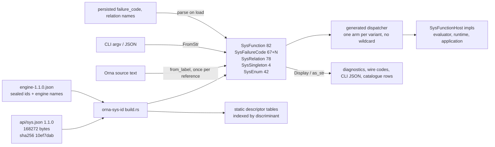

# reform(sys-identity): generated typed identity for the `sys` surface

**Epic:** `reform(sys-identity)` (bead `ornadb-ouxeq`)
**Status:** design for orchestrator review. No production code changes in this PR.
**Superseded in part (2026-11-11):** S1 and S3 are superseded by [sys-as-native.md](sys-as-native.md) and
[ADR 0123](../decisions/0123-sys-as-native-declarations.md), and so are sections 4.3 and 4.5. S0, S2 and S4 to S9
stand. S0 changes its input from the JSON catalogues to the declarations at SN2, and S2 stands until SN7. S10 stands,
scoped to the identity crate and its key enum.
**Authority:** `reference/Orna-1.1.0` (`api/sys.json`, `source/15-system.md`,
`source/34-system-reference.md`, `source/33-diagnostics.md`, `profiles/coordinates.json`).
**Scope:** the identity of `sys` functions, `sys` failure codes, `sys` relations and
singletons, and the versioned `name@version` identifiers the engine uses internally.
Behaviour, formats, wire codes and CLI output must not change.

---

## 0. Summary

OrnaDB today has three parallel, unreconciled representations of the same identity:

1. Build-time generated JSON (`OUT_DIR/api_sys.json`, `system_host_operations.json`, ...)
   which is embedded with `include_str!` and **re-parsed into string-keyed maps at
   runtime** (`crates/orna-sys/src/system_api.rs:97-124`,
   `crates/orna-sys/src/host_registry_model.rs:47-51`,
   `crates/orna-sys/src/format_api_selection.rs:213-215`).
2. Hand-written Rust constants duplicating the same names
   (`crates/orna-core/src/system.rs` - 45 hand-assigned 16-byte `_ID` constants
   (27 function, 17 type, 1 parameter) and 39 `sys.*`-valued name constants).
3. Bare string literals at every dispatch and failure site: **1,650 occurrences of
   `"sys.`... in `crates/**/*.rs`, 386 distinct values**, plus **182 occurrences of
   overload labels spelled `"sys.snapshot(SnapshotRef)"`-style** and **190 distinct
   three-segment failure codes**.

None of these is exhaustive. A new `api/sys.json` function today produces no compile
error anywhere: it silently becomes an unbound name that fails at runtime with
`sys.version.incompatible` or falls into a `_ =>` arm.

This design replaces all three with one generated, closed, exhaustive identity:

* a new zero-dependency crate `orna-sys-id` whose build script generates
  `SysFunction` (82 variants), `SysFailureCode` (spec codes plus engine codes),
  `SysRelation`, `SysSingleton`, `SysEnum` and static descriptor tables from the
  vendored 1.1.0 catalogue;
* a generated `SysHostBinding` trait plus dispatcher so that "the catalogue names a
  function that no host implements" and "a host implements a function the catalogue
  does not name" are both **compile errors**;
* names (`&'static str`) only at parse and print boundaries: `FromStr` in the
  parser/semantic resolver, `Display` in diagnostics, CLI JSON and catalogue rows.

`name@version` identifiers (`host.std.io.fs.read@1.0`,
`orna.kernel.value.boolean@1`, `langitem.sys.explain@1.0`) are **not** part of the
spec-fixed identity set; they are an open, versioned ABI namespace. They get a typed
versioned newtype (`VersionedId`), not an enum. Section 1.3 gives the rule.

---

## 1. What the specification actually fixes

Everything else is an implementation choice and must not be treated as protocol.

### 1.1 Portable `sys` member names (closed set, spec-fixed)

`api/sys.json` (`reference/Orna-1.1.0/api/sys.json`, 168,272 bytes,
sha256 `10ef7dab9665de4e065ee2b96797b2751c7c3f98f9886241011aee0cc8c0d40e`)
is declared normative by `source/34-system-reference.md:3`:

> This reference defines system names, field types and callable interfaces. ...
> A machine-readable schema is available in `api/sys.json` (reference/Orna-1.1.0/api/sys.json).

Its `counts` object fixes the closed sets:

| Set | Count | JSON key |
|---|---|---|
| singletons | 4 | `singletons` |
| opaque identifiers | 21 | `opaque_identifiers` |
| reference aliases | 78 | `reference_aliases` |
| value types | 35 | `value_types` |
| enums | 42 | `enums` |
| relations | 78 | `relations` |
| callables | 82 | `functions` |
| failure codes | 67 | `failure_codes` |

Two properties of the callable set matter for identity and are easy to get wrong:

* **Overloads are separate identities.** `functions[]` names include a
  parenthesised disambiguator: `sys.snapshot(SnapshotRef)`, `sys.snapshot(Str)`,
  `sys.admin.checkout(GitOid)`. `source/15-system.md:114` (ORNA-SYS-136) makes this
  normative: "Snapshot selection is represented by explicit overloads for
  `SnapshotRef`, `CommitRef`, `BranchRef`, `TagRef`, `GitOid` and `Str`; Orna 1.0
  defines no implicit `SnapshotLike` union or coercion type." So the identity is the
  pair `(path, overload-kind)`, not the path.
* **Grouped handles are identities too.** Relations carry `grouped_handle`
  (for example `sys.catalog.databases` for `sys.Database`); ORNA-SYS-009
  (`source/15-system.md:52`) binds the two: "A grouped catalogue/history handle and
  its canonical PascalCase relation MUST identify the same rows at the same
  snapshot." Both spellings must be typeable and distinct.

Naming rules that constrain the type: portable names are case-sensitive
(ORNA-SYS-010, `source/15-system.md:28`); no prefix matching, alias lookup or
case folding is permitted. A generated `match` on exact literals satisfies this by
construction. Name-typed access is also encouraged by the spec itself:
ORNA-SYS-001 (`source/15-system.md:18`) requires structural references to "use typed
references where possible, not unstructured path strings".

### 1.2 Failure codes (closed portable set plus engine codes)

`failure_codes` (67 entries) is the machine-readable portable set. `sys.Diagnostic`
declares `code : Str` and `severity : sys.Severity` - the code is a **string on the
wire and in stored rows**, so the exact bytes are part of the contract.
`source/33-diagnostics.md:41`: "Diagnostic codes are stable primary classifications;
implementations may add structured notes and secondary spans."

Measured reality in this tree:

* all 67 portable codes appear as Rust literals (good);
* Rust also raises **88 three-segment `sys.*` codes that appear nowhere in the
  specification's source prose or `api/sys.json`** - `sys.abi.*` (16),
  `sys.inspect.*` (13), `sys.security.*` (13), `sys.dependencies.*` (7),
  `sys.invoke.*` (6), `sys.fixture.*` (5), `sys.admin.*` (4),
  `sys.conformance.*` (4), `sys.test.*` (4), and singletons (`sys.binding.stub`,
  `sys.callback.rejected`, `sys.vendor.future_code`, ...). Two of them
  (`sys.admin.set_storage_preference`, `sys.admin.rewrite_storage`) are 1.0.0 names
  retained by `api/retired.json` for historical readers, not engine inventions.

That split is real and must survive the reform: portable codes are fixed by the
spec; engine codes are this implementation's own vocabulary. Both must be closed and
typed, but they must be *distinguishable at the type level* so a future spec
comparison cannot silently pass on a vendor name (ORNA-SYS-004,
`source/15-system.md:24`: a vendor extension "MUST NOT change portable row identity,
field meaning, ordering, failure codes, transaction boundaries or redaction rules").

Engine families that are **not in 1.1.0 at all** (verified by searching
`source/*.md`, `api/*.json`, `profiles/*`): `sys.inspect.*` (13 functions),
`sys.security.*` (13), `sys.state.*` (2), `sys.catalog.health`, plus
`sys.blob.annotate_all` and `sys.admin.pause_stream_with_reason`. They are shipped
behaviour and have persisted `FunctionId`s (section 2.5), so they cannot be renamed
or removed by this epic; they are classified as `Origin::Engine`.

### 1.3 `name@version` identifiers are *not* protocol identity

The strings the owner objected to fall into groups with very different standing:

| Example | Where it lives | Spec status | Correct type |
|---|---|---|---|
| `"sys.snapshot(SnapshotRef)"` | `api/sys.json` | fixed, closed | `enum SysFunction` |
| `"sys.object.not_found"` | `api/sys.json` | fixed, closed | `enum SysFailureCode` |
| `"sys.catalog.tables"` | `api/sys.json` `grouped_handle` | fixed, closed | `enum SysRelation` |
| `"sys.DiffScope"` + `"all"` | `api/sys.json` `enums` | fixed, closed | `enum SysEnum` + variant |
| `"sys.abi.precondition_failed"` | Rust only | engine vocabulary | `enum SysFailureCode` (`Origin::Engine`) |
| `"host.std.io.fs.read@1.0"` | `crates/orna-sys/src/host_filesystem.rs:262` | not in spec: host ABI role | `VersionedId` |
| `"orna.kernel.value.boolean@1"` | `crates/orna-core/src/catalogue.rs:2527` | not in spec: durable representation contract | `VersionedId` |
| `"langitem.sys.explain@1.0"` | `crates/orna-sys/src/system_api.rs` | not in spec: linkage tag | `VersionedId` |
| `"1.1"`, `"final-2026-10-05"`, `"ORP-1"` | `profiles/coordinates.json` | fixed coordinates | `SysVersion`, `PublicationRevision`, profile newtypes |

The only `name@version`-shaped things the specification fixes are the coordinates in
`profiles/coordinates.json` (`language`, `publication_revision`, `repository_format`,
and the profile coordinates `OGS-1`, `ORP-1`, `OGB-2`, `ROV-3`, `SOV-3`, `OVB-2`,
`VFS-1`, `MIME-1`, `orna.present.v1`) plus `sys_version` in `api/sys.json`. None of
`host.*`, `langitem.*`, `orna.kernel.*`, `orna.sys.*` appears anywhere in the spec
tree.

**Rule adopted by this design:** a set the spec closes gets an enum (exhaustive
matches, one variant per name, generation from the catalogue). A namespace the spec
leaves open and versioned - host roles, providers, representation contracts,
langitem tags - gets a validated newtype carrying `(namespace, name, version)` with
`FromStr`/`Display`. Making these enums would force a spec-shaped review for every
new host operation and would still not prevent `@2.0` variants of the same role.

---

## 2. Current state, measured

All numbers below are from `origin/main` at `7c5fce9e4` (worktree
`trees/sysid-design`), measured with `rg` over `crates/**`.

### 2.1 Volume of stringly identity

```
"sys.*" string literals in crates/**/*.rs      1,650 occurrences / 386 distinct
"sys.*" string literals incl. JSON fixtures    7,264 occurrences / 628 distinct
overload labels "sys.x(Y)" in crates/**/*.rs     182 occurrences
three-segment failure codes in crates/**/*.rs    190 distinct
   of which appear in spec prose                 102
   of which appear nowhere in the spec            88
"name@version" ABI identifiers                    48 distinct / 179 occurrences
```

The largest single consumer, `crates/orna-runtime/src/lib.rs` (54,369 lines), holds
191 of them; `crates/orna-evaluator/src/sys_bindings.rs` (2,392 lines) holds 114.

### 2.2 Dispatch by string with non-exhaustive fallbacks

`crates/orna-evaluator/src/sys_bindings.rs:212-270` is the whole dispatch prologue:

```rust
fn dispatch(
    &self,
    operation_name: &str,
    arguments: &[CanonicalValue],
    cancellation: Option<&CancellationToken>,
) -> Result<Option<CanonicalValue>, EvaluationError> {
    if operation_name == "std.random.entropy" {                 // :218
        ...
    }
    let registry = system_host_operation_registry();
    let Some(operation) = registry.operation(operation_name) else {   // :241
        return Ok(None);
    };
    if operation.effects.iter().any(|effect| !matches!(effect.as_str(), "read" | "invoke"))
    { return Err(redacted_error("ORNA-EVAL-UNSUPPORTED")); }          // :244-250
    let role = registry.role(&operation.role) ...;                    // :251
    if role.provider != operation.provider
        || !role.operations.iter().any(|candidate| candidate == operation_name) { ... }
    match role.provider.as_str() {                                    // :262
        "orna.sys.host.environment.v1" => self.dispatch_environment(operation, arguments),
        ...
        _ => Err(redacted_error("ORNA-EVAL-UNSUPPORTED")),             // :268
    }
}
```

and each per-provider dispatcher re-matches on the name and repeats the
`implementation` as a guard string, e.g. `crates/orna-evaluator/src/sys_bindings.rs:281`:

```rust
let value = match operation.name.as_str() {
    "std.io.fs.read_text" if operation.implementation == "read_text" => { ... }
    "std.io.fs.write_text" if operation.implementation == "write_text" => { ... }
    ...
    _ => return Err(redacted_error("ORNA-EVAL-UNSUPPORTED")),          // :440, :523
};
```

Five such `if`/`match` sites exist (`:212`, `:281`, `:447`, `:1481`, `:1646`), each
admitting a *different* subset of the catalogue, none of which the compiler relates
to `api/sys.json`.

The same pattern repeats in other crates:

* `crates/orna-runtime/src/lib.rs:6320-6325` validates an administrative function by
  matching a string pair:
  `matches!((function, reason.is_some()), ("sys.admin.pause_stream", false) | ("sys.admin.pause_stream_with_reason", true) | ("sys.admin.resume_stream", false))`
* `crates/orna-core/src/system.rs:1059-1196` (`SYSTEM_FUNCTIONS`) is a 27-entry
  descriptor table looked up by linear scan with `Option` results
  (`system_function_by_id` at `:1198`, `system_function_by_name` at `:1206`).
* `crates/orna-semantic/src/system_api.rs:682` `fn function(&self, name: &str)` over
  `functions: BTreeMap<String, Vec<FunctionDescriptor>>` (`:27-37`).
* `crates/orna-sys/src/format_api_selection.rs:257` `fn dispatch(&self, context, name: &str)`
  over `callables: BTreeMap<String, SystemCallable>` (`:213-215`).

### 2.3 Failure codes as bare strings, including inside SQL

`crates/orna-evaluator/src/sys_bindings.rs:1189` and `:1582` are the only two
constructors in the evaluator's system path, and both take a string:

```rust
fn static_failure(code: &'static str) -> FailureCode {
    FailureCode::new(code).expect("static provider failure code is valid")
}
fn redacted_error(code: &'static str) -> EvaluationError {
    EvaluationError::redacted(SafeText::new(code).expect("static evaluator error code is safe"))
}
```

`FailureCode(String)` at `crates/orna-sys/src/provider.rs:207` re-validates the string
at runtime, and `crates/orna-evaluator/src/sys_bindings.rs:1535` decides semantics from
a string prefix:

```rust
if code.as_str().starts_with("sys.abi.") { ... }
```

The same `ValueError` is mapped to a failure code by **three separate tables with
different defaults**, which is what happens when a vocabulary is spelled in strings
instead of named once:

```rust
// :1165 blob_reflection_failure            // :1442 blob_read_failure
ValueError::ContentUnavailable => "sys.blob.unavailable"
_ => "ORNA-EVAL-VALUE"                     // :1173
                                           // :1557 blob_value_failure
ValueError::InvalidMediaType => "sys.blob.invalid_media_type",
_ => "sys.abi.provider_failed",            // :1563
```

A typed `SysFailureCode` does not by itself deduplicate these - the migration must
preserve each site's existing mapping (a later issue may unify them only with a
behaviour decision). Its value is that the *vocabulary* becomes closed, so a typo or a
missing code is a compile error instead of a fourth default arm.

`crates/orna-runtime/src/lib.rs:2574-2585` maps internal errors to codes as strings:

```rust
pub fn public_code(&self) -> Option<&'static str> {
    match self {
        Self::AdminBusy => Some("sys.admin.busy"),
        ...
        _ => None,
    }
}
```

and `crates/orna-runtime/src/invocation.rs:727` **inlines a failure code into SQL**:

```rust
SET status = ?1, failure_code = 'sys.invoke.orphaned',
```

`failure_code` is a persisted TEXT column (`crates/orna-runtime/src/invocation.rs:188`
`pub failure_code: Option<String>`), so the bytes are durable.

The CLI then re-derives the vocabulary from strings
(`crates/orna-cli/src/fuse_mount.rs:4957`):

```rust
fn spec_code(cause: &'static str) -> Option<&'static str> {
    cause.starts_with("sys.").then_some(cause)
}
```

"Does this string name a specification code" is answered by a prefix test.

### 2.4 Duplicated metadata, embedded as JSON inside attributes

Host operation metadata is a hand-written JSON document inside a Rust attribute
(`crates/orna-sys/src/host_filesystem.rs:227-229`, one of 21 in
`crates/orna-sys/src/host_*.rs`):

```rust
#[sys_host_operation(
    r###"{"name":"sys.blob.capture_file","version":{"major":1,"minor":0},
         "signature":"fn sys.blob.capture_file(root: Str, path: Str, max_bytes: Int): Blob",
         "effects":["invoke"],"preconditions":[...],
         "failures":["sys.blob.source_denied","sys.blob.bounds","sys.blob.limit","sys.blob.source_changed"],
         "role":"host.sys.blob.capture@1.0","provider":"orna.sys.host.filesystem.v1",
         "implementation":"capture_file"}"###
)]
```

The build script parses it back with `serde_json::from_str`
(`crates/orna-sys/build_host.rs:553-592`), and the runtime parses the generated JSON
again into a `BTreeMap<String, HostOperationDescriptor>`
(`crates/orna-sys/src/host_registry_model.rs:47-51`, `:84`). Three parses of the same
facts, none type-checked against the catalogue: `std.io.fs.read_text` and
`sys.blob.capture_file` are host operations that no `api/sys.json` entry relates to
`SysFunction` today.

Meanwhile the *portable* function metadata uses a different, nicer attribute dialect
(`crates/orna-sys/src/system_api.rs`, 84 `#[ornasys(...)]` annotations), also parsed
from source text by `syn` (`crates/orna-sys/build_support.rs:899-1000`), also
serialised to JSON and re-parsed at runtime (`crates/orna-sys/src/system_api.rs:97-124`).
`system_api_json() -> String` clones the 168,272-byte document on every call.

### 2.5 Three identity representations for one function

```
orna-core::FunctionId     16 bytes, "function:<base32>"   crates/orna-core/src/lib.rs:187
orna_sys::FunctionId      arbitrary String                crates/orna-sys/src/lib.rs:131-144
QualifiedSemanticName     Vec of name parts               crates/orna-core/src/catalogue.rs
```

`crates/orna-core/src/system.rs:19-49` hand-assigns the durable ids:

```rust
pub const CATALOGUE_HEALTH_FUNCTION_ID: FunctionId =
    FunctionId::from_bytes([0, 0, 0, 0, 0, 0, 0, 0, 0, 0, 0, 0, 0, 0, 0, 1]);
pub const CATALOGUE_HEALTH_FUNCTION_NAME: &str = "sys.catalog.health";
pub const SYS_INVOKE_FUNCTION_ID: FunctionId =
    FunctionId::from_bytes([0, 0, 0, 0, 0, 0, 0, 0, 0, 0, 0, 0, 0, 0, 0, 2]);
```

...through `0x03`..`0x4d` for the remaining 25 entries. These bytes are durable
catalogue/snapshot state (`crates/orna-core/src/revision/tests/reserved_identities.rs:242`,
`:499`) and they have gaps, so they **cannot be re-derived** by enumeration order.
Any generated table must carry the bytes explicitly.

### 2.6 Admitting that coverage is test-enforced, not compiler-enforced

`crates/orna-sys/src/provider_linkage.rs:31-43` declares
`SystemSurfaceMember<'a> { Callable(&'a str), Relation(&'a str), ... }` and
`:56` declares `const DECLARED_LINKS: [SystemProviderLink; 19]`. The module doc says
the quiet part out loud:

> Every other provider is dispatched by a crate that depends on this one, so those
> links are declared here and tests in the dispatching crates cross-check them
> against the dispatch sites.

So today, agreement between "what the catalogue says exists", "what admission
accepts" and "what some crate implements" is maintained by hand-written tables and
tests spread across crates. That is the structural reason a new spec function can
land with no compile error: the only thing that would notice is a test that nobody
wrote for it.

### 2.7 Runtime cost of the current shape

* Every process that touches `sys` parses 168,272 bytes of JSON and builds seven
  `BTreeMap<String, _>` plus a `BTreeSet<String>` of failure codes
  (`crates/orna-semantic/src/system_api.rs:27-37`, `:221`) covering roughly 407
  catalogued members with nine `String` fields per callable (`:90-112`). That
  is roughly 1,150 `String` allocations before the first `sys.` name is resolved.
* `system_api_json() -> String` clones the full document per call
  (`crates/orna-sys/src/system_api.rs:127`).
* Dispatch performs at minimum two string comparisons plus a `BTreeMap` lookup plus a
  linear scan of `role.operations` before it reaches the implementation
  (`crates/orna-evaluator/src/sys_bindings.rs:241-261`).

The typed design removes all three: static tables, integer dispatch, no startup
parse.

---

## 3. Prior art

### 3.1 PostgreSQL: `pg_proc.dat` -> `fmgroids.h` / `fmgrtab.c`

`src/backend/utils/Gen_fmgrtab.pl`
(https://github.com/postgres/postgres/blob/master/src/backend/utils/Gen_fmgrtab.pl)

* The data file (`pg_proc.dat`) is the single authority; the generator emits
  `fmgroids.h` (macro per function), `fmgrprotos.h` and `fmgrtab.c`
  (`fmgr_builtins[]` plus the sparse `fmgr_builtin_oid_index[]` array and
  `fmgr_nbuiltins`).
* **Overload disambiguation is generated, not hand-written**: "`F_XXX` macros are
  named after the `proname` field; if that is not unique, we append the `proargtypes`
  field, replacing spaces with underscores. For example, we have `F_OIDEQ` ... but
  `F_POW_FLOAT8_FLOAT8`". Orna's `sys.snapshot(SnapshotRef)` is the same problem and
  gets the same treatment: one variant per catalogue label.
* The generated header exists so callers can reference a function "without a catalog
  lookup", and the table is sorted by OID with an index array - the design rationale
  for our `[SysCallableDescriptor; 82]` indexed by discriminant.
* The generator writes to a temp file and renames (`Catalog::RenameTempFile`), so a
  failed generation cannot leave a half-written header. Our build script already
  writes into `OUT_DIR`, which gives the same guarantee.

Applies: generation from one data file, generated per-overload symbols, dense table
plus index, byte-stable output. Does not apply: OID assignment (Orna has no user
visible OID space; `FunctionId` bytes already exist and are durable) and `prosrc`
symbol linking (Orna's provider seam is `SystemOperationProvider`, not C symbols).

### 3.2 SQLite: one `FuncDef` row per (name, arity)

`src/func.c` `sqlite3RegisterBuiltinFunctions()`
(https://github.com/sqlite/sqlite/blob/master/src/func.c, table at line 3424)

```c
static FuncDef aBuiltinFunc[] = {
    SFUNCTION(load_extension,    1, 0, 0, loadExt),
    SFUNCTION(load_extension,    2, 0, 0, loadExt),
    ...
    INLINE_FUNC(unlikely,        1, INLINEFUNC_unlikely, SQLITE_FUNC_UNLIKELY),
```

* One row per **(name, arity)** pair: overloads are separate rows, exactly as
  `sys.snapshot(SnapshotRef)` and `sys.snapshot(Str)` must be separate identities.
* Macros (`FUNCTION`, `SFUNCTION`, `DFUNCTION`, `INLINE_FUNC`, `TEST_FUNC`) encode
  the flag/arity class so the table stays one line per entry. The equivalent for
  Orna is a generated `#[repr(..)]` enum plus a generated descriptor array - no
  macro table needed, because the generator emits it.
* `SQLITE_FUNC_BUILTIN` distinguishes builtins from `sqlite3_create_function`
  registrations. We need the same distinction at the type level (`Origin::Portable`
  vs `Origin::Engine`) rather than a flag.
* Registration goes into a global hash at `sqlite3_initialize()`
  (`sqlite3InsertBuiltinFuncs`). Orna should **not** copy this: a static `match` gives
  the same lookup with no initialisation step and no mutable global.

### 3.3 DuckDB: default functions defined in the language, registered lazily

`src/catalog/default/default_functions.cpp`
(https://github.com/duckdb/duckdb/blob/main/src/catalog/default/default_functions.cpp)

```cpp
static const DefaultMacro internal_macros[] = {
    {DEFAULT_SCHEMA, "current_role", "() AS 'duckdb'"},
    {DEFAULT_SCHEMA, "array_to_string",
     "(arr, sep) AS case len(arr::varchar[]) when 0 then '' else ... end"},
    {nullptr, nullptr, nullptr}};
```

* The body of a default function is **source text in the target language**, parsed
  into catalog entries on first use (`DefaultFunctionGenerator::CreateInternalMacroInfo`,
  which builds `CREATE MACRO` text and parses it). Overloads live in the definition
  string: `"(x) AS x, (x, y) AS x+y"`.
* Lookup is a linear scan of the array (`DefaultFunctionMatches`).

Applies directly to the sibling epic `reform(std-native)`: anything in the `std`
surface that is expressible in Orna should be Orna source in the pinned `stdlib/std`
submodule, not Rust. It also justifies the identity split: a function's *identity*
(schema, name, overload) is metadata; its *body* may be source. Orna should implement
that separation - `SysFunction` carries identity and descriptors, while the
`std.*` surface moves to `.orna` source - but must not adopt lazy catalog mutation:
Orna's `sys` members are not user-mutable (ORNA-SYS-003,
`source/15-system.md:22`: source "MUST NOT declare, replace, shadow or
monkey-patch the root `sys` namespace").

Not applicable: DuckDB's dynamic catalog because Orna's `sys` is immutable and
versioned by the source snapshot; a linear scan because our set is fixed and small
enough for a generated `match`.

### 3.4 Lua: `luaL_Reg` arrays

`luaL_newlib` / `luaL_setfuncs` (https://www.lua.org/manual/5.4/manual.html#luaL_Reg)

```c
typedef struct luaL_Reg { const char *name; lua_CFunction func; } luaL_Reg;
```

A NULL-terminated array of `(name, function)` is the whole standard-library
registration surface.

Applies: the general shape "table of name plus implementation" and the discipline of
one table per library. Does not apply: Lua has no overloading and no closed catalogue,
so a name alone is an identity there; Orna needs the overload axis, and it needs
exhaustiveness, which a runtime array cannot give.

### 3.5 rustc: lang items and `#[rustc_intrinsic]`

* Lang items (https://doc.rust-lang.org/beta/unstable-book/language-features/lang-items.html):
  "The `rustc` compiler has certain pluggable operations, that is, functionality that
  isn't hard-coded into the language, but is implemented in libraries, with a special
  marker to tell the compiler it exists." They are resolved lazily and "`rustc` will
  emit an error when an item is needed but not found".
* Intrinsics (`library/core/src/intrinsics/mod.rs`, 177 `#[rustc_intrinsic]`
  declarations) are declared with real signatures in `core`, and rustc matches on a
  closed set; an intrinsic that is not lowered is a hard error, not a warning.

Applies: the split between a *low* crate that declares identity and signatures and
*high* crates that implement them; and the principle that an unbound identity is a
compile error rather than a runtime `Option::None`. Does not apply: late/lazy
resolution. Orna's catalogue is fixed at build time, so binding can be checked
eagerly, which is strictly stronger.

### 3.6 Roslyn: `WellKnownMember` enum plus a name table

https://github.com/dotnet/roslyn/blob/main/src/Compilers/Core/Portable/WellKnownMember.cs

A ~700-entry `internal enum WellKnownMember` (`System_Math__RoundDouble`, ...) with a
parallel `WellKnownMemberNames` string table and `WellKnownMembers.GetDescriptor`
returning the full symbol descriptor. Every enum member has exactly one name and every
name maps back; a unit test enforces the bijection.

This is the closest analogue to the target design and validates three choices:
closed enum, parallel descriptor table, and a bijection test between the enum and the
strings - except that Orna generates the enum *and* the table from the spec catalogue
instead of maintaining both by hand.

### 3.7 What does not apply to Orna

* **A mutable global function registry** (SQLite, DuckDB, Lua `luaL_setfuncs`):
  Orna's `sys` surface is closed by ORNA-SYS-002/003 and must not be user-mutable.
* **Dynamic registration by name** (`sqlite3_create_function`): the `sys` namespace is
  not extensible; extensions go to `sys.vendor.<vendor>` per ORNA-SYS-004.
* **Numeric OIDs as the primary identity** (PostgreSQL): Orna already has durable
  `FunctionId` bytes; the enum must preserve them, not replace them.
* **Lazy resolution** (lang items): Orna can and should fail at build time.

---

## 4. Target design

### 4.1 One identity, three boundaries



### 4.2 Crate layout

```
crates/orna-sys-id/                  new crate, zero runtime dependencies
    Cargo.toml                       [build-dependencies] serde_json = "..."
    build.rs                         catalogue JSON -> generated Rust in OUT_DIR
    catalogue/
        sys-1.1.0.json               byte copy of api/sys.json (sha256 pinned in build.rs)
        engine-1.1.0.json            sealed + engine-private identity table (new, derived)
    src/
        lib.rs                       re-exports, Origin, SysEffect, SysVersion
        versioned.rs                 VersionedId / Namespace / AbiVersion (name@version)
        function.rs                  include!(generated); SysFunction accessors
        error_code.rs                include!(generated); SysFailureCode accessors
        relation.rs                  include!(generated); SysRelation/SysSingleton/SysEnum
        descriptor.rs                static tables + lookup by discriminant
        generated/                   (OUT_DIR) functions.rs, codes.rs, relations.rs, tables.rs
    tests/
        catalogue_bijection.rs       enum <-> catalogue bytes, both directions
        versioned_id.rs              parse/print of every name@version literal in the tree
```

`orna-sys-id` depends on **nothing** in the workspace. That is the whole point: it
must sit below `orna-core` (today: depends on `orna-syntax`, `orna-value` only) and
below `orna-sys` (depends on `orna-foundation`, `orna-security`, `orna-syntax`), so
both can use one identity type without a cycle. A build dependency on `serde_json` is
build-only; the shipped crate has no dependencies.

The catalogue is vendored inside the crate rather than read from
`crates/orna-conformance/tests/fixtures/` because a build script must only read files
inside its own package to stay publishable and hermetic. A test pins equality:

```rust
// tests/catalogue_bijection.rs
const SYS_API_1_1_SHA256: &str =
    "10ef7dab9665de4e065ee2b96797b2751c7c3f98f9886241011aee0cc8c0d40e";

#[test]
fn vendored_catalogue_is_the_reviewed_final_contract() {
    let vendored = include_str!("../catalogue/sys-1.1.0.json");
    assert_eq!(format!("{:x}", Sha256::digest(vendored)), SYS_API_1_1_SHA256);
    let fixture = std::fs::read_to_string(concat!(
        env!("CARGO_MANIFEST_DIR"),
        "/../orna-conformance/tests/fixtures/reference/api/sys.json"
    )).unwrap();
    assert_eq!(vendored, fixture, "vendored copy must equal the conformance fixture");
}
```

### 4.3 Generated types

```rust
// crates/orna-sys-id/src/generated/functions.rs  (build output)
#[derive(Clone, Copy, Debug, Eq, Hash, Ord, PartialEq, PartialOrd)]
pub enum SysFunction {
    BlobAbort,                 // "sys.blob.abort"
    BlobDigest,                // "sys.blob.digest"
    BlobRead,                  // "sys.blob.read"
    AdminCheckoutSnapshotRef,  // "sys.admin.checkout(SnapshotRef)"
    AdminCheckoutStr,          // "sys.admin.checkout(Str)"
    SnapshotSnapshotRef,       // "sys.snapshot(SnapshotRef)"
    SnapshotStr,               // "sys.snapshot(Str)"
    ...
}

pub const SYS_FUNCTION_COUNT: usize = 82;

impl SysFunction {
    pub const ALL: [SysFunction; SYS_FUNCTION_COUNT] = [ ... ];

    /// Exact `api/sys.json` `functions[].name`, overload label included.
    #[must_use]
    pub const fn label(self) -> &'static str { ... }

    /// Resolved path without the overload disambiguator (`sys.snapshot`).
    #[must_use]
    pub const fn path(self) -> &'static str { ... }

    /// Overload disambiguator (`SnapshotRef`), `None` for an unoverloaded callable.
    #[must_use]
    pub const fn overload(self) -> Option<&'static str> { ... }

    #[must_use]
    pub const fn descriptor(self) -> &'static SysCallableDescriptor { ... }

    #[must_use]
    pub const fn effect(self) -> SysEffect { ... }

    #[must_use]
    pub const fn origin(self) -> Origin { ... }

    /// Exact, case-sensitive inverse of [`Self::label`].
    #[must_use]
    pub fn from_label(label: &str) -> Option<Self> { ... }

    /// Name-only lookup for a callable with no overloads; refuses ambiguity.
    #[must_use]
    pub fn from_path(path: &str) -> Result<Self, AmbiguousPath> { ... }
}

impl fmt::Display for SysFunction { /* label() */ }
impl std::str::FromStr for SysFunction { type Err = UnknownSysMember; /* from_label */ }
```

`from_label` and `label` are generated as `match` over string literals. The compiler
turns the forward direction into a length switch plus literal comparisons, which is
the fastest available form, is allocation-free, and - because the literals are exact -
cannot violate ORNA-SYS-010 (no case folding, no prefix match).

```rust
// crates/orna-sys-id/src/generated/codes.rs
#[derive(Clone, Copy, Debug, Eq, Hash, Ord, PartialEq, PartialOrd)]
pub enum SysFailureCode {
    // Origin::Portable - generated from api/sys.json `failure_codes` (67)
    VersionIncompatible,       // "sys.version.incompatible"
    ObjectNotFound,            // "sys.object.not_found"
    // Origin::Engine - generated from engine-1.1.0.json
    AbiPreconditionFailed,     // "sys.abi.precondition_failed"
    VfsStaleEdit,              // "sys.vfs.stale_edit"
    InvokeOrphaned,            // "sys.invoke.orphaned"
    ...
}

impl SysFailureCode {
    pub const ALL: &'static [SysFailureCode];
    /// Exactly the `api/sys.json` `failure_codes` set, in catalogue order.
    pub const PORTABLE: &'static [SysFailureCode];
    #[must_use] pub const fn as_str(self) -> &'static str;
    #[must_use] pub const fn origin(self) -> Origin;
    #[must_use] pub const fn is_portable(self) -> bool { matches!(self.origin(), Origin::Portable) }
    /// Engine ABI failures, replacing the `starts_with("sys.abi.")` test.
    #[must_use] pub const fn is_provider_abi(self) -> bool;
    #[must_use] pub fn parse(code: &str) -> Option<Self>;
}
```

Wire and storage safety: `as_str` returns the exact bytes; `parse` is the only
inbound door; a bijection test walks `ALL` in both directions and compares against
the catalogue JSON. `PORTABLE` is the set the spec comparison uses, so an engine code
can never be mistaken for a specification code again.

Relations, singletons, enums and types follow the same generator:

```rust
pub enum SysRelation { Database, File, Definition, ... }   // 78 canonical names
pub enum SysGroupedHandle { CatalogDatabases, CatalogTables, ... } // 78 handles
pub enum SysSingleton { Database, Current, Rt, Repl }      // 4
pub enum SysEnum { RuntimeMode, ObjectKind, Severity, ... } // 42
pub enum SysEnumValue { ... }                              // per-enum variants
pub enum SysType { DatabaseId, RowRefT, ... }              // 35 value types + 78 aliases + 21 opaque
```

`SysRelation::handle()` returns the `grouped_handle` identity for the canonical name
(`sys.Database` -> `sys.catalog.databases`), which is ORNA-SYS-009 encoded in the type
system instead of in a comment.

### 4.4 Removed names and ORNA rule codes

`removed_names` is part of the catalogue and carries a MUST:
ORNA-SYS-005 (`source/15-system.md:26`) requires that `sys.runtime` "MUST produce
`ORNA100-E-SYS-RUNTIME` with `sys.rt` as the suggested spelling. It is not an alias."
Today that lives in an untitled string map
(`crates/orna-semantic/src/system_api.rs:33` `removed: BTreeMap<String, RemovedName>`,
struct at `:131-137` with `replacement: Option<String>`, `diagnostic: String`).

The catalogue field is **heterogeneous**: the four entries under
`api/sys.json` `removed_names` carry either an `ORNA*` rule code
(`ORNA100-E-SYS-RUNTIME`, twice) or a `sys.*` failure code
(`sys.version.incompatible`, twice), and only the retired pair carries a `reason`.
A single string type cannot represent that without losing the distinction the spec
draws between a *source* diagnostic and a *runtime* failure, so the generator emits:

```rust
pub enum SysRemovedName {                       // 4 variants, one per catalogue entry
    Runtime,                                    // "sys.runtime"
    RuntimeInfo,                                // "sys.runtime_info"
    AdminSetStoragePreference,                  // "sys.admin.set_storage_preference"
    AdminRewriteStorage,                        // "sys.admin.rewrite_storage"
}

pub enum PortableRemoval {
    /// Still resolvable through another portable member (never an alias).
    Replaced { by: SysMemberPath, diagnostic: DiagnosticIdentity },
    /// Retired with no replacement; the reason is user-visible.
    Retired { diagnostic: DiagnosticIdentity, reason: &'static str },
}

/// The replacement target of a removed name. `sys.rt` is a singleton and
/// `sys.rt.info` is one field of it, so a flat `SysFunction`/`SysRelation`
/// cannot express these; the path is still a closed set.
pub enum SysMemberPath {
    Callable(SysFunction),
    Relation(SysRelation),
    GroupedHandle(SysGroupedHandle),
    Singleton(SysSingleton),
    SingletonField(SysSingleton, SysField),     // validated at build time
}

pub enum DiagnosticIdentity {
    Rule(RuleCode),                             // "ORNA100-E-SYS-RUNTIME"
    Failure(SysFailureCode),                    // "sys.version.incompatible"
}

/// A closed `ORNA`-family rule code. Seeded here from the diagnostics the
/// catalogue itself names; the full `source/33-diagnostics.md` table
/// (28 codes, currently bare strings in `crates/orna-syntax/src/parser.rs:1876`
/// and `crates/orna-cli/src/main.rs:351`) is a separate follow-up, so this
/// type stays small and honest rather than pretending to be complete.
#[derive(Clone, Copy, Debug, Eq, PartialEq)]
pub struct RuleCode(&'static str);
```

`SysField` is generated from the field lists the catalogue already publishes for
relations and value types, and `SingletonField` construction is checked at build time -
so `sys.rt.info` cannot be spelled as a field the catalogue does not declare.

Scope boundary, stated explicitly: `ORNA*` rule codes are **not** part of this epic
except where `api/sys.json` names one. They get the same treatment later; the design
keeps `DiagnosticIdentity` ready for it instead of forcing `sys.*` codes and `ORNA*`
rules into one enum now (they are different vocabularies with different stability
guarantees: `source/33-diagnostics.md:41` for rule codes, `api/sys.json`
`failure_codes` for portable failures).

### 4.5 Exhaustive dispatch

The build script emits a dispatcher skeleton *and* a trait, so binding is checked by
the compiler rather than by `provider_linkage.rs` tests:

```rust
// crates/orna-sys-id/src/generated/tables.rs  (generated)
pub trait SysFunctionHost {
    fn blob_read(&self, args: &[CanonicalValue]) -> SysCallOutcome;
    fn snapshot_snapshot_ref(&self, args: &[CanonicalValue]) -> SysCallOutcome;
    fn admin_checkout_str(&self, args: &[CanonicalValue]) -> SysCallOutcome;
    // one method per sys function the implementing crate binds
}

pub fn dispatch<H: SysFunctionHost>(
    host: &H,
    function: SysFunction,
    args: &[CanonicalValue],
) -> SysCallOutcome {
    match function {
        SysFunction::BlobRead => host.blob_read(args),
        SysFunction::SnapshotSnapshotRef => host.snapshot_snapshot_ref(args),
        SysFunction::Meta => SysCallOutcome::Unavailable(Origin::Portable),
        ...
    }
}
```

Two properties follow:

1. A new catalogue entry appears in the generated `match` immediately, pointing at a
   trait method nobody implements, so **the workspace stops compiling** until the
   function is either implemented or explicitly classified `Unavailable`.
2. The `match` has no `_` arm; `crates/orna-evaluator/src/sys_bindings.rs` therefore
   loses the five `_ => redacted_error("ORNA-EVAL-UNSUPPORTED")` fallbacks that today
   hide unbound functions.

`SysCallOutcome` keeps today's semantics exactly:

```rust
pub enum SysCallOutcome {
    Value(CanonicalValue),
    /// The member is catalogued but no provider is linked in this host
    /// (ORNA-SYS-008: fail before evaluates writes).
    Unavailable(Origin),
    Failure(SysFailureCode),
}
```

The existing admission machinery (`SystemProviderHost`,
`crates/orna-sys/src/provider_linkage.rs:44-54`) stops being a hand-maintained table of
19 string links: the per-function host becomes a generated
`const LINK: [Option<SystemProviderHost>; SYS_FUNCTION_COUNT]` that the binding crate
must fill, and a test asserts every one of the 82 entries is either `Some(host)` or
documented as deliberately unbound.

### 4.6 Where strings may still exist

Only four boundaries, each with a single function:

| Boundary | Direction | API |
|---|---|---|
| Source parsing | name -> identity | `SysFunction::from_label` / `from_path` (parser, `orna-semantic` resolver) |
| Diagnostics and CLI JSON | identity -> name | `Display` / `as_str()` |
| Persisted rows (`failure_code` TEXT, relation names, representation contracts) | both | `parse` on load, `as_str` on store, never inline in SQL |
| Generated artifacts (`api_sys.json`, host registry JSON, Orna stubs) | identity -> name | generator only |

Everything else takes `SysFunction`, `SysFailureCode`, `SysRelation`,
`SysSingleton`, `SysEnumValue` by value. In particular:

* `HostOperationDescriptor.name: SysFunction` (not `String`);
* `OperationId`/`SemanticRoleId` keep their own newtypes for *host provider* identity,
  but the catalogue-side key is `SysFunction`;
* `FailureCode` becomes `FailureCode(SysFailureCode)` - still `Copy`, still comparable,
  no validation failure path;
* `SystemMember<'a>` becomes `SystemMember { Callable(SysFunction), Relation(SysRelation), HistoricalView(SysRelation), Singleton(SysSingleton) }`;
* `RuntimeError::public_code() -> Option<SysFailureCode>`.

### 4.7 `VersionedId` for `name@version`

```rust
// crates/orna-sys-id/src/versioned.rs
#[derive(Clone, Copy, Debug, Eq, Hash, Ord, PartialEq, PartialOrd)]
pub enum Namespace { Host, Langitem, Orna, Std, Sys, Vendor }

#[derive(Clone, Copy, Debug, Eq, Hash, Ord, PartialEq, PartialOrd)]
pub struct AbiVersion { pub major: u16, pub minor: u16 }

/// A validated, versioned provider/role/representation identifier of the form
/// `namespace.name@major.minor` (or `@major`), for example
/// `host.std.io.fs.read@1.0` or `orna.kernel.value.boolean@1`.
#[derive(Clone, Debug, Eq, Hash, Ord, PartialEq, PartialOrd)]
pub struct VersionedId {
    namespace: Namespace,
    path: Box<str>,          // "std.io.fs.read"
    version: AbiVersion,
}

impl VersionedId {
    #[must_use] pub fn new(namespace: Namespace, path: &str, version: AbiVersion) -> Result<Self, IdError>;
    #[must_use] pub fn namespace(&self) -> Namespace;
    #[must_use] pub fn path(&self) -> &str;
    #[must_use] pub fn version(&self) -> AbiVersion;
    #[must_use] pub fn same_role(&self, other: &Self) -> bool; // namespace+path, any version
}
impl fmt::Display for VersionedId { /* "host.std.io.fs.read@1.0" */ }
impl std::str::FromStr for VersionedId { type Err = IdError; }
```

Constructed from `&'static str` constants today, parsed at every existing boundary.
`AbiVersion` already exists (`crates/orna-sys/src/abi_version.rs`) and moves here.
This type also replaces `crates/orna-core/src/catalogue.rs:2522-2527`'s
`ValueTypeDefinition::primitive(..., representation: &str)` parameter - a durable
catalogue field that participates in semantic hashes - with the same bytes and a
parser that refuses malformed values at construction.

Rejected: an enum over the 48 current literals (they are versioned and grow per host;
`@2.0` of the same role is a legitimate future value), and staying with `&str`
(today's state, which is how `system_api.rs` accepts
`role = "langitem.sys.explain@1.0"` with no validation at all).

---

## 5. Migration plan

Ten stages, each independently mergeable, each one agent PR, in this order. Every
stage ships with the tests that prove it changed no behaviour. One bead per stage is
filed under `ornadb-ouxeq`:

| Stage | Bead | One-line scope |
|---|---|---|
| S0 | `ornadb-ouxeq.1` | generate `orna-sys-id` identity tables (no consumers) |
| S1 | `ornadb-ouxeq.2` | `orna-sys` descriptors from the typed table |
| S2 | `ornadb-ouxeq.3` | typed host-operation attributes replace embedded JSON |
| S3 | `ornadb-ouxeq.4` | exhaustive evaluator dispatch over `SysFunction` |
| S4 | `ornadb-ouxeq.5` | typed failure codes in evaluator and provider ABI |
| S5 | `ornadb-ouxeq.6` | semantic admission carries typed identity |
| S6 | `ornadb-ouxeq.7` | runtime typed codes, typed admin functions, no SQL literals |
| S7 | `ornadb-ouxeq.8` | application, CLI and conformance adapters typed |
| S8 | `ornadb-ouxeq.9` | sealed engine registry becomes generated data |
| S9 | `ornadb-ouxeq.10` | `VersionedId` for the open `name@version` namespace |
| S10 | `ornadb-ouxeq.11` | remove escape hatches and guard against new string ids |

Ordering constraints: S0 before everything; S3 requires S1 and S2; S5 requires S3;
S8 is independent of S1-S7 and can run in parallel; S9 is independent of S1-S8 except
for the `HostOperationDescriptor` field it retypes in S2.

### S0 - `orna-sys-id`: generate the identity tables (no consumers)

*Files:* new `crates/orna-sys-id/**` (Cargo.toml, build.rs, `catalogue/sys-1.1.0.json`,
`catalogue/engine-1.1.0.json`, `src/{lib,versioned,function,error_code,relation,removed,descriptor}.rs`,
`tests/{catalogue_bijection,versioned_id,removed_names}.rs`), root `Cargo.toml` members.

*Content of `engine-1.1.0.json`:* the 27 sealed entries of
`crates/orna-core/src/system.rs:19-1058` (id bytes, name parts, signature), the 13
`sys.inspect.*`, 13 `sys.security.*`, 2 `sys.state.*` names, and the engine failure
codes enumerated in section 1.2. Each entry records `origin: engine`, so the portable
set stays exactly the 67 catalogue codes.

*Removed names (section 4.4):* `SysRemovedName` (4 variants), `PortableRemoval`,
`SysMemberPath`, `DiagnosticIdentity`, `RuleCode` and `SysField`, generated from
`removed_names` plus the catalogue's declared field lists, so `sys.rt` and
`sys.rt.info` are closed identities and `sys.rt.info` cannot name an undeclared field.

*Acceptance:*
* `cargo test -p orna-sys-id` green; bijection tests prove:
  every `functions[]` entry has exactly one variant whose `label()` is byte-equal;
  `SYS_FUNCTION_COUNT == 82`; `PORTABLE.len() == 67`;
  `as_str`/`parse` round-trip for every variant of every enum;
  vendored catalogue sha256 `10ef7dab...` and byte equality with the conformance fixture.
* `cargo test -p orna-sys-id --test versioned_id` parses every `name@version` literal
  currently present in `crates/**` (list generated from the tree in the test) and
  prints the identical string.
* No other crate changed: `git diff --stat` touches only the new crate plus
  `Cargo.toml`/`Cargo.lock`.

*Proof commands:*
```
cargo test -p orna-sys-id --locked
cargo test -p orna-sys --locked --test system_registry_parity
```

### S1 - `orna-sys`: descriptors come from the typed table

> **Superseded in part (2026-11-11).** Descriptors come from the lowered declarations of `sys.orna`, not from generated
> tables. See [sys-as-native.md](sys-as-native.md), stages SN5 and SN6.

*Files:* `crates/orna-sys/src/lib.rs` (`SystemFunctionDescriptor` gains
`function: SysFunction`), `src/system_api.rs` (`SYSTEM_FUNCTION_DESCRIPTORS` built from
`SysFunction::ALL`; `system_function_descriptor` delegates to `from_label`),
`src/format_api_selection.rs` (`callables: [SystemCallable; SYS_FUNCTION_COUNT]`),
`crates/orna-sys/Cargo.toml` (+`orna-sys-id`).

*Acceptance:* `system_api_json()` bytes unchanged (sha256 `10ef7dab...` asserted in
`sys_api_generation.rs` already), `system_api_selection` decisions identical for every
`(format, context, name)` triple - the existing 400-line test module in
`format_api_selection.rs:333-508` already enumerates them and must pass unchanged.

*Proof commands:*
```
cargo test -p orna-sys --locked --test sys_api_generation --test system_registry_parity \
    --test sys_api_export --test system_provider_abi
```

### S2 - typed host-operation attributes replace embedded JSON

*Files:* `crates/orna-sys/src/host_{filesystem,network,process,environment,clock}.rs`
(21 attributes rewritten), `build_host.rs` (parse typed keys, not `serde_json::from_str`),
`src/host_registry_model.rs` (`HostOperationDescriptor.name: SysFunction`,
`role: VersionedId`, `failures: &'static [SysFailureCode]`), `src/host_registry.rs`.

Attribute dialect after this stage:

```rust
#[sys_host_operation(
    function = SysFunction::BlobCaptureFile,
    effects = [SysEffectKind::Invoke],
    failures = [SysFailureCode::BlobSourceDenied, SysFailureCode::BlobBounds,
                SysFailureCode::BlobLimit, SysFailureCode::BlobSourceChanged],
    role = "host.sys.blob.capture@1.0",
    provider = HostProvider::Filesystem,
    implementation = "capture_file"
)]
pub fn capture_file(&self, root: &str, path: &str, max_bytes: u64) -> Result<CaptureFileStream, CaptureFileError>
```

Preconditions stay as doc-comment prose (the `#[ornasys]` collector already extracts
doc sections, `crates/orna-sys/build_support.rs:1063-1085`), so the JSON blob loses
only the machine-checkable fields.

*Acceptance:* `system_host_operations.json` byte-identical to the pre-stage build for
all 21 operations (pin its sha256 in a new test); `host_registry_parity.rs` and
`system_provider_abi.rs` unchanged and green; the build script rejects an annotation
whose `function` is not a real `SysFunction` variant (unit test in `build_host.rs`).

*Proof commands:*
```
cargo test -p orna-sys --locked --test host_registry_parity --test system_provider_abi \
    --test system_binding_stubs
```

### S3 - exhaustive evaluator dispatch

> **Superseded in part (2026-11-11).** Dispatch is by registration at link, with a pinned not-yet list. The generated
> `SysFunctionHost` trait goes. See [sys-as-native.md](sys-as-native.md), stages SN5 and SN6.

*Files:* `crates/orna-evaluator/src/sys_bindings.rs` (2,392 lines -> provider
implementations plus `impl SysFunctionHost`), new
`crates/orna-evaluator/src/sys_dispatch.rs` (registry lookup by `SysFunction`),
`src/lib.rs` (`SystemMember`/call plumbing by identity).

*Acceptance:* the five string dispatchers (`:212`, `:281`, `:447`, `:1481`, `:1646`)
are gone; `SysHostBindingRegistry::dispatch` takes `SysFunction`; new test
`every_catalogued_callable_is_classified` iterates `SysFunction::ALL` and asserts each
is implemented or `Unavailable`; every existing evaluator test passes unchanged,
including the byte-level `explain_runtime.rs` expectations.

*Proof commands:*
```
cargo test -p orna-evaluator --locked
cargo test -p orna-evaluator --locked --test explain_runtime --test sys_provider_linkage
```

### S4 - typed failure codes in the evaluator and provider ABI

*Files:* `crates/orna-evaluator/src/sys_bindings.rs` (`static_failure`,
`redacted_error`), `src/lib.rs` (24 error sites), `crates/orna-sys/src/provider.rs`
(`FailureCode(SysFailureCode)`, `ProviderFailure`), `crates/orna-sys/src/lib.rs`.

*Acceptance:* no `"sys.` literal remains in the evaluator except in test fixtures;
`starts_with("sys.abi.")` becomes `is_provider_abi()`; every existing test that asserts
a code string passes unchanged (they assert the same bytes). The three duplicated
`ValueError` tables keep their **per-site** mappings and defaults - deduplicating them
would change behaviour at at least one call site and is out of scope here; a test pins
each of the three sites' code for every `ValueError` variant.

*Proof commands:*
```
cargo test -p orna-evaluator --locked
cargo test -p orna-sys --locked
cargo test -p orna-conformance --locked --test sys_api_contract
```

### S5 - semantic admission carries identity

*Files:* `crates/orna-semantic/src/system_api.rs` (`SystemMember` payloads typed,
`SystemApi` maps keyed by `SysFunction`/`SysRelation`, `removed` map replaced by
`SysRemovedName` and `PortableRemoval` from section 4.4, `enum_constant` returns
`SysEnumValue`), `crates/orna-semantic/src/lib.rs` (`function.name != "sys.invoke"` at
`:19607`, `spelled == Some("sys.explain")` at `crates/orna-evaluator/src/lib.rs:9145`),
`crates/orna-sys/src/provider_linkage.rs` (`SystemSurfaceMember` typed,
`DECLARED_LINKS` -> generated `LINK` table), `crates/orna-sys/src/lib.rs`
(`SysHostBinding` admission).

*Acceptance:* `sys_api_contract.rs` (110 literals today) rewritten against typed names
and still asserting the same document properties; admission of every relation and
callable is decided by the generated link table, proven by a test that iterates
`SysFunction::ALL` and `SysRelation::ALL`. ORNA-SYS-005 behaviour is byte-identical:
`sys.runtime` reports `ORNA100-E-SYS-RUNTIME` with the suggestion `sys.rt`,
`sys.runtime_info` reports the same rule with the suggestion `sys.rt.info`, and
`sys.admin.set_storage_preference` / `sys.admin.rewrite_storage` report
`sys.version.incompatible` with no replacement - asserted for all four catalogue
entries, with the suggestion produced from `SysMemberPath`, not from a string constant.

*Proof commands:*
```
cargo test -p orna-semantic --locked
cargo test -p orna-conformance --locked --test sys_api_contract --test reference_corpus
cargo test -p orna-evaluator --locked --test evaluator
```

### S6 - runtime: typed codes, typed admin functions, no SQL code literals

*Files:* `crates/orna-runtime/src/lib.rs` (`public_code`, `reject_admin_stream_effect_as_busy`),
`src/invocation.rs` (`failure_code: Option<SysFailureCode>` on load/store; bind the code
as a SQL parameter at `:727`), `src/vfs.rs`.

*Acceptance:* `public_code() -> Option<SysFailureCode>`; the persisted
`failure_code` column round-trips the same bytes for every `SysFailureCode::ALL`
(exhaustive test); no `'sys.` SQL string literal remains in the crate.

*Proof commands:*
```
cargo test -p orna-runtime --locked
cargo test -p orna-runtime --locked --test checkpoint_reset_provider --test activation_owner_fence
```

### S7 - application, CLI and conformance adapters

*Files:* `crates/orna-application/src/lib.rs` (`SourceEffectFailed(SysFailureCode)`,
relation routing at `:2608`, `:2661`, `:3019`, `:3299`),
`crates/orna-cli/src/fuse_mount.rs` (`cause()`, `spec_code`, `DRAFT_RETAINED`, 24 sites),
`crates/orna-cli/src/cli_mount.rs`, `crates/orna-conformance/src/semantic_adapter.rs`
(`PUBLICATION_RELATIONS`), `crates/orna-conformance/tests/*` where names are asserted.

*Acceptance:* CLI JSON output byte-identical for the existing scenario oracles
(`cargo test -p orna-cli`), including
`"code":"sys.vfs.stale_edit"` (`crates/orna-cli/src/cli_mount.rs:1824`); the
`spec_code(cause: &'static str)` prefix test is deleted.

*Proof commands:*
```
cargo test -p orna-application --locked
cargo test -p orna-cli --locked
cargo test -p orna-conformance --locked
```

### S8 - sealed engine registry becomes a data table

*Files:* `crates/orna-core/src/system.rs` (2,180 lines -> includes generated table;
`SYSTEM_FUNCTIONS` derived), `crates/orna-core/src/security.rs`,
`crates/orna-core/src/lib.rs` (+`orna-sys-id` dependency),
`crates/orna-sys-id/catalogue/engine-1.1.0.json` (authority for the ids).

*Acceptance:* the 27 `FunctionId` byte values and every `_NAME` string identical
(asserted against a literal table in the test at `:1235`); `system_function_by_id` and
`system_function_by_name` keep their signatures and results; `EngineFunction` enum
generated with one variant per entry so `orna-core` matches exhaustively.

*Proof commands:*
```
cargo test -p orna-core --locked
cargo test -p orna-core --locked --test reserved_identities
```

### S9 - `VersionedId` for the open `name@version` namespace

*Files:* `crates/orna-sys-id/src/versioned.rs` (new in S0, consumed here),
`crates/orna-sys/src/{abi_version,provider,provider_linkage}.rs`
(`OperationId`, `SemanticRoleId`, role/provider ids), `crates/orna-core/src/catalogue.rs`
(`ValueTypeDefinition` representation contract, `orna.sys.source.function@1`),
`crates/orna-sys/src/system_api.rs` (`role = "langitem.*@1.0"` attribute values
validated at build time).

*Acceptance:* every previously `&str` identifier displays its identical bytes; a test
parses all 48 literals from the tree; malformed ids are rejected at construction
(unit tests per error variant).

*Proof commands:*
```
cargo test -p orna-sys-id --locked --test versioned_id
cargo test -p orna-sys --locked
cargo test -p orna-core --locked
```

### S10 - remove the escape hatches and enforce the invariant

*Files:* `crates/orna-sys/src/lib.rs` (deprecate/remove
`system_function_descriptor(&str)` in favour of `SysFunction::from_label(...)`),
`crates/orna-sys/src/system_api.rs` (`system_api_json() -> &'static str`),
new `crates/orna-conformance/tests/sys_identity_literals.rs`.

*Acceptance:* `system_api_json()` no longer allocates; the new conformance test fails
if any crate outside `orna-sys-id` contains a `"sys.`-prefixed literal that is not
(a) an exact `SysFunction`/`SysFailureCode`/`SysRelation` label produced through the
typed API, or (b) in an allow-listed file (wire fixtures, docs, this design doc). This
is the guard that keeps the reform from decaying.

*Proof commands:*
```
cargo test -p orna-conformance --locked --test sys_identity_literals
cargo clippy --workspace --locked --all-targets -- -D warnings
```

---

## 6. Risks, performance, specification constraints

### 6.1 Risks

| Risk | Severity | Mitigation |
|---|---|---|
| An enum variant renamed during generation changes a wire code | high | S0 bijection test pins every string against `api/sys.json` bytes and `engine-1.1.0.json`; `as_str` values never hand-edited |
| Re-deriving `FunctionId` bytes from enum order changes durable ids | high | ids stay explicit data in `engine-1.1.0.json`; S8 asserts the 27 byte values verbatim |
| The generator becomes a second authority the spec can drift from | medium | catalogue is a byte copy of the frozen fixture with a sha256 constant; a test compares it to `crates/orna-conformance/tests/fixtures/reference/api/sys.json`; no hand edits allowed in `generated/` |
| An enum variant left out of the dispatch `match` because a `_` arm hides it | high | S0 generates the enum *and* `ALL`; S3 generates the dispatcher from `ALL` with no `_` arm, and a test asserts the generated match has one arm per variant |
| Build-time `syn` scanning grows more fragile | medium | the new generator reads JSON only; the annotation collector keeps its existing role but must resolve `SysFunction::Variant` paths (already parsed by `syn`) instead of free-form strings |
| Ruleset churn: spec adds `sys.admin.checkout(RowRef)` | low | regeneration only; no Rust edit, because the variant is generated |
| Repository-format legacy readers (1/2) still need 1.0.0 names | medium | `format_api_selection` keeps the `contexts` axis; typed table keeps per-callable availability, and `orna-sys-id` gains a `contexts` field so legacy admission is unchanged (S1) |
| Engine names (`sys.inspect.*`) are not in the spec, so a future spec may claim them differently | medium | `Origin::Engine` is visible at the type level and in tests; no portable code may be `Origin::Engine` |

### 6.2 Performance

* Startup: removes a 168,272-byte parse and roughly 1,150 `String` allocations per
  process (`crates/orna-semantic/src/system_api.rs:221`) in favour of static tables.
* Dispatch: `SysFunction` is a `Copy` integer; `descriptor()` is one array index;
  `from_label` is a generated `match` (length switch plus literal compare), replacing
  a `BTreeMap<String, _>` lookup plus a linear scan of `role.operations`
  (`crates/orna-evaluator/src/sys_bindings.rs:241-261`).
* Allocation: `static_failure` and `redacted_error` stop allocating a `String` and stop
  having a failure path (`FailureCode::new(...).expect(...)` disappears).
* Size: 82 callable descriptors plus 190 codes plus relation/enum tables are
  `&'static str` tables - the same bytes that are embedded today as JSON, minus the
  JSON syntax and minus the runtime parse. A rough estimate is 20-40 KiB of rodata
  replacing 168 KiB of embedded JSON strings plus heap maps. `[INFERENCE]` - the exact
  delta is a stage-S1 measurement, not measured here.
* No regression path: nothing in the typed design allocates that did not allocate
  before; `SysFailureCode` and `SysFunction` are `Copy`.

### 6.3 Specification constraints honoured

* ORNA-SYS-001 (`source/15-system.md:18`): structural references use typed references,
  not path strings - the design's premise.
* ORNA-SYS-002 (`:20`): the complete portable surface - the enum is generated from the
  full 82-entry catalogue, so completeness is checkable by `SYS_FUNCTION_COUNT`.
* ORNA-SYS-004 (`:24`): vendor extensions cannot change portable failure codes - engine
  codes are a separate `Origin`, and `PORTABLE` is the only set compared to the spec.
* ORNA-SYS-005 (`:26`): `sys.runtime` -> `ORNA100-E-SYS-RUNTIME` with `sys.rt`
  suggested; the suggestion is a `SysMemberPath` in the generated `PortableRemoval`
  (section 4.4), so the four catalogue removals cannot disagree with the diagnostic
  they must raise.
* ORNA-SYS-009 (`:52`): canonical relation and grouped handle identify the same rows -
  encoded as `SysRelation::handle()`.
* ORNA-SYS-010 (`:28`): case-sensitive names, no aliasing - exact-literal `match`.
* ORNA-SYS-016 (`:88`): opaque identifiers are not interchangeable with `Str`; typed
  ids already hold, and `VersionedId` extends the rule to ABI names.
* ORNA-SYS-136 (`:114`): explicit overloads, no union - one variant per catalogue label.
* `source/33-diagnostics.md:41`: codes are stable primary classifications - `as_str`
  bytes are pinned to the catalogue.
* `api/sys.json` `counts` and the frozen fixture sha256 are the acceptance oracle.

---

## 7. Rejected alternatives

**Keep strings, add a lint.** A custom clippy lint or grep test over
`"sys.` literals could flag typos, but it cannot prove dispatch completeness, cannot
carry descriptors, and cannot distinguish portable from engine vocabulary. It also
leaves the payload untyped, so nothing prevents `("sys.blob.read", args)` matching a
name that no catalogue entry binds.

**Enum by hand, no generation.** Roslyn-style hand-maintained enum plus name table
works (see 3.6) but duplicates the catalogue in Rust, which is precisely the defect
being removed: `crates/orna-core/src/system.rs` already demonstrates the failure mode
- 39 pairs of `_NAME`/`_ID` constants kept in sync by eye.

**Per-overload functions instead of a variant-per-overload enum.** A
`SysFunction::Snapshot` variant carrying a `SnapshotOverload` enum would be one level
less flat, but the catalogue's own identity is the flattened label
(`sys.snapshot(SnapshotRef)`), the admission label is the flattened string, and
PostgreSQL generates flat symbols for exactly this reason. Flat variants keep
`from_label` a single `match` and keep `ALL` aligned with catalogue order.

**Typed ids everywhere including `sys.vendor.*`.** Vendor extensions are, by
ORNA-SYS-004, an open namespace; a closed enum would make every vendor name a
workspace code change. `Origin::Engine` plus `VersionedId` covers them without an
enum.

**Runtime function registry (SQLite/DuckDB/Lua style).** A mutable registrable global
contradicts ORNA-SYS-003 (`source/15-system.md:22`) and would reintroduce the string
lookup we are removing. Compile-time tables give the same lookup without a global.

**Make `name@version` an enum.** See section 1.3: these namespaces are versioned and
open (host roles, langitems, representation contracts). 48 current literals, with
`@1.0` and `@1` both in use, and no spec statement that closes the set. An enum would
force spec-shaped review for an ABI change and still need a version field inside.

**Generate at check-in time and commit `generated/*.rs`.** Would make review diffs
explicit but reintroduces drift between committed output and its input, and the repo
already has the `*_regeneration` test precedent for build-time generation
(`crates/orna-sys/tests/sys_schema_regeneration.rs`). Build-time generation with a
byte-pinned input is smaller to maintain.

---

## 8. Decisions the owner must make

1. **New crate vs existing home.** Recommend `crates/orna-sys-id` with zero workspace
   dependencies, so both `orna-core` (below) and `orna-sys` (above) can depend on it
   without a cycle. Alternative: fold into `orna-foundation`, which would put a
   `sys`-specific 82-variant enum into the crate every other crate already depends on,
   and would make `orna-foundation` the owner of the sys catalogue. Approve the new
   crate?

2. **One failure-code enum or two.** Recommend one closed `SysFailureCode` with
   `Origin::Portable` / `Origin::Engine`, because a single error value must be able to
   carry either and exhaustive matching is the point. The alternative (closed portable
   enum plus an open engine newtype) keeps the spec surface smaller but forces a
   conversion at every boundary and loses exhaustiveness for engine codes. Approve one
   enum with an origin tag?

3. **Engine-private names that the spec does not contain** (`sys.inspect.*` 13,
   `sys.security.*` 13, `sys.state.*` 2, `sys.catalog.health`, `sys.blob.annotate_all`,
   `sys.admin.pause_stream_with_reason`): this epic keeps their exact names, marks them
   `Origin::Engine`, and does not rename them, because their `FunctionId` bytes are
   durable catalogue/snapshot state. Is that the intended disposition, or does the
   owner want a separate epic to move them under `sys.vendor.orna.*` with a migration?
   (Moving them would change persisted identity and needs a repository format story.)

4. **Durable representation-contract strings** (`orna.kernel.value.boolean@1`,
   `orna.sys.source.function@1`, and the other `orna.kernel.value.*`): these are stored
   in catalogue rows and feed semantic hashes. This design freezes the exact bytes and
   only validates them. Confirm no renaming is intended in the 1.1.x line.

5. **`#[ornasys]` / `#[sys_host_operation]` source-scanning.** Recommend keeping the
   attributes as the *binding declaration* mechanism (they express what a Rust method
   implements) but requiring their `function = SysFunction::X` argument to be a real
   variant, with identity itself generated from the catalogue JSON. Alternative: drop
   the attributes entirely and declare bindings in a single generated table keyed by
   `SysFunction`, losing the locality of "this method implements this function".
   Which does the owner prefer?

---

## Appendix A - evidence index (all paths relative to `origin/main` = `7c5fce9e4`)

```
reference/Orna-1.1.0/api/sys.json                                  counts + catalogue
reference/Orna-1.1.0/source/15-system.md:18,20,24,26,28,52,88,114  MUST clauses
reference/Orna-1.1.0/source/33-diagnostics.md:41                   code stability
reference/Orna-1.1.0/source/34-system-reference.md:3               api/sys.json normative
reference/Orna-1.1.0/profiles/coordinates.json                     fixed coordinates
crates/orna-evaluator/src/sys_bindings.rs:212,218,241,262,268,281,444,447,1082,1189,1393,1481,1535,1582
crates/orna-evaluator/src/lib.rs:537,9145
crates/orna-sys/src/host_filesystem.rs:227-229                     embedded JSON attribute
crates/orna-sys/src/host_registry_model.rs:47,84
crates/orna-sys/src/build_host.rs:553-592
crates/orna-sys/build_support.rs:899-1000,1063-1085,2535
crates/orna-sys/src/system_api.rs:17-22,97-124,127,731-737
crates/orna-sys/src/format_api_selection.rs:213,257,318,333-508
crates/orna-sys/src/provider.rs:31,207,812
crates/orna-sys/src/provider_linkage.rs:31-43,44-54,56
crates/orna-sys/src/lib.rs:131-144,691-707
crates/orna-core/src/system.rs:19-49,1059,1198,1206,1235
crates/orna-core/src/lib.rs:187
crates/orna-core/src/catalogue.rs:2522-2527
crates/orna-runtime/src/lib.rs:2574-2585,6320-6325
crates/orna-runtime/src/invocation.rs:188,727
crates/orna-semantic/src/system_api.rs:27-37,165-176,682,726,221
crates/orna-cli/src/fuse_mount.rs:2208,4957
crates/orna-conformance/tests/sys_api_contract.rs                 110 name literals
crates/orna-conformance/src/semantic_adapter.rs:6293
```

## Appendix B - prior art index

```
https://github.com/postgres/postgres/blob/master/src/backend/utils/Gen_fmgrtab.pl
https://github.com/sqlite/sqlite/blob/master/src/func.c                      (aBuiltinFunc, line 3424)
https://github.com/duckdb/duckdb/blob/main/src/catalog/default/default_functions.cpp
https://www.lua.org/manual/5.4/manual.html#luaL_Reg
https://doc.rust-lang.org/beta/unstable-book/language-features/lang-items.html
https://github.com/rust-lang/rust/blob/master/library/core/src/intrinsics/mod.rs
https://github.com/dotnet/roslyn/blob/main/src/Compilers/Core/Portable/WellKnownMember.cs
```
